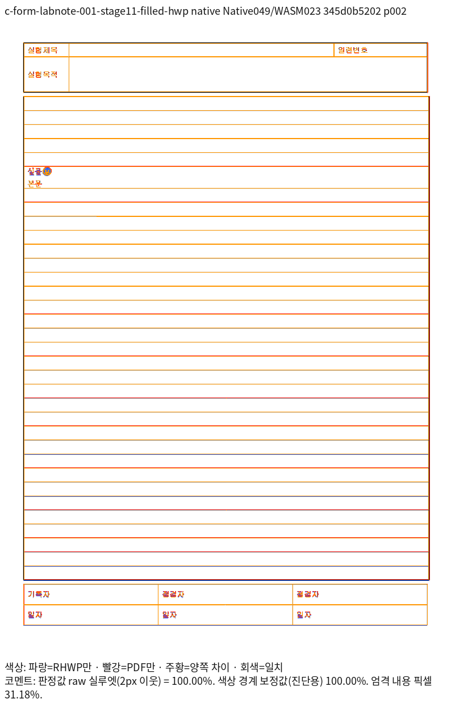
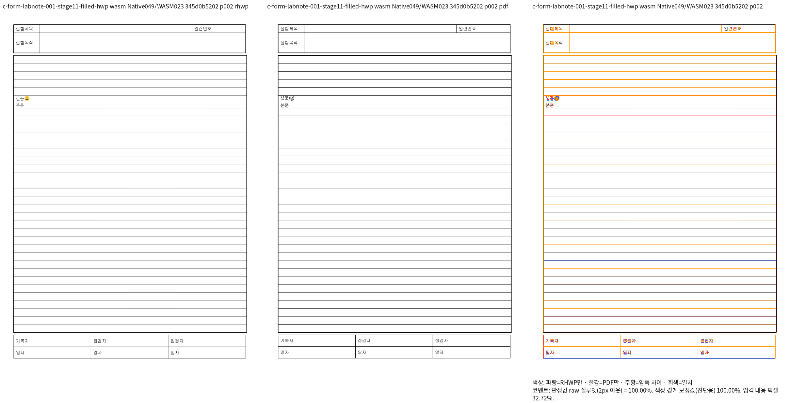
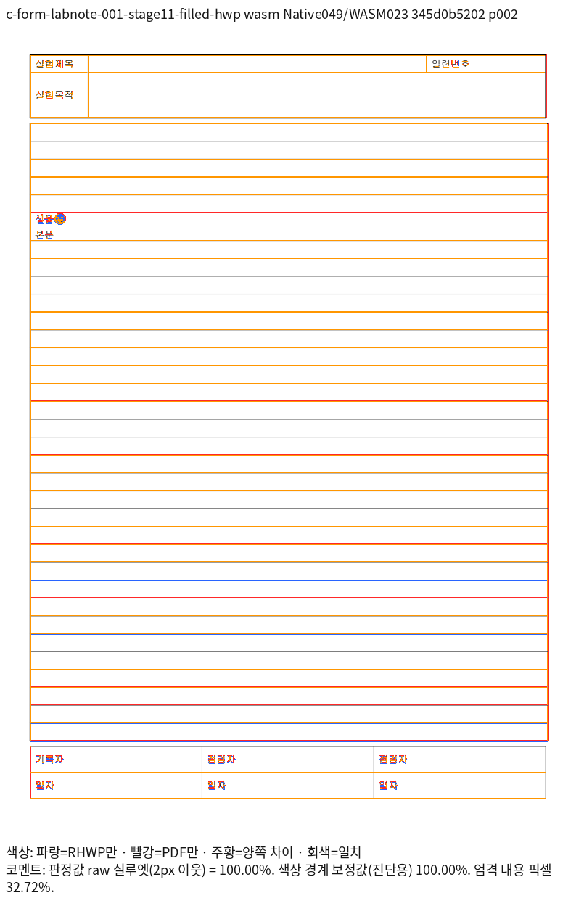

# 같은 빈 호스트에 속한 형제 표의 여백 프레임 회귀

제품 SHA: `345d0b520239446a8e0dad770c39515e60826762`.
Native049와 최적화한 fresh WASM023의 실제 소스 145개 지문을 이 커밋과 대조했다.
Native 빌드 당시 HEAD는 `b0a85b6b88`이고 작업 트리는 dirty였다. 이를 clean HEAD의 빌드로
표현하지 않는다. 실제 제품 지문, 실행 파일·WASM SHA와 명령은 [provenance](provenance.json)에 있다.

## 원 처리와 보정 근거

- [#7119](https://github.com/edwardkim/rhwp/pull/7119)의 실제 backend 폭·세대·서식 격리 계약을 유지한다.
- #7270의 `5b481c8b2c`와 메인터너 `0532933b9`, #7382를 통합한 #7505의
  `5a36cf37267`을 추적했다. 측정·예약·paint는 동일하게 확정한 표 프레임을 소비해야 한다.
- `host_spacing::resolve`가 이미 산출한 위·아래 바깥 여백을 `empty_float::prepare`의
  형제 표 확정 경로가 Native HWP에서도 소비하도록 수정했다. 문서 ID, 고정 gap, paint clamp는 없다.
- 원본 [HWP](../../../../samples/issue3587/c-form-labnote-001-stage11-filled.hwp)와
  [HWPX](../../../../samples/issue3587/c-form-labnote-001-stage11-filled.hwpx)는 기존 바이트를 유지했다.
  원문 호스트의 세 표만 바깥 위/아래 여백을 0/0, 283/0, 0/283HU로 바꾼 세 파일은
  진단 대조군이며 원본을 대체하지 않는다. 각각 독립 Print PDF를 확보했다.

## 독립 출력과 전쪽 대조

다섯 입력 모두 한컴 2020 **11.0.0.9136 · PrintMethod 0 · 1-up · 전체 2쪽**이다.
원본 HWP의 전처리는 `scripts_disabled`, 다른 HWPX는 `none`이다. 문서 스크립트는 실행하지 않았다.
비교는 96 DPI·종이 원점·compat2022이며, compat2022는 조판 프로필 이름이다.
독립 인쇄 제품은 위의 한컴 2020이다. 실제 공급한 글꼴 경로·바이트 지문은 backend별
font-supply JSON에 보존하며 글꼴 파일은 재배포하지 않는다.

| 입력 | Print PDF | Native 전쪽 TSV | fresh WASM 전쪽 TSV |
| --- | --- | --- | --- |
| 원본 HWP | [PDF](c-form-labnote-001-stage11-filled-hwp-hancom2020.pdf) | [100%](native/c-form-labnote-001-stage11-filled-hwp-silhouette.tsv) | [100%](wasm/c-form-labnote-001-stage11-filled-hwp-silhouette.tsv) |
| 원본 HWPX | [PDF](c-form-labnote-001-stage11-filled-hwpx-hancom2020.pdf) | [100%](native/c-form-labnote-001-stage11-filled-hwpx-silhouette.tsv) | [100%](wasm/c-form-labnote-001-stage11-filled-hwpx-silhouette.tsv) |
| [여백 0/0](outer-zero.hwpx) | [PDF](outer-zero-hancom2020.pdf) | [100%](native/outer-zero-silhouette.tsv) | [100%](wasm/outer-zero-silhouette.tsv) |
| [위 여백만](outer-top-only.hwpx) | [PDF](outer-top-only-hancom2020.pdf) | [100%](native/outer-top-only-silhouette.tsv) | [100%](wasm/outer-top-only-silhouette.tsv) |
| [아래 여백만](outer-bottom-only.hwpx) | [PDF](outer-bottom-only-hancom2020.pdf) | [100%](native/outer-bottom-only-silhouette.tsv) | [100%](wasm/outer-bottom-only-silhouette.tsv) |

고정 devel `5e2b9bfbf08573a31fa1e11a2445ff63fc0755c0`에서 같은 입력·PDF·글꼴로
Native/fresh WASM 전쪽을 대조했다. 원본2쪽은 Native14.08322%, WASM14.13750%에서
각각100%로 개선됐다. 총20쪽 비교에서0.1%p 이상 하락0쪽이다.
base의 미달 gate(exit1)는 성공으로 바꾸지 않고 provenance에 보존했다.
기준 TSV도 `base/native`, `base/wasm`에 바이트 그대로 보존했다.

양쪽2쪽의 전체 review·standalone overlay와 앞뒤 표 사이 여백을 직접 확대 판독했다.
0/0 대조군은 새 여백을 만들지 않으며, 나머지는 원본 속성의 위·아래 여백을 한 번씩 소비한다.
컬러 이모지와 raster 경계의 농도 차이는 남아 있으며 RGB 완전 일치를 주장하지 않는다.

## 회귀 검사

새 `tests/cases/coanchored_float_outer_frame.rs`의7건은 원문 표 소유·순서, 행·열과 셀 내용의
누락·중복, 전체2쪽과 세 표의2쪽 소속, 앞 표 아래·뒤 표 위 여백 관계를 보호한다.
원본 두 형식의 완료2쪽은 양쪽 raw100%·직접 판독을 마쳤으므로 독립 PDF vector 외곽의
[좌표](independent-pdf-coordinates.json)를96 DPI에서±2px로 추가 보호한다.
관계 검사는 함께 유지하며, source HU를 환산한 gap은 절대 위치 핀이 아니다.

같은7검사는 수정 전 Native048에서6FAIL·여백0대조군1PASS,
수정 후 Native049에서7PASS다. 정식 소스의 strict rustc 실행과 자동 수집 검사를 별도 기록한다.
전체 Cargo 회귀를 완료했다는 뜻은 아니다.

#7084의 기존 검사 두 곳은 과거 보편0.5em 폭·특정 fallback 출처 문자열을 제거하고,
독립 provider 폭27.5의 적용, 뒤 문자 상대 간격·원문 경계 보존,
서식 분할 자소의 폭·출처 격리와 IR 불변을 검사한다. 옛 fallback 자체의 폭을 정답으로 쓰지 않는다.
같은32검사는 수정 전 Native047에서16FAIL·16PASS, Native049에서32PASS다.
이는 제어된 provider 계약 검사이며 그 측정값을 한컴의 실제 이모지 폭이라고 주장하지 않는다.

## 대표 원본 2쪽

### Native

### fresh WASM

