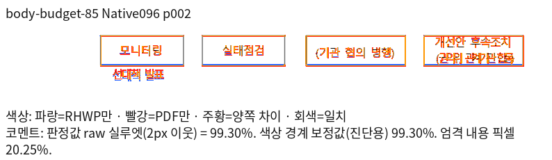
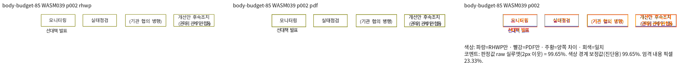
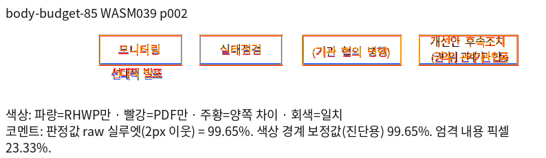

# 재조판 호스트와 표 조각의 독립 Print 증거

이 자료의 제품 소스는 `8452145e94c8780895fa95bf4b39343ee9e4f172`이다.
검증 당시 고정 devel은 `2e3b4f880bd11d35398e6ea0100846611f13a72d`이다.
이후 리베이스한 head의 완료 근거로 이 실행 결과를 그대로 사용하지 않는다.

## 입력과 기준

공개 #6184 원본과 #5871 원본, 단 정의·호스트 크기·오프셋 대조군 및 작은 용지의
분할 경계 입력을 포함한 17조건이다. 모든 입력과 Print PDF, Native/fresh WASM의
전쪽 TSV 원문을 보존한다. 입력·PDF·TSV SHA, 실제 명령과 한컴 실행 증거는
[provenance.json](provenance.json)에 있다. 로그·MCP 원문·중간 산출물은 커밋하지 않는다.

작은 용지 입력은 #6184의 호스트·표를 보존한 HWPX 파생 대조군이다. 호스트 저장 줄을
제거하고 활성 용지·방향을 명시했으며, 다음 본문을 추가했다. 본문 높이 160/122/85는
96DPI 진단 명칭으로, 구현의 분기나 고정 기대 좌표가 아니다. 짧은 변·긴 변과
`landscape=NARROWLY`가 정상인 입력만 사용했다. 방향을 잘못 지정했던 초기 출력은
증거에 포함하지 않았다. `cell-boundary`와 `unbroken-table`은 같은 85 입력에서
표의 나누기 속성만 바꾼 대조군이다. 다른 ZIP part는 그대로 보존했다.

모든 PDF는 명시적 한컴 2020 MCP의 PrintMethod 0·1-up 출력이다. 입력 전처리는
개별 영수증에서 확인한 값을 provenance에 구분했다. 저장 제품 미상의 입력은 기존
2020/2024 독립 대조를 참고하며, 파일 확장자만으로 제품 버전을 추정하지 않았다.

## 전쪽 확인 결과

17조건 39쪽의 Native 최저 raw는 **98.47238%**, 최적화 fresh WASM은
**98.40456%**다. 모든 쪽이 90% 이상이고 독립 PDF와 쪽수가 일치한다.
작은 경계 5조건은 다음과 같으며 모두 양쪽 전쪽 98% 이상이다.

| 입력 | 쪽수 | Native 최저 raw | fresh WASM 최저 raw |
| --- | ---: | ---: | ---: |
| body-budget-160 | 1 | 98.84573% | 99.74107% |
| body-budget-122 | 3 | 98.99865% | 100.00000% |
| body-budget-85 | 3 | 99.30397% | 99.65348% |
| cell-boundary | 3 | 99.24399% | 99.74000% |
| unbroken-table | 2 | 99.34152% | 99.73272% |

같은 영역의 Native/fresh review·standalone overlay를 직접 판독했다. 표 조각의 외곽,
앞뒤 호스트 글줄, 셀 내용, 후속 문단의 위치와 쪽 소속을 대조했다. 글자 획과 괘선
가장자리의 래스터 차이는 남으며 raw 실루엣 통과를 RGB 완전 일치로 해석하지 않는다.
나누지 않는 표의 본문 하단 초과는 독립 Print에도 같은 물리 용지 안에서 나타난다.
그 표를 강제로 나누거나 용지 밖으로 숨겨 진단 경고를 없애지 않았다.

## 회귀 계약

새 이름의 `tests/cases/computed_split_host_fragment_ownership.rs`는 다음을 검사한다.

- 원본 호스트 전체 문구와 셀 주소별 내용의 순서·누락·중복.
- 현재 쪽에 함께 들어가는 표와 꼬리 줄, 새 쪽에서 함께 수용하는 표와 꼬리 줄.
- RowBreak의 조각별 셀 소유와 마지막 조각 뒤 호스트의 한 번 소비.
- CellBreak의 셀 단위 보존과 원본 바깥 여백을 반복하는 관계.
- None 표만 이월하고 호스트·후속 문단은 앞쪽에 보존하는 관계.
- 양쪽 98% 이상인 완료 페이지의 첫 열 셀 괘선을 독립 PDF의 선 중심과 ±2px로 대조.

쪽수와 함께 내용·소속·포함·비겹침 관계를 검사한다. 좌표는 96DPI 종이 왼쪽 위
원점이며 [expected.json](expected.json)의 PDF vector에서 추출했다. 첫 열을 문서
전체의 세로 괘선으로 식별하여 앞 조각의 안내선을 첫 열 셀로 오인하지 않는다.
같은 핵심 셀 경계를 보호할 수 있는 해당 페이지를 선택했고 관계 검사도 유지한다.

현재 Native096에서는 새 6검사 모두 통과한다. 동일 검사·입력의 수정 전 Native090은
꼬리 문구 중복, Native093은 작은 용지의 쪽 소속, Native095는 반복 여백과 None 표
쪽수에서 실제 실패한다. 빌드 실패를 결함 재현으로 계산하지 않았다.
기존 #6184의 오래된 1쪽 말미 고정 조건은 새 Print와 다르므로 후속 검토에서
새 계약과 함께 재검토한다. 이 자료가 다른 미완료 검사나 전체 PR 승인을 의미하지 않는다.

## 대표 판독

