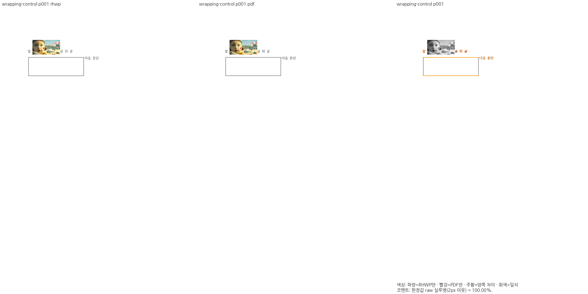
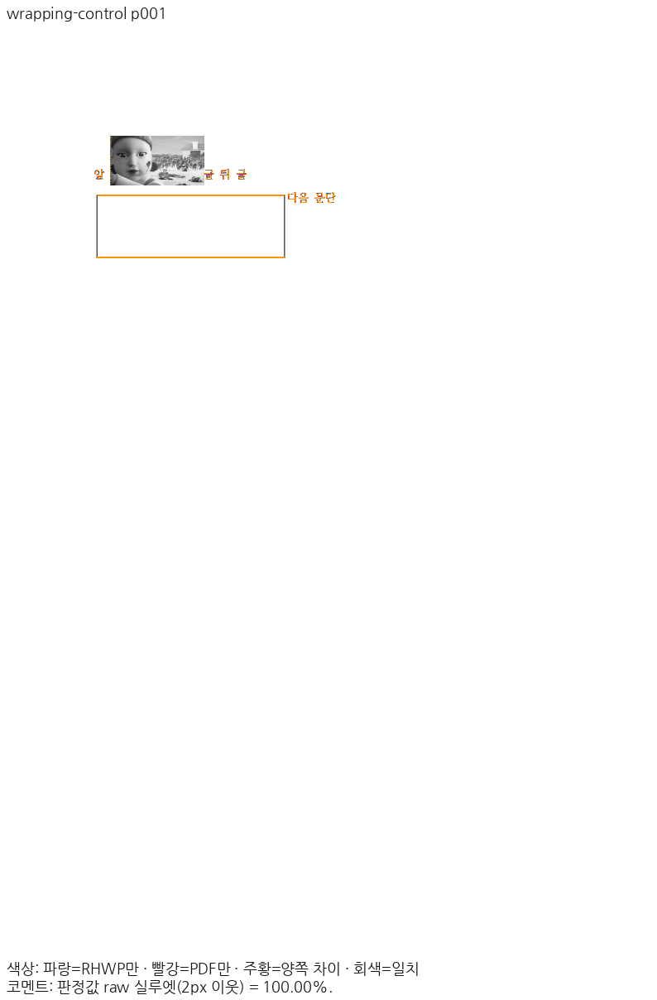
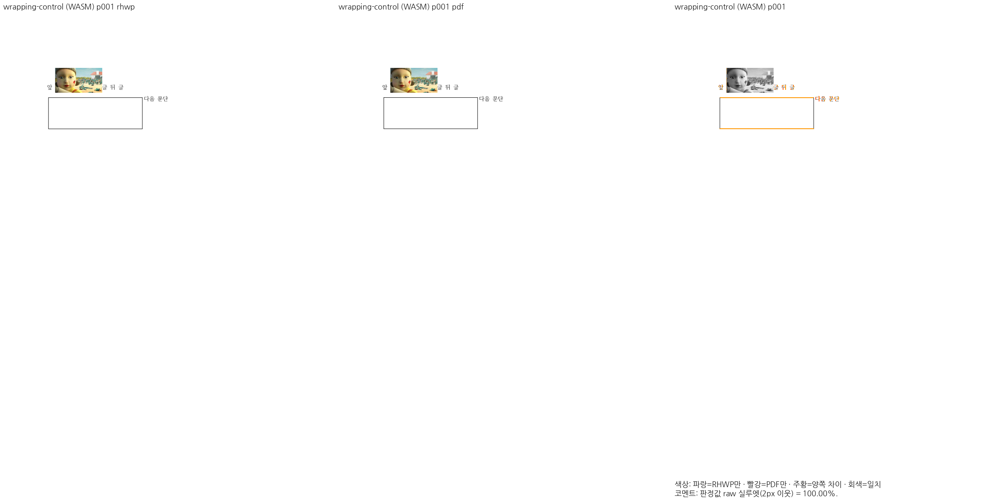
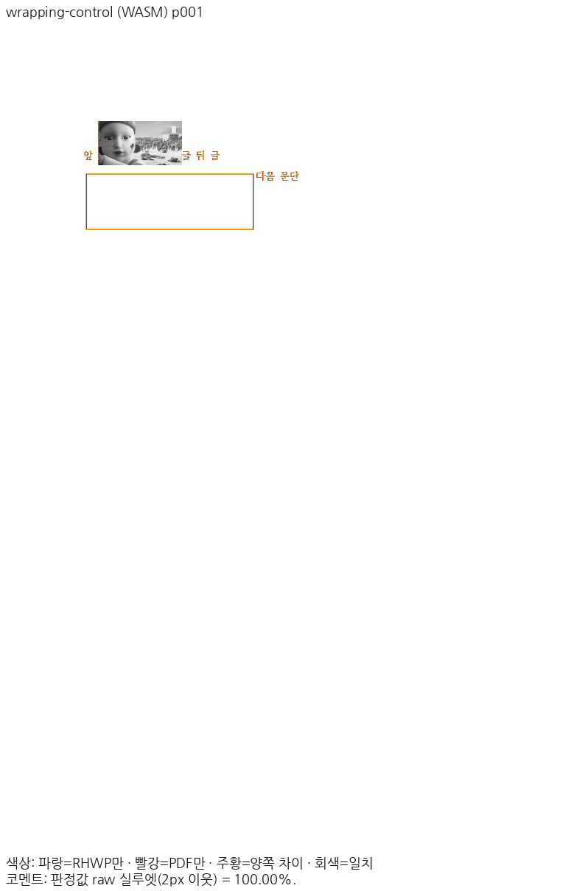

<!-- dependabot-20261109-accepted-8827 -->
의존성 갱신에 감사드립니다.

이 업데이트를 [통합 PR #{{INTEGRATION_PR}}](https://github.com/edwardkim/rhwp/pull/{{INTEGRATION_PR}})에서 수용했습니다. 원 기여 commit을 그대로 보존했습니다.

- 원 head: `bb4981791b116b393e3f432c14cdf261304f7a69`.
- 통합 merge: [{{MERGE_SHA}}](https://github.com/edwardkim/rhwp/commit/{{MERGE_SHA}}). [정확한 통합 head의 CI](https://github.com/edwardkim/rhwp/actions/runs/{{CI_RUN_ID}})와 [self-review](https://github.com/edwardkim/rhwp/pull/8840#pullrequestreview-5822605316)를 확인했습니다.
- [개별 검토](https://github.com/edwardkim/rhwp/blob/{{EVIDENCE_COMMIT}}/mydocs/pr/archives/pr_8827_review.md), [공통 검증](https://github.com/edwardkim/rhwp/blob/{{EVIDENCE_COMMIT}}/mydocs/pr/assets/dependabot-20261109/README.md).

공유 결합 graph에서 전체 회귀 13,005건·Native 공식 4,077건·Studio 2,778건과 적용 lint·build·실제 브라우저를 통과했습니다. 이 검사를 각 원 PR에서 따로 실행한 것으로 집계하지 않습니다.

Native/fresh WASM 각 9쪽은 독립 Print 대비 최저 raw 실루엣 일치율 100.00%이며, 기준 devel과 후보 PNG가 모두 같습니다. 직접 확대 판독도 완료했습니다. 이는 2px 내용 실루엣 지표이며 일반 pixel match나 사람 판정 정확도와 구분합니다. [Visual Sweep 절차](https://github.com/edwardkim/rhwp/blob/{{EVIDENCE_COMMIT}}/mydocs/manual/verification/visual_sweep_guide.md).

| 출력·wrapping-control 1쪽 | review | overlay |
| --- | --- | --- |
| Native Skia |  |  |
| fresh WASM Canvas2D |  |  |
