# Native·fresh WASM 시각 검토

측정·직접 판독: 2026-11-09 KST. base `024d610633ede166ebcbb915f9c90e7a9d0649d8`, candidate runtime `2320351d2325a41d900e91f4e07f559d4a924a7d`. 최종 하네스·고지·문서 commit은 runtime source를 바꾸지 않는다. 96 DPI, print profile, Native Skia PNG와 최적화 WASM getPageRenderTree → 실제 Canvas2D PNG를 사용했다. SVG raster를 이 결과로 표시하지 않는다.

## 실제 producer

```sh
CARGO_BUILD_JOBS=12 cargo build --locked --profile release-test --features native-skia --lib --bin rhwp --target-dir /home/edward/mygithub/rhwp/target/pr-review
```

```sh
cargo build --profile release-test --features native-skia --locked --target-dir /home/edward/mygithub/rhwp/target/pr-review --lib --bin rhwp
```

| producer | source | binary/WASM SHA-256 | bytes | exit |
| --- | --- | --- | --- | --- |
| base Native | 024d610633ede166ebcbb915f9c90e7a9d0649d8 | f5f7e04b37c8ac3e235c7d4697e1889e25c9cd1f5394e98ca4b45b02dc43c0e3 | 88166864 | 0 |
| candidate Native | 2320351d2325a41d900e91f4e07f559d4a924a7d | c611a9264dcd52913e4002582ae9b3e703ffe0da2d207cc819eed1e93f3c7c94 | 88491112 | 0 |
| base WASM | 024d610633ede166ebcbb915f9c90e7a9d0649d8 | d56069d793f99980b480669e6e24053aed9faf36f23250773e687a42e233ef89 | 28616078 | 0 |
| candidate WASM | 2320351d2325a41d900e91f4e07f559d4a924a7d | 33bbf5fcc887f2d1450ac6ca815793d6c468e717d3aa6ed0775df5010e024a89 | 28979419 | 0 |

```sh
scripts/wasm-pack-locked.sh --release --target web --out-dir /home/edward/mygithub/rhwp/output/pr-review/dependabot-20261109/build/candidate-pkg --out-name rhwp
```

WASM 양쪽 모두 release + wasm-opt, codegen-units 16, CARGO_BUILD_JOBS=12, shared target의 locked build다. 후보 최적화 단계까지 874.697초로 완료했다. WASM 28,616,078→28,979,419 bytes (+1.2697%), CLI 88,166,864→88,491,112 bytes (+0.3678%). 이 수치로 로딩·실행 성능 개선을 주장하지 않는다.

## 원본·독립 Print·호환 모드

| 문서 | 기존 입력 | 입력 SHA-256 | 기존 독립 PDF | PDF SHA-256 | mode | 전체 쪽 |
| --- | --- | --- | --- | --- | --- | --- |
| saved-bottom | [tests/fixtures/pr8309-latest/textbox-saved-bottom.hwp](../../../../tests/fixtures/pr8309-latest/textbox-saved-bottom.hwp) | ba89b94fbefd06841b666d3b94e95a59110397f4ccfe879fb4a34644f056c3af | [pdf/pr8309-latest/textbox-saved-bottom-2024.pdf](../../../../pdf/pr8309-latest/textbox-saved-bottom-2024.pdf) | 11f741a95f301df1a561c26954fbb0016e4f07a5cdf83c2af6f211c2044a4b13 | 2024 | 1 |
| wrapping-control | [samples/issue8399/A.hwpx](../../../../samples/issue8399/A.hwpx) | fddd90eed7c4f8818e723bb526c50cad8269c7b1a02eddd64d5a0cda2a5773c7 | [pdf/issue8399/A-hwpx-2024.pdf](../../../../pdf/issue8399/A-hwpx-2024.pdf) | 0450bebb11625b1acbcc1ce06ff36a12474a76b3a52b6ac143b10b000226633a | 2024 | 1 |
| bitmap-channel | [samples/issue8160/bitmap-channel-transfer-independent.hwpx](../../../../samples/issue8160/bitmap-channel-transfer-independent.hwpx) | cdb26249443ca1a2e0200245ece0df75255acc7b20278fbdaa8378e398db9784 | [pdf/issue8160/bitmap-channel-transfer-independent-2024.pdf](../../../../pdf/issue8160/bitmap-channel-transfer-independent-2024.pdf) | cb99add7db63dc4f783a7484a611b43175fbd08ab68fa5d3b22ddd223dcf4880 | 2024 | 1 |
| radial-pages | [tests/fixtures/gradient/radial-corner-print-contract.hwpx](../../../../tests/fixtures/gradient/radial-corner-print-contract.hwpx) | 01884d8ea148e21fdb68194dd23c353c635903e4fc19d8b242e1efbe1d0aaf0d | [tests/fixtures/gradient/radial-corner-print-contract-2020.pdf](../../../../tests/fixtures/gradient/radial-corner-print-contract-2020.pdf) | 1f0a7707198e81b8bd9a93efe9e5e6a35fe3ffd9e0131ebb4851c71e9ec2d1a8 | 2022 | 6 |

기준 PDF는 기존 저장소의 독립 한컴 Print 출력이다. 파일을 새 raster/PDF로 교체하지 않았다. 4문서 각각 전체 페이지를 대응시켰다.

## 실행 명령과 source 신원

각 명령은 완료 exit 0이다. run manifest의 도구 Git SHA와 실제 CLI/WASM producer SHA를 혼동하지 않는다. 설치된 글꼴을 우연히 소비하지 않도록 다음 명시적 font-path를 사용했다.

### base Native

saved-bottom: exit 0.

```sh
/home/edward/mygithub/rhwp/venv/bin/python /home/edward/mygithub/rhwp/scripts/visual_sweep.py --file-target saved-bottom /home/edward/mygithub/rhwp/tests/fixtures/pr8309-latest/textbox-saved-bottom.hwp /home/edward/mygithub/rhwp/pdf/pr8309-latest/textbox-saved-bottom-2024.pdf --compat 2024 --dpi 96 --page-workers 3 --rhwp-bin /home/edward/mygithub/rhwp/output/pr-review/dependabot-20261109/build/base-rhwp --out /home/edward/mygithub/rhwp/output/pr-review/dependabot-20261109/visual/base/native --font-path /home/edward/mygithub/rhwp/output/pr-review/native-webfont-cache/supplied-hcr/HANBatang.ttf --font-path /home/edward/mygithub/rhwp/output/pr-review/native-webfont-cache/supplied-hcr/HANDotum.ttf --font-path /home/edward/mygithub/ttfs/hwp/HBATANG.TTF --font-path /home/edward/mygithub/ttfs/windows/gulim.ttc
```

wrapping-control: exit 0.

```sh
/home/edward/mygithub/rhwp/venv/bin/python /home/edward/mygithub/rhwp/scripts/visual_sweep.py --file-target wrapping-control /home/edward/mygithub/rhwp/samples/issue8399/A.hwpx /home/edward/mygithub/rhwp/pdf/issue8399/A-hwpx-2024.pdf --compat 2024 --dpi 96 --page-workers 3 --rhwp-bin /home/edward/mygithub/rhwp/output/pr-review/dependabot-20261109/build/base-rhwp --out /home/edward/mygithub/rhwp/output/pr-review/dependabot-20261109/visual/base/native --font-path /home/edward/mygithub/rhwp/output/pr-review/native-webfont-cache/supplied-hcr/HANBatang.ttf --font-path /home/edward/mygithub/rhwp/output/pr-review/native-webfont-cache/supplied-hcr/HANDotum.ttf --font-path /home/edward/mygithub/ttfs/hwp/HBATANG.TTF --font-path /home/edward/mygithub/ttfs/windows/gulim.ttc
```

bitmap-channel: exit 0.

```sh
/home/edward/mygithub/rhwp/venv/bin/python /home/edward/mygithub/rhwp/scripts/visual_sweep.py --file-target bitmap-channel /home/edward/mygithub/rhwp/samples/issue8160/bitmap-channel-transfer-independent.hwpx /home/edward/mygithub/rhwp/pdf/issue8160/bitmap-channel-transfer-independent-2024.pdf --compat 2024 --dpi 96 --page-workers 3 --rhwp-bin /home/edward/mygithub/rhwp/output/pr-review/dependabot-20261109/build/base-rhwp --out /home/edward/mygithub/rhwp/output/pr-review/dependabot-20261109/visual/base/native --font-path /home/edward/mygithub/rhwp/output/pr-review/native-webfont-cache/supplied-hcr/HANBatang.ttf --font-path /home/edward/mygithub/rhwp/output/pr-review/native-webfont-cache/supplied-hcr/HANDotum.ttf --font-path /home/edward/mygithub/ttfs/hwp/HBATANG.TTF --font-path /home/edward/mygithub/ttfs/windows/gulim.ttc
```

radial-pages: exit 0.

```sh
/home/edward/mygithub/rhwp/venv/bin/python /home/edward/mygithub/rhwp/scripts/visual_sweep.py --file-target radial-pages /home/edward/mygithub/rhwp/tests/fixtures/gradient/radial-corner-print-contract.hwpx /home/edward/mygithub/rhwp/tests/fixtures/gradient/radial-corner-print-contract-2020.pdf --compat 2022 --dpi 96 --page-workers 3 --rhwp-bin /home/edward/mygithub/rhwp/output/pr-review/dependabot-20261109/build/base-rhwp --out /home/edward/mygithub/rhwp/output/pr-review/dependabot-20261109/visual/base/native --font-path /home/edward/mygithub/rhwp/output/pr-review/native-webfont-cache/supplied-hcr/HANBatang.ttf --font-path /home/edward/mygithub/rhwp/output/pr-review/native-webfont-cache/supplied-hcr/HANDotum.ttf --font-path /home/edward/mygithub/ttfs/hwp/HBATANG.TTF --font-path /home/edward/mygithub/ttfs/windows/gulim.ttc
```

### base WASM

saved-bottom: exit 0.

```sh
/home/edward/mygithub/rhwp/venv/bin/python /home/edward/mygithub/rhwp/scripts/visual_sweep.py --file-target saved-bottom /home/edward/mygithub/rhwp/tests/fixtures/pr8309-latest/textbox-saved-bottom.hwp /home/edward/mygithub/rhwp/pdf/pr8309-latest/textbox-saved-bottom-2024.pdf --compat 2024 --dpi 96 --page-workers 3 --rhwp-bin /home/edward/mygithub/rhwp/output/pr-review/dependabot-20261109/build/base-rhwp --out /home/edward/mygithub/rhwp/output/pr-review/dependabot-20261109/visual/base/wasm --wasm-pkg /home/edward/mygithub/rhwp/output/pr-review/dependabot-20261109/build/base-pkg --font-path /home/edward/mygithub/rhwp/output/pr-review/native-webfont-cache/supplied-hcr/HANBatang.ttf --font-path /home/edward/mygithub/rhwp/output/pr-review/native-webfont-cache/supplied-hcr/HANDotum.ttf --font-path /home/edward/mygithub/ttfs/hwp/HBATANG.TTF --font-path /home/edward/mygithub/ttfs/windows/gulim.ttc
```

wrapping-control: exit 0.

```sh
/home/edward/mygithub/rhwp/venv/bin/python /home/edward/mygithub/rhwp/scripts/visual_sweep.py --file-target wrapping-control /home/edward/mygithub/rhwp/samples/issue8399/A.hwpx /home/edward/mygithub/rhwp/pdf/issue8399/A-hwpx-2024.pdf --compat 2024 --dpi 96 --page-workers 3 --rhwp-bin /home/edward/mygithub/rhwp/output/pr-review/dependabot-20261109/build/base-rhwp --out /home/edward/mygithub/rhwp/output/pr-review/dependabot-20261109/visual/base/wasm --wasm-pkg /home/edward/mygithub/rhwp/output/pr-review/dependabot-20261109/build/base-pkg --font-path /home/edward/mygithub/rhwp/output/pr-review/native-webfont-cache/supplied-hcr/HANBatang.ttf --font-path /home/edward/mygithub/rhwp/output/pr-review/native-webfont-cache/supplied-hcr/HANDotum.ttf --font-path /home/edward/mygithub/ttfs/hwp/HBATANG.TTF --font-path /home/edward/mygithub/ttfs/windows/gulim.ttc
```

bitmap-channel: exit 0.

```sh
/home/edward/mygithub/rhwp/venv/bin/python /home/edward/mygithub/rhwp/scripts/visual_sweep.py --file-target bitmap-channel /home/edward/mygithub/rhwp/samples/issue8160/bitmap-channel-transfer-independent.hwpx /home/edward/mygithub/rhwp/pdf/issue8160/bitmap-channel-transfer-independent-2024.pdf --compat 2024 --dpi 96 --page-workers 3 --rhwp-bin /home/edward/mygithub/rhwp/output/pr-review/dependabot-20261109/build/base-rhwp --out /home/edward/mygithub/rhwp/output/pr-review/dependabot-20261109/visual/base/wasm --wasm-pkg /home/edward/mygithub/rhwp/output/pr-review/dependabot-20261109/build/base-pkg --font-path /home/edward/mygithub/rhwp/output/pr-review/native-webfont-cache/supplied-hcr/HANBatang.ttf --font-path /home/edward/mygithub/rhwp/output/pr-review/native-webfont-cache/supplied-hcr/HANDotum.ttf --font-path /home/edward/mygithub/ttfs/hwp/HBATANG.TTF --font-path /home/edward/mygithub/ttfs/windows/gulim.ttc
```

radial-pages: exit 0.

```sh
/home/edward/mygithub/rhwp/venv/bin/python /home/edward/mygithub/rhwp/scripts/visual_sweep.py --file-target radial-pages /home/edward/mygithub/rhwp/tests/fixtures/gradient/radial-corner-print-contract.hwpx /home/edward/mygithub/rhwp/tests/fixtures/gradient/radial-corner-print-contract-2020.pdf --compat 2022 --dpi 96 --page-workers 3 --rhwp-bin /home/edward/mygithub/rhwp/output/pr-review/dependabot-20261109/build/base-rhwp --out /home/edward/mygithub/rhwp/output/pr-review/dependabot-20261109/visual/base/wasm --wasm-pkg /home/edward/mygithub/rhwp/output/pr-review/dependabot-20261109/build/base-pkg --font-path /home/edward/mygithub/rhwp/output/pr-review/native-webfont-cache/supplied-hcr/HANBatang.ttf --font-path /home/edward/mygithub/rhwp/output/pr-review/native-webfont-cache/supplied-hcr/HANDotum.ttf --font-path /home/edward/mygithub/ttfs/hwp/HBATANG.TTF --font-path /home/edward/mygithub/ttfs/windows/gulim.ttc
```

### candidate Native

saved-bottom: exit 0.

```sh
/home/edward/mygithub/rhwp/venv/bin/python /home/edward/mygithub/rhwp/scripts/visual_sweep.py --file-target saved-bottom /home/edward/mygithub/rhwp/tests/fixtures/pr8309-latest/textbox-saved-bottom.hwp /home/edward/mygithub/rhwp/pdf/pr8309-latest/textbox-saved-bottom-2024.pdf --compat 2024 --dpi 96 --page-workers 3 --rhwp-bin /home/edward/mygithub/rhwp/output/pr-review/dependabot-20261109/build/candidate-rhwp --out /home/edward/mygithub/rhwp/output/pr-review/dependabot-20261109/visual/candidate/native --font-path /home/edward/mygithub/rhwp/output/pr-review/native-webfont-cache/supplied-hcr/HANBatang.ttf --font-path /home/edward/mygithub/rhwp/output/pr-review/native-webfont-cache/supplied-hcr/HANDotum.ttf --font-path /home/edward/mygithub/ttfs/hwp/HBATANG.TTF --font-path /home/edward/mygithub/ttfs/windows/gulim.ttc
```

wrapping-control: exit 0.

```sh
/home/edward/mygithub/rhwp/venv/bin/python /home/edward/mygithub/rhwp/scripts/visual_sweep.py --file-target wrapping-control /home/edward/mygithub/rhwp/samples/issue8399/A.hwpx /home/edward/mygithub/rhwp/pdf/issue8399/A-hwpx-2024.pdf --compat 2024 --dpi 96 --page-workers 3 --rhwp-bin /home/edward/mygithub/rhwp/output/pr-review/dependabot-20261109/build/candidate-rhwp --out /home/edward/mygithub/rhwp/output/pr-review/dependabot-20261109/visual/candidate/native --font-path /home/edward/mygithub/rhwp/output/pr-review/native-webfont-cache/supplied-hcr/HANBatang.ttf --font-path /home/edward/mygithub/rhwp/output/pr-review/native-webfont-cache/supplied-hcr/HANDotum.ttf --font-path /home/edward/mygithub/ttfs/hwp/HBATANG.TTF --font-path /home/edward/mygithub/ttfs/windows/gulim.ttc
```

bitmap-channel: exit 0.

```sh
/home/edward/mygithub/rhwp/venv/bin/python /home/edward/mygithub/rhwp/scripts/visual_sweep.py --file-target bitmap-channel /home/edward/mygithub/rhwp/samples/issue8160/bitmap-channel-transfer-independent.hwpx /home/edward/mygithub/rhwp/pdf/issue8160/bitmap-channel-transfer-independent-2024.pdf --compat 2024 --dpi 96 --page-workers 3 --rhwp-bin /home/edward/mygithub/rhwp/output/pr-review/dependabot-20261109/build/candidate-rhwp --out /home/edward/mygithub/rhwp/output/pr-review/dependabot-20261109/visual/candidate/native --font-path /home/edward/mygithub/rhwp/output/pr-review/native-webfont-cache/supplied-hcr/HANBatang.ttf --font-path /home/edward/mygithub/rhwp/output/pr-review/native-webfont-cache/supplied-hcr/HANDotum.ttf --font-path /home/edward/mygithub/ttfs/hwp/HBATANG.TTF --font-path /home/edward/mygithub/ttfs/windows/gulim.ttc
```

radial-pages: exit 0.

```sh
/home/edward/mygithub/rhwp/venv/bin/python /home/edward/mygithub/rhwp/scripts/visual_sweep.py --file-target radial-pages /home/edward/mygithub/rhwp/tests/fixtures/gradient/radial-corner-print-contract.hwpx /home/edward/mygithub/rhwp/tests/fixtures/gradient/radial-corner-print-contract-2020.pdf --compat 2022 --dpi 96 --page-workers 3 --rhwp-bin /home/edward/mygithub/rhwp/output/pr-review/dependabot-20261109/build/candidate-rhwp --out /home/edward/mygithub/rhwp/output/pr-review/dependabot-20261109/visual/candidate/native --font-path /home/edward/mygithub/rhwp/output/pr-review/native-webfont-cache/supplied-hcr/HANBatang.ttf --font-path /home/edward/mygithub/rhwp/output/pr-review/native-webfont-cache/supplied-hcr/HANDotum.ttf --font-path /home/edward/mygithub/ttfs/hwp/HBATANG.TTF --font-path /home/edward/mygithub/ttfs/windows/gulim.ttc
```

### candidate WASM

saved-bottom: exit 0.

```sh
/home/edward/mygithub/rhwp/venv/bin/python /home/edward/mygithub/rhwp/scripts/visual_sweep.py --file-target saved-bottom /home/edward/mygithub/rhwp/tests/fixtures/pr8309-latest/textbox-saved-bottom.hwp /home/edward/mygithub/rhwp/pdf/pr8309-latest/textbox-saved-bottom-2024.pdf --compat 2024 --dpi 96 --page-workers 3 --rhwp-bin /home/edward/mygithub/rhwp/output/pr-review/dependabot-20261109/build/candidate-rhwp --out /home/edward/mygithub/rhwp/output/pr-review/dependabot-20261109/visual/candidate/wasm --wasm-pkg /home/edward/mygithub/rhwp/output/pr-review/dependabot-20261109/build/candidate-pkg --font-path /home/edward/mygithub/rhwp/output/pr-review/native-webfont-cache/supplied-hcr/HANBatang.ttf --font-path /home/edward/mygithub/rhwp/output/pr-review/native-webfont-cache/supplied-hcr/HANDotum.ttf --font-path /home/edward/mygithub/ttfs/hwp/HBATANG.TTF --font-path /home/edward/mygithub/ttfs/windows/gulim.ttc
```

wrapping-control: exit 0.

```sh
/home/edward/mygithub/rhwp/venv/bin/python /home/edward/mygithub/rhwp/scripts/visual_sweep.py --file-target wrapping-control /home/edward/mygithub/rhwp/samples/issue8399/A.hwpx /home/edward/mygithub/rhwp/pdf/issue8399/A-hwpx-2024.pdf --compat 2024 --dpi 96 --page-workers 3 --rhwp-bin /home/edward/mygithub/rhwp/output/pr-review/dependabot-20261109/build/candidate-rhwp --out /home/edward/mygithub/rhwp/output/pr-review/dependabot-20261109/visual/candidate/wasm --wasm-pkg /home/edward/mygithub/rhwp/output/pr-review/dependabot-20261109/build/candidate-pkg --font-path /home/edward/mygithub/rhwp/output/pr-review/native-webfont-cache/supplied-hcr/HANBatang.ttf --font-path /home/edward/mygithub/rhwp/output/pr-review/native-webfont-cache/supplied-hcr/HANDotum.ttf --font-path /home/edward/mygithub/ttfs/hwp/HBATANG.TTF --font-path /home/edward/mygithub/ttfs/windows/gulim.ttc
```

bitmap-channel: exit 0.

```sh
/home/edward/mygithub/rhwp/venv/bin/python /home/edward/mygithub/rhwp/scripts/visual_sweep.py --file-target bitmap-channel /home/edward/mygithub/rhwp/samples/issue8160/bitmap-channel-transfer-independent.hwpx /home/edward/mygithub/rhwp/pdf/issue8160/bitmap-channel-transfer-independent-2024.pdf --compat 2024 --dpi 96 --page-workers 3 --rhwp-bin /home/edward/mygithub/rhwp/output/pr-review/dependabot-20261109/build/candidate-rhwp --out /home/edward/mygithub/rhwp/output/pr-review/dependabot-20261109/visual/candidate/wasm --wasm-pkg /home/edward/mygithub/rhwp/output/pr-review/dependabot-20261109/build/candidate-pkg --font-path /home/edward/mygithub/rhwp/output/pr-review/native-webfont-cache/supplied-hcr/HANBatang.ttf --font-path /home/edward/mygithub/rhwp/output/pr-review/native-webfont-cache/supplied-hcr/HANDotum.ttf --font-path /home/edward/mygithub/ttfs/hwp/HBATANG.TTF --font-path /home/edward/mygithub/ttfs/windows/gulim.ttc
```

radial-pages: exit 0.

```sh
/home/edward/mygithub/rhwp/venv/bin/python /home/edward/mygithub/rhwp/scripts/visual_sweep.py --file-target radial-pages /home/edward/mygithub/rhwp/tests/fixtures/gradient/radial-corner-print-contract.hwpx /home/edward/mygithub/rhwp/tests/fixtures/gradient/radial-corner-print-contract-2020.pdf --compat 2022 --dpi 96 --page-workers 3 --rhwp-bin /home/edward/mygithub/rhwp/output/pr-review/dependabot-20261109/build/candidate-rhwp --out /home/edward/mygithub/rhwp/output/pr-review/dependabot-20261109/visual/candidate/wasm --wasm-pkg /home/edward/mygithub/rhwp/output/pr-review/dependabot-20261109/build/candidate-pkg --font-path /home/edward/mygithub/rhwp/output/pr-review/native-webfont-cache/supplied-hcr/HANBatang.ttf --font-path /home/edward/mygithub/rhwp/output/pr-review/native-webfont-cache/supplied-hcr/HANDotum.ttf --font-path /home/edward/mygithub/ttfs/hwp/HBATANG.TTF --font-path /home/edward/mygithub/ttfs/windows/gulim.ttc
```

| 명시 공급 파일 | SHA-256 |
| --- | --- |
| /home/edward/mygithub/rhwp/output/pr-review/native-webfont-cache/supplied-hcr/HANBatang.ttf | d85550717552101699122adc5b948e8129881f39ffcf802cafe62aac3b1ced40 |
| /home/edward/mygithub/rhwp/output/pr-review/native-webfont-cache/supplied-hcr/HANDotum.ttf | 0dfe708556a36379ed1aaa37d4a9ec62b860939e84dd3ccdbeb0c0ad5314cd14 |
| /home/edward/mygithub/ttfs/hwp/HBATANG.TTF | 35f84328500fc2c3ee0b148aa75de0ed384bf9eee8dee9148c01b0a11a27fe05 |
| /home/edward/mygithub/ttfs/windows/gulim.ttc | 05a38ff214ee932c6147a4e697b494040fd68ce654795f10f723c01d7bb8ee12 |
| /home/edward/mygithub/rhwp/output/pr-review/native-webfont-cache/programs/49bf312aec309ba88c3eb612c591c2d8e28b765c156c808691850137431bb1bf/native.ttf | ea299ec3f90eb7aeea827f2191823968aad06ba77afef31aca99b53e80e915ea |
| /home/edward/mygithub/rhwp/output/pr-review/native-webfont-cache/programs/49bf312aec309ba88c3eb612c591c2d8e28b765c156c808691850137431bb1bf/source.woff | 49bf312aec309ba88c3eb612c591c2d8e28b765c156c808691850137431bb1bf |
| /home/edward/mygithub/rhwp/output/pr-review/native-webfont-cache/programs/dab3d492daa687386292cff1499225db580f931f800ee0d124eb0636378c6020/native.ttf | 54aa5a782042f8f4efbeae2bb11a5d04869492afce43fa2281d4532d9538a2b7 |
| /home/edward/mygithub/rhwp/output/pr-review/native-webfont-cache/programs/dab3d492daa687386292cff1499225db580f931f800ee0d124eb0636378c6020/source.woff2 | dab3d492daa687386292cff1499225db580f931f800ee0d124eb0636378c6020 |
| /home/edward/mygithub/rhwp/output/pr-review/native-webfont-cache/programs/504d6af6abb882acd912d47bafa383c4512a6c8c33635e4e8fb37111d9310941/native.ttf | ba7e023cec6882ee2a2696dce069d2d675331b1fa723afa7e09ed3132d9846f0 |
| /home/edward/mygithub/rhwp/output/pr-review/native-webfont-cache/programs/504d6af6abb882acd912d47bafa383c4512a6c8c33635e4e8fb37111d9310941/source.woff2 | 504d6af6abb882acd912d47bafa383c4512a6c8c33635e4e8fb37111d9310941 |

HCR 공급 출처는 다음 commit 고정 URL이다. 글꼴 프로그램 자체는 로컬 검증 전용이고 커밋·배포하지 않는다.

| 공급 파일 | 출처 | SHA-256 |
| --- | --- | --- |
| HANBatang.ttf | https://raw.githubusercontent.com/dsolver-el/hwpx-template-engine/d3018c859da225ea8b0f71408ce30ac48de862f6/src/main/resources/fonts/hcr/HANBatang.ttf | d85550717552101699122adc5b948e8129881f39ffcf802cafe62aac3b1ced40 |
| HANDotum.ttf | https://raw.githubusercontent.com/dsolver-el/hwpx-template-engine/d3018c859da225ea8b0f71408ce30ac48de862f6/src/main/resources/fonts/hcr/HANDotum.ttf | 0dfe708556a36379ed1aaa37d4a9ec62b860939e84dd3ccdbeb0c0ad5314cd14 |

## 전체 페이지 TSV

색상 경계 보정 전 2px 내용 실루엣 `silhouette_raw_match_percent`. base/candidate, Native/WASM 전 9쪽씩 모두 raw 100.00%. 누락·쪽수 불일치·측정 불가·하락이 없고, 18개 base/후보 PNG 쌍의 byte·RGBA 픽셀도 모두 동일했다. 이 실루엣 값은 일반 pixel match나 사람 판정 정확도가 아니다.

| 전쪽 TSV 원본 | SHA-256 | bytes |
| --- | --- | --- |
| [tsv/base/native/bitmap-channel/silhouette.tsv](tsv/base/native/bitmap-channel/silhouette.tsv) | 75764217b6231001246ab7d8b934bdc683297f16bd9ca4c983fffc90aa768466 | 132 |
| [tsv/base/native/radial-pages/silhouette.tsv](tsv/base/native/radial-pages/silhouette.tsv) | cdcf3e026b8de27abee1649a14fc0767bd3b6d02806046e34dcc9164c24df91f | 232 |
| [tsv/base/native/saved-bottom/silhouette.tsv](tsv/base/native/saved-bottom/silhouette.tsv) | 75764217b6231001246ab7d8b934bdc683297f16bd9ca4c983fffc90aa768466 | 132 |
| [tsv/base/native/wrapping-control/silhouette.tsv](tsv/base/native/wrapping-control/silhouette.tsv) | 75764217b6231001246ab7d8b934bdc683297f16bd9ca4c983fffc90aa768466 | 132 |
| [tsv/base/wasm/bitmap-channel/silhouette.tsv](tsv/base/wasm/bitmap-channel/silhouette.tsv) | 75764217b6231001246ab7d8b934bdc683297f16bd9ca4c983fffc90aa768466 | 132 |
| [tsv/base/wasm/radial-pages/silhouette.tsv](tsv/base/wasm/radial-pages/silhouette.tsv) | cdcf3e026b8de27abee1649a14fc0767bd3b6d02806046e34dcc9164c24df91f | 232 |
| [tsv/base/wasm/saved-bottom/silhouette.tsv](tsv/base/wasm/saved-bottom/silhouette.tsv) | 75764217b6231001246ab7d8b934bdc683297f16bd9ca4c983fffc90aa768466 | 132 |
| [tsv/base/wasm/wrapping-control/silhouette.tsv](tsv/base/wasm/wrapping-control/silhouette.tsv) | 75764217b6231001246ab7d8b934bdc683297f16bd9ca4c983fffc90aa768466 | 132 |
| [tsv/candidate/native/bitmap-channel/silhouette.tsv](tsv/candidate/native/bitmap-channel/silhouette.tsv) | 75764217b6231001246ab7d8b934bdc683297f16bd9ca4c983fffc90aa768466 | 132 |
| [tsv/candidate/native/radial-pages/silhouette.tsv](tsv/candidate/native/radial-pages/silhouette.tsv) | cdcf3e026b8de27abee1649a14fc0767bd3b6d02806046e34dcc9164c24df91f | 232 |
| [tsv/candidate/native/saved-bottom/silhouette.tsv](tsv/candidate/native/saved-bottom/silhouette.tsv) | 75764217b6231001246ab7d8b934bdc683297f16bd9ca4c983fffc90aa768466 | 132 |
| [tsv/candidate/native/wrapping-control/silhouette.tsv](tsv/candidate/native/wrapping-control/silhouette.tsv) | 75764217b6231001246ab7d8b934bdc683297f16bd9ca4c983fffc90aa768466 | 132 |
| [tsv/candidate/wasm/bitmap-channel/silhouette.tsv](tsv/candidate/wasm/bitmap-channel/silhouette.tsv) | 75764217b6231001246ab7d8b934bdc683297f16bd9ca4c983fffc90aa768466 | 132 |
| [tsv/candidate/wasm/radial-pages/silhouette.tsv](tsv/candidate/wasm/radial-pages/silhouette.tsv) | cdcf3e026b8de27abee1649a14fc0767bd3b6d02806046e34dcc9164c24df91f | 232 |
| [tsv/candidate/wasm/saved-bottom/silhouette.tsv](tsv/candidate/wasm/saved-bottom/silhouette.tsv) | 75764217b6231001246ab7d8b934bdc683297f16bd9ca4c983fffc90aa768466 | 132 |
| [tsv/candidate/wasm/wrapping-control/silhouette.tsv](tsv/candidate/wasm/wrapping-control/silhouette.tsv) | 75764217b6231001246ab7d8b934bdc683297f16bd9ca4c983fffc90aa768466 | 132 |

[base/후보 페이지별 대응 표](base-candidate-pages.tsv)는 18개 backend/쪽 행을 담은 파생 표다. 원 수치와 raw TSV를 변경하지 않고 파생 표의 EOL만 LF로 정리했다.

## 직접 확대 판독

독립 Print와 base/candidate Native/WASM의 같은 영역을 같은 2배율로 전 9쪽에서 직접 열었다.

| 입력·쪽 | 내용·판독 결과 |
| --- | --- |
| saved-bottom 1 | Text box alignment ABC 123의 아래 정렬, frame/inset, 문자 누락·clip·겹침 없음. |
| wrapping-control 1 | 그림 wrap, 한글 본문·다음 문단 위치, 읽기 순서·선 유지. |
| bitmap-channel 1 | 세 gray transfer ramp의 명암·순서·테두리 유지. |
| radial-pages 1–6 | radial focal/aspect/gradient·border·가운데 label·전체 쪽 순서 유지. |

PDF와 RHWP의 일부 미세 raster edge·안티앨리어싱 차이는 안정적으로 남지만 후보에서 새 변화가 없다. 이 원본에 수식이 없으므로 수식 모양을 독립 판독한 것으로 확대하지 않는다. 새 조판 예외·수치 조정·fixture/golden·기대값 변경은 없다.

## PR·완료 댓글의 최종 대표 이미지

아래 16개만 PR의 네 입력 비교와 해당 소비 PR의 완료 댓글에 직접 사용한다. 나머지 원시 raster·중복 panel·실패 캡처·run manifest·분석 JSON은 제외했다.

### wrapping-control · 기준/출력 1쪽

| 출력 | review | overlay |
| --- | --- | --- |
| Native Skia | 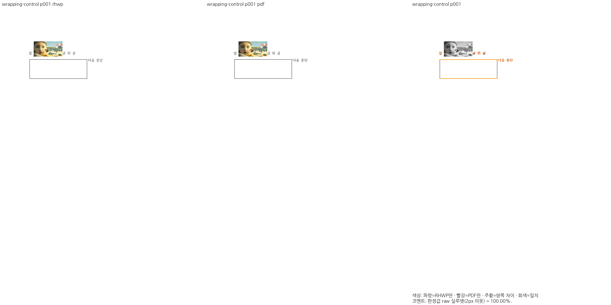 | 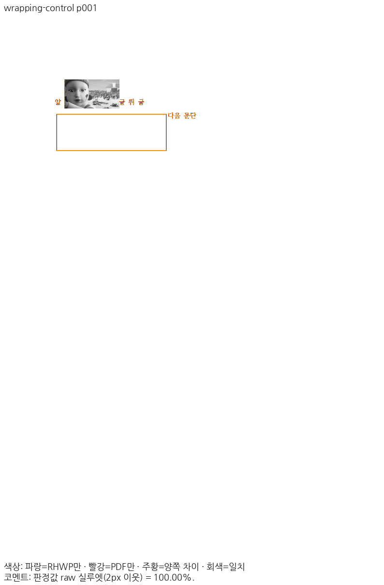 |
| fresh WASM Canvas2D | 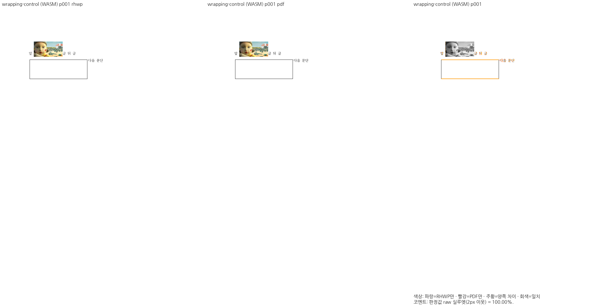 | 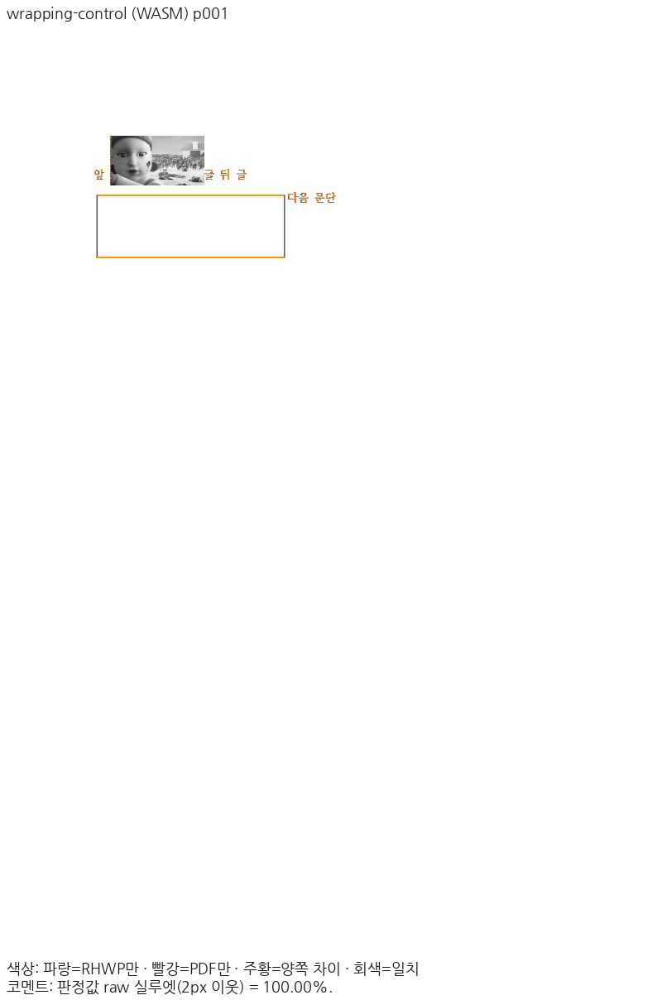 |

### saved-bottom · 기준/출력 1쪽

| 출력 | review | overlay |
| --- | --- | --- |
| Native Skia | 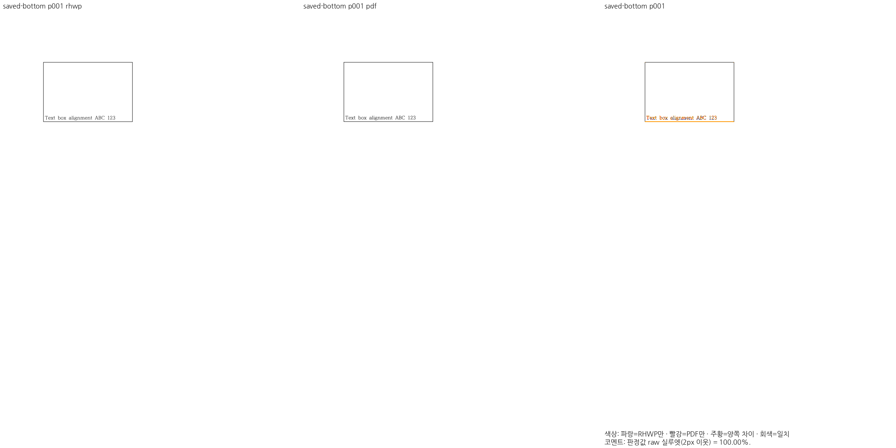 | 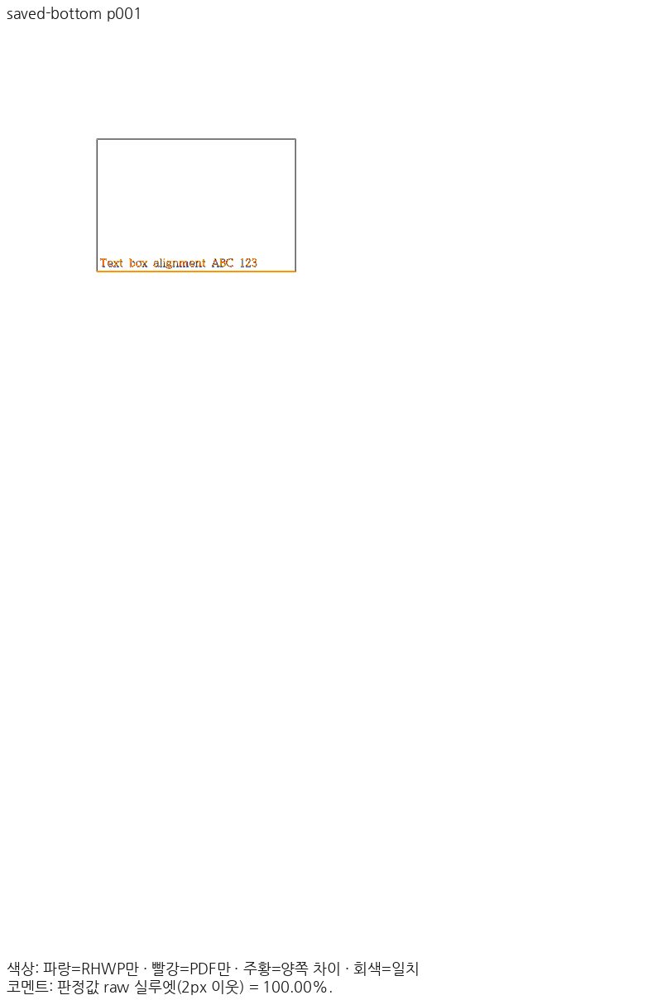 |
| fresh WASM Canvas2D | 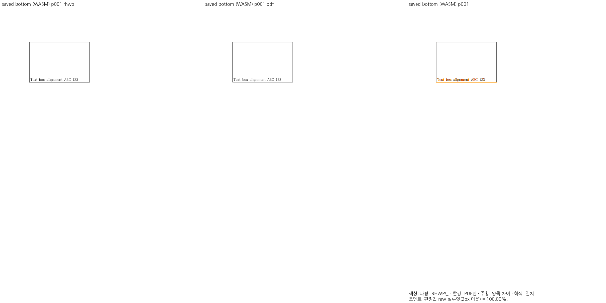 | 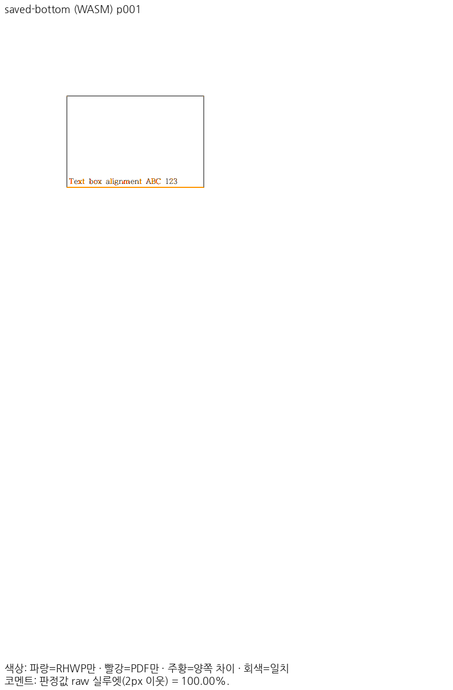 |

### bitmap-channel · 기준/출력 1쪽

| 출력 | review | overlay |
| --- | --- | --- |
| Native Skia |  | 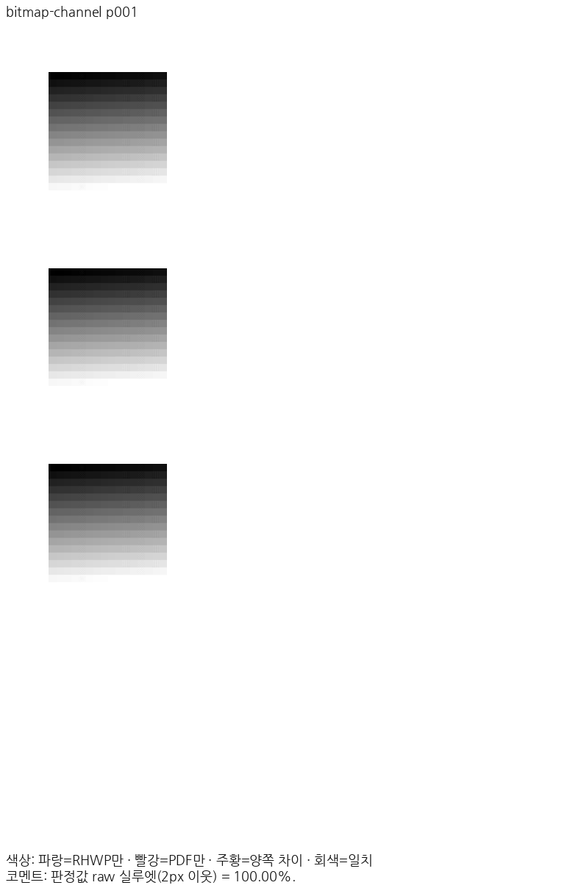 |
| fresh WASM Canvas2D | 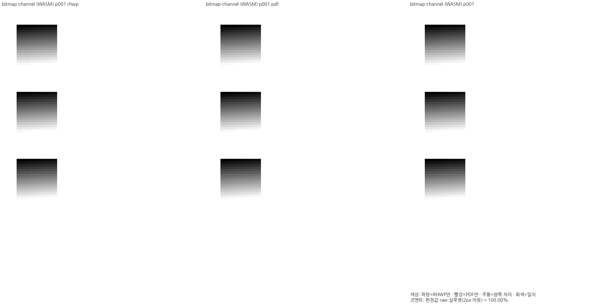 | 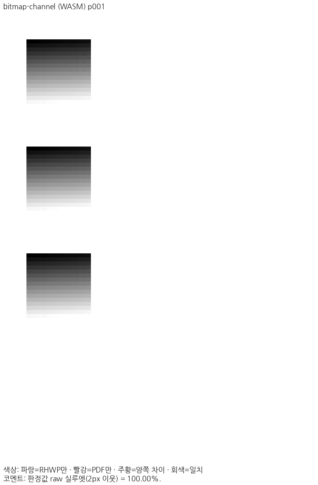 |

### radial-pages · 기준/출력 1쪽

| 출력 | review | overlay |
| --- | --- | --- |
| Native Skia | 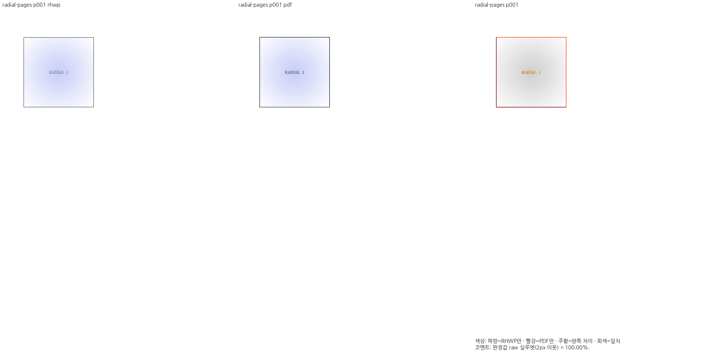 | 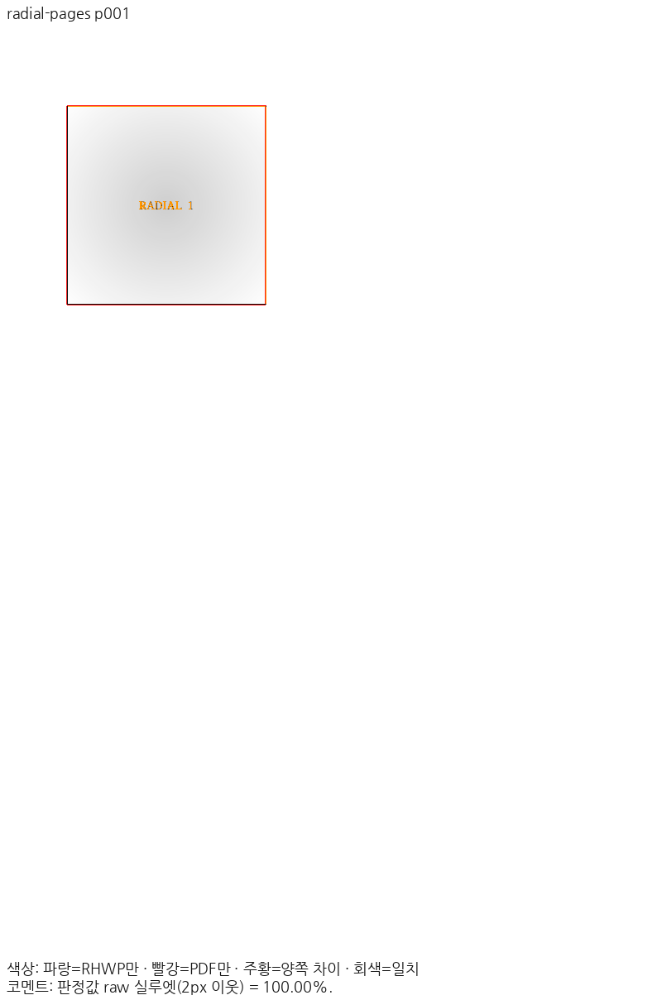 |
| fresh WASM Canvas2D |  | 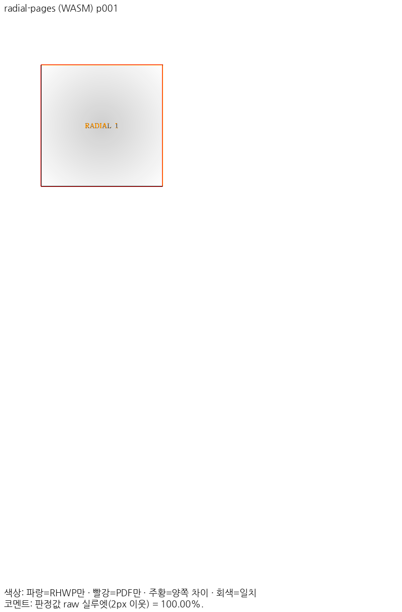 |

## 편람 gate

Native `--handbook-gate` 383쪽은 PASS, 최저 raw 99.96%, regressions 0이다. 기준 하한 비교와 실제 Skia 경로를 수행했고 편람 fresh WASM 383쪽이나 383쪽 직접 판독을 수행한 것으로 확대하지 않는다.

```sh
/home/edward/mygithub/rhwp/venv/bin/python scripts/visual_sweep.py --handbook-gate --page-workers 3 --rhwp-bin /home/edward/mygithub/rhwp/output/pr-review/dependabot-20261109/build/candidate-rhwp --out /home/edward/mygithub/rhwp/output/pr-review/dependabot-20261109/handbook
```

[383쪽 TSV 원본](handbook/silhouette.tsv), SHA-256 `d5006cd9110c1247282aa5627f1728d9c751c3212925204582b9b40f39900308`, 8428 bytes. 기준 TSV `mydocs/pr/assets/issue_8153/final-50cdf-validation-20261030/handbook-hwpx-native.tsv`의 SHA-256은 `d5006cd9110c1247282aa5627f1728d9c751c3212925204582b9b40f39900308`다.
