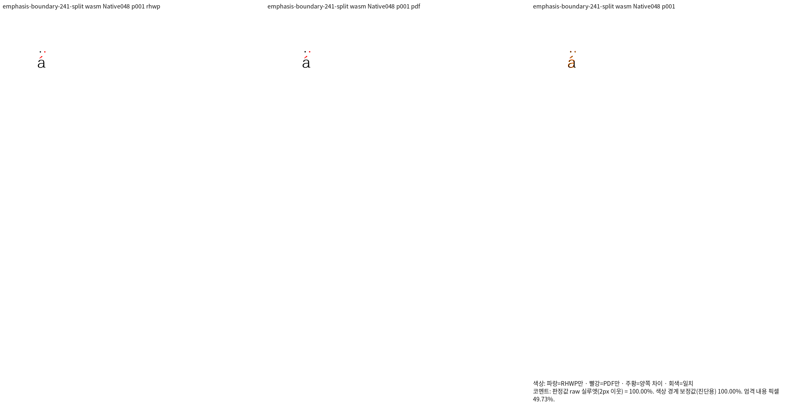
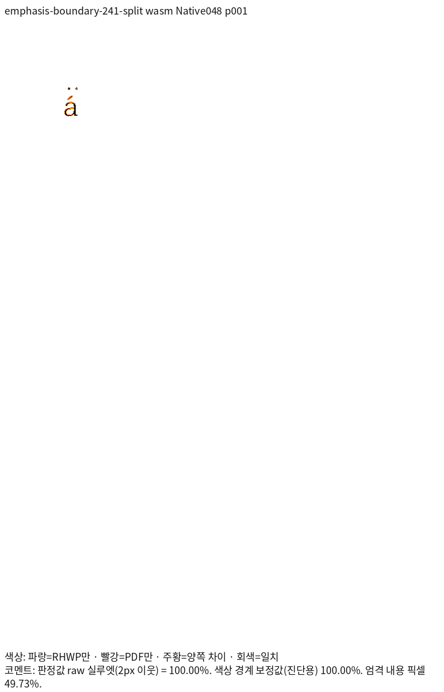

# 원문 서식 경계의 강조점 회귀 증거

제품 SHA: `d26f6aef06d7e2abe6811f8d7901eaf245c55ad7`. Native048/fresh WASM022, 96 DPI, compat2022.
같은 source snapshot의 최적화 WASM을 빌드했고 Studio public과 JS/WASM SHA가 일치한다.
compat2022는 비교 프로필 이름이며 독립 인쇄 엔진은 아래 영수증의 한컴 2020이다.

세 입력의 독립 Print는 engine 2020·한컴 11.0.0.9136·PrintMethod 0·1-up·전처리 none이다.
원문 split과 ID만 다른 동등 서식/동일 ID 반례를 구분한다. source 주소·표시 런·실제 강조점 소유를 검사한다.
Native/fresh 모두 전체 1쪽씩 100%다. 전체 색상 RGB 일치를 주장하지 않는다.

| 입력 | Native TSV | fresh WASM TSV | 기대 점 |
| --- | --- | --- | --- |
| [different-styles](different-styles.hwpx) · [Print PDF](different-styles-hancom2020.pdf) | [100%](native/different-styles-silhouette.tsv) | [100%](wasm/different-styles-silhouette.tsv) | 검정·빨강 각 1개 |
| [equal-styles-distinct-ids](equal-styles-distinct-ids.hwpx) · [Print PDF](equal-styles-distinct-ids-hancom2020.pdf) | [100%](native/equal-styles-distinct-ids-silhouette.tsv) | [100%](wasm/equal-styles-distinct-ids-silhouette.tsv) | 검정 1개 |
| [shared-source-style](shared-source-style.hwpx) · [Print PDF](shared-source-style-hancom2020.pdf) | [100%](native/shared-source-style-silhouette.tsv) | [100%](wasm/shared-source-style-silhouette.tsv) | 검정 1개 |

ID만 다르면 구간을 끊는 가정은 두 반례의 독립 Print RGB가 동일하다는 근거로 배제했다.
새 검사는 실제 원문 해소 서식이 다를 때만 강조점 구간을 나누며, 자동 표시 런 경계의 중복을 막는다.
원문 scalar 순서·누락·중복과 최종 SVG의 점 개수·색·앞뒤 관계를 검사한다. 절대 px 좌표 핀은 없다.

수정 전 Native047은 동일 검사 3건 중 해당 결함 1건 FAIL·반례 2건 PASS, Native048은 3건 PASS다.
고정 devel `5e2b9bfbf0`과 같은 입력·PDF·글꼴로 Native/fresh 전쪽을 대조했고 하락 0쪽이다.
실행 원문은 ignored `output/pr-review/semanticist21-20261019/`의
`emphasis-metric-before-after-437.json`, `emphasis-base-comparison-434.json`,
`char-overlap-native-build-048-result.json`, `char-overlap-fresh-wasm-build-022-result.json`에 있다.
정식 파일의 실제 3검사는 동결 rlib에 연결한 엄격한 rustc 실행으로 확인했다.
자동 수집 prepare/check는 통과했으며, 전체 Cargo 재실행은 아직 남아 있다.
원본·PDF SHA, 실제 실행 명령, Print job, TSV 원문 SHA는 [provenance](provenance.json)에 보존한다.
글꼴 바이트 지문은 [font-supply](font-supply.json)에 있으며 글꼴 파일을 재배포하지 않는다.

## 대표 원문 review와 standalone overlay

### native

### wasm

