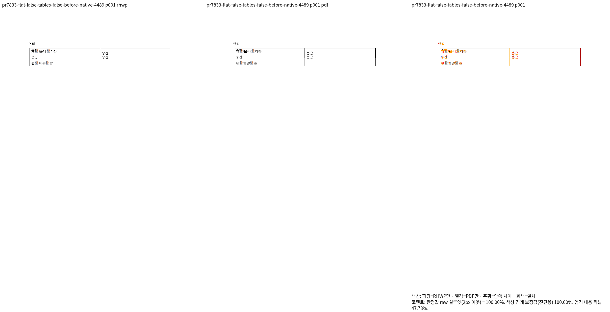
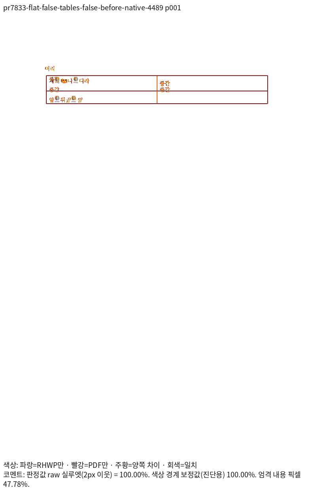
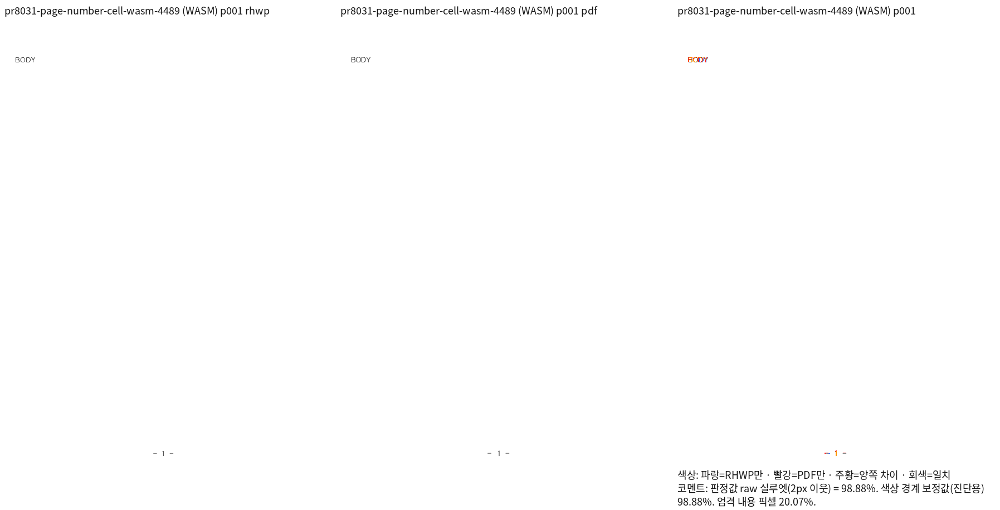
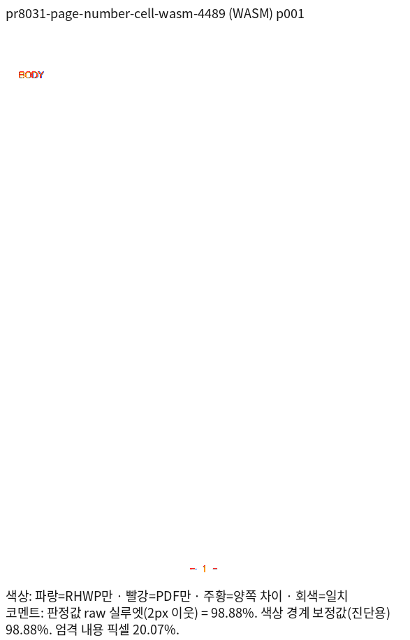

# 원본 HWPX 셀 프레임과 암묵적 스타일의 독립 Print 회귀

런타임 소스는 `b9c1249098856f5cb1fb17c45d75ad76e855a18a`, 고정 base는
`49bc935a149c20b942d3045c2f5c733aeccf57d0`다. 원 PR #7833·#8031·#8039의 기존
생성 입력 11개만 보존한다. 새로운 실제 문서나 정규화한 진단 사본으로 범위를 바꾸지 않는다.

[독립 기준과 실행 명령](independent-oracle.json)에 원본·Print PDF의 경로, 바이트 수,
SHA-256, 원본 XML의 문단·개체 수, PDF 텍스트 원점과 양쪽 TSV의 SHA를 기록했다.
입력은 `tests/fixtures/hwpx_cell_frame_print/`, PDF는 기존
`pdf/semanticist21-20261019/generated-hwpx/` 경로에 있다. 각 PDF는 원래 입력의 한컴
2020 Print 출력이다. 사후 Save로 바뀐 캐시·글자모양을 정답으로 대신하지 않는다.

## 시각 선행 증거

| 원본 조건 | 쪽수 | Native raw 최저 | 최적화 fresh WASM raw 최저 |
| --- | --- | --- | --- |
| #7833 깊은/얕은 셀 × 그림/표 × 절단 전/후 8개 | 각각 1/1 | 각각 100% | 각각 100% |
| #8031 빈 글자모양 표·쪽 번호 | 1/1 | 98.91304% | 98.88476% |
| #8039 비가시 컨트롤 꼬리 false/true 2개 | 각각 1/1 | 각각 100% | 각각 100% |

96 DPI·Print profile·compat 2022·동일한 명시적 네 글꼴 루트를 사용했다. compat 값은
기존 문서의 조판 프로필이며, 기준 PDF를 출력한 한컴 2020과 구분한다. Native271의 SHA는
`f234d6500f092b33aa8af7808666fe7f546bc92ed19d2111b4b3e0182a0527ab`, fresh081 WASM의 SHA는
`b64a8c15246c50c378f0c6d3a30ab7d2d902379f73b2a5a1e7123f450106cd3f`다.
표준 release 빌드와 실제 `wasm-opt -O` 종료를 확인했다. Native 4471·WASM 4482의 TSV는
`native/`·`wasm/`에 바이트 그대로 복사했다. 실행 로그·중간 JSON은 ignored output에 둔다.

4489에서 깊은 셀의 그림 before·표 cut, #8031, #8039 true의 Native/fresh WASM
review·standalone overlay를 각각 직접 열었다. 첫 글줄의 옛 본문 원점 재사용, 다음 본문의
아래 이동, 절단 후 내용 순서 차이는 해소됐다. 원래 Print에도 있는 중첩·클리핑을 임의로
숨기거나 모든 자손을 바깥 셀 안으로 옮기지 않았다. #8031의 작은 글자 가장자리와 쪽 번호의
잔여 차이는 실루엣 수치와 구분하며, 엄격한 RGB 동일성을 주장하지 않는다.

## 새 회귀의 독립 기대값

[새 검사](../../../../tests/cases/hwpx_cell_frame_print.rs)는 기존 검사를 교체하지 않는다.

- 원본 XML의 표·그림 개수, 가장 가까운 셀의 행·열 소유, 셀 안의 문단 순서와 절단 후
  텍스트 누락·중복을 검사한다. 중첩 표의 외부 앵커를 무시한 조상 셀 전체 포함은 요구하지 않는다.
- 첫 `가`의 실제 SVG 기준선은 독립 PDF에서 직접 읽은 원점을 96/72로 환산해 ±2px로 검사한다.
  원본 저장 캐시의 잘못된 본문 원점을 셀 안 여백으로 다시 쓰지 않는 관계도 함께 보호한다.
- 암묵적 글자모양 입력은 독립 Print의 Gulim 약 10pt와 BODY/NEXT 기준선 ±2px,
  본문 문단 소속·본문/쪽 번호 보존, 물리 표 높이와 부호 있는 줄 전진의 구분을 검사한다.
  비가시 컨트롤 꼬리 두 조건의 본문 원점도 같아야 한다.
- 좌표는 새 구현 계산값에서 가져오지 않았다. glyph별 SVG 노드를 단어 노드 하나로 가정하지 않는다.
  모든 좌표 검사 대상 쪽은 양쪽 raw 98% 이상과 직접 판독의 선행 조건을 충족했다.

CLI 사전 대조 4493은 11개 모두 통과했다. 정식 Rust 실행·수정 전 FAIL/수정 후 PASS·자동
suite 수집 결과는 실제 종료 뒤 여기에 추가한다. 이 선행 대조를 전체 Rust 통과로 보고하지 않는다.

## 대표 review와 overlay

Native 중첩 셀:

fresh WASM 쪽 번호:

## 새 회귀의 정식 실행과 전후 검출 — 2026-10-27

새 base `0bb36e6f976e9ebeba0b1c48d86a2c5bdaee7f7c`로 리베이스하고 기본 feature의
공통 보간 모듈 접근을 보정한 code head는 `b4aca422ec`다. 4502에서 fmt·자동 suite 수집을
확인한 뒤 `regression_suite_016`의 새 검사 두 함수가 2 PASS·0 FAIL·exit0이었다.
같은 검사 바이너리로 Native266을 사용하면 2 FAIL·각 exit101, 현재 실제 CLI를 사용하면
2 PASS·각 exit0이었다. 첫 실패는 0% 전진 관계, 다른 실패는 독립 Print의 첫 글자
x=123.93283px 대비 실제145.10667px를 검출했다. 파일 누락이나 실행 환경 오류를 RED로
사용하지 않았다. 기존 검사는 교체하지 않았다.

새 의존성 기준의 Native/fresh WASM 전쪽 검증과 전체 lint·Rust·Studio는 4503·4504·4506에서
이어 간다. 이전 runtime의 시각 선행 증거와 이번 정식 Rust 실행을 구분하며, 이 결과만으로
최종 전체 검증·원격 CI·통합 완료를 선언하지 않는다.
