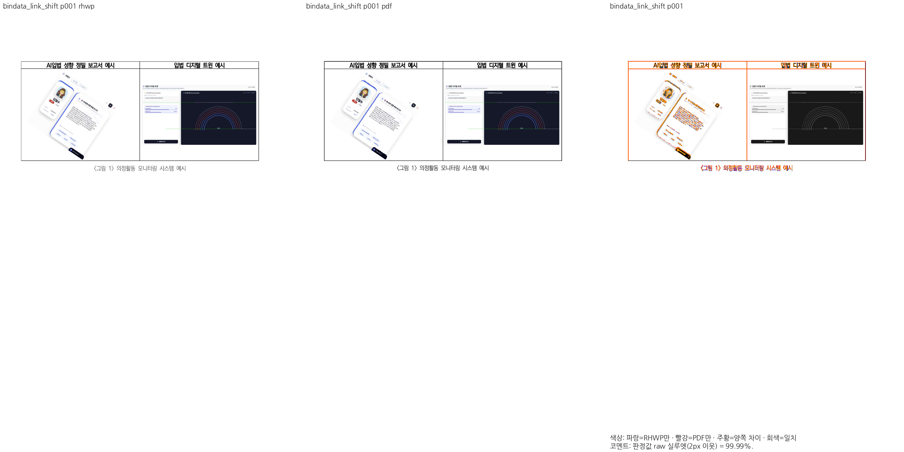
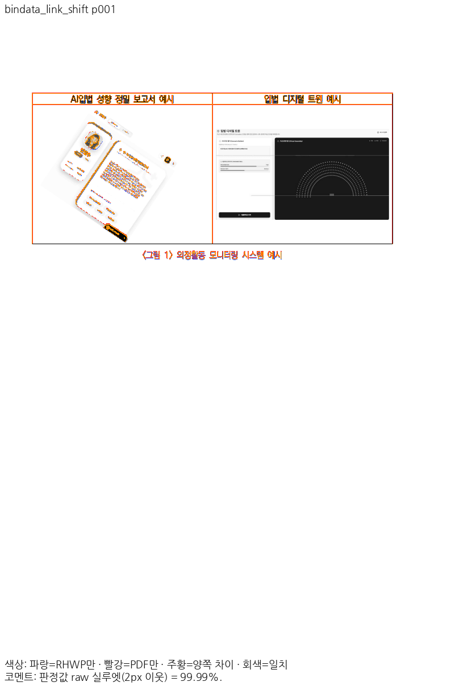
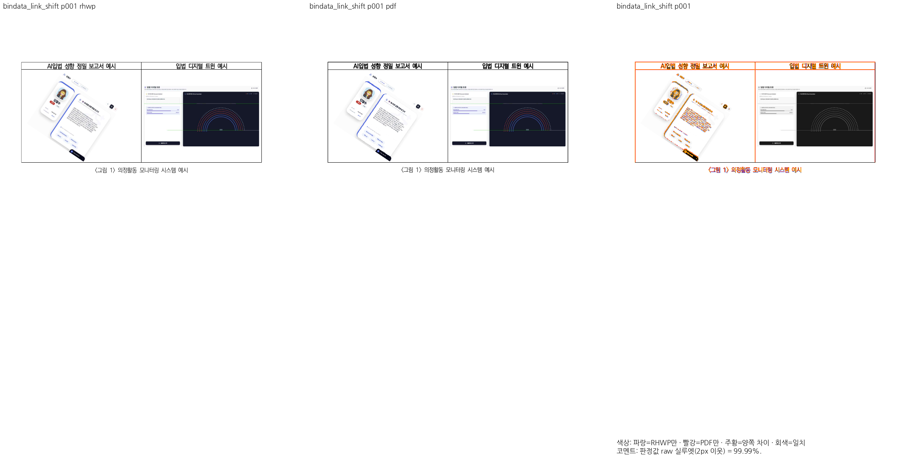

<!-- 로컬 초안. 원격 승인·실제 merge·운영 기록·devel sync 뒤 integration_pr/merge_sha를 확정해 게시한다. -->
기여해 주셔서 감사합니다. [#8631](https://github.com/edwardkim/rhwp/pull/8631)의 원 기여 commit을 보존하여 [통합 PR #{integration_pr}](https://github.com/edwardkim/rhwp/pull/{integration_pr})의 merge commit `{merge_sha}`로 devel에 반영했습니다.

Link 레코드의 순번 자리를 보존하고 실제 저장 파일에서 빈 자리만 제외하는 원 기여를 수용했습니다. HWP/HWPX 저장·재열기에서 독립 원본 그림의 바이트·크기·crop·alpha가 유지됨을 확인했습니다.

같은 입력의 독립 한컴 Desktop Print와 전체 1쪽을 비교해 Native 최저 **99.98529%**, 최적화 fresh WASM 최저 **99.98529%**를 확인했습니다. 전체 회귀·Native 공식 검사·lint·새 sample 보안 및 최종 head CI의 실제 결과는 [검토 기록](https://github.com/edwardkim/rhwp/blob/devel/mydocs/pr/archives/pr_8631_review.md)에 남겼습니다. 수치는 원 재현물의 전쪽 최저이며 추가 경계와 남은 차이는 별도로 구분했습니다.

문서 비교는 [Visual Sweep 정본](https://github.com/edwardkim/rhwp/blob/devel/mydocs/manual/verification/visual_sweep_guide.md#github-merge-comment)을 따랐습니다. 아래 raw 실루엣은 96dpi·2px 이웃 기준의 내용 일치율 보조값이며 사람의 판정 정확도가 아닙니다. 독립 Print와 같은 영역을 직접 확대 판독했습니다.

입력 `bindata_link_shift`: [Native 전쪽 TSV](https://github.com/edwardkim/rhwp/blob/devel/mydocs/pr/assets/hyunmyungjanelee-20261106/native-bindata_link_shift.tsv), [fresh WASM 전쪽 TSV](https://github.com/edwardkim/rhwp/blob/devel/mydocs/pr/assets/hyunmyungjanelee-20261106/wasm-bindata_link_shift.tsv)

native p1 raw 99.98529%

wasm p1 raw 99.98529%

