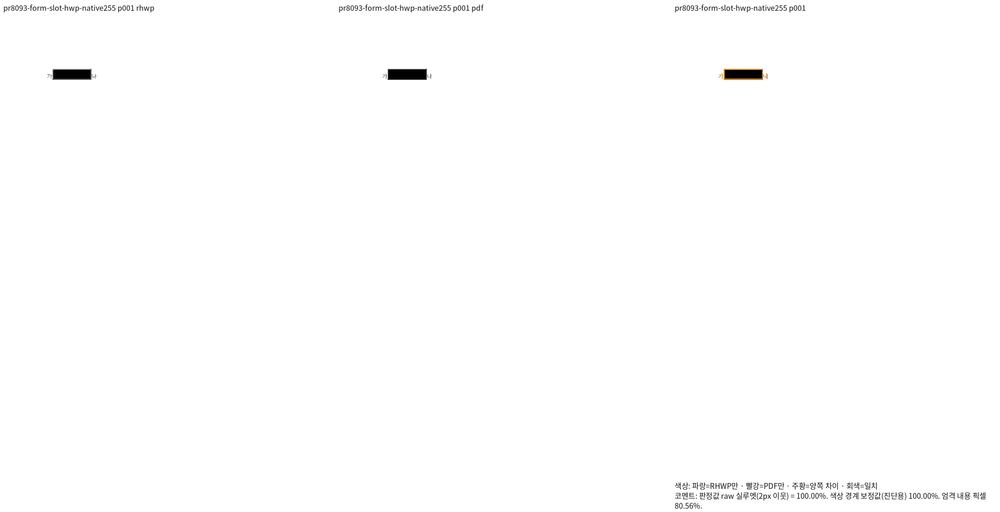
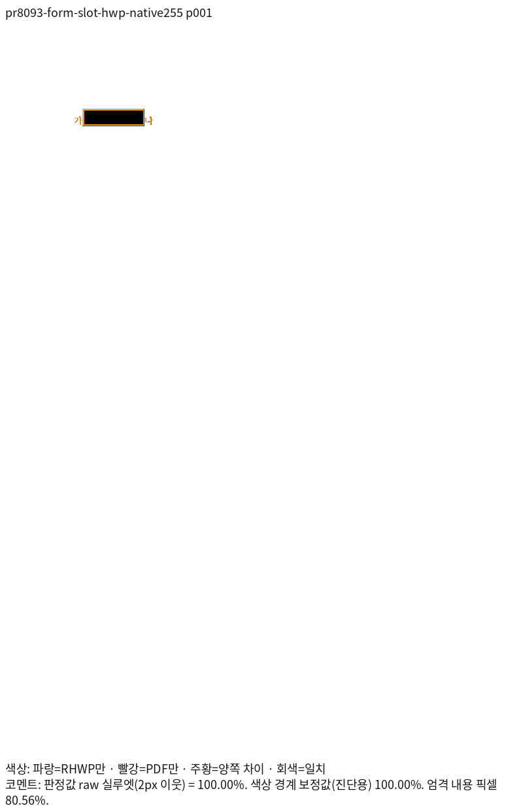
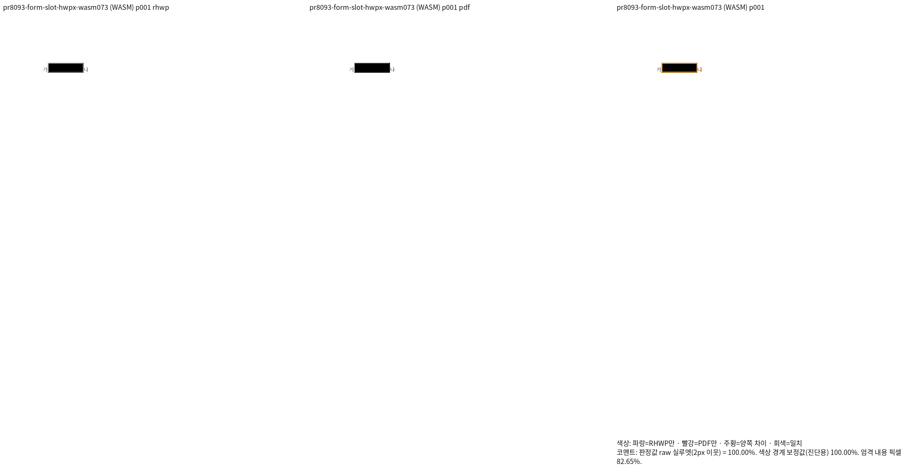
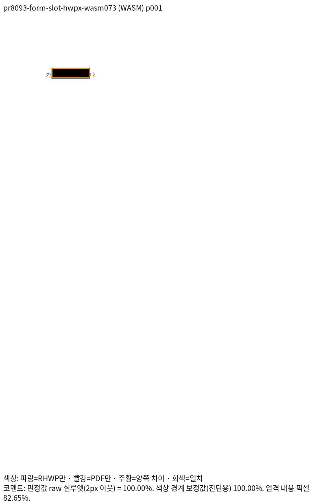
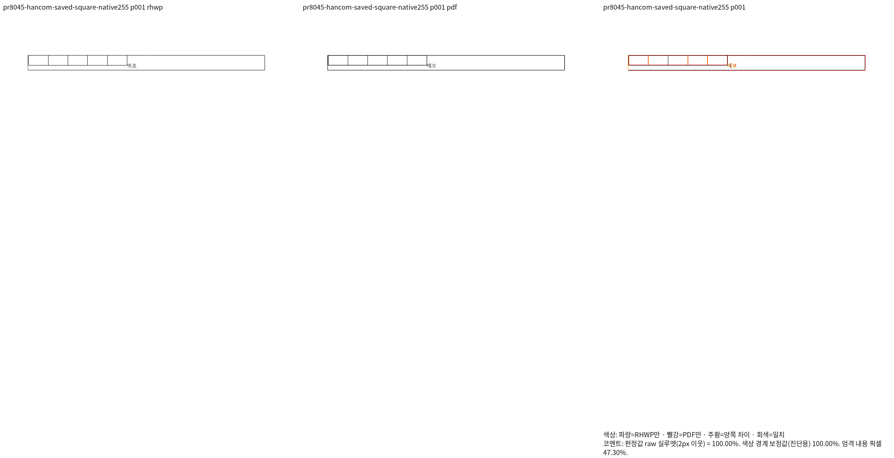
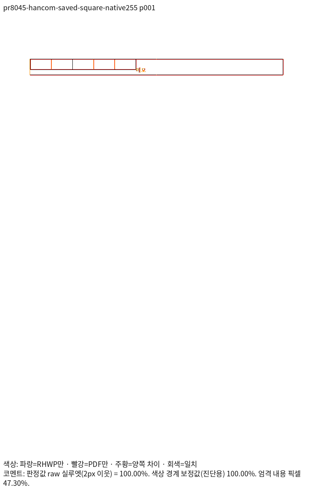
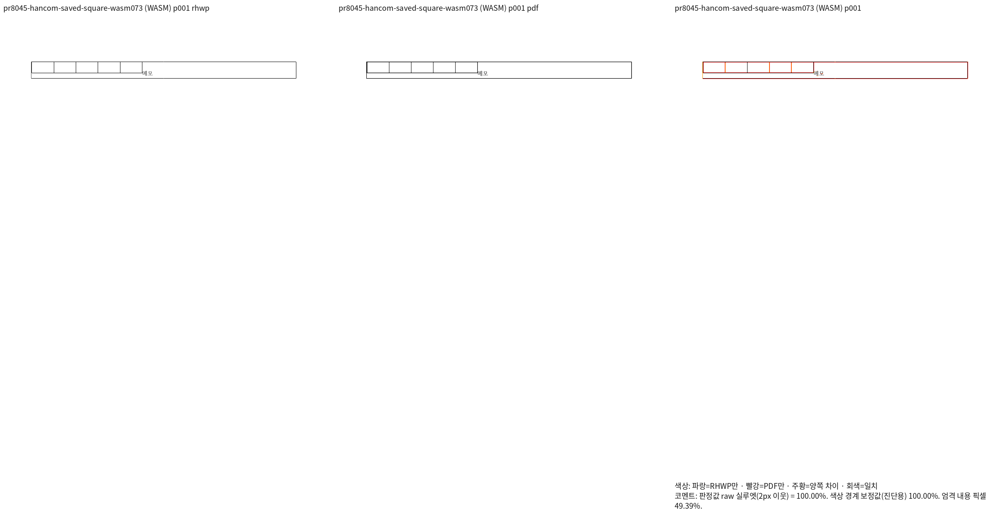
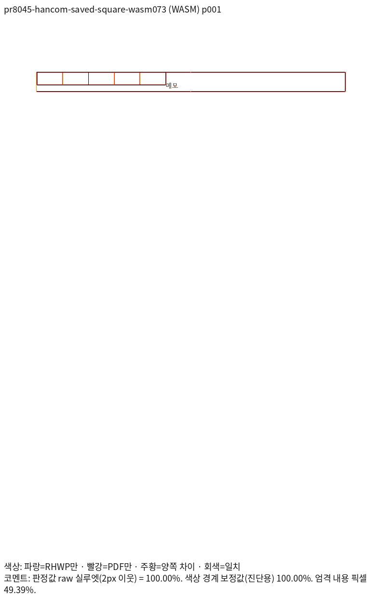

# 양식 host·어울림 표의 최종 시각 증거

렌더 소스는 `bbf3aed18dd82bbf344072b77b5ac590e7a71f3a`이며, 입력·회귀 검사 등록은
`61528013511c87c732524f91c6f224286a055337`이다. 두 commit 사이의 Rust 런타임·의존성에는
변경이 없다. 기존 #8093 재현본 두 형식과 #8045의 한컴 저장본만 검증했다. 새로운 문서로
범위를 확대하지 않았으며 삭제한 검사·입력·파생 참조는 복원하지 않았다.

Native255는 실제 Skia PNG, fresh WASM073은 표준 release 및 `wasm-opt -O`를 마친 실제
Canvas PNG다. 같은 원본의 독립 한컴 2020 Print PDF와 96DPI·print 프로필로 비교했다.
`compat=2022`는 이 엔진의 기존 호환 모드 인자이며 한컴 2022로 새로 인쇄했다는 뜻이 아니다.
입력·PDF·producer·TSV·PNG의 SHA-256, 실제 실행 명령과 글꼴 공급 정보는
[provenance.json](provenance.json)에 있다. TSV와 PNG를 생성 원본에서 바이트 그대로 복사했다.
로그와 중간 분석 결과는 ignored `output/`에만 남긴다.

| 기존 입력 | 독립 Print PDF | 전체 쪽수 | Native 최저 | fresh WASM 최저 |
| --- | --- | ---: | ---: | ---: |
| [양식 HWP](../../../../tests/fixtures/pr8093_form_caret/form-slot.hwp) | [Print PDF](../../../../pdf/pr8093_review/form-slot-hwp-2020.pdf) | 1 | 100% | 100% |
| [양식 HWPX](../../../../tests/fixtures/pr8093_form_caret/form-slot.hwpx) | [Print PDF](../../../../pdf/pr8093_review/form-slot-hwpx-2020.pdf) | 1 | 100% | 100% |
| [한컴 저장 Square HWPX](../../../../tests/fixtures/pr8045_square_wrap/square-hancom2020.hwpx) | [Print PDF](../../../../pdf/pr8045_review/square-hancom2020-2020.pdf) | 1 | 100% | 100% |

전체 문서 쪽수는 원래 캡처의 run manifest에서 각각 1쪽 대 1쪽임을 확인했다. PNG 쌍으로
산출한 TSV의 파일 개수를 전체 쪽수 증거로 대신하지 않았다. 100%는 색상 경계 보정 전
2px 내용 실루엣 값이다. 괘선의 농도·안티앨리어싱 등 RGB 완전 일치를 뜻하지 않는다.

## 양식 HWP · p1

- [Native TSV](native/pr8093-form-slot-hwp/silhouette.tsv) · [fresh WASM TSV](fresh-wasm/pr8093-form-slot-hwp/silhouette.tsv)
- 같은 배율에서 `가`·양식·`나`의 순서, 글자 기준선과 양식 점유 폭을 독립 Print와 직접 대조했다.
  원본 Form 폭에 따른 caret 구간과 문단 분리 후 개체 소유 관계를 검사하며,
  독립 PDF에서 읽은 `가`·`나` 원점만 완료 페이지의 ±2px 좌표로 보호한다.

| 출력 | review | overlay |
| --- | --- | --- |
| Native |  |  |
| fresh WASM |  |  |

## 양식 HWPX · p1

- [Native TSV](native/pr8093-form-slot-hwpx/silhouette.tsv) · [fresh WASM TSV](fresh-wasm/pr8093-form-slot-hwpx/silhouette.tsv)
- 저장 LineSeg가 없는 HWPX의 합성 host도 같은 Form 메트릭을 소비한다.
  HWP와 별도로 기준선·앞뒤 문자·개체 폭을 확인했으며, 두 형식의 저장 정보가 같다고 가정하지 않았다.

| 출력 | review | overlay |
| --- | --- | --- |
| Native |  |  |
| fresh WASM |  |  |

## 한컴 저장 Square HWPX · p1

- [Native TSV](native/pr8045-hancom-saved-square/silhouette.tsv) · [fresh WASM TSV](fresh-wasm/pr8045-hancom-saved-square/silhouette.tsv)
- 부모 표와 중첩 표의 위·아래 경계, `메모` 시작 위치와 내용 순서를 직접 확인했다.
  어울림 표의 저장 anchor를 측정과 실제 배치가 공유하여 부모 높이를 중복 전진시키지 않는다.
  원본 HWPUNIT의 열 원점·줄 높이 관계와 독립 PDF의 `메모` 원점을 함께 검사한다.
- 원래의 수동 작성 Square fixture에는 잘못된 저장 column/vpos 가정이 있다.
  [원본·기준 PDF와 판정](../source_pr8045/manual_cache_reference/README.md)을 유지하며,
  이 정상 한컴 저장본의 통과를 수동 원본의 일치나 0.1%p 무회귀로 바꾸어 보고하지 않는다.

| 출력 | review | overlay |
| --- | --- | --- |
| Native |  |  |
| fresh WASM |  |  |

이 자료는 위 세 입력의 시각 검증 증거다. 별도로 실행 중인 전체 Rust·lint·Native Skia 게이트나
통합 PR의 준비 완료·원격 CI·merge 완료를 뜻하지 않는다.

## 고정 devel의 실제 base와 비교

원본·독립 Print의 해시가 같은 기존 Native247/fresh WASM070 실행을 재사용했다.
base 제품 소스 `3e02fe2749866a8453af3eb3901b9c1a674cccaf`는 정책 base와 런타임이 동등하다.
수정 전 후보 Native253/fresh072의 결과와 base를 혼동하지 않았으며, 같은 입력의 실제 base
TSV 여섯 개를 바이트 그대로 보존했다. 새로 빌드하거나 동일 검증을 다시 실행하지 않았다.

| 조건 | backend | base raw | 현재 raw | 하락폭 | base TSV |
| --- | --- | ---: | ---: | ---: | --- |
| pr8093-form-slot-hwp | native | 94.80944% | 100.00000% | -5.19056%p | [TSV](native/base/pr8093-form-slot-hwp/silhouette.tsv) |
| pr8093-form-slot-hwp | fresh-wasm | 94.90909% | 100.00000% | -5.09091%p | [TSV](fresh-wasm/base/pr8093-form-slot-hwp/silhouette.tsv) |
| pr8093-form-slot-hwpx | native | 94.52700% | 100.00000% | -5.47300%p | [TSV](native/base/pr8093-form-slot-hwpx/silhouette.tsv) |
| pr8093-form-slot-hwpx | fresh-wasm | 94.66037% | 100.00000% | -5.33963%p | [TSV](fresh-wasm/base/pr8093-form-slot-hwpx/silhouette.tsv) |
| pr8045-hancom-saved-square | native | 51.84932% | 100.00000% | -48.15068%p | [TSV](native/base/pr8045-hancom-saved-square/silhouette.tsv) |
| pr8045-hancom-saved-square | fresh-wasm | 51.84510% | 100.00000% | -48.15490%p | [TSV](fresh-wasm/base/pr8045-hancom-saved-square/silhouette.tsv) |

세 조건 모두 양쪽 0.1%p 초과 하락이 없으며 현재 100%다. 음의 하락폭은 개선이다. base의 낮은 점수를 현재 회귀의 기대값으로 고정하지 않았다.
