# 통합 검증에서 발견한 캐시 출처·인쇄 장치 회귀 보정

이 자료는 통합 브랜치의 보정 단계 증거입니다. 전체 브랜치 검증이나 PR 제출 완료가 아닙니다.
현재 소스의 부모는 `9cd2790e2c9d84a8c541e8a858e32acf3838e2d1`이며,
[validation.json](validation.json)에 실제 생산 소스·Native·fresh WASM 해시를 고정했습니다.

## 원인과 보정

원본 TTF가 준비되어 있고 문서에 대체 face가 적혀 있다는 사실만으로 저장 줄을 다시 채웠습니다.
정상 온새미로9쪽은 이 때문에 `내 / 용을`의 줄 소속이 바뀌고 raw 값이 약2.8%p 떨어졌습니다.
같은 가로 상자에서 문서가 지정한 대체 프로그램으로 채워 **전체 저장 줄 경계를 재현하는지**를
먼저 확인하고, 그 캐시와 다른 현재 원본 TTF의 줄 구성을 후속 원점과 함께 발행하도록 보강했습니다.
규제영향분석서의3개 본문 문단은 대체 프로그램이 저장 줄 전체를 재현했고 정상 대조군은 그렇지
않았습니다. 문서 이름·쪽 번호·수치 예외를 추가하지 않았습니다.

또한 최소 장치 폭을 적용하면서 기존의 장치 픽셀 중심 적분을 빠뜨려 여러 쪽의 raw가 떨어졌습니다.
해당 쪽의 render tree는 이전과 바이트 동일했습니다. 레이아웃 좌표·속성 선폭은 유지하며,
인쇄의 단일 직교 실선만 장치 법선 방향 최대 반 픽셀 안에서 픽셀 중심에 모으고 최소1장치px
폭으로 그립니다. Native·WebCanvas와 CanvasKit이 같은 계약을 소비합니다. 화면·점선·복합선·
화살표·그림자·대각선은 원래 경로를 유지합니다.

## 검증 범위

PDFium·Print·96 CSSpx·2px 관용·90% 및 고정 devel 대비 페이지별0.1%p 기준을 유지했습니다.
fresh WASM은 Mac locked wrapper `--target web --out-dir pkg --no-opt` 로컬 대체 빌드입니다.
Docker 최적화 통과나 최신 실제 Studio 소비 완료로 확대하지 않습니다.

| 범위 | Native 최저 | fresh WASM 최저 | 미달 |
| --- | --- | --- | --- |
| 온새미로 변환 원본 전46쪽, 명시한 실제 Print 글꼴 환경 | 94.65583% | 94.55536% | 0 |
| 정상 온새미로 전46쪽 | 92.38021% | 92.38142% | 0 |
| 규제영향분석서 전64쪽 | 98.73269% | 98.73139% | 0 |
| 다른6조건의 하락 경계8쪽 집중 비교 | 95.14080% | 95.05109% | 0 |

양쪽 각각9조건164쪽이며 그중3문서156쪽은 전쪽, 다른6조건8쪽은 집중 범위입니다.
[Native/fresh WASM TSV 원본18개](tsv/)의 원문·쪽 번호·수치를 유지했습니다. 비교 가능한
고정 devel TSV의 해당 전쪽/집중 범위에서는0.1%p 이상 하락이 없습니다. 온새미로 변환본은
고정 base48쪽/후보46쪽으로 숫자 하락 비교를 대신하지 않으며, Print46쪽 및 독립 CFB 원문의
본문468문단 소속·내용·순서와 누락·중복·역전0을 양쪽에서 확인했습니다.

[정식 검사](../../../../../tests/cases/issue_7881_current_body_frame.rs)7건과 규제영향분석서3건,
CanvasKit 장치 계약4건이 통과했습니다. 새 정상 줄 소속 검사는 같은 검사 바이너리에서
이전 CLI1FAIL → 현재1PASS로 실제 검출을 확인했습니다. unit fixture6곳의 새 필드 초기화
누락도 보완했으며, 이 초기화만 바꾼 이전 제품 소스의 Native Skia lib3859PASS/12ignore 및
다른 libs182PASS는 새 후보의 전체 unit 통과와 구분해 보존했습니다.

## 직접 판독

정상9쪽의 단어 줄 소속과 로드맵295쪽 끝 상자·본문을 독립 Print와 같은 배율로 확인했습니다.
이것은 픽셀 동일성 주장이 아닙니다. 로드맵295쪽 일부 위·옆 괘선 차이와 본문의 작은 획 차이는
기존 출력에도 있으며, 이번에 도입한 raw 하락의 복구와 구분합니다.

### 정상 온새미로 · Print 9쪽 ↔ rhwp 9쪽

| 출력 | review | overlay |
| --- | --- | --- |
| Native | 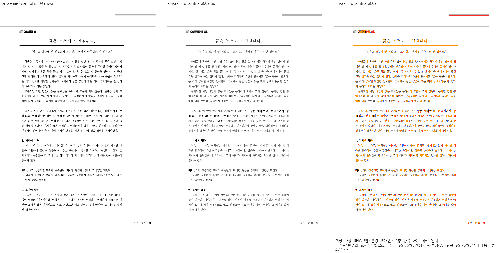 | 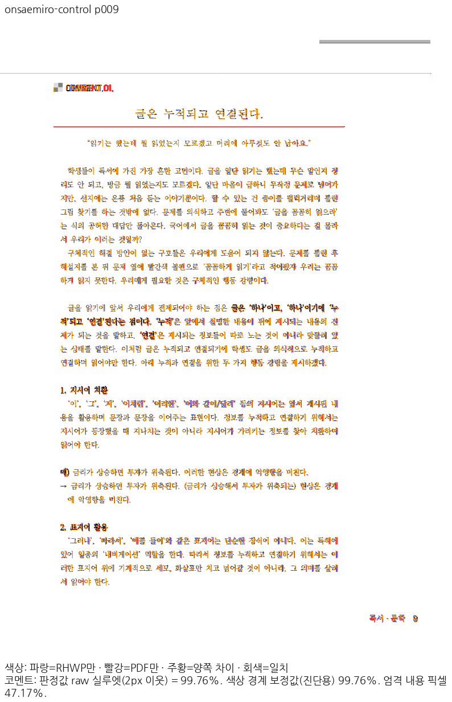 |
| fresh WASM | 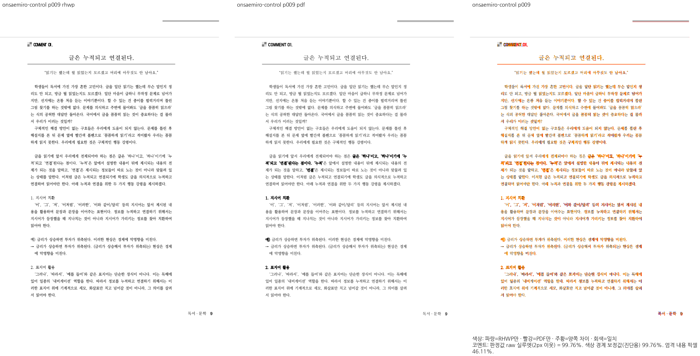 | 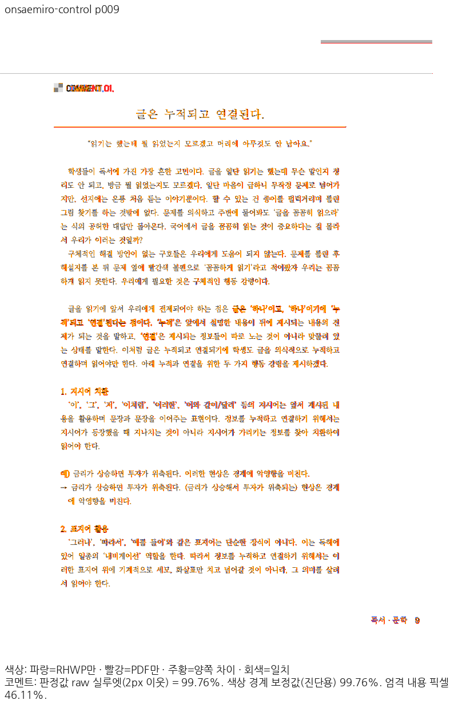 |

### 온새미로 변환본 · Print 19쪽 ↔ rhwp 19쪽

| 출력 | review | overlay |
| --- | --- | --- |
| Native | 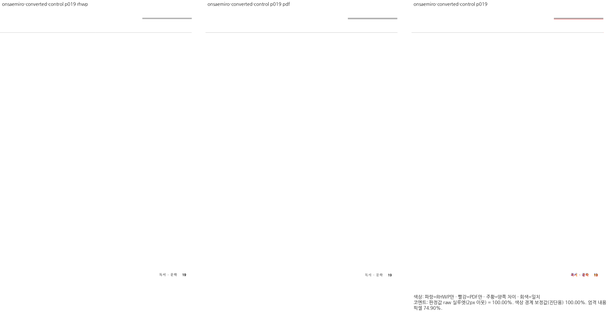 |  |
| fresh WASM |  | 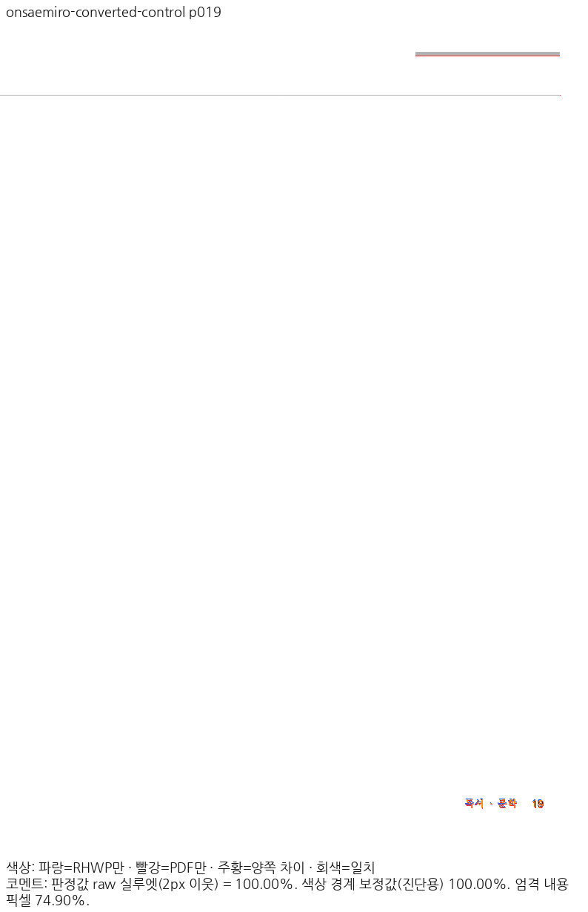 |

### 규제영향분석서 · Print 28쪽 ↔ rhwp 28쪽

| 출력 | review | overlay |
| --- | --- | --- |
| Native | 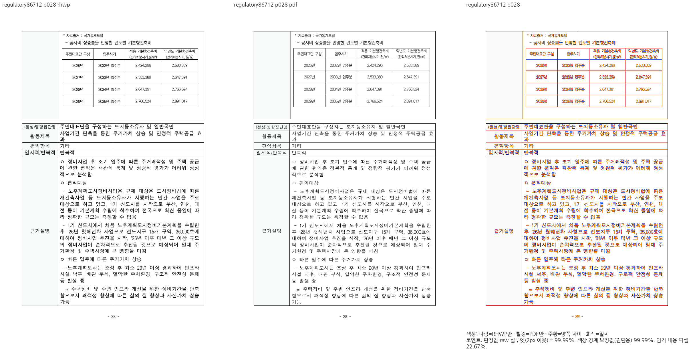 |  |
| fresh WASM | 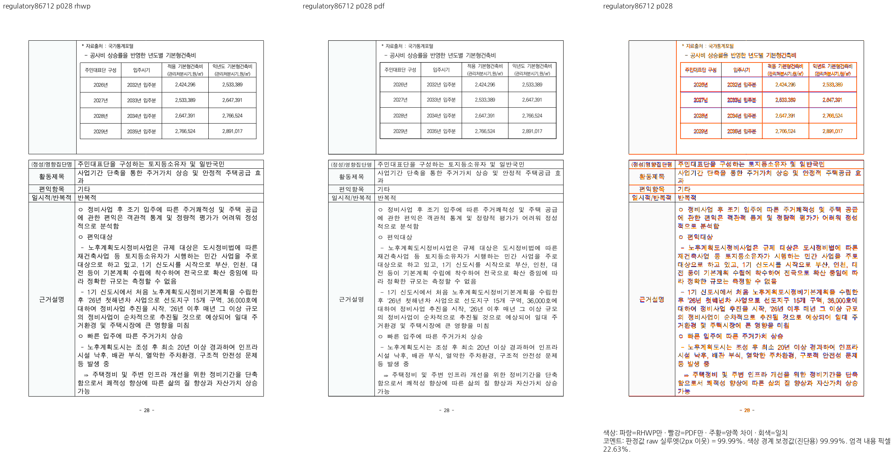 | 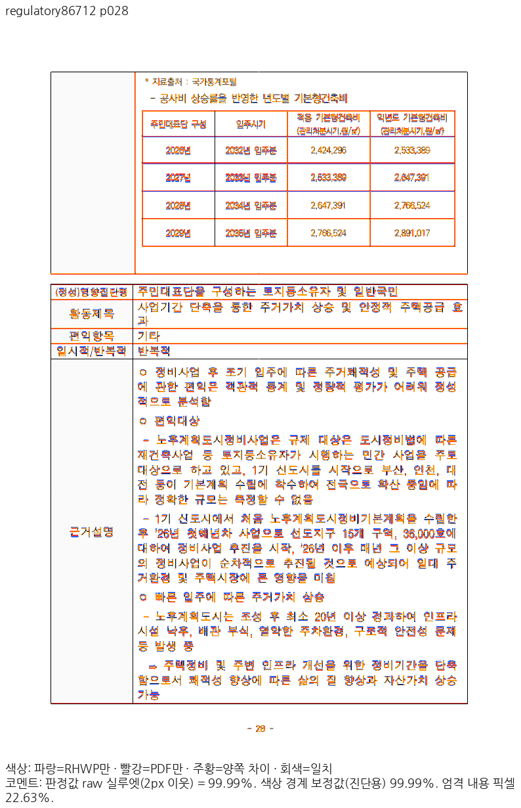 |

### 로드맵 · Print 295쪽 ↔ rhwp 295쪽

| 출력 | review | overlay |
| --- | --- | --- |
| Native | 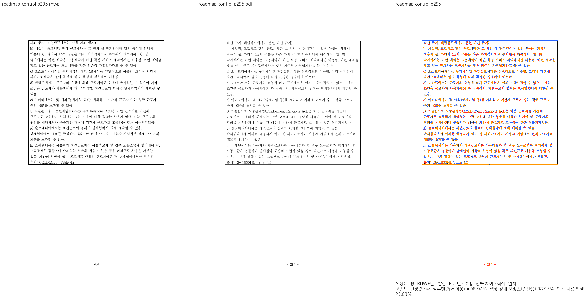 |  |
| fresh WASM | 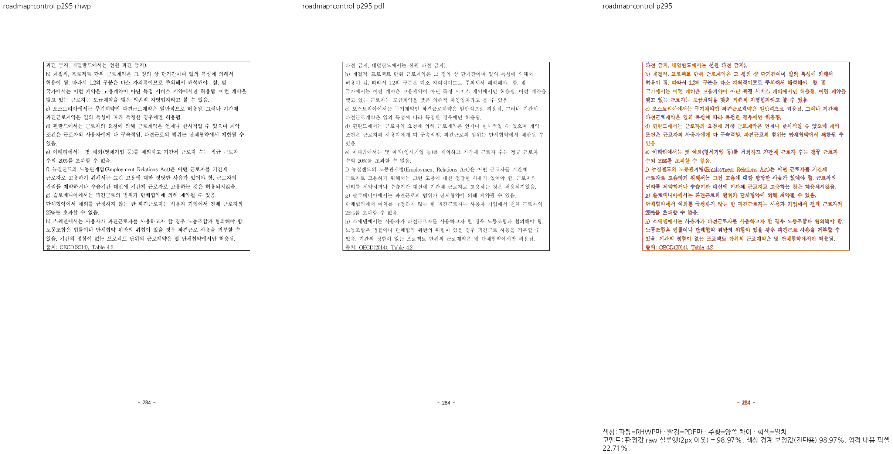 | 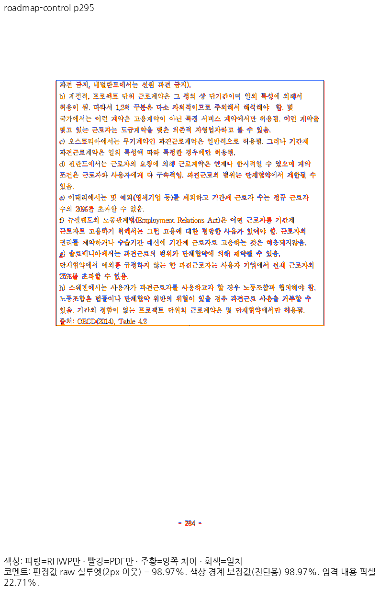 |

### CBTA · Print 59쪽 ↔ rhwp 59쪽

| 출력 | review | overlay |
| --- | --- | --- |
| Native | 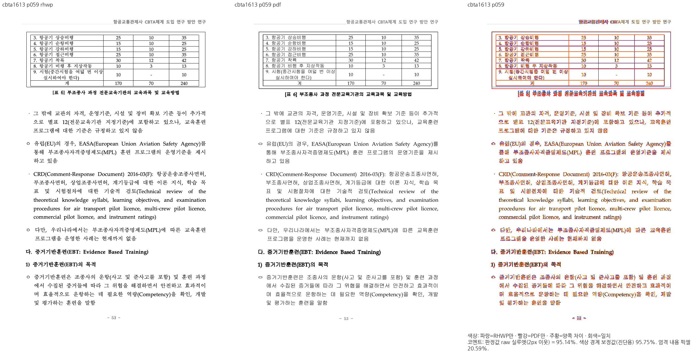 | 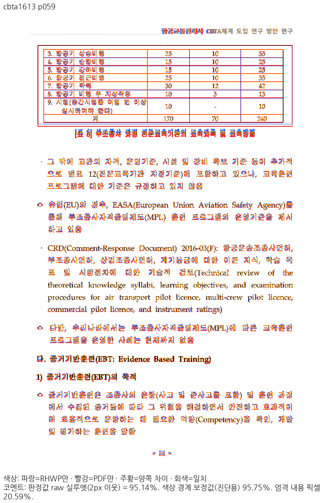 |
| fresh WASM | 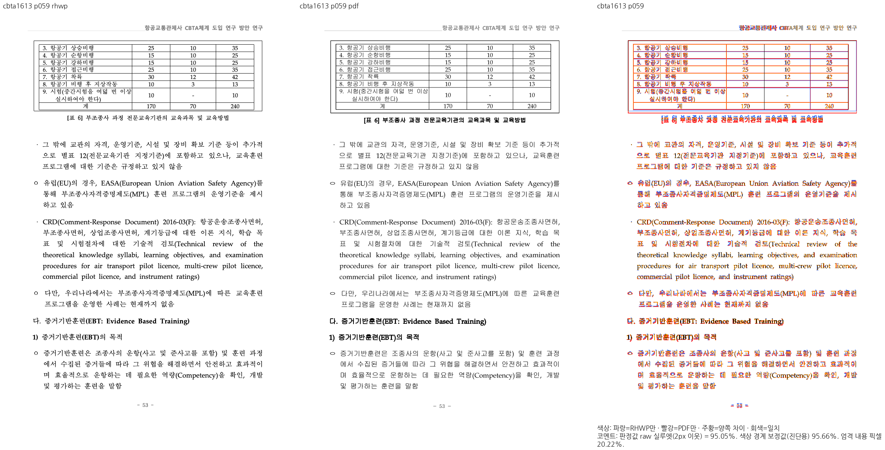 | 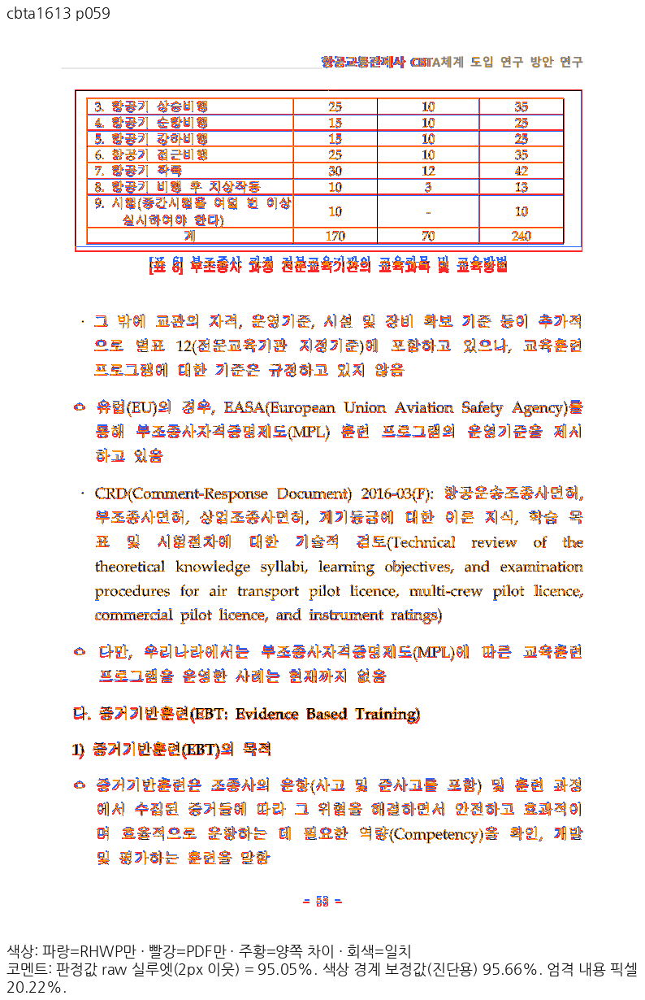 |

## 제출 전 남은 범위

편람은 Native의 쪽수가384→383으로 복원됐지만 양쪽 전383쪽 재검증은 아직 남았습니다.
교육과정 편성표는416쪽/Print415쪽의 회귀가 남아 있어 보정을 계속합니다. 최종 소스의 전체
36조건 TSV·전체 nextest·lint/build·Skia·필수 정책 검사·실제 Studio 소비·PR 템플릿의 공개
SHA 고정 asset 검증을 완료하기 전 제출하지 않습니다.
