# 기존 월간 수출입 원본의 표시용 face·실제 Canvas 검증

기존 font trace 대조군의 같은 원본·독립 한컴 Print를 사용했다. 새로운 HWP 문서를 생성하거나
검토 범위에 추가하지 않았다. [원본과 Print 출처](../../../../pdf/pr8025_review/README.md)의
19쪽을 고정 devel `238de6de41a208648f4ade6b494fe433a81c1fce`와 현재 렌더 소스
`bbf3aed18dd82bbf344072b77b5ac590e7a71f3a`에서 각각 출력했다.

Native247·fresh WASM070의 제품 소스는 `3e02fe2749866a8453af3eb3901b9c1a674cccaf`이며
고정 devel과 런타임이 동등하다. 현재 제품은 Native255와 표준 release·실제 wasm-opt를 마친
fresh WASM073이다. Native는 실제 Skia PNG, WASM은 실제 Canvas2D print PNG이며 SVG raster가 아니다.
96DPI·print·compat 2022를 같은 글꼴 공급으로 맞췄다. 입력·PDF·producer·TSV·PNG SHA와 명령,
원본 셀 소유·실제 Canvas 글꼴 프로그램·브라우저 정보는 [provenance.json](provenance.json)에 있다.

## 전체 페이지

| backend | base 최저 raw | 후보 최저 raw | Print/base/후보 쪽수 | 0.1%p 초과 하락 |
| --- | ---: | ---: | ---: | ---: |
| Native | 96.66566% | 96.62490% | 19 / 19 / 19 | 0 |
| fresh WASM | 96.94896% | 96.89977% | 19 / 19 / 19 | 0 |

전체 페이지 raw는 양쪽 모두 90% 이상이다. 원래 소수값을 Decimal로 비교했다.
[Native base TSV](native/base/silhouette.tsv) · [Native 후보 TSV](native/candidate/silhouette.tsv) ·
[fresh WASM base TSV](fresh-wasm/base/silhouette.tsv) · [fresh WASM 후보 TSV](fresh-wasm/candidate/silhouette.tsv).
TSV와 아래 PNG를 바이트 그대로 복사했으며, 전체 캡처의 PNG가 resume 전후에도 같음을 확인했다.
실행 로그와 중간 분석 파일은 ignored output에만 남긴다.

## 원본 속성에서 실제 paint까지

원본의 글자모양 124·62·96은 `HY헤드라인M`, `bold=false`다. 4쪽의 큰 제목과 `1 수출 현황`,
8쪽의 `2 수입 현황`, 10쪽의 `3 무역수지 현황` 등 실제 표시 문자열 10개를 확인했다.
본문의 주소로 잘못 조회하지 않고 `getCellCharPropertiesAtByPath`로 실제 셀 소유 경로를 조회했다.

`TextStyle::is_visually_bold → CanvasTextFont::for_positioned_text → 실제 Canvas paint`의 소비를
확인했다. CSS descriptor assertion만을 glyph 증거로 쓰지 않았다. 실제 Canvas 적재 기록에는
`HY헤드라인M` 프로그램 SHA-256 `a3f57b4cb4292977479c1511b52997daadaf04c37f180ff05ab152c4d12ccaf5`,
weight 400·normal·faceIndex 0이 있다. 글꼴 자체의 굵기와 명시적 bold 요청을 구분하며,
단순히 source의 bold=false를 출력의 보통 굵기로 해석하지 않는다. 다른 표시용 face 별칭의
적용·일반 함초롬바탕의 비적용은 기존 `canvas_heavy_display_face_bold` 검사로 확인한다.

## 같은 쪽의 review·standalone overlay

아래 세 쪽을 Native/fresh WASM과 독립 Print에서 같은 배율로 직접 확인했다. 제목의 획 굵기·
장평·기준선·문자 사이 간격과 뒤 본문의 소속을 확인했으며, 차트의 축·범례·계열과 표 경계도
대조했다. raw 98% 이상인 쪽이라는 사실만으로 직접 판독을 대신하지 않았다.

### p4 · Native 99.16846% / fresh WASM 99.04671%

| 출력 | review | overlay |
| --- | --- | --- |
| Native | 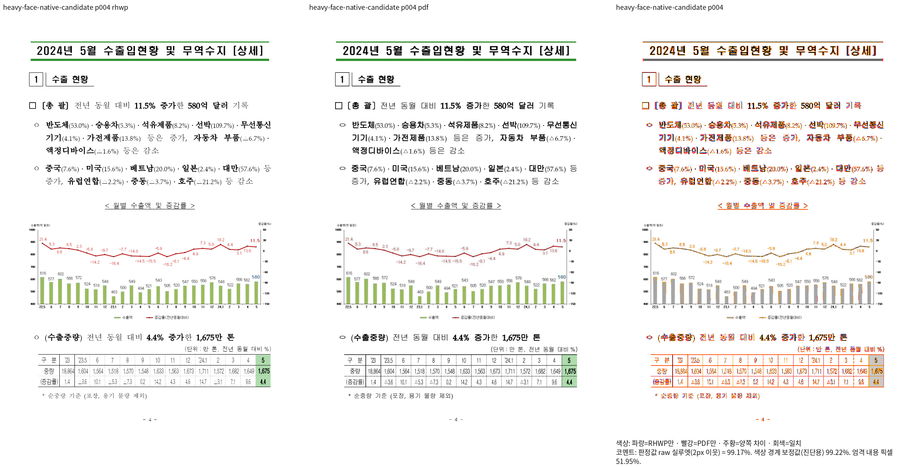 | 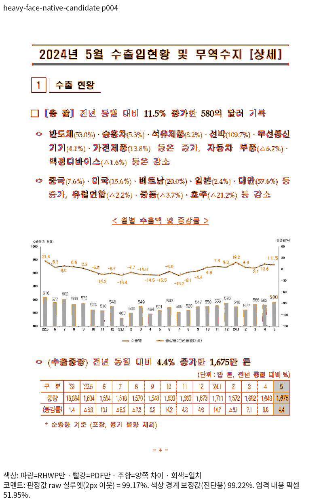 |
| fresh WASM | 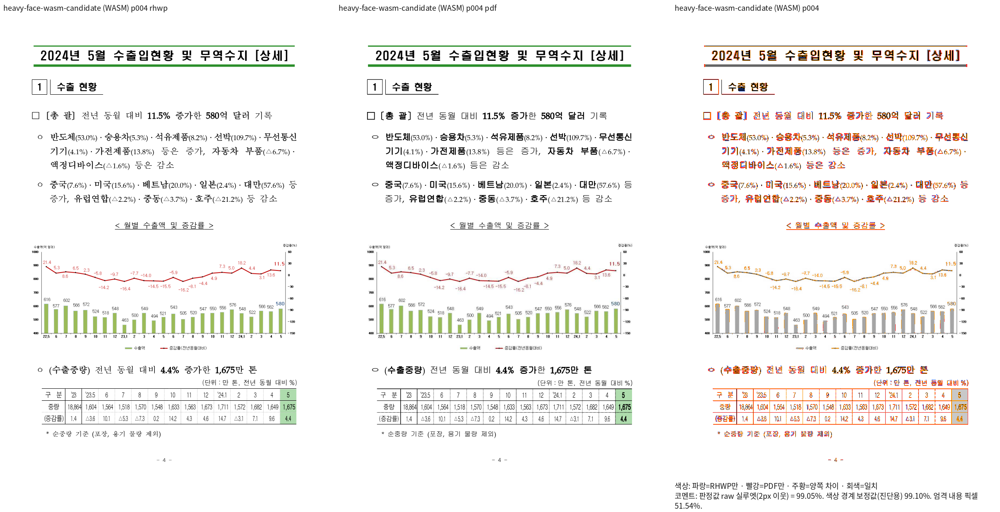 | 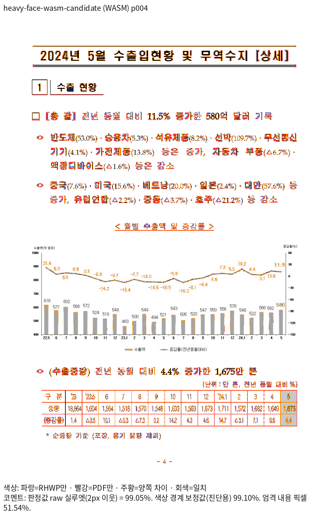 |

### p8 · Native 98.76705% / fresh WASM 98.73836%

| 출력 | review | overlay |
| --- | --- | --- |
| Native | 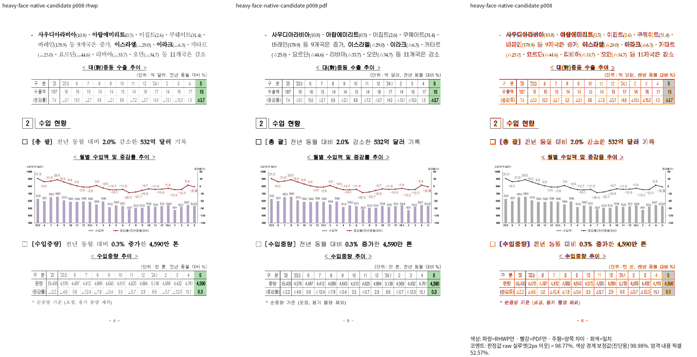 | 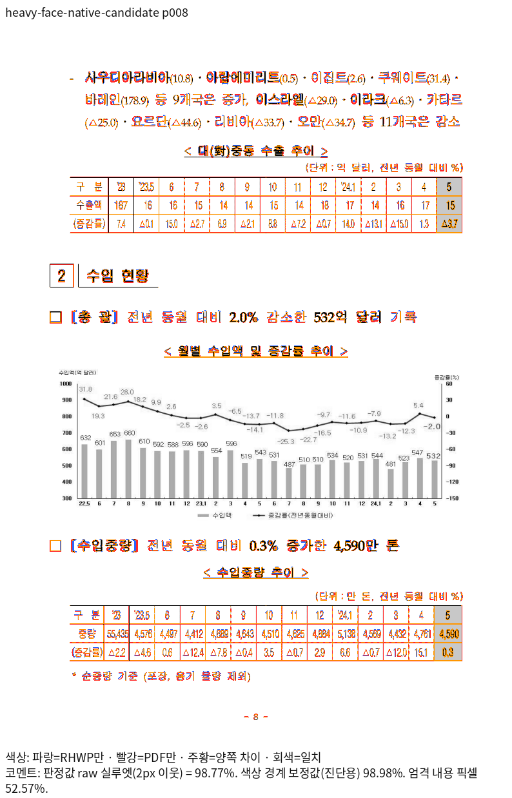 |
| fresh WASM | 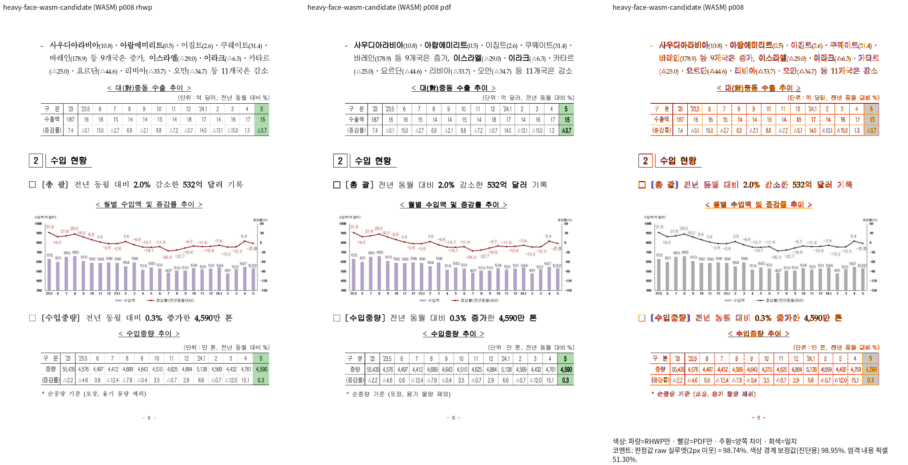 | 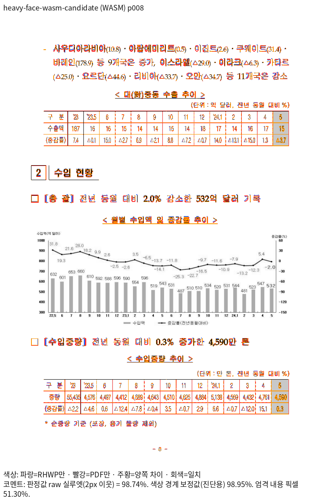 |

### p10 · Native 99.93056% / fresh WASM 99.81911%

| 출력 | review | overlay |
| --- | --- | --- |
| Native | 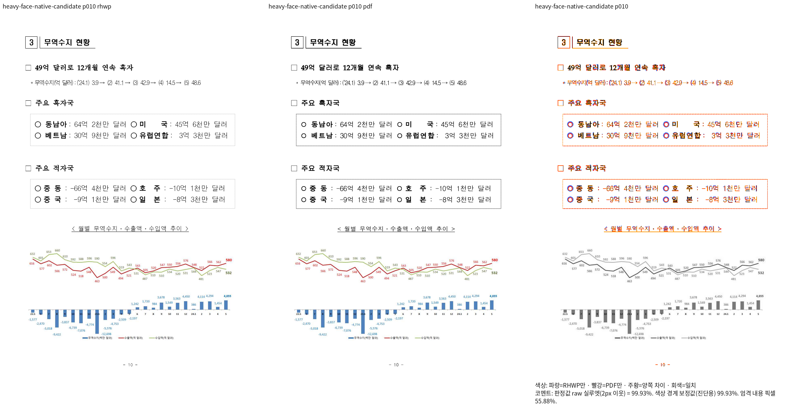 | 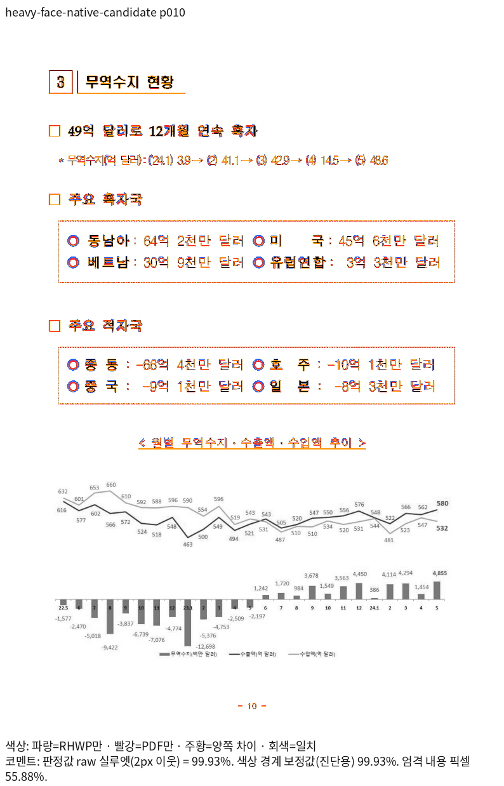 |
| fresh WASM | 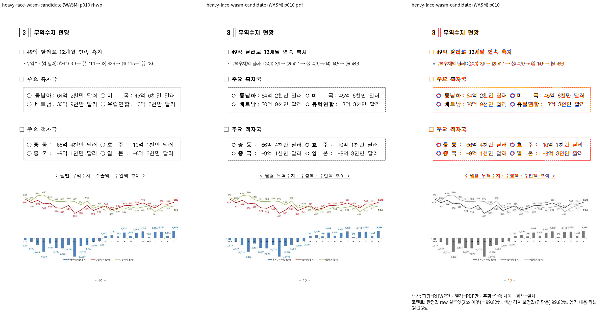 | 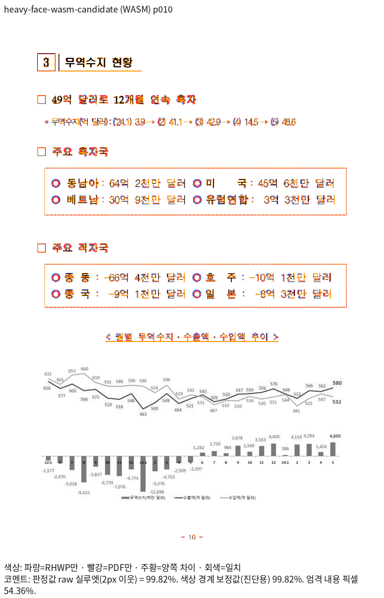 |

## 남은 차이와 판정 경계

글자·괘선의 RGB 농도와 안티앨리어싱 차이는 남으며 완전 일치를 주장하지 않는다.
10쪽의 ○ 기호는 PDF와 크기 차이가 남아 있다. 같은 현상이 base에도 있으며 해당 glyph의
완전한 보정을 이 표시용 제목 검증의 결과로 주장하지 않는다. 양쪽에서 8개 중 6개 진단 영역은
base와 후보의 바이트가 같고, 처음 두 영역에는 차이가 있다. 두 번째 ○의 독립 Print x는
396.8px, base는 394.4px, 후보는 396.9px로 후보 원점은 Print에 가까워졌다. 이 값은
판독·원인 분리용 관측값이며 새 고정 px 회귀 검사를 추가한 것이 아니다.

전체 19쪽·명시적 bold가 없는 실제 제목의 출력과 devel 대비 보존을 확인했다. 이 증거는
전체 Rust·lint·원격 CI의 완료를 뜻하지 않는다. #8025의 최종 판정은 나머지 필수 로컬 게이트의
실제 종료 결과와 함께 갱신한다. 삭제된 sample16·편람의 입력·검사·파생 참조는 복원하지 않았다.
