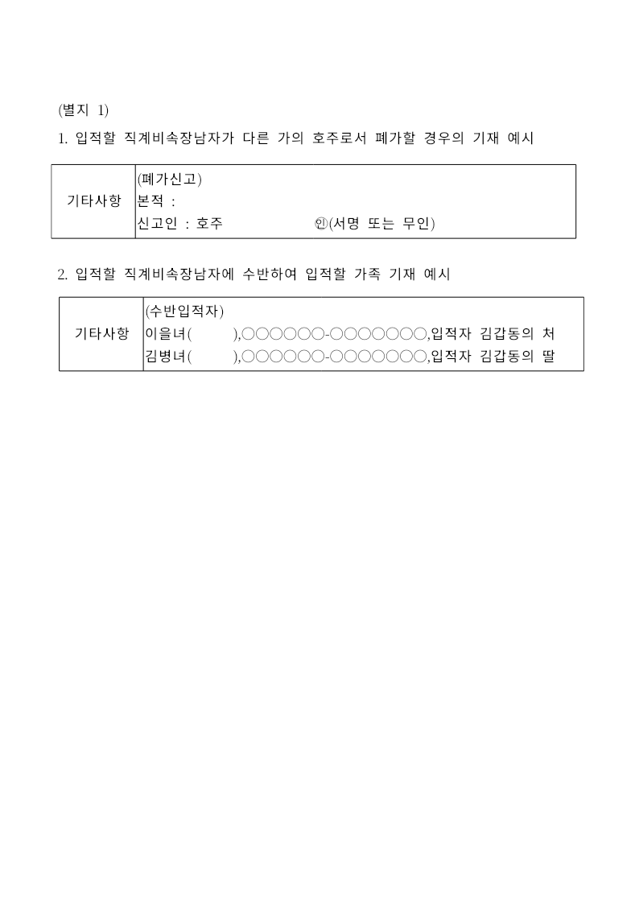
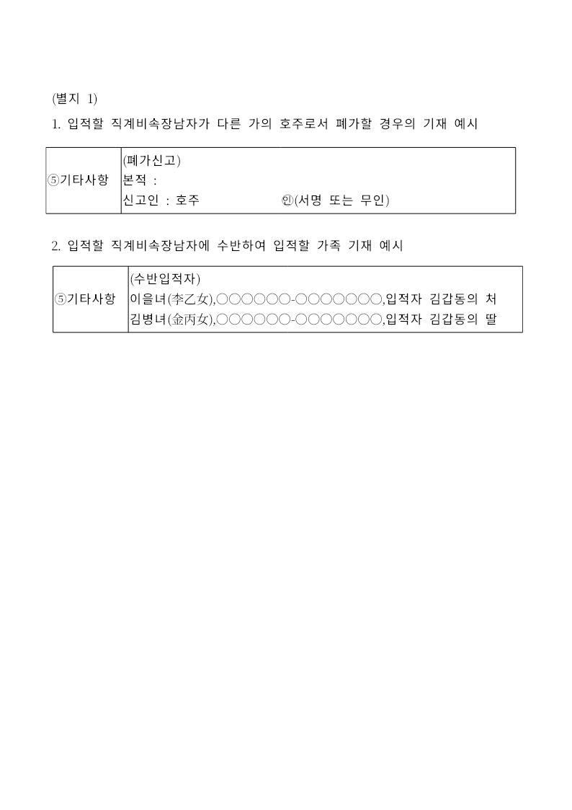

# P136: available installed character fallback after a generic subset

Refs #8590. This bounded Native paint check uses the existing public
[`2913671-appendix1-family-register.hwp`](../../../../../samples/issue8554/2913671-appendix1-family-register.hwp), page 1, at 96 dpi.
The pinned automatic webfont supply maps the document's fonts to a Hangul-only
`NotoSansKR-Regular` subset. With Fontconfig restricted to the installed Noto
Serif CJK collection, the baseline loses the six characters in `李乙女` and `金丙女`
even though that collection covers them. An empty webfont cache is the
counterexample: the same installed Serif paints all six characters.

The change preserves declared/supplied candidate precedence. Only after those
candidates fail does ordinary Unicode text use the platform's character matcher;
private-use characters retain their program-specific rules. Paint and Native
font decision diagnostics share that choice.

| Same Serif-only Fontconfig + pinned cache | Native output |
| --- | --- |
| Before (devel `22da8358`) |  |
| After |  |

The per-character interior ink counts change from `[0, 0, 0] / [0, 0, 0]` to
`[39, 39, 43] / [41, 60, 43]`. The empty-cache Serif control produces those same
counts. The existing Sans+Serif control remains `[80, 52, 68] / [79, 76, 68]`
([control PNG](sans-serif-control.png)). All compared render-tree bytes are
unchanged. Actual `font_decision` records for these six characters and the paint
observer both report the platform-selected `Noto Serif CJK JP` system face.
The collection contains all regional faces; this is the actual selection, not a
claim of Korean face selection or Hancom typography equivalence.

The regression test decodes licensed repository fonts into private temporary
Fontconfig inputs. It fails on the baseline for absent ink and passes after the
fix, including a missing-supplier negative control, covered Hangul, and explicit
font-program precedence. It needs no installed system fonts or network access.
The repository's normal suite generator collects it without adding an
integration target (48/48 targets).

`evidence.json` records input/program/PNG hashes and measurement scope. Font
program binaries and absolute machine paths are excluded. CLI rendering used
`--page 0 --dpi 96 --json --render-tree-output ...` with
`RHWP_WEBFONT_OFFLINE=1` and a verified pinned webfont cache. Both the baseline
Native build and the fixed `native-skia-gl` build use the same CPU raster path
for this export.

This is glyph-presence evidence for the reproduced #8590 condition. Full
Native/fresh WASM corpus and independent Hancom Print comparison remain the
user's later qualification. #8624's bracket overlap does not reproduce in the
current Linux sample16 page 41 condition (eleven opening brackets retain
18.7px widths); that does not close all platforms. #8635 stays open because its
original 195-page input is unavailable.
