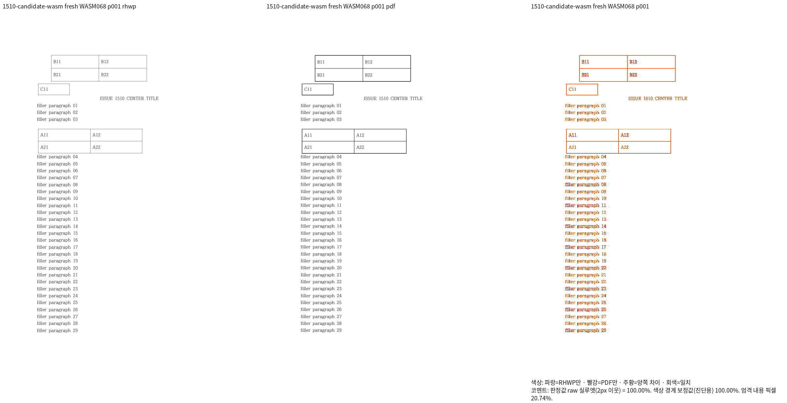
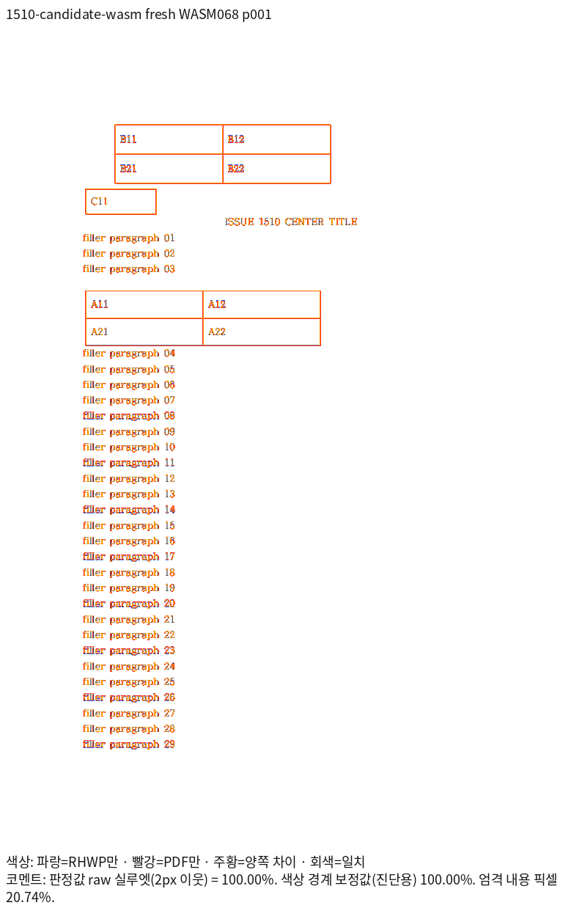
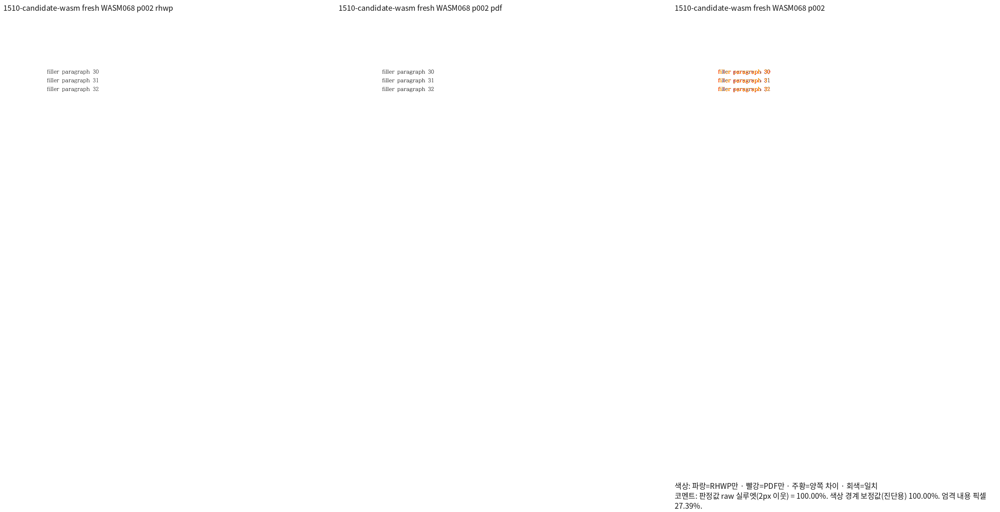
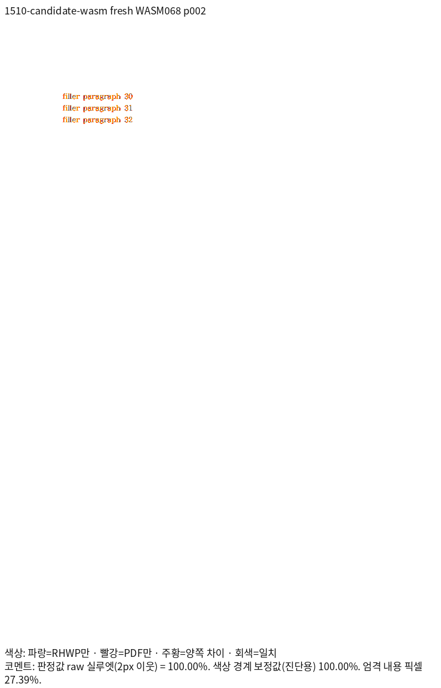

# 형제 부동 표 회귀 등록의 시각 선행 증거

- 검증 코드: `ca4420fad6d974931aafdfbc1a803d729611967c`.
- Native240 및 표준 release·wasm-opt를 거친 fresh WASM068, 96 DPI, Print profile.
- 3개 원본·5쪽의 Native/fresh WASM 전쪽 raw 최저값은 각각 100%다.
- 같은 실행의 #6133 2쪽도 양쪽 100%지만 이 새 회귀의 입력으로 추가하지 않는다.
- 정확한 원문 TSV는 아래 각 backend 폴더에 바이트 그대로 보존한다.
- 이 자료는 새 회귀 등록 전 확인이다. 뒤 코드 변경의 최종 PR 검증을 대신하지 않는다.

| 입력 | 독립 Print PDF | Native TSV | fresh WASM TSV |
| --- | --- | --- | --- |
| `samples/issue1510_coanchored_float_tables.hwp` | `pdf/issue1510/issue1510_coanchored_float_tables-hwp-2020.pdf` | [HWP](native/1510-hwp.tsv) | [HWP](wasm/1510-hwp.tsv) |
| `samples/issue1510_coanchored_float_tables.hwpx` | `pdf/issue1510_coanchored_float_tables-hwpx-2020.pdf` | [HWPX](native/1510.tsv) | [HWPX](wasm/1510.tsv) |
| `samples/hwpx/issue1535_coanchored_float_exclusion.hwpx` | `pdf/issue1535/issue1535_coanchored_float_exclusion-2020.pdf` | [HWPX](native/1535.tsv) | [HWPX](wasm/1535.tsv) |

## 직접 판독과 독립 좌표

표의 위·아래 여백, 셀 글자 기준선, 제목·뒤 본문의 간격, 첫 쪽 끝과 둘째 쪽 시작·마지막
문단을 같은 배율로 대조했다. 괘선의 농도 차이는 있으나 내용 순서·줄바꿈·간격·표 위치의
추가 보류 결함은 보이지 않았다. Native239와 안전성 보완 뒤 Native240의 7쪽 PNG는
바이트 단위로 같아 앞서 본 HWP 영역의 판독도 같은 실제 출력에 해당한다.

독립 PDF의 글자 원점은 72pt를 96 DPI로 환산했다. 렌더의 baseline은 TextRun bbox.y에
run-relative baseline을 더한다. 아래 좌표만 ±2 CSSpx로 보호하고 쪽 소속·내용 보존·
겹침 방지와 원문 여백의 관계 검사를 함께 유지한다.

| 문서·쪽 | 핵심 내용 | PDF x | PDF baseline y |
| --- | --- | ---: | ---: |
| #1510 HWP p1 | 제목 | 306.87368 | 204.25677 |
| #1510 HWP p1 | filler 32 | 113.37855 | 963.42708 |
| #1510 HWPX p2 | filler 30 | 113.37855 | 143.52315 |
| #1510 HWPX p2 | filler 32 | 113.37855 | 186.19651 |
| #1535 HWPX p2 | filler 31 | 113.37855 | 143.52315 |
| #1535 HWPX p2 | filler 32 | 113.37855 | 164.77992 |

## 대표 출력

## 입력 해시

- `samples/issue1510_coanchored_float_tables.hwp`: `66399b3ff7fbe8410a1996788702208be3b732b8ec96aff6b0ec8160a66e2d55`
- `samples/issue1510_coanchored_float_tables.hwpx`: `70eec10ee4682a9ef39b2ad05dbfa06621406da1c96d02efd9b038b5c55ddddb`
- `samples/hwpx/issue1535_coanchored_float_exclusion.hwpx`: `8f23ccab265dc768fc470b168ed4e5f47ce2e302fdf9be37cb81e6c5355a2b1a`
- `pdf/issue1510/issue1510_coanchored_float_tables-hwp-2020.pdf`: `106b80dee1437144245206c3bc69ebcaca1e883f7cc5031504bddab338bd6aa0`
- `pdf/issue1510_coanchored_float_tables-hwpx-2020.pdf`: `78ce39d29f80d6eecc45da399f114621df557f4b9ed72bef6fadf308c1729b92`
- `pdf/issue1535/issue1535_coanchored_float_exclusion-2020.pdf`: `14c65bf0232b751a2ccd2de79875ccb7eac7e5697709ead93b32c5886f5ac115`
