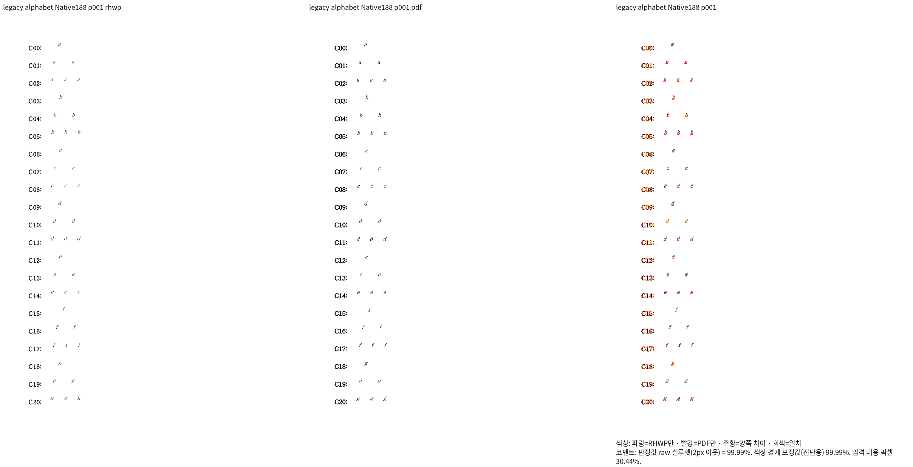
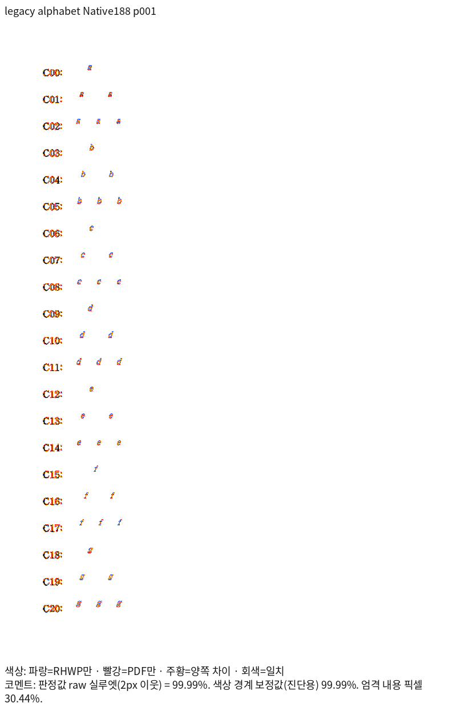
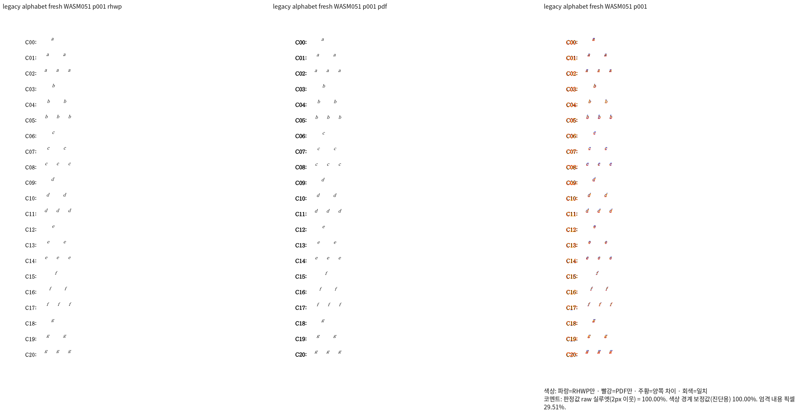
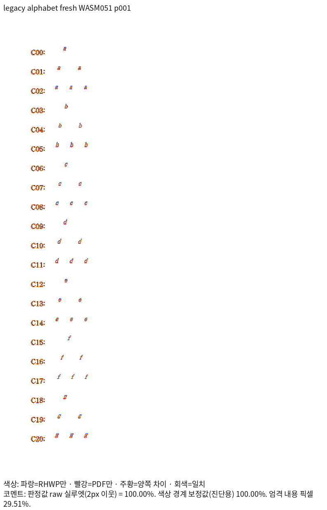

# 구형 CHAR 수식 문자 전진의 완료 증거

제품 source: `f3143bf35e71b1d419966d49c7aa54dce27d2a60`.
Native188 및 standard release fresh WASM051의 실제 Print 프로필 출력이다.
인쇄·글꼴 출처와 기대 좌표는 [fixture 설명](../../../../tests/fixtures/issue1949/LEGACY_CHARACTER_PLANE.md)을 따른다.

| 경로 | 전체 쪽수 | raw 최저 | 90% 미만·누락 | 직접 판독 |
| --- | ---: | ---: | ---: | --- |
| [Native TSV 원본](native/silhouette.tsv) | 9 | 99.98690% | 0 | 1·5·9쪽 글리프·반복 전진·기준선 |
| [fresh WASM TSV 원본](wasm/silhouette.tsv) | 9 | 100% | 0 | 1·5·9쪽 글리프·반복 전진·기준선 |

수치는 색상 경계 보정 전 `silhouette_raw_match_percent`다. 두 TSV는 실행 결과를
바이트 그대로 복사했다. `not_evaluated`는 자동 승인 의미가 아니며, 직접 판독·내용
소유 검사와 구분한다. 이 자료는 아래 신규 검사 대상의 선행 자격 증거이며 전체 통합 PR의
필수 검증 완료나 복합 수식 문제 해결을 주장하지 않는다.

## Native 실제 출력

## Fresh WASM 실제 출력

## 실행 조건

저장 버전에 맞춘 Windows 한컴 2020 Print 기준 PDF, 96dpi, Print 프로필,
`--silhouette-only --compat 2022 --page-workers 1`을 사용했다. 여기서 CLI의
`2022`는 구형 조판 호환 bucket이며 MCP의 실제 실행 제품은 2020이다.
Native는 고정 `target/pr-review`에서 빌드 잡 8개로 만든 불변 실행 파일이고,
WASM은 같은 제품 source의 standard release·최적화·package/Studio 바이트 검증을
완료한 패키지다. 공급 글꼴 경로는 `/usr/share/fonts`, `/usr/local/share/fonts`,
`/home/tsjang/.local/share/fonts`, 저장소 `assets/fonts`다.

검토 중 로그·manifest·중간 JSON은 ignored
`output/pr-review/semanticist21-20261019/`에 보존한다. Native receipt 188·실행 2974,
fresh receipt 051·실행 2995, 직접 판독 2976·2998·3000을 구분한다.
원본 HWP/HWPX 전체 230쪽과 이 합성 입력의 9쪽을 서로 대신하지 않는다.
