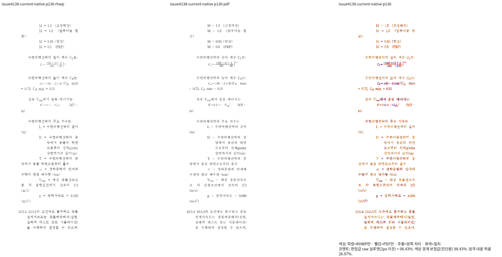
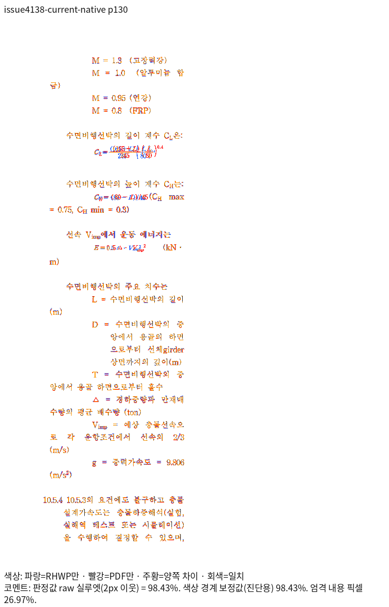
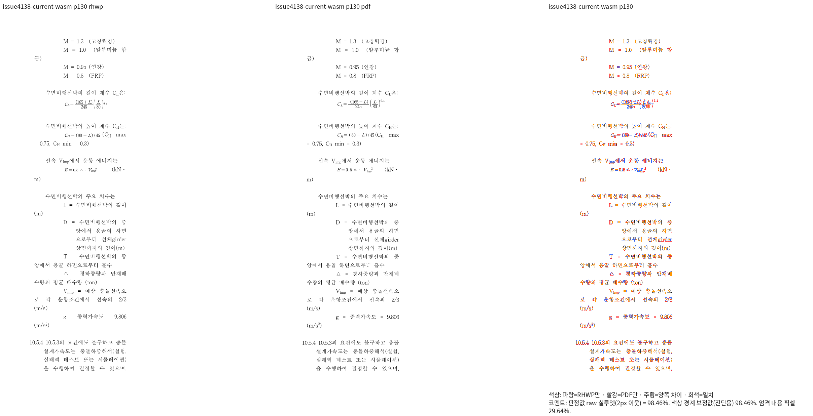
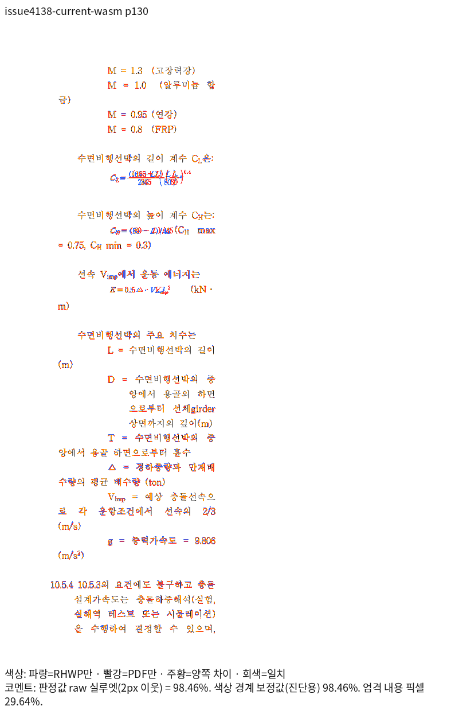

# #4138 분할 저장본의 줄 전진량 검증

## 변경한 검사와 유지한 계약

기존 `saved_split_keeps_the_first_continuation_line_on_its_own_page`를
`verified_saved_split_preserves_continuation_and_equation_line_advance`라는 새 이름으로
검증한다. 원본 내용·분할 셀 소속·쪽 경계·내용 누락/중복·자동 탭·다른 수식의 줄 소속
검사는 유지했다. 입력이나 제품 코드를 바꾸어 실패를 피하지 않았다.

문단 1701의 내부 LineSeg 분할은 이전 `높이1260+간격720`에서 현재
`높이1373+간격607`로 달라졌지만 전진량1980HU와 기준선1020HU는 같다.
출력 줄 전진을 입증하지 않는 내부 분할 튜플 대신, 독립 Print/한컴 저장본이 입증한
전진량과 기준선의 글줄 상자 내부 포함 관계를 검사한다. 새 Print 130쪽의 본문 기준선은 96 DPI 환산으로
372.3930→398.7642px이며, 약26.4px인1980HU 전진과 대응한다. 실제 RenderTree의
두 줄 원점 차이도26.4px이며 앞 줄의 점유 끝과 다음 줄의 비겹침을 함께 검사한다.
절대 페이지 원점이나 임의로 갱신한 높이 핀을 추가하지 않았다.

변경 전 모듈 전체는 [previous-expectations.rs.txt](previous-expectations.rs.txt)에
보존했다. source commit은 `7cce670d2b24c27ec56e738a45ce3262ef2d5d7a`다.
정확한 모듈·입력·PDF·TSV SHA-256은 [qualification.json](qualification.json)에 있다.

## 입력과 독립 Print

- 원본: 기존 `samples/issue1949_giant_cell_nested_tables_perf.hwp`,115쪽.
- 현재 API로 셀을1×2로 나눈 정확한 저장본: [split-current.hwp](split-current.hwp),197쪽.
- 독립 기준: [한컴2024 Print PDF](../../../../pdf/issue4138_line_advance_20261025/split-current-2024.pdf).
- MCP engine2024 / 한컴13.0.0.3901 / PrintMethod0 / `frame_print_to_pdf_ex_one_up`.
- 원본의 빈 JScript 템플릿만 제거한 `scripts_disabled`다. 원래 스트림의 코드가 없는지
  해시와 바이트로 확인했으며 실제 문서 내용을 수정하지 않았다. 증거는 ignored output의
  `current-issue4138-3702/stream-comparison.json`과 Print 요청/응답에 보존했다.
- Print job·입력/기준 SHA·제품 버전·옵션은 qualification 파일에 기록했다.

이전 저장본과 현재 저장본의 CFB를 직접 대조했을 때 BodyText/Section0만 달랐다.
그 안의 바뀐 LineSeg에서도 줄 높이+간격의 합은 모두 유지됐다. 저장 폭·column·flag도
일부 달라졌으므로 이전 PDF를 정확한 현재 입력의 기준이라고 가정하지 않고 새로 Print했다.

## 전쪽 Native/fresh WASM 결과

제품 코드 `98c2a364e68731e4f4911d765756904a0258dd46`의 Native229와 최적화 fresh065를
같은 원본·PDF·96 DPI·compat2024·시스템 글꼴 경로에서 비교했다. Native229의 빌드 시점
제품 소스와 해당 commit의 동일성은 파일 해시 대조로 확인했다. fresh065는 표준 release와
`wasm-opt -O` 빌드다.

| 입력 | 독립 Print 쪽수 | Native 전쪽 최저 raw | fresh 전쪽 최저 raw |
| --- | ---: | ---: | ---: |
| 원본 | 115 | [97.54281%](tsv/native/original115.tsv) | [97.53920%](tsv/wasm/original115.tsv) |
| 현재 분할 저장본 | 197 | [97.88065%](tsv/native/saved197.tsv) | [97.84920%](tsv/wasm/saved197.tsv) |

모든 페이지가90% 이상이고 Native/fresh/독립 PDF의 쪽수가 일치한다. 이 표는 두 문서의
선행 검증이며 통합 브랜치 전체의 최종 성공을 뜻하지 않는다. 평균값으로 미달 쪽을 상쇄하지
않았다. source/Print를 바꾼 대조군도 아니다.

같은 API 저장본을 렌더하는 명령의 핵심은 다음과 같다. 경로별 입력/PDF와 producer
바이너리·package 해시는 qualification 및 ignored output의 실행 영수증에 연결한다.

```bash
venv/bin/python scripts/visual_sweep.py --silhouette-only \
  --file-target KEY INPUT PRINT_PDF --rhwp-bin FROZEN_NATIVE \
  --compat 2024 --dpi 96 --page-workers 1 --out output/pr-review/REVIEW_ID
# fresh 경로는 같은 명령에 --wasm-pkg FRESH_RELEASE_PACKAGE를 추가한다.
```

두 경로 모두 `/usr/share/fonts`, `/usr/local/share/fonts`,
`/home/tsjang/.local/share/fonts`, 저장소 `assets/fonts`를 공급했다.

## 직접 판독

현재 저장본129~131쪽의 수식 줄·뒤 본문·줄 소속을 Native/fresh와 독립 Print로 대조했다.
특히130쪽 문단 1701의 본문 두 줄과 줄 간격을 확인했다. 일부 수식의 작은 글리프·장평 차이가
남아 있으므로 페이지 점수를 모든 수식 픽셀의 완전한 일치라고 보고하지 않는다. 이번 검사
정정은 동일한 줄 전진량을 갖는 내부 높이/간격 분할을 구분하며, 제품 출력 변경이나 글꼴
차이 면제를 주장하지 않는다.






문단 1704의 캐시 기준선도 과거1040HU와 현재1039HU로1HU 차이가 있었다. 그 수치를
새 값으로 고정하거나 허용치를 늘리지 않았다. 네 수식 줄 모두 줄 전진량은 독립 근거의
정확한 값으로 보호하고, 기준선은 자기 글줄 상자 내부에 속하는 관계로 검사한다.
한컴 출력과 실제 위치 대조는 위 PDF/TSV/PNG로 별도로 수행했다.

정식 자동 수집 경로에서 다음 명령을 실행해 **5 tests run / 5 passed / exit0**를 확인했다.

```bash
CARGO_BUILD_JOBS=8 node scripts/run-rust-test.mjs issue_4138_split_cell_stale_linesegs -- \
  --cargo-profile release-test --target-dir target/pr-review \
  --features native-skia,pdf-jbig2,pdf-jpeg2000 --test-threads 12 --no-fail-fast
```

실제 로그는 `output/pr-review/semanticist21-20261019/logs/issue4138-nextest-3722.log`에
보존한다. 앞선3719는 파생 suite를 다시 생성하기 전의 0 tests 오류이고,3720은 과거
기준선 캐시 핀을 아직 남긴 중간 실패다. 둘 다 성공 증거로 사용하지 않았다. 파생 suite를
재생성한3722는 실제5개를 실행했으며 전체 Rust 성공과 구분한다. 로그·중간 JSON과
파생 harness·manifest는 커밋하지 않는다.
