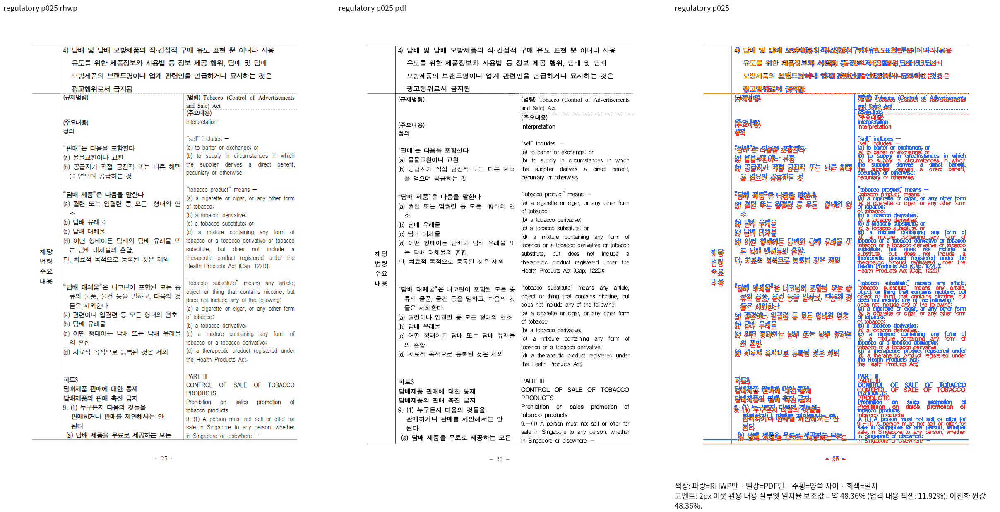
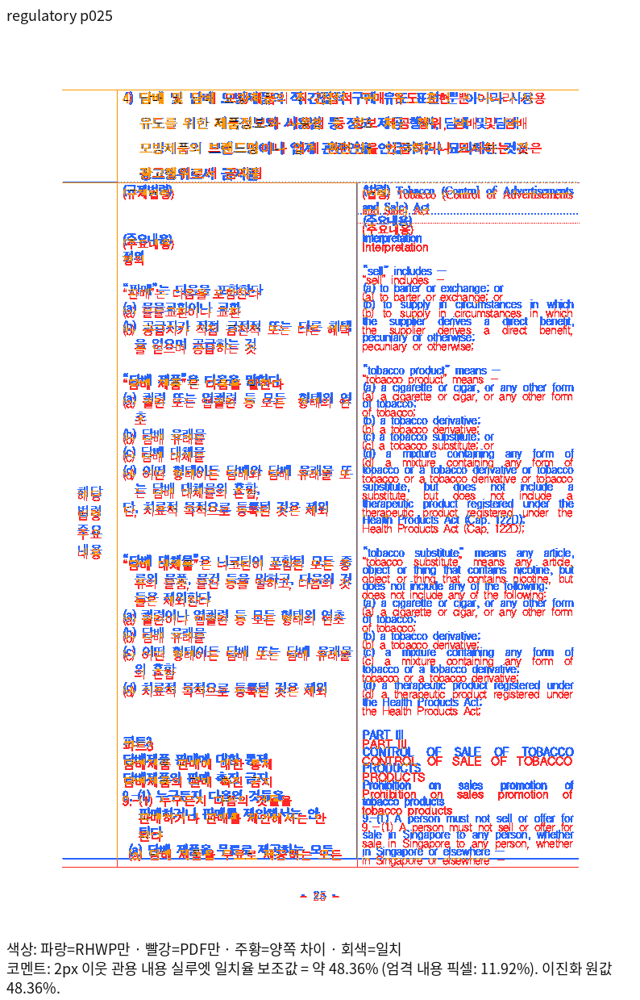

# #7778 기존 미달 회귀의 활성 참조 이관

대표 이슈 [#7445](https://github.com/edwardkim/rhwp/issues/7445), 동일 원본 하위 이슈 [#7778](https://github.com/edwardkim/rhwp/issues/7778).

고정 base `22317614b03722e95349a1d3d71c86923363c6f5`와 보정 전 PR head `edd8dc49eb9d945af08ea31801e5a9f430abea06`의 동일 입력/Print 비교다. 이 PNG는 **기존 미달의 증거**이며 정상 출력 golden이나 해결 증거가 아니다.

- 원본: `samples/issue1921/59043_regulatory_analysis.hwp`, SHA-256 `da9f9c9862475d1710f6ecf93e3ce134726054fe0be0d9523b9d60d1a90c82ef`.
- 독립 한컴 Print: `pdf/issue1921/59043_regulatory_analysis-2022.pdf`, SHA-256 `fade38ba20113ab52eaf42c55eec207943fe66e1b18efdeee06bfa65a1d64fa1`.
- base/current 전체 쪽수37/37. 선택25쪽의 2px 이웃 관용 내용 실루엣은 모두48.36347%; 출력 PNG는 바이트 동일하다. 선택1쪽 미달로 전체 문서90% 선행 조건의 미충족을 확인하며, 전쪽 검증 통과로 주장하지 않는다.
- 직접 판독: 영문 칼럼의 줄바꿈·글꼴 폭, 행 경계와 아래쪽 내용 소속 차이가 남는다. 기존 이관 기록과 같은 원본·전체 피델리티 범위다.
- CI Archive C의 실제 증가4→6건은 별도 실패 기록으로 보존한다. 허용치를6으로 올리지 않고, 사용자 지침에 따라 `text_overlap_baseline`의 해당 활성 corpus 참조와 기준선1행만 이관한다. 원본/PDF 및 다른 파서·쪽수·문서 의미 검사에는 적용하지 않는다.
- 재현: `venv/bin/python scripts/visual_sweep.py --hwp samples/issue1921/59043_regulatory_analysis.hwp --pdf pdf/issue1921/59043_regulatory_analysis-2022.pdf --key regulatory --rhwp-bin <base 또는 current 바이너리> --embed-fonts full --compat 2022 --pages 25 --out <검증 출력>`. 실제 추가 font-path·입력/바이너리 해시·로그는 ignored `output/pr-review/semanticist21-20261008/ci-regression-rebase-v458/`에 보존한다.

