# 원본 HWP3 sample16 전쪽 보정 증적

입력은 `samples/hwp3-sample16.hwp`(SHA-256
`559fd94860cf836d5800436d56055c23a73e59eedef3da273a5ba365e6ed9e16`)이며 변환 HWP5와 구별한다.
기준은 `pdf/hwp3-sample16-current-print-20261017-2020.pdf` 한컴2020 Print64쪽
(SHA-256 `8f0bfd27ae567481e244f39de6f7b596b3afa8b227dce895d4ebf9cebc416bd0`)이다.
MCP job `e5e48314-3620-40cb-a9a8-b90ce3e31348`, 한컴11.0.0.9136, Print method0,
`hancom2020_pdf_driver_one_up`이며 진단 재저장 HWPX를 기준으로 대체하지 않았다.

## 전쪽 측정

C94는 parent `6c8ee5adeca31bf15eace47d1e10a51eea10f4a2`와 다음 두 production 파일의 후보이다.

- `src/parser/hwp3/mod.rs`: `d4bf7d1fdbbe2e76f01ee9c48a621824ba9891daf7a12b83457b3b53d75166ca`
- `src/parser/hwp3/drawing.rs`: `ac85e90030437df6cc584f6d6d4edd3ae2f06885a773b91bdcb7bfa31c38a5fb`

같은 원본·독립 PDF·글꼴, compat2022·Print·192DPI의 실제 Native PNG와 fresh WASM Canvas PNG를
각64쪽 비교했다. Mac WASM은 locked wrapper `--target web --out-dir pkg --no-opt` 로컬 대체 빌드다.
Docker 최적화 빌드 통과를 의미하지 않는다. canonical Visual Sweep의 색상 경계 보정 전2px
`silhouette_raw_match_percent`이며 엄격 RGB 픽셀 일치율이 아니다.

| 범위 | Native | fresh WASM |
| --- | ---: | ---: |
| 전체 쪽수 / 독립 PDF |64/64|64/64|
| 전체 최저 |91.52306%|91.77199%|
|90% 미만 / 누락 |0/0|0/0|
|3쪽 |99.49622%|99.47834%|
|6쪽 |91.52306%|91.77199%|
|19쪽 |99.56267%|99.55065%|
|33쪽 |99.25546%|98.53604%|
|고정 devel 대비0.01%p 이상 하락 |0쪽|0쪽|

고정 devel은 `9415b920c8dec299e8ada69b01dbd1c3c044f1f1`이다. 같은 backend별64쪽을
Decimal로 대조했으며 양쪽 모두 하락 목록이 비었다. 이전 후보의21–23쪽 하락도 복구했다.
전체 TSV·PNG·빌드/글꼴 출처·비교 JSON은 ignored
`/Users/tsjang/rhwp/output/pr-review/7445-completed-20261009/rebase-9415b920-20261017/hwp3-original-repair-c94/`
아래에 보존한다. `paired-qualification.json`은 두 TSV SHA와 base 비교를 연결한다.

## 직접 판독과 검사 선택

3쪽의 세 제목과 첫 상자의 위치·그라데이션,33쪽의 빈 시작 줄·제목·본문 표 소속·간격을
Native/WASM review와 overlay에서 확인했다.3쪽은 세 제목의 PDF 기준선119.4/269.28/578.4pt,
33쪽은 본문 표 윗선100.57pt를96dpi CSS px로 환산해 ±2px 검사와 소속·순서 검사를 함께 둔다.
상자 선 종류·둥근 모서리·전이 위치는 V3 원본과 독립 재저장본의 속성으로 검사한다.

6쪽은 수식 두 개가 나타나며 본문 순서와 뒤 문단이 복원됐으나 분수·괄호와 기준선의 미세 차이가
남아 있다.6쪽은98% 미만이므로 절대 px 핀을 추가하지 않는다. 스크립트·글자 취급·원본 글자 크기·
기준선·추출 순서를 검사한다.63쪽 원 기호 모양에도 차이가 남아 있으며 완전 일치로 보고하지 않는다.
이번 전쪽90% 수치는 PR 전체 검증 완료나 남은 수식 차이의 해결을 뜻하지 않는다.

## 대표 이미지

###3쪽

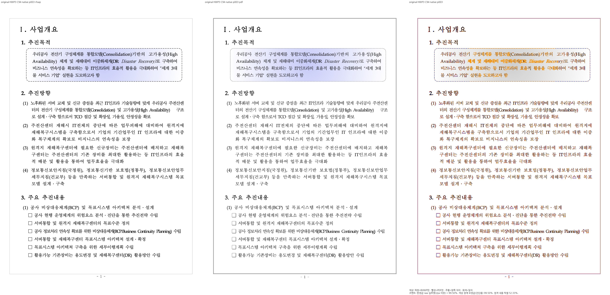
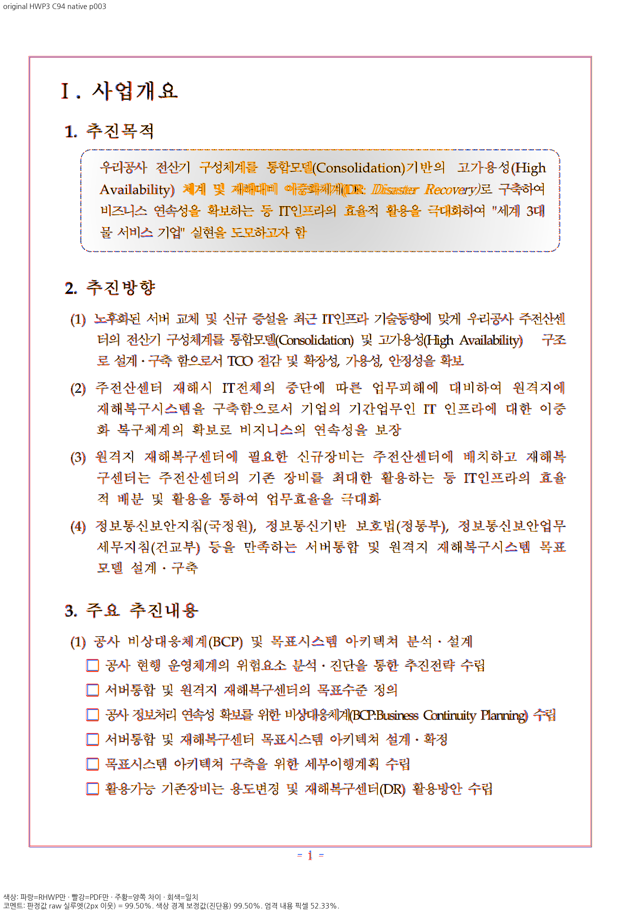
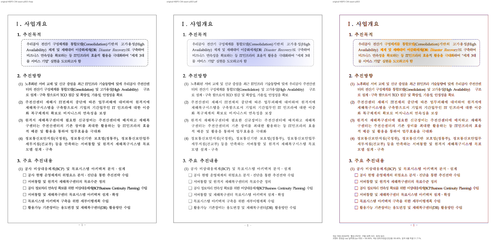
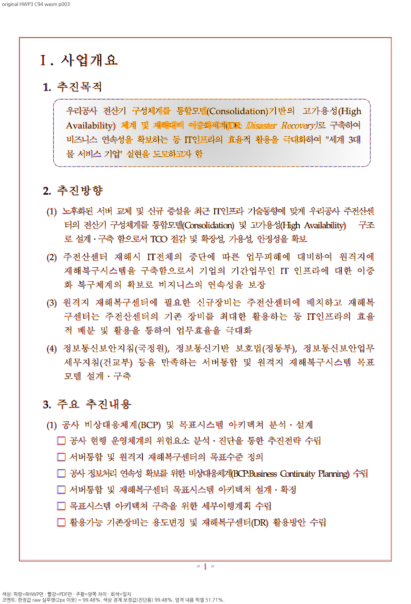

###33쪽

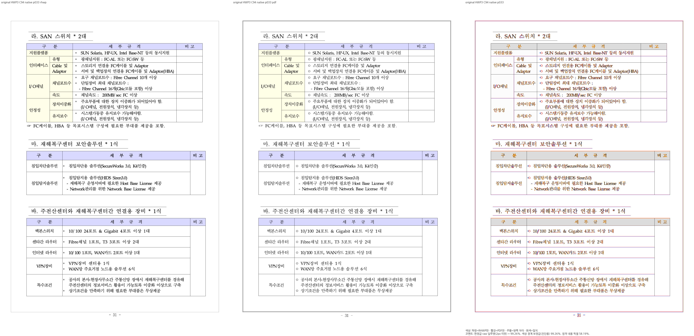
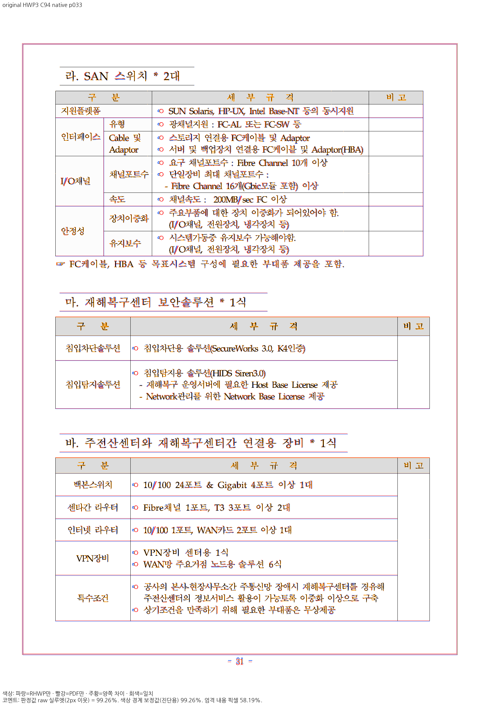
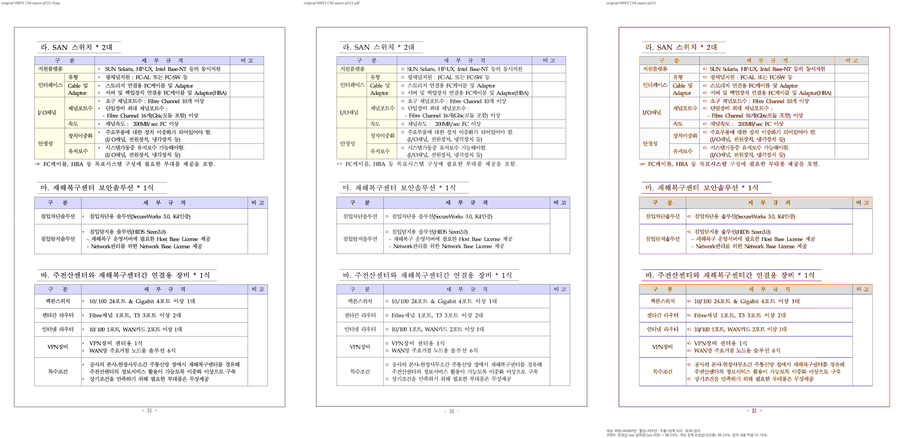
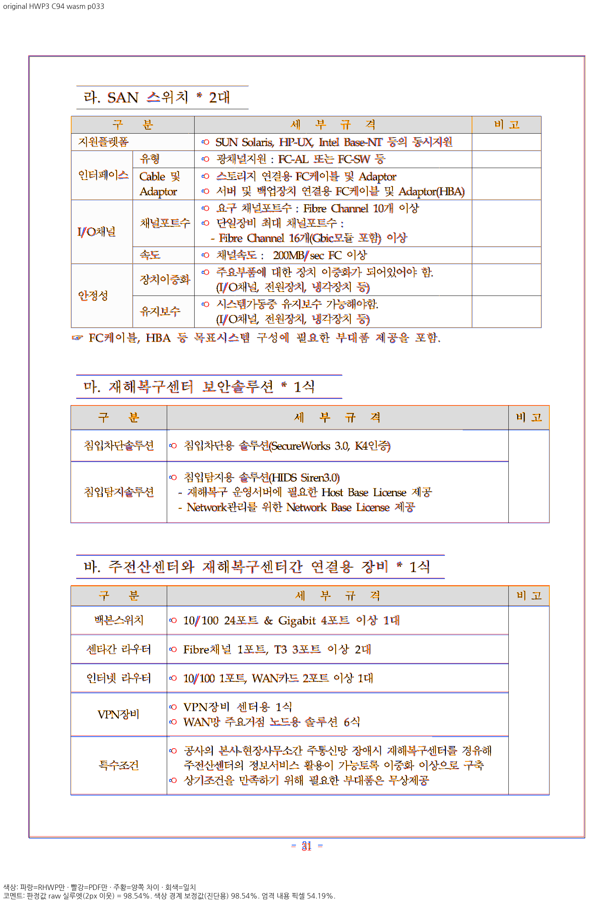

###6쪽 잔여 차이

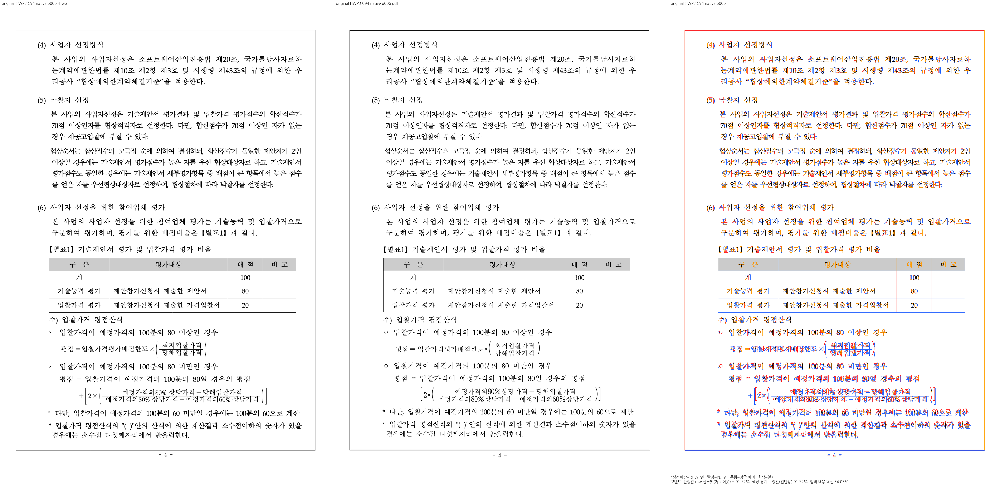
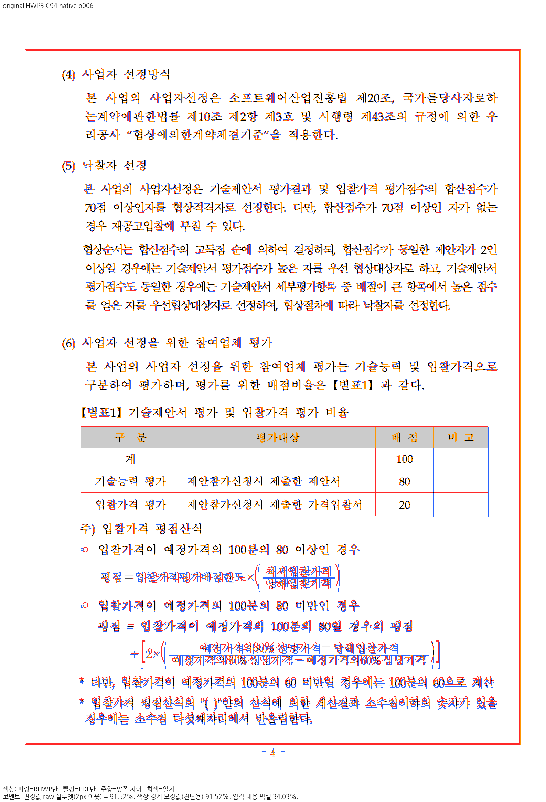
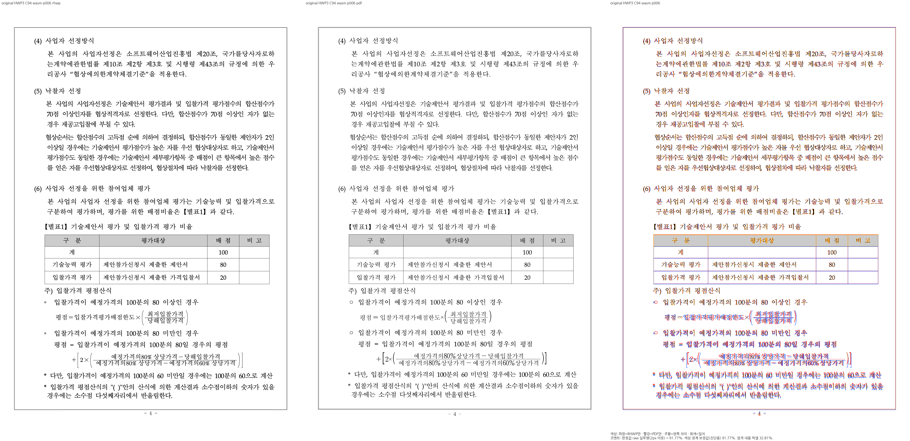
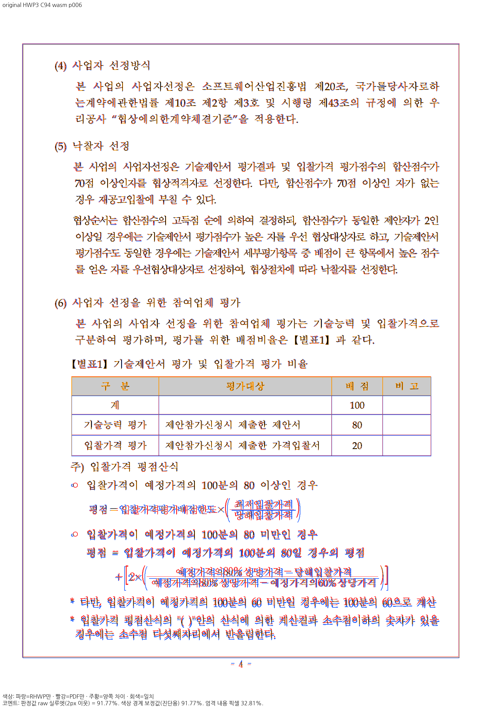
