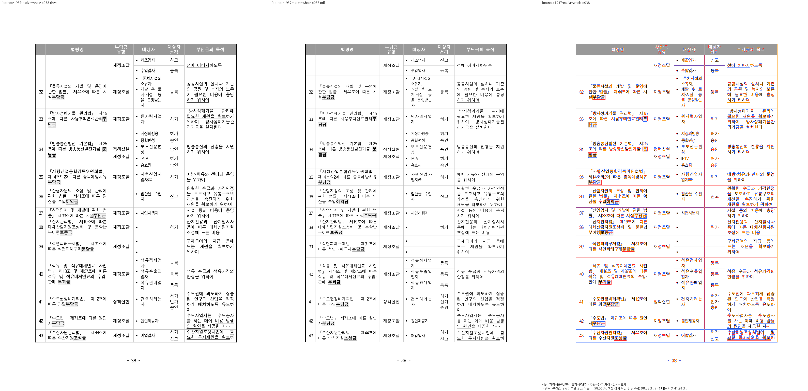
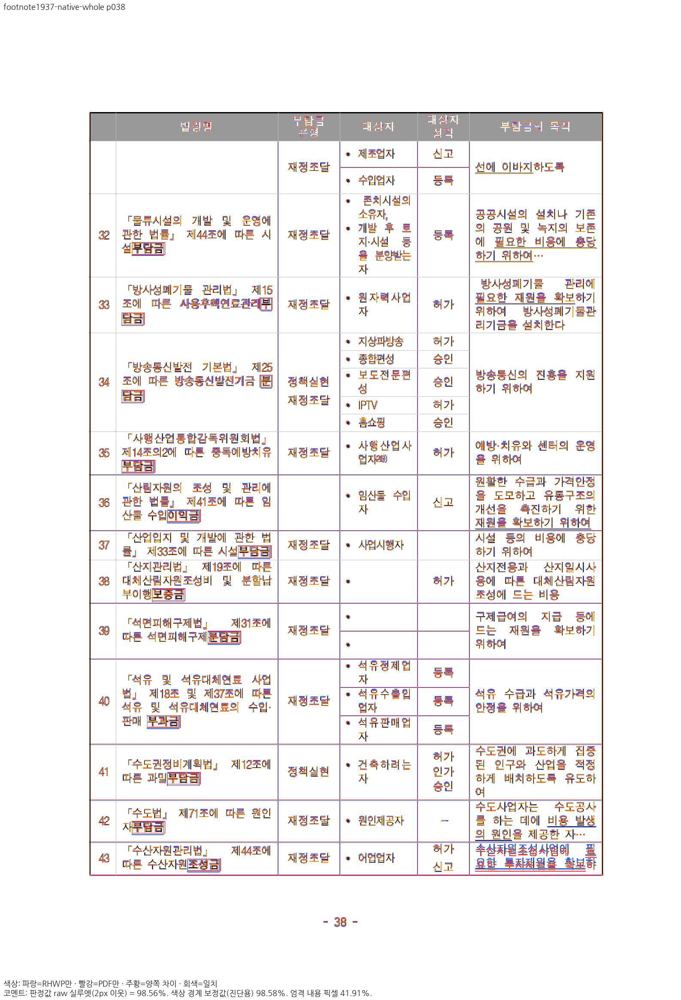
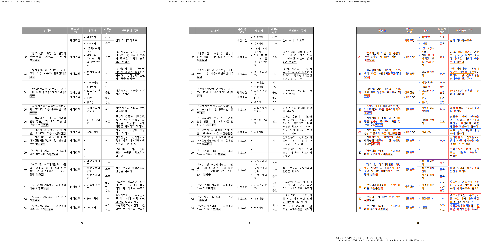
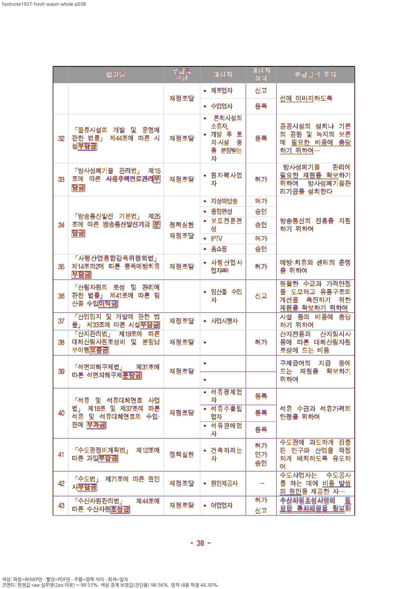
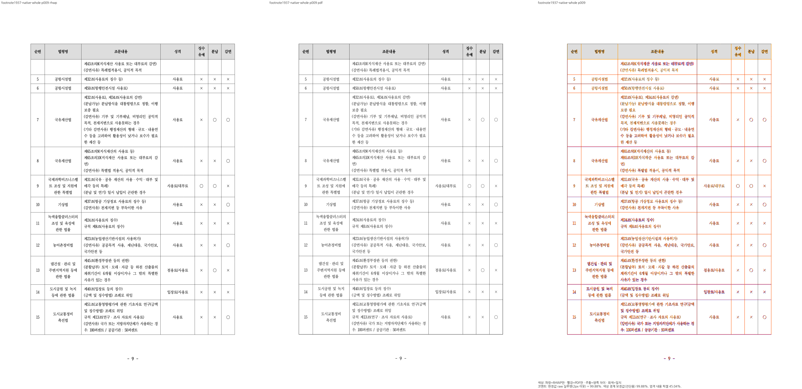
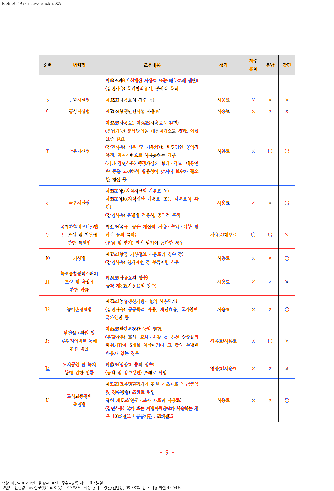
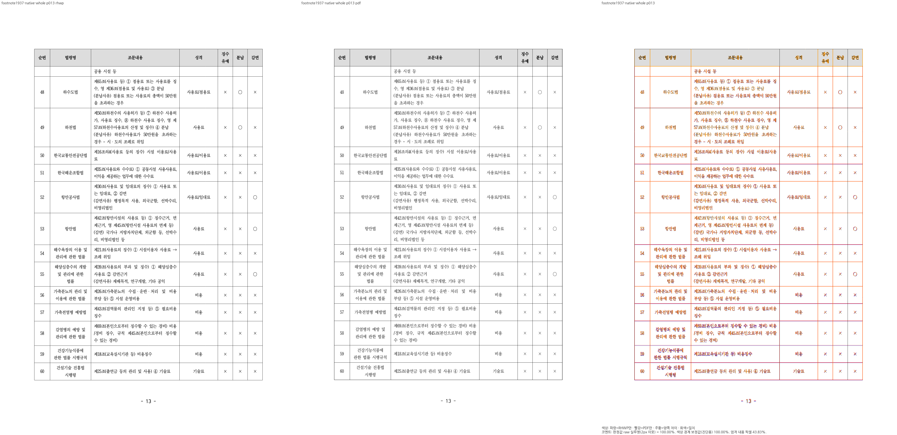
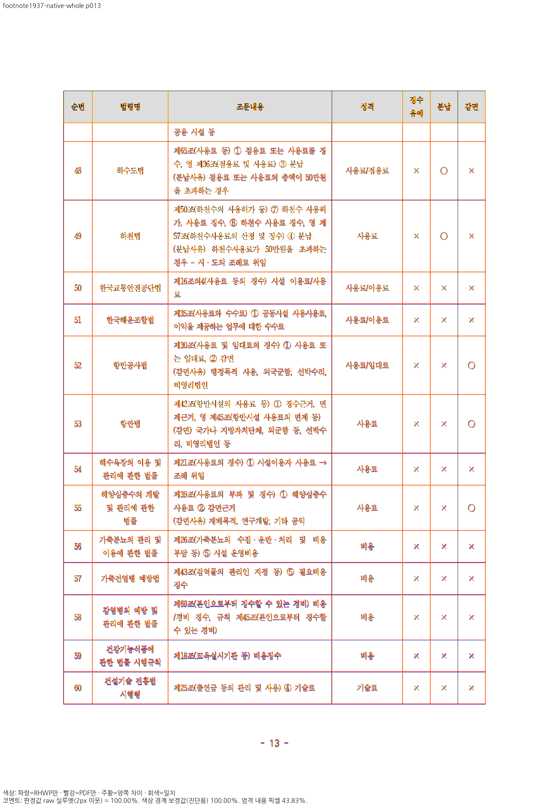

# 완료 병합 꼬리 정렬·표/각주 공간 소유

원본 `samples/issue1937_rowbreak_footnote_overpagination.hwp`와 같은 바이트의 독립 한컴
Print50쪽을 사용했습니다. base `4a07d3ae4dd3255a57fb0166b2b2a2dc335a61fa`, parent
`979dbf4ebd72fbd0f72bb1efd01f882cdd16d7ea`+보정10의 원본 파일·생산 hash는
[validation.json](verification.md)에 있습니다. Native/fresh WASM 전쪽 원본은
[native.tsv](native.tsv), [wasm.tsv](wasm.tsv)입니다.

192DPI/compat2022·현행 PDFium smooth_rgb_v1·색상 경계 보정 전2px/raw90%입니다.
각50/50쪽, Native최저94.90661%,WASM94.96082%,90%미달0입니다. Mac WASM은 locked
web/pkg/no-opt 로컬 대체 빌드입니다. 직전 후보와 비교해38쪽만 각각+1.41870/+1.41415%p이고
나머지49쪽씩은 점수가 같습니다. 모든 #7445 개선 또는 전체 PR 검증 완료의 증거는 아닙니다.

## 완료 꼬리38쪽

‘정책실현’ 앞 조각과 ‘재정조달’ 뒤 조각의 내용 소유를 유지하고,뒤 조각의 원본Center가
실제 수용한 두 독립 일반 행 상자에 적용되는 것을 양쪽PNG로 확인했습니다.

## 중요한 첫 종료·이어받기 경계9/13쪽

Native/WASM raw 각각9쪽99.88474/99.88906%,13쪽99.99969/99.99970%입니다.
같은 독립PDF의 괘선 좌표를96DPI CSS±2px로 보호하고 쪽 소유·602셀 원문 보존·각주
이어받기를 함께 검사합니다. 실루엣100%를 엄격RGB 픽셀 동일로 설명하지 않습니다.

37쪽 앞 조각 등 기존 잔여 정렬을 이번 완료 꼬리 보정으로 해결했다고 주장하지 않습니다.
원PR1976→통합1998의 각주 예약 continuation 계약과 정상 대조군을 유지합니다.
