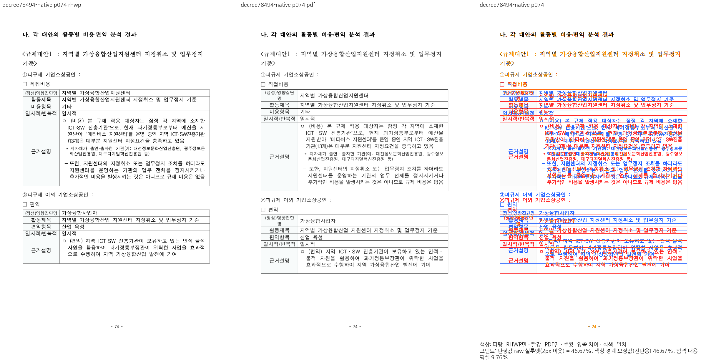
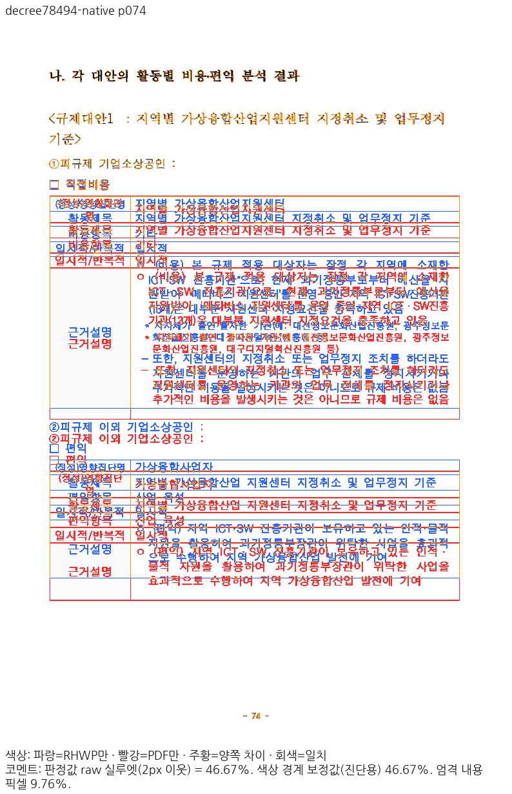
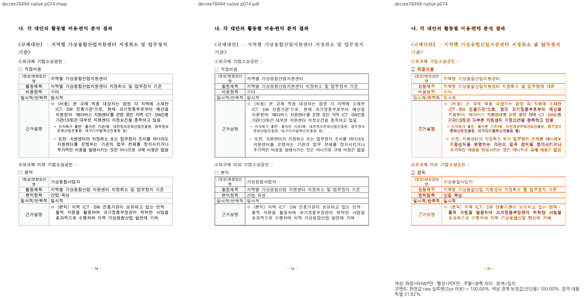
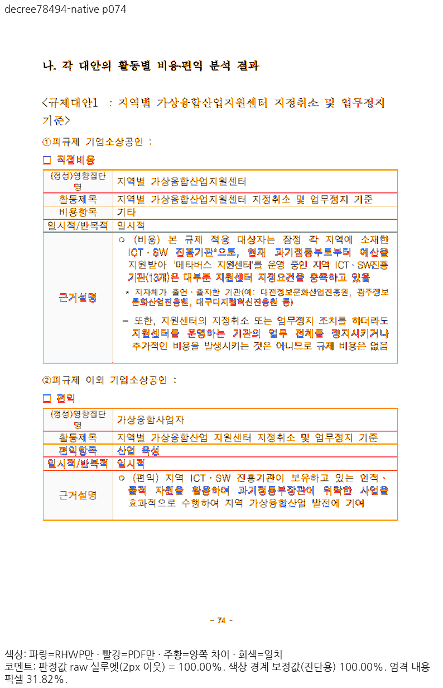
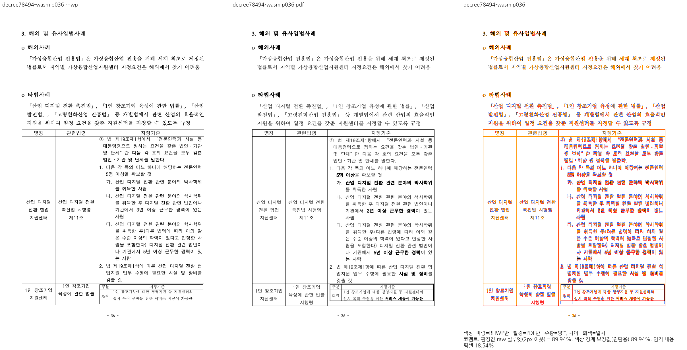
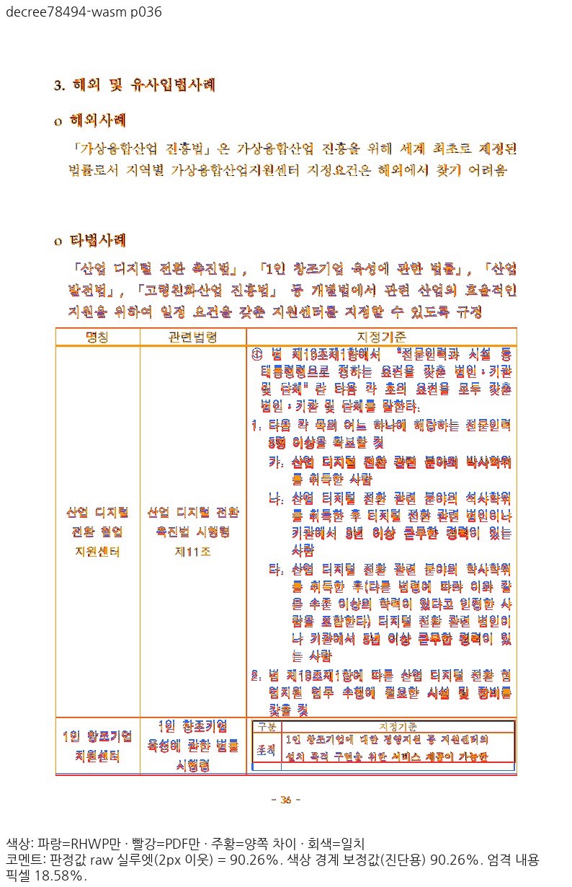
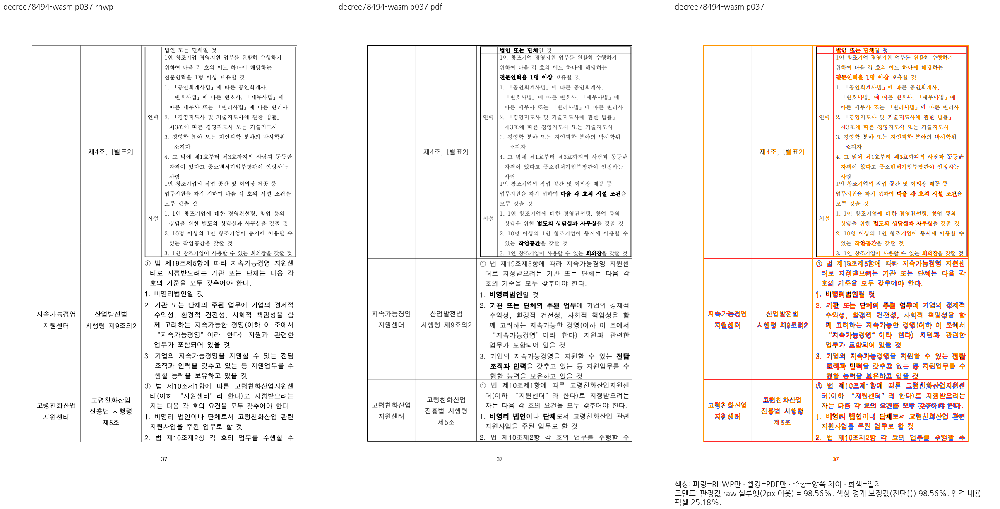
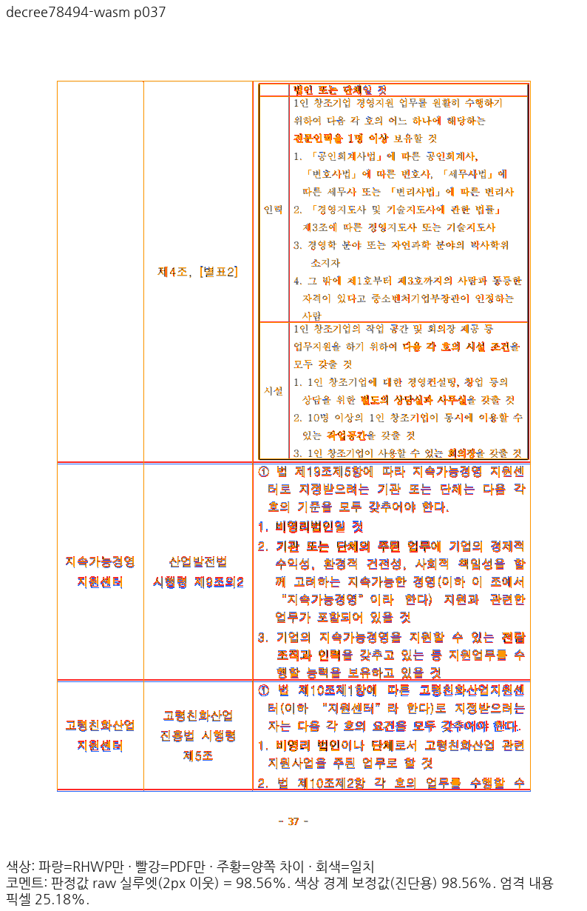
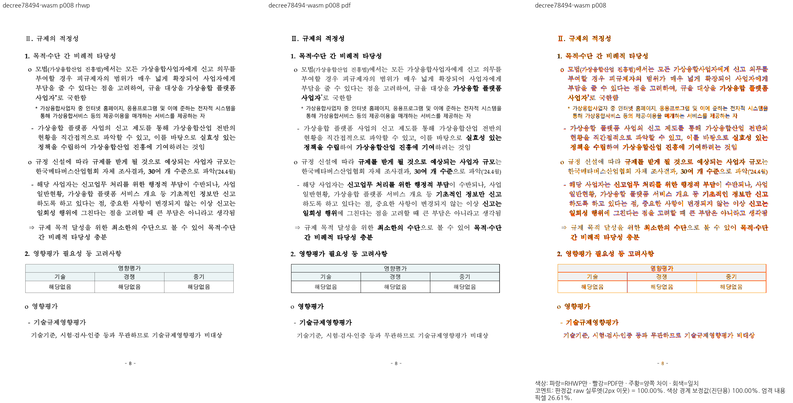
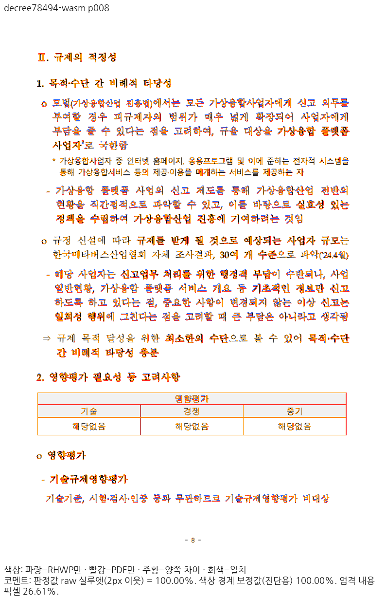

# 78494 원본 글꼴 레코드와 병렬 셀 종료 간격

## 입력·독립 기준과 실행 범위

- 입력: `samples/issue6776/78494-virtual-convergence-industry-decree.hwpx`.
  실제 형식은 HWP5/한컴2018 저장본이며 SHA-256은
  `5090e9d20ce75814febeb4b79e106ea6abfd2546e511f229900d137d42623617`다.
- 독립 Print: `pdf/78494-virtual-convergence-industry-decree-2020.pdf`,74쪽,
  SHA-256 `367fb3749f571521eef2036fe4327ce5b9cf6b7728966257328c1144f08ff8c9`.
- 기존96DPI/compat2022/Print/PDFium `smooth_rgb_v1`/2px raw90% 계약을 유지했다.
  다른 동일 제목 PDF나 HFT 부분 글꼴 공급으로 기준을 바꾸지 않았다.
- `before-font`는 C448 코드 `67b0857298f4cf44b54963f0d19733143a62f670`와
  runtime 파일 전체 hash가 일치하는 frozen310 Native/frozen312 WASM이다.
  `before-closing`는 원본 주소별 프로그램 선택만 적용한325/330,
  `after`는 선택과 셀 종료 보정을 함께 적용한341/343이다.
- Mac fresh WASM은 locked wrapper `--target web --out-dir pkg --no-opt` 실제 로컬 대체 빌드다.
  Docker 최적화 결과가 아니다. Native는 `native-skia` CLI의 실제 PNG다.
  이 문서의 fresh WASM 전쪽 출력과 별도 Studio Canvas/CanvasKit actual36은 구분한다.

## 전쪽 결과

| 단계 | 경로 | 쪽수(출력/PDF) | raw 최저 | 90% 미만 | 전쪽 원문 |
| --- | --- | --- | --- | --- | --- |
| before-font | native | 74/74 | 46.67111% (p74) | 21, 36, 42, 59, 61, 74 | [TSV](before-font-native.tsv) |
| before-font | wasm | 74/74 | 46.63944% (p74) | 21, 36, 42, 59, 61, 74 | [TSV](before-font-wasm.tsv) |
| before-closing | native | 74/74 | 90.17252% (p36) | 0쪽 | [TSV](before-closing-native.tsv) |
| before-closing | wasm | 74/74 | 89.93811% (p36) | 36 | [TSV](before-closing-wasm.tsv) |
| after | native | 74/74 | 90.48680% (p36) | 0쪽 | [TSV](after-native.tsv) |
| after | wasm | 74/74 | 90.25539% (p36) | 0쪽 | [TSV](after-wasm.tsv) |

두 before와 after의 Native/fresh WASM을 각각 Decimal로74쪽씩 비교했다.
0.1%p 이상 하락은 네 비교 모두0쪽이다. 이 비교는 부모 후보 보존 증거이며,
고정 `upstream/devel`의 전체 출력/리베이스 유입 기능 검증을 대신하지 않는다.
TSV는 기존 PNG의 부분 수치를 붙이지 않고 각 실행의 전74쪽을 다시 산출했다.
누락·중복 쪽 번호0, 모두74/74쪽이다.

## 원인과 실제 소비

같은 원본 이름 `한양중고딕`이 언어0/1/2/3/5의 `HY중고딕`과4/6의
`함초롬돋움` 프로그램을 선언한다. 이름 하나의 전역 사전에서 충돌을 버리던 경로를
원본 언어 슬롯/글꼴 ID/원본 이름/프로그램 신원으로 보존했다. 실제 HY/HCR TrueType
프로그램을 공급해 측정과 paint가 같은 최종 선택을 소비함을 확인했다.
이 원본의 TrueType 공급에 HFT 검토 전용 부분 OTF를 섞었던322/326은 최종 증거가 아니다.
HFT 문서나 유효한 CFF 프로그램을 차단하는 제품 예외를 추가하지 않았다.

표331/셀7/문단0의 마지막 `시행령`은 독립 Print36쪽 소유다. 옆 셀8의 중첩 표가
현재 텍스트 셀의 종료 간격 제외를 막아37쪽으로 넘어갔다. 가시 점유와 여백74.16px는
현재 물리 조각77.16px 안에 든다. 셀의 동일한 유닛 분류를 측정/컷 예약에서 소비하며,
행 전체가 필요한 호출은 계속 모든 소유 셀을 확인한다. 중첩 셀·개체·TAC의 제외는 유지한다.
측정과 paint 전진이 다르다는 초기 가설은 기각했다. 실제 전진은 둘 다27.2px다.

Native 전74쪽 render tree의 문단/셀 경로2451개는 before/after 텍스트가 모두 동일하다.
쪽 소속 변화는 라벨 첫 문단의 `[36,37] → [36]` 하나이며, 별도 조문 번호 문단은37쪽을 유지한다.
이는 Native 소유 감사이며 전74쪽 WASM의 별도 텍스트 감사로 주장하지 않는다.

## 직접 판독과 핵심 검사

8·36·37·74쪽의 양쪽 review/standalone overlay를 직접 판독했다. 완료된 다른 실행의
같은 raster를 판독한 경우 현재 PNG/PDF PNG 두 hash와 producer를 모두 대조해 동일성을 확인했다.
8쪽의 하이픈과 첫 한글 시작/기준선,74쪽 두 줄 셀 라벨과 후행 행,
36쪽의 `시행령` 포함 및37쪽 조문 번호의 중복 없는 이어받기를 확인했다.
미세 글꼴 두께/AA와 가는 괘선 래스터 차이는 남으며 완전 glyph 동일성으로 쓰지 않는다.

8쪽은 Native99.99885%/fresh WASM99.99884%다. 원본 s0/p73/char2 하이픈과 char3 이후
첫 한글을 소유 주소로 골라, 독립 PDF의 cm/Tm에서 계산한95.52/111.52px 원점과538.56px
paint 기준선을 ±2 CSS px로 보호한다. 과거 분리한 첫 줄의 `사업` 종료·다음 줄
`일반현황,` 시작·독립74쪽 계약도 전체 원문 순서/보존과 함께 복원한다.
36쪽에는98% 조건을 충족하지 않은 px 핀을 만들지 않고 셀/문단 소속·포함·누락/중복 관계를 쓴다.
레이아웃 검사의 공급 snapshot 모형과 실제 glyph/program 공급 증거는 구분한다.

## 대표 그림

### 글꼴 프로그램 선택 — 74쪽 Native 전후

### 셀 종료 — 36쪽 fresh WASM 전후

### 이어받기 — 37쪽 fresh WASM

### 핵심 구두점 — 8쪽 fresh WASM

## 정식 집중 회귀

선택 프로토콜10·혼합 꼬리1·그림 RowBreak3·합성 셀 간격2와 최종 원문 소속/좌표2의
18건이 정식 helper/nextest에서 통과했다. Native/WASM Clippy·fmt·manifest도 exit0이다.
최종 원문 검사 동일 소스는 동결325에서1PASS/1FAIL,341에서2PASS다.
함수 수 변경 뒤prepare한 실제suite002에서 최종2건을 실행했다. 전체 nextest 통과는 아니다.

## producer와 로컬 원장

부모 HEAD는 `67b0857298f4cf44b54963f0d19733143a62f670`이며 후보 runtime patch SHA-256은
`da9bef9672b199dee3567748c9264d9d6f096a8628d7b631c843a2e0bfc2639e`다. 현재 후보 runtime 파일 hash:

- `src/renderer/font_environment.rs`: `976814f9c20af1c54c547930ee3b25c93f098db2e6e7c98d46cc0869a6784d15`
- `src/renderer/style_resolver.rs`: `c343d74352db5a7f7dab1da1683225109b15121c26ca16846adde0036e17a240`
- `src/renderer/layout/table_layout.rs`: `8547c91c121cffcb00b35d9b050c20b539dc1678b18aebc7bcbbd11910e9a707`

Native CLI SHA-256: `e9ed9607703cb5c219231c1aa8c73cf3a5ed5a8f3886218494cf2a9b50465cd9`.
fresh WASM SHA-256: `70ca03965d8d6474ed32315b7e25cdeebc6ba2388ff9532e7716f150306ecaaf`.
JS SHA-256: `23f085e36c78d952ddac0d91faed9752f33ee1124db78e290382687410917591`.
Root pkg/Studio public은 동일한 bytes이며 실제 초기화 WASM 응답도 일치했다.
JS 응답은 Vite의 정확한 asset URL 치환과 inline source-map로 원본에 연결했으며,
응답 raw hash 자체가 원본 JS raw hash와 같다는 뜻이 아니다. 실제 초기화 true/오류0이다.

상세 로그/JSON/글꼴 프로그램은 ignored 로컬
`output/pr-review/7445-completed-20261009/rebase-4a07d3ae-20261019/`의
repair341/343/344/345/348/350/352/353/354 원장에 보존한다.
이 폴더에는 PNG·전쪽 TSV·설명만 보존한다. 이 문서의 한 단계 보정은
다른 잔여 문서·전체 nextest·최신 devel 비교·actual36을 포함한 PR 전체 완료 선언이 아니다.
PR과 외부 게시는 사용자 별도 승인 전 진행하지 않는다.
