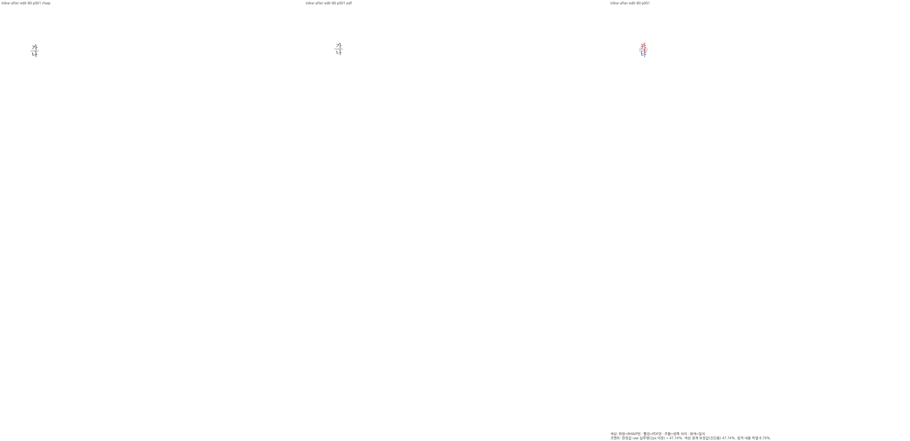
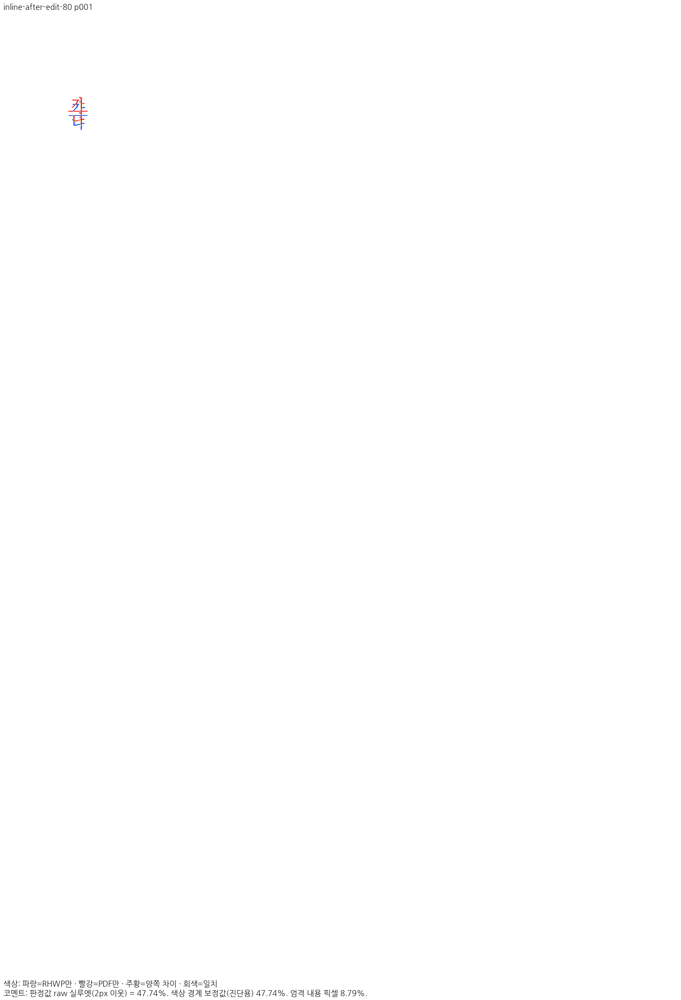
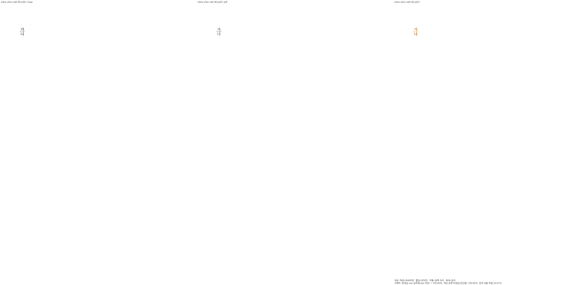
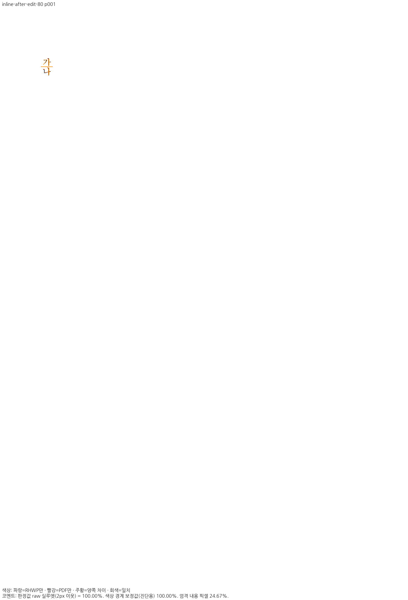

# HFT 기준선 편집의 기존 검사 보정 증거

stage8 C429의 국소 보정 증거입니다. 전체 시각 검증·PR 수용 완료가 아닙니다.
정확한 동일 입력의 independent Hancom2024 Print, 192DPI/2px raw 조건입니다.
기존4상태와 새 생산2상태는 Native/fresh WASM 모두 전1쪽100%·1/1쪽입니다.
TSV는 원본 그대로 복사했습니다. 100%는 RGB byte 동일성의 뜻이 아닙니다.

- before: runtime72ef9c21bec6ee20a5aed74a1c329220454f8de9, frozen27.
- after: parent3d023ba4d7a1abec664c1697e8d46a8b6fb89602 + 아래 source patch의 frozen36/fresh37.
- source patch SHA256: `8541253a817ea73f858587cf1899e8eb2d80f92dd4e5f4ca0f373be2d9160f80`.
- frozen Native/rlib·전체 source ledger와 command/log는 ignored repair36에 보존합니다.
- Mac fresh WASM은 locked web/pkg/no-opt 대체 빌드이며 Docker 최적화가 아닙니다.
- WASM SHA256: `0706f7a344f77b7eec2099ca4776068838498d2819395f4a635c89613f3f4a27`.
- Native/fresh WASM의 서로 다른4개 실제 PNG 그룹을 review/overlay로 직접 판독했습니다.
- 기존 실패 입력은 보존했습니다. 새 셀 생산 높이는2760→2808HU이며 이전 입력과 섞지 않습니다.
- 검사 prototype 수정 전7PASS/2FAIL→수정 후9PASS, 정식 실행9+2=11PASS/0FAIL입니다.
- 실제 glyph 원점/내용 순서/소유/포함을 검사합니다. 바깥 bbox가 움직인다는 잘못된 기대값은 제거했습니다.
- 기존 분수 괘선의 독립 Print ±2CSSpx 보호는 유지합니다.

| 상태 | 입력 SHA256 | 독립 Print PDF SHA256 |
| --- | --- | --- |
| existing-inline-after-edit-67 | `debf81898c3b016dfab102040f0c787a485d4b8d4ebc134f44afd2a763b389f0` | `cec6020e72bed90ac3788c84a0d1e181f2b0c8da9d10cd5c32042db51153b97e` |
| existing-inline-after-edit-80 | `553b935e8dd1517fe3ed07f9ab6ec9b863bc7c5c40738fbf0dc925504bb7485f` | `722a2ab02269415f9497f45e346cb0fc95d106080d8ef80144da1fccd0a05fb3` |
| existing-cell-after-edit-90 | `fe2bc3ac3cc32482b9c0065d45cea0c808b0ff0aea119e3dd5722af888046824` | `5b3a653f905878d800233978c9bfd519173a893bc878f235ac3edae330ee38ba` |
| existing-cell-after-edit-95 | `b57b6162d29e931f1d5912692d409212e8dee0cdc49e3be370e9d1c4f2663686` | `bcf6e1d49537bc0afc863c71e017e90310a3749d0ff41c3f12fb0b33bdc50272` |
| current-cell-after-edit-90 | `8a48f0fd6114bce20576d8615215379a8c42ffbfa02d2d32d6c2d69241264c18` | `71c59c00b8bab14320b8f3f2df4ba2dffc862033749579b01c3bd8512715b612` |
| current-cell-after-edit-95 | `07821b8b148ff7356cfdb26889208fc65033e9ab4be78a4b72e3b6e82085bfcb` | `3322b57c82692f7fc40abbf1d1afd896b3d1c0e3942be5883830f18e443dfc64` |

## 같은 기존 inline80 입력의 전후

복합 CJK/괄호 프로그램·논리 폭 차이는 남아 있으며, 현재 전체 nextest/전쪽/incoming 기능 보존/실제 제품 소비 검증은 완료 전입니다.
