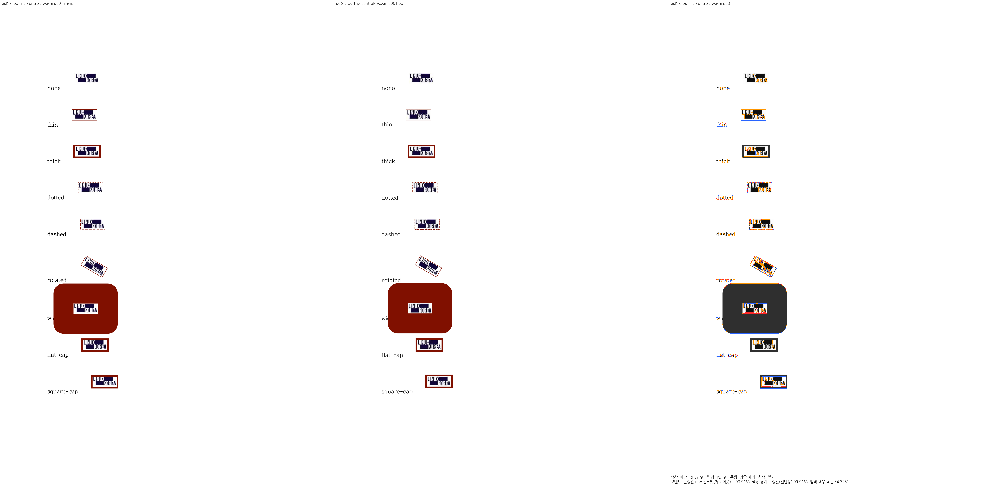
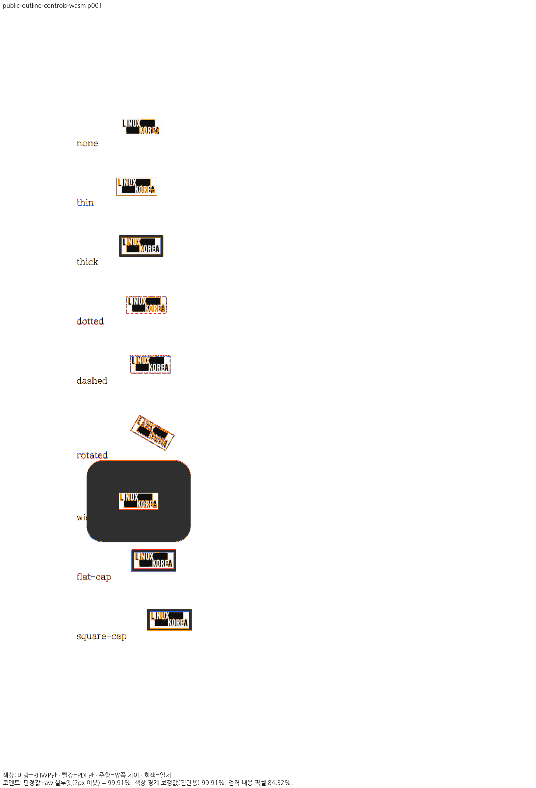
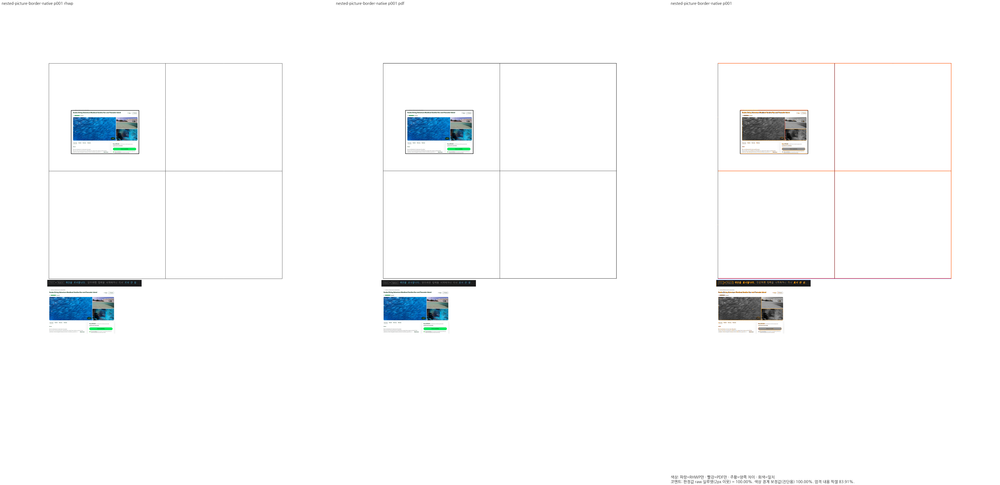
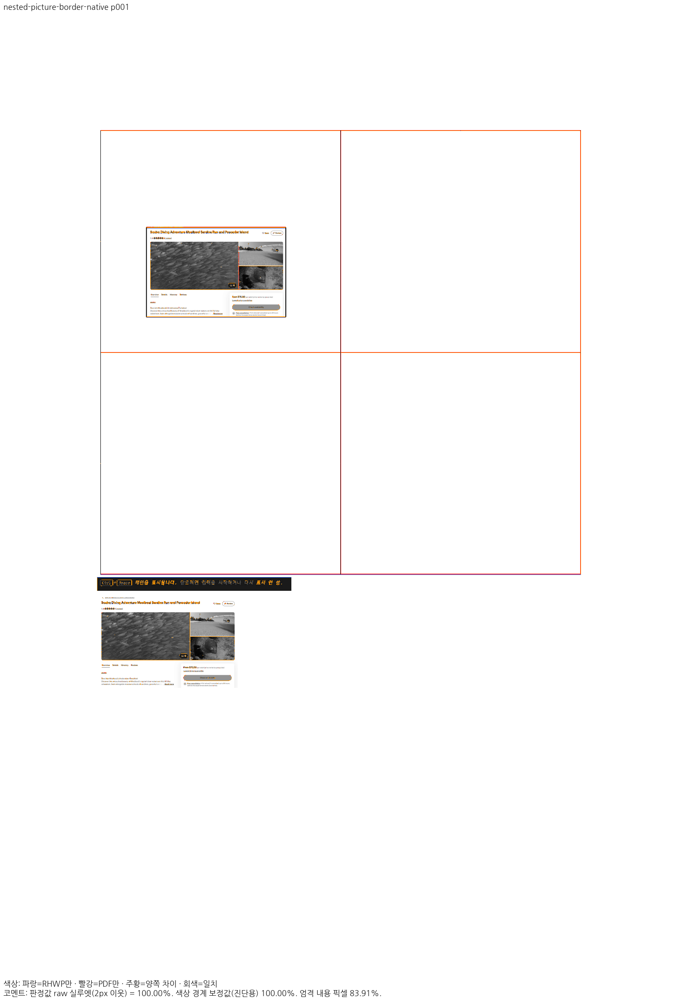
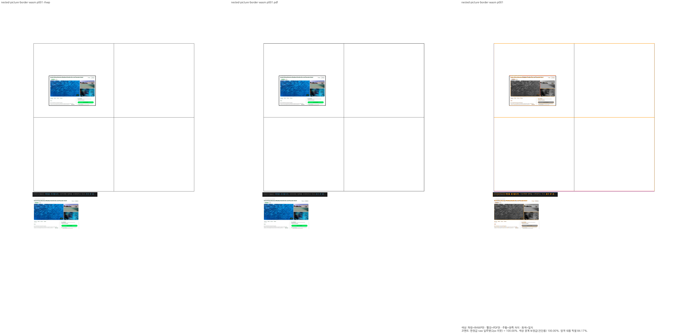
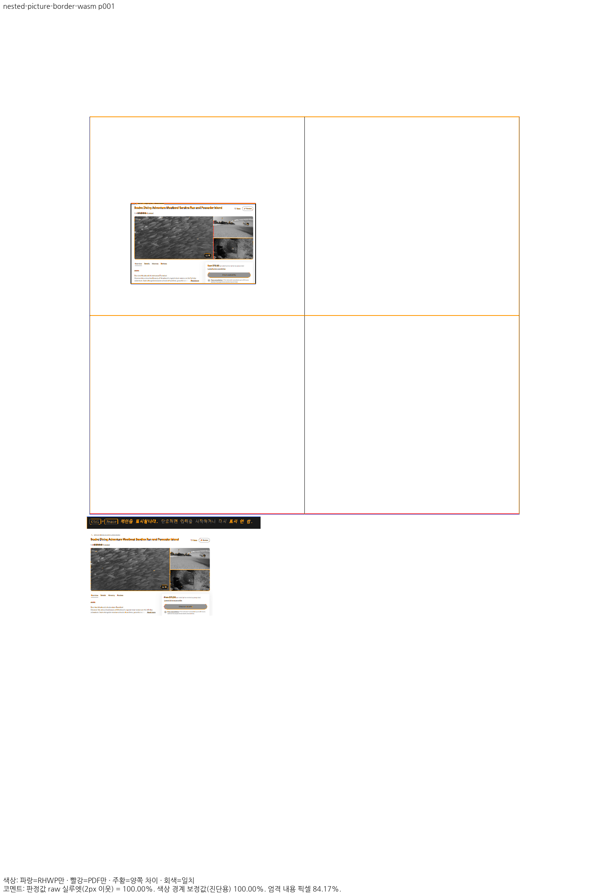

# 그림 프레임·외곽선 소유: 최종 집중 증적

Native713/fresh WASM714, schema1.28,192DPI/compat2022(기존90도 대조군만2024), PDFium smooth_rgb_v1/색상 경계 보정 전2px 실루엣.

각 문서 전쪽 TSV를 바이트 그대로 복사했다. Native/fresh 각각6조건51쪽이다. 전체 PR·전체 corpus·actual36 완료는 아니다.

| 문서 | 쪽수 | Native 최저 | fresh WASM 최저 | Native TSV | WASM TSV |
|---|---:|---:|---:|---|---|
| original | 16 | 99.01890% | 98.86844% | [전체](native-original-all-pages.tsv) | [전체](wasm-original-all-pages.tsv) |
| current-hwp | 16 | 98.99647% | 98.84560% | [전체](native-current-hwp-all-pages.tsv) | [전체](wasm-current-hwp-all-pages.tsv) |
| current-hwpx | 16 | 98.99933% | 98.84898% | [전체](native-current-hwpx-all-pages.tsv) | [전체](wasm-current-hwpx-all-pages.tsv) |
| public-outline-controls | 1 | 99.90570% | 99.90577% | [전체](native-public-outline-controls-all-pages.tsv) | [전체](wasm-public-outline-controls-all-pages.tsv) |
| nested-picture-border | 1 | 100.00000% | 100.00000% | [전체](native-nested-picture-border-all-pages.tsv) | [전체](wasm-nested-picture-border-all-pages.tsv) |
| quarter-turn | 1 | 100.00000% | 100.00000% | [전체](native-quarter-turn-all-pages.tsv) | [전체](wasm-quarter-turn-all-pages.tsv) |

## 독립 입력·PDF 신원

### original

- 입력: `/Users/tsjang/rhwp-7445-completed-20261009/samples/issue_265.hwp`
- 입력 SHA: `645525c8cd5ec11b1742ba7cfc759f68622861916233b5e982385cdb12f0ced2`
- 독립 Print PDF: `/Users/tsjang/rhwp-7445-completed-20261009/pdf/issue_265-hwp-2020.pdf`
- PDF SHA: `c8e4218c7b80f1fb4f7877f5613eb6fd82fa1ca2b1ca3cde6266b81586357302`

### current-hwp

- 입력: `/Users/tsjang/rhwp/output/pr-review/7445-completed-20261009/rebase-4a07d3ae-20261019/repair699-current-picture-public-save/current.hwp`
- 입력 SHA: `6dbf34bc4a46b631f0fe801d71f35307caf5c8a5807f598a9b06a9fc6a796c34`
- 독립 Print PDF: `/Users/tsjang/rhwp/output/pr-review/7445-completed-20261009/rebase-4a07d3ae-20261019/repair655-picture-frame-public-save/current-hwp-2020.pdf`
- PDF SHA: `8f975f371674e4f15b0f2559ed2bf7561322b5f755fa7a2265c5cc66c59ef22d`

### current-hwpx

- 입력: `/Users/tsjang/rhwp/output/pr-review/7445-completed-20261009/rebase-4a07d3ae-20261019/repair699-current-picture-public-save/current.hwpx`
- 입력 SHA: `f80dc77e884d59fe5a1e3d402d823846ba20800769c051cdcc0d51410666468e`
- 독립 Print PDF: `/Users/tsjang/rhwp/output/pr-review/7445-completed-20261009/rebase-4a07d3ae-20261019/repair655-picture-frame-public-save/current-hwpx-2020.pdf`
- PDF SHA: `4474703b5b521b7180d3b215e720b3aaf6868b8b41788ad250e092001297faf6`

### public-outline-controls

- 입력: `/Users/tsjang/rhwp/output/pr-review/7445-completed-20261009/rebase-4a07d3ae-20261019/repair687-public-picture-cap-controls/public-picture-outlines.hwpx`
- 입력 SHA: `b352bae1c818f19c0a44fec71495d8c5dc560a243f3d73c69b430a20c64d4227`
- 독립 Print PDF: `/Users/tsjang/rhwp/output/pr-review/7445-completed-20261009/rebase-4a07d3ae-20261019/repair687-public-picture-cap-controls/public-picture-outlines-2020.pdf`
- PDF SHA: `482da4c3708c454b8620a8f04fb983f727b93b18207979ecc7b0394fd4f1505b`

### nested-picture-border

- 입력: `/Users/tsjang/rhwp/output/pr-review/7445-completed-20261009/rebase-4a07d3ae-20261019/repair698-nested-picture-single-owner-control/nested-picture-border.hwpx`
- 입력 SHA: `1a9b4dcd251dff00f391cb47901d041339ef435da6b335335fa4386f110ef53c`
- 독립 Print PDF: `/Users/tsjang/rhwp/output/pr-review/7445-completed-20261009/rebase-4a07d3ae-20261019/repair698-nested-picture-single-owner-control/nested-picture-border-2020.pdf`
- PDF SHA: `27fd0067584e8cf17dd5dbcb86b3e49f8c1a310ea93c21b452f0027c61dded11`

### quarter-turn

- 입력: `/Users/tsjang/rhwp-7445-completed-20261009/samples/issue5595_rotated_picture_topbottom.hwpx`
- 입력 SHA: `891298cf968d714cc0f5b0169644e16ac10b6718ccaaa527c06aa6194dac8047`
- 독립 Print PDF: `/Users/tsjang/rhwp/output/pr-review/7445-completed-20261009/rebase-4a07d3ae-20261019/repair683-quarter-turn-independent-print/quarter-turn-2024.pdf`
- PDF SHA: `d28db4666930efa9e4648f09dd2f75bd4fc1193ffe5b017b4491037f1abff6ab`

## 대표 review와 overlay

Native693/701·WASM697에서 직접 읽은 두 완료 대조군을 최종715의 동일 PNG로 연결했다.102/102 PNG의 해시가 이전697과 동일하며 원본·글꼴·producer를 ignored 원장에 보존했다. 예전 source를 새 빌드로 재인용하지 않고 동일 이미지의 판독만 재사용한다.

### native / public-outline-controls

### wasm / public-outline-controls

### native / nested-picture-border

### wasm / nested-picture-border

## 범위와 잔여

그림9종은 회전 전 크기·중심·굵은 외곽선의 안쪽 로고 보존과ROUND/FLAT/SQUARE를 판독했다. 중첩 표 대조군은 첫 셀 그림과 한 번의 외곽선·표 경계·후속 그림을 확인했다. 점선/파선의 위상과 래스터 프린지의 작은 차이를 완전 일치라고 쓰지 않는다.

정식6함수 직접 PASS, 자동5모듈39 PASS다. source bit 함수의 실제 before607 FAIL과 처음5함수의 before656 FAIL을 구분한다. 인쇄 표면 크기 단위 검사는6PASS2FAIL→8PASS이며 tsc도exit0이다.

실제 Studio는 Print backend 비교4PASS 및각12개 초기 JS/WASM 응답 일치를 확인했다. 캐시/중단 글꼴 응답 증적 수집의exit1과 Screen4개의report-only 픽셀 예산 초과는 남아 있다. font/backend guard나 임계값을 바꾸지 않았고 actual36 전체 수용은 아니다.

고정4a07 기준의 picture-start7 8쪽0.39730%p·Science3쪽0.32810%p 하락, 최신base2e3의전체 비교 갱신·전체회귀·기타 필수게이트는 계속 보류다. 전체 원시 로그·중간JSON은 ignored output의repair633–723에만 보존한다.
