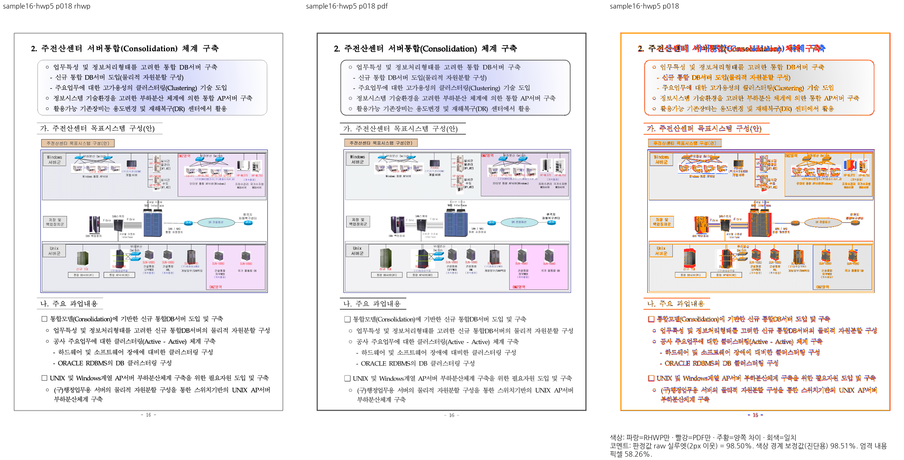
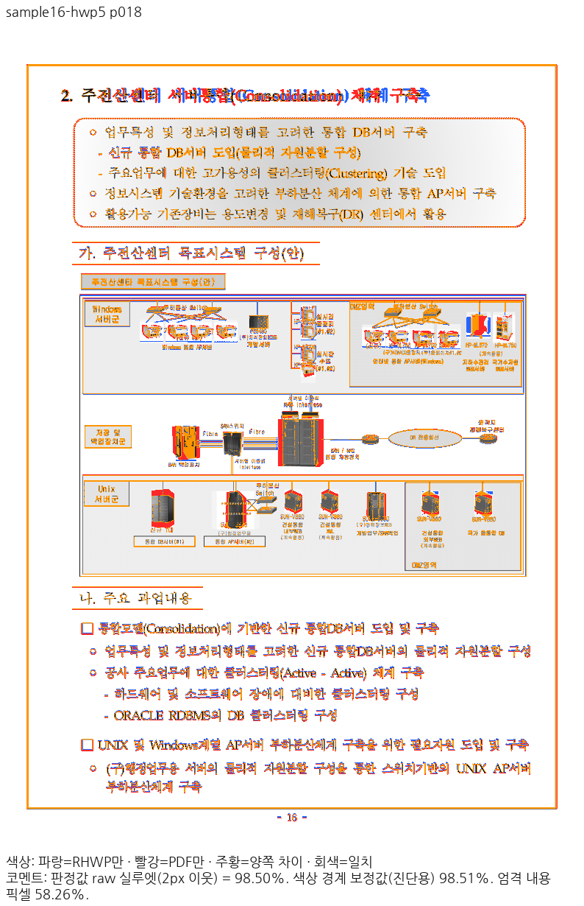
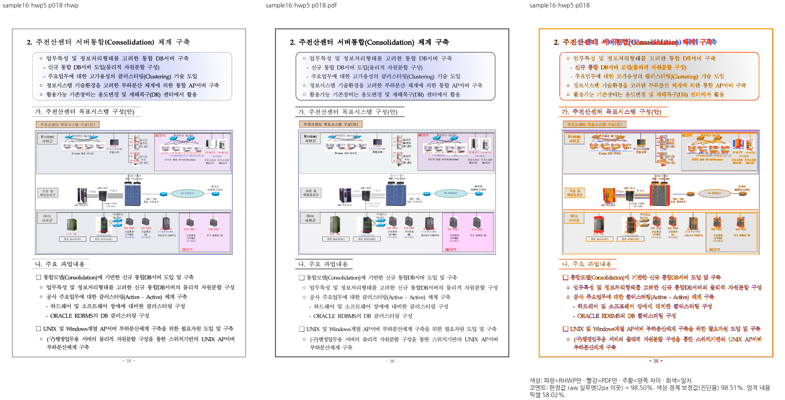
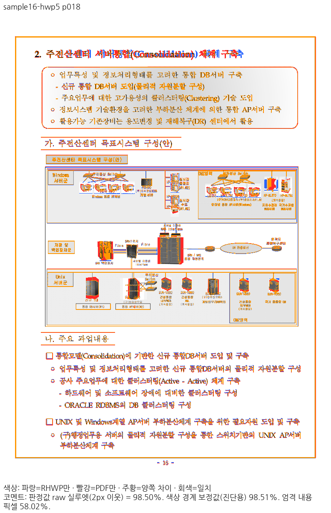

# PNG 생산 장치와 소비 해상도: Stage 56 중간 증거

보정 전 부모 `e236f80262eb6521dced7f705b62b66d1486fc74`와 기록된 source patch를 빌드한 결과다. 새 base는 `605ccfd92f2f12f18e14182548d729f9929fda00`다. 이 자료는 전체 PR 검증 완료가 아니다.

- Source patch SHA-256: `6940c0de61b5838c3ccb12cc7e733ef28503ad227120cb4e4f3657cffaa2496b`.
- Native SHA-256: `7e904a5f19f77215bdfa1b2881ab66dbbe2af12992fcd0bdecdf7b70c880de17`.
- fresh WASM SHA-256: `3f0eb6d1ebe3436051990c5d9a686a1f9828e85e39647674bf9cf934dfd19234`.
- Mac locked wrapper `--target web --out-dir pkg --no-opt` 로컬 대체 빌드. Docker 최적화 통과가 아니다.
- 같은 로컬 HMKMM.TTF·HBATANG.TTF 우선 공급. 글꼴 바이너리는 포함하지 않는다.
- Native 장치 계약 5 PASS. 공통 알파 coverage 검사는 수정 전 1 FAIL → 정식 검사 1 PASS.
- Canonical PDFium 153.0.7999.0, 96DPI, raw2px, 90% 문턱.
- 모든 TSV는 전64쪽 원본을 바이트 그대로 복사했다.

| 경로 | 전쪽 최저 | 미달 |
| --- | ---: | ---: |
| native-whole / sample16-hwp3 | 97.01457% | 0 |
| native-whole / sample16-hwp5 | 97.09573% | 0 |
| native-whole / sample16-hwpx | 95.13828% | 0 |
| wasm-whole / sample16-hwp3 | 97.00639% | 0 |
| wasm-whole / sample16-hwp5 | 97.03480% | 0 |
| wasm-whole / sample16-hwpx | 95.14423% | 0 |

기준은 #8064의 기존 입력·독립 Print PDF다. 새로 제공된 ubuntu-ted2의 동명 PDF 3개는 별도 출처로 수령했으며 기존 기준과의 대응·픽셀 대조를 진행한다. 원본 HWP3, 2010 저장 HWP5, 2022 저장 HWP5, 2024 저장 HWP5를 혼동하지 않는다.

직접 판독한 HWP5 18쪽은 Native/fresh WASM 모두 도해의 거친 회색 무늬가 복구됐고 본문·그림·쪽수는 보존됐다. 제목의 굵은 한글 간격과 세부 도형 차이는 남아 있다. 새 base와의 전쪽 감소 및 #8064 accepted 값, 전체 회귀 23개 실패, 필수 gate·실제 소비 검증은 남아 있으므로 수용 완료로 쓰지 않는다.

