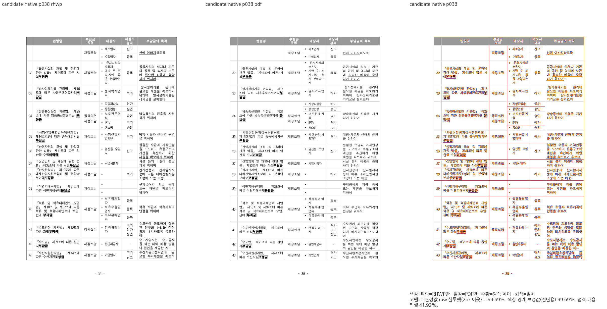
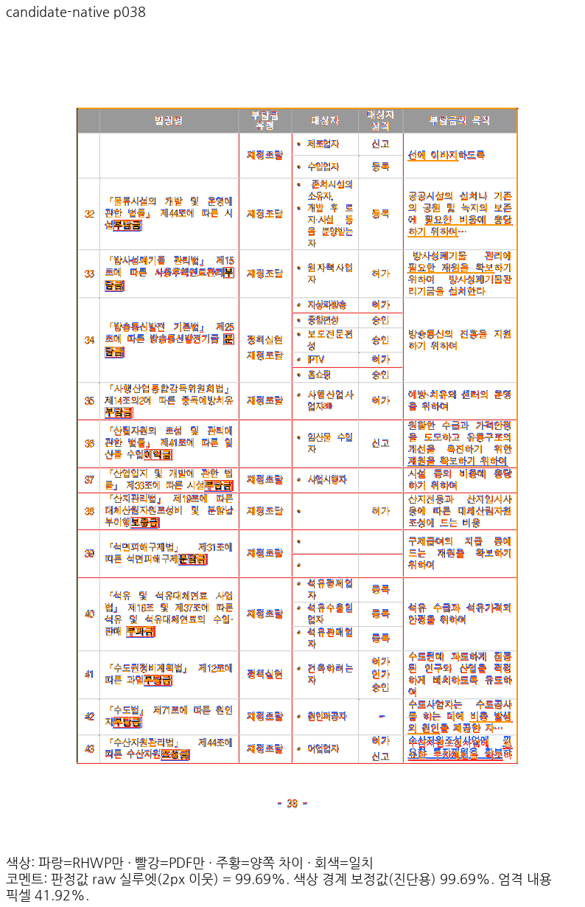
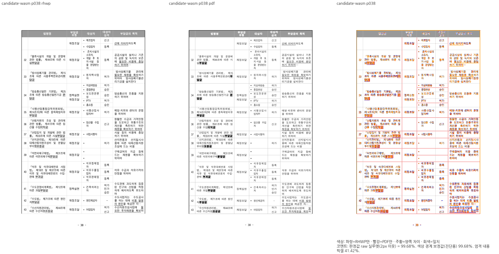
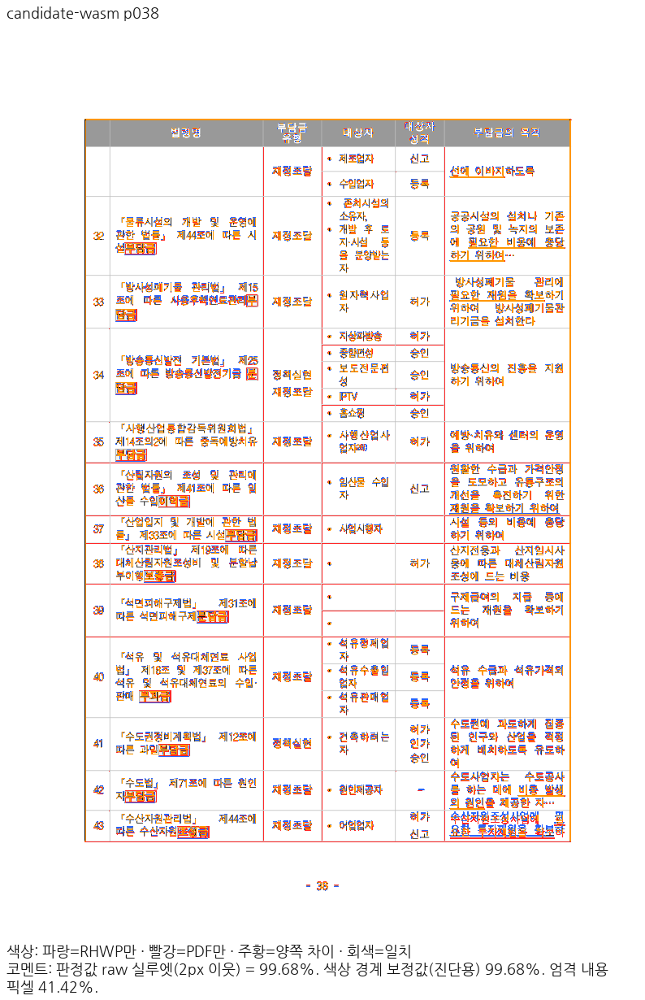

# #7445 보정 67: 완결 병합 셀의 독립 행 공간과 각주 소유

[작업 보고서](../../../../../../working/task_m100_7445_rebase_repair_stage67.md)의 기존 고정 목록 21번만 다룬다. 새 문서 보정 대상을 추가하지 않았다.
parent `b85525634a55f7cc1ba5bfb537c0fd6d62d8822e`, base `7bb143879dbde80a02fb4a63692556ac28fe46ac`와 아래 생산 소스 해시로 빌드를 고정했다.

## 입력과 측정

- [원본 HWP](../../../../../../../samples/issue1937_rowbreak_footnote_overpagination.hwp) SHA-256 `a3a075594994e4741a7fbe973bc230d95ae75fdee6578ac6017cec0d52844990`.
- [독립 한컴 Print PDF](../../../../../../../pdf/issue7382-regression-review/issue1937_rowbreak_footnote_overpagination-2020.pdf) SHA-256 `7f14bc85eb389a68cc88bd40fcafeb7a638d8454293a30bb2c8fe884a16978eb`, 50쪽.
- 96 DPI, compat 2022, Print, PDFium 153.0.7999.0 / `pdfium_smooth_rgb_v1`, raw 2px, capture 총 8.
- Native 실행 파일 SHA-256 `5e01e868f859dd652956562a5aab5cc66b2e3085e1199d8ac03b618d70e21e9b`.
- fresh WASM SHA-256 `077ccc04a83679803620c76b3f9e348a270d684b5aa99eba685b8a7d058c3690`.
- JS SHA-256 `aea5f6639676442e0628b640b75d0f70eb300481421112d23b661a082f695a68`.
- Mac locked wrapper `--target web --out-dir pkg --no-opt` 로컬 대체 빌드다. Docker 최적화 통과가 아니다.
  루트 pkg·Studio public·봉인 package 해시는 같다. 실제 Studio 초기화·문서 소비 검증은 별도 미완료다.

## 전쪽 원본 TSV

| 조건 | 측정 쪽수 | 최저 raw | 90% 미달 쪽수 |
| --- | ---: | ---: | ---: |
| [before-native](before-native-whole.tsv) | 50 | 47.23834% | 11 |
| [before-wasm](before-wasm-whole.tsv) | 50 | 47.37236% | 11 |
| [base-native](base-native-whole.tsv) | 50 | 45.23183% | 16 |
| [base-wasm](base-wasm-whole.tsv) | 50 | 45.32676% | 13 |
| [after-native](after-native-whole.tsv) | 50 | 97.84594% | 0 |
| [after-wasm](after-wasm-whole.tsv) | 50 | 97.84280% | 0 |

각 TSV는 원본 바이트 그대로 복사했으며 페이지 1~50의 누락·중복이 없다.
`before`는 이 단계 직전 b855의 새 전쪽 출력이다. `base`는 7bb와 src/assets/ttfs/Cargo 등
실행 트리가 같은 고정 605 빌드를 사용해 현재 조건으로 새로 출력했다. Native와 WASM 각각
base 대비 **2%p 이상 하락·후보 90% 미달·누락 0쪽**이다. 평균으로 미달을 상쇄하지 않았다.

기준 WASM에는 새 자동 글꼴 선택 API가 없어 최초 실행은 실패했다. 실패 산출물은 수용하지 않았다.
후보의 전쪽 자동 선택 결과가 `noDeclaredSubstitutions` / None임을 확인하고, canonical 도구가
지원하는 동일한 명시적 `null` 환경으로 기준을 다시 출력했다. 후보 38쪽의 자동 None과 명시적
None PNG도 SHA-256 `be5a5987b0b8d5897751bb0622f32a30229c61181789b2e2f57674681e54c924`로 같다.
원 face 공급·로드 검증이나 CanvasKit guard를 바꾸지 않았다.

## 회귀와 정상 대조군

기존 검사 본문·기대값은 바이트 그대로 유지했다. 전 50쪽·602개 원본 셀의 순서/누락/중복,
38쪽의 완결 병합 꼬리 Center, 42/43쪽 각주 31·40의 소유를 보호한다.
집중 묶음은 **119 실행 / 112 PASS / 7 기존 FAIL / 4378 선택 제외 / 8.947초**다.
원 해결 PR #1976의 1073/1070/1417/1050/1658 정상 대조군에서 새 실패는 없다.

38쪽 Native와 WASM raw가 각각 99%대이고 전쪽이 90% 이상임을 확인·직접 판독한 뒤,
`native_completed_span_tail_keeps_independent_print_borders`를 추가했다. 실제 Native CLI의
최종 RenderTree에서 원본 문단306 / 셀45:2로 선택하고 독립 PDF 괘선의 x0/y0/x1/y1을
±2 CSS px로 검사한다. 정답 좌표는 PDF 72dpi pt × 96/72다:
`[323.825338, 148.317301, 395.786662, 209.530680]`.
수정 전 실행 파일은 하단 `182.5`로 **1 FAIL**, 수정 후는 **1 PASS**다.
현재 generated suite028에서 기존·신규 두 함수 **2 PASS / 0 FAIL / 260 선택 제외 / 1.532초**를 확인했다.
manifest는 1736 sources / 7611 attrs / 48 targets, unit tiers는 4101 tests / 296 modules로 통과했다.

[그림 Native](picture-native-whole.tsv)·[그림 WASM](picture-wasm-whole.tsv),
[민원서식 Native](civil-native-whole.tsv)·[민원서식 WASM](civil-wasm-whole.tsv)의 각 2쪽도 모두 raw100%다.
8개 새 PNG의 바이트가 직접 판독한 66단계의 같은 backend 출력과 같다. 그림 14개의 실제
위치·셀 포함은 별도 기존/신규 회귀가 보호하며, 흰 대체 그림의 raw100%만으로 보장하지 않는다.

## 직접 판독과 잔여

- 수정 전 Native·WASM 37/38쪽: 표 내용과 병합 꼬리가 앞 조각에서 밀린다.
- 수정 후 Native·WASM 35/37/38/42쪽: 첫 표 조각, 완결 꼬리의 실제 행 공간·정렬, 각주 배출을 대조했다.
- 37쪽의 각주 표지와 래스터 미세 차이는 남는다. raw와 RGB 엄격 일치율은 다른 값이며
  100% 픽셀 일치로 보고하지 않는다. 이 단계에서 새 HWP 대상이나 별도 자형 보정을 추가하지 않았다.
- 아래 38쪽 review·overlay는 같은 후보 PNG를 사용한다. WASM common driver의
  `before-wasm` 화면 제목을 `candidate-wasm`으로 바로잡은 패널이며 재렌더·점수 변경이 아니다.

## 생산 소스 SHA-256

- `src/renderer/layout/table_layout.rs`: `c3313d6f82377ed5467ca062fc7b1b79f6e2a11d9f32b0635a26ba97b9e95e35`
- `src/renderer/layout/table_partial.rs`: `0df5fee6e29df9973b2f3496ebf0669f298d29cb791ee0b7ee98ea42b5b3a879`
- `src/renderer/layout/table_layout/stored_ordinary_row_frame.rs`: `97c480f0d932afa27843117d02a81e553dfe809b36b3418026ab9dce1ced278a`
- `src/renderer/typeset/table/block/prepare.rs`: `ad63d05d5366766b663288adc08f986bde4c6e2a4ceee47c6ca3e96a40e85693`
- `src/renderer/typeset/table/continuation/fragment/emit.rs`: `e33bf1e23215baaaa226871c38bf0571dd9403d6f476c3376bc156308c540ea7`
- `src/renderer/typeset/table/footnotes.rs`: `36d91ae5f694509d30e29c5ba2ce4a24cfb9451535e59fc3d0ce3edf5a71e321`

## 판정 범위

이 단계의 국소 보정·전쪽 검증만 수용한다. 남은 기존 실패 7개, 최신 전체 nextest,
나머지 승인 범위 전쪽·범위 게이트·실제 소비·초기화는 전체 PR의 필수 후속 작업이다.
따라서 전체 PR 준비·CI·머지 완료라고 판정하지 않는다. 로그·중간 JSON·driver는 ignored
`output/pr-review/7445-completed-20261009/rebase-8155-20261022/stage67-completed-span-ownership/`에만 보존했다.
