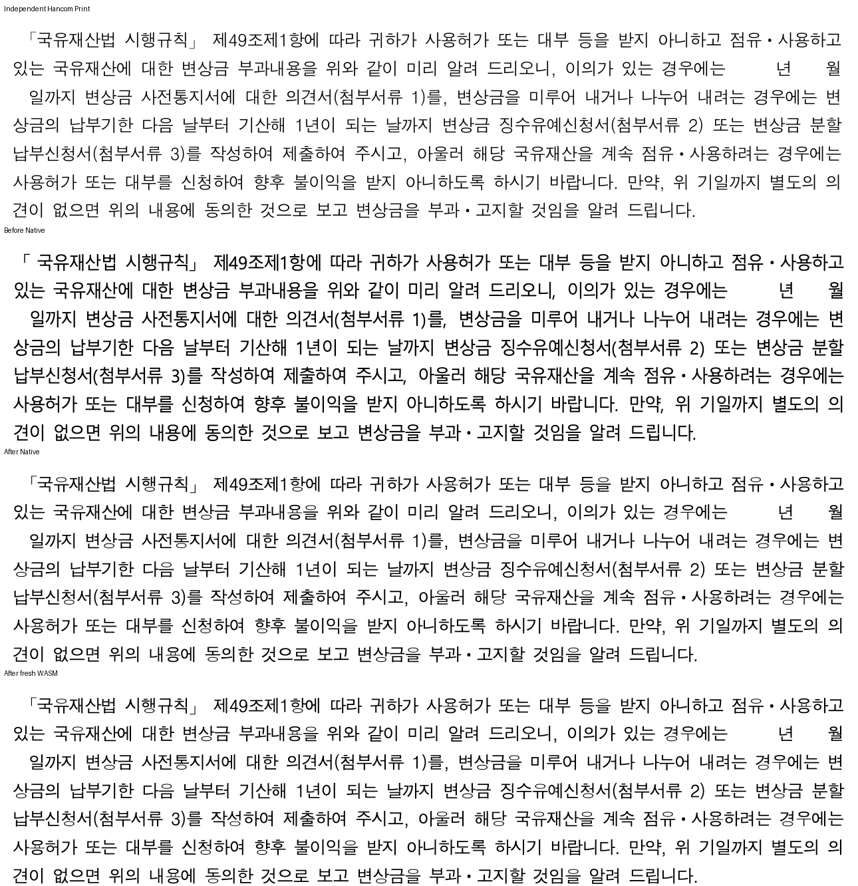

# 돋움의 설치 프로그램 별칭 복원

Issue: #7445. 전체 PR 완료 기록이 아닌 개별 보정 증거다.

## 원인과 소비 경로

`gulim.TTC` collection face2의 name ID1은 한국어 `돋움`과 영문 `Dotum`을 함께 선언한다.
확인한 설치 파일 SHA-256은 `ed7502755424c560f4538647eff0833b738fe7f3f4ba4de8fca9ff8c4d6a776c`다.
공통 설치 별칭에 이 이름 쌍이 빠져 Native는 source의 돋움을 일반 대체 맑은 고딕으로 그렸다.
같은 프로그램의 두 이름을 원 face 바로 뒤에 연결했다. 원본 face와 메트릭은 변경하지 않는다.

`원본 family → 공통 설치 별칭 → Native 후보/문자별 glyph 공급, SVG/Canvas family chain`
경로를 함께 사용한다. 다른 글꼴 별칭을 추정해 추가하지 않았다.

실제 준비된 `SkiaLayerRenderer.with_font_paths`의 inventory로 읽은 decision trace에서
자산57쪽의 돋움932자는 수정 전 Malgun Gothic/custom → 수정 후 Dotum/system으로 바뀌었다.
위첨자3쪽은 수정 후 Dotum1256자, 별도 glyph 공급 HCR Dotum1자다.
이는 관측한 family와 공급 경로이며 선택된 system typeface 파일의 byte hash까지 관측했다는
뜻은 아니다. 설치 TTC hash는 별칭의 독립 name 근거와 구분한다.

## 전쪽 시각 검증

정본은 ignored output `rebase-sync-20261015/native-font-ownership-diagnostic-v24/`의
`after-producer.json`, `wasm-producer.json`, `whole-native-results.json`,
`whole-wasm-results.json`, 각 페이지 TSV와 `base-comparison.json`이다.
빌드 parent는 `09dcf3da3`이며 당시 전체 작업 source hash를 고정했다.
Mac fresh WASM은 locked wrapper web/no-opt 로컬 대체 빌드다. root pkg/Studio public의
JS/WASM hash 일치를 확인했다. 이 커밋 단독 또는 최종 HEAD의 전체 통과로 재인용하지 않는다.

| 동일 원본·Print | DPI | Native 전쪽 최저 | fresh WASM 전쪽 최저 | 쪽수 |
| --- | ---: | ---: | ---: | --- |
| 자산관리규정 | 192 | 92.05225% | 92.07832% | 60/60 |
| 위첨자 보도자료 | 96 | 96.07722% | 96.05780% | 3/3 |
| 법원 서식 대조군 | 192 | 90.03597% | 90.06197% | 2/2 |

입력은 `samples/issue6031/3249937_asset_management_rules.hwpx` 및
`samples/issue5756/156732409_superscript_advance.hwp`다. 대응 독립 기준은
`pdf/3249937_asset_management_rules-2020.pdf`, `pdf/156732409_superscript_advance-2020.pdf`다.
입력/PDF SHA는 기존 고정 scope 및 실행 manifest와 대조했다. compat2022, 현재 정본
Visual Sweep 2px 관용, 캡처8개를 사용했다.

동일 fixed devel `463c48cc2`와 Decimal로 전쪽 대조했다. 자산 Native는0.01%p 이상 하락0쪽이다.
fresh 자산46쪽은94.35808→94.16771%, 위첨자3쪽은 Native98.26112→98.14738%,
fresh98.28711→98.21541%로 남아 있다. 개선한 다른 페이지로 이 하락을 상쇄하지 않는다.
법원 대조군의 이 실행에는 같은 fixed-base TSV가 없으므로 devel 대비 통과를 주장하지 않는다.

새 공개 SVG 회귀는 원 source face 우선·같은 TTC 영문 별칭·일반 대체 순서와 두 페이지의
전체 paint text 순서·누락·중복 보존을 검사한다. Native 실제 glyph 선택은 위 trace로 별도 확인했다.
수정 전28건 중27 PASS/1 실제 FAIL → 수정 후28 PASS다. 관련 기존27건을 유지했고
manifest/fmt도 통과했다. 초기 검사가 요청 family의 text만 비교하여 정상 기호 fallback을
누락한 실행은 `initial-selector-error/INVALID.txt`에 제외 사유를 남기고 사용하지 않았다.

## 직접 판독과 잔여

독립 Print → 수정 전 Native → 수정 후 Native → fresh WASM 순서다.
동일 배율에서 자산57쪽의 원 돋움 획과 본문 간격·줄바꿈을 직접 확인했다.

자산46쪽의 좁은 셀 정렬과 위첨자3쪽의 실제 크기·전진은 후속 보정 대상이다.
최종 전범위 회귀·전쪽 시각 검증·실제 Studio 소비 경로 검증이 남았으므로 PR 제출 가능 상태가 아니다.
