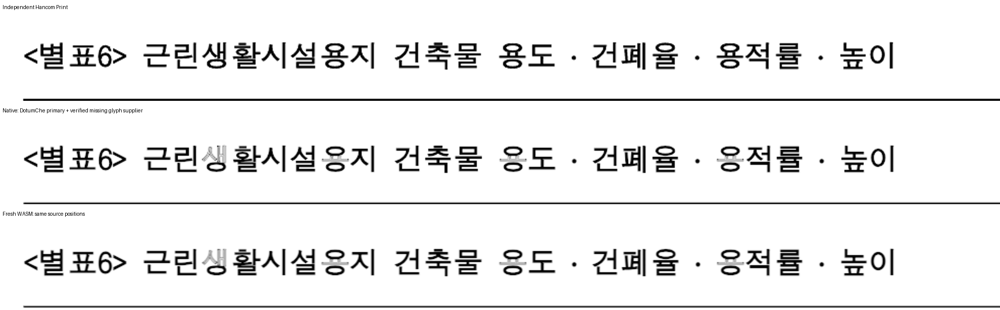

# 근린생활시설 표: 결측 기호 공급자와 전진 폭

- 원본: `samples/issue6803/1376496-neighborhood-facility-land-table.hwp`
  SHA-256 `2482b695bc92c0cafe661af63c54acea834b6927bf9c666bdf47299910e3801d`.
- 독립 기준: `pdf/1376496-neighborhood-facility-land-table-2020.pdf`
  SHA-256 `ef7ac0c12d37f8b96f1af5e2d67e812151d9b9862c4f42824fee8bc04a5dda12`.
- 비교 base: `463c48cc228170b576c832591b76826116e86a49`.
- 생산 후보: parent `40016623253ba141e88b94ae2a6812a8a1828749` + 현재 작업 패치.
  `verified-glyph-alias-candidate-v20/producer.json`과 `wasm-producer.json`에
  전체 Rust source SHA-256·빌드 명령·실제 산출물 해시를 고정했다.
  jobs8, capture8; Mac WASM은 locked wrapper의 로컬 `--no-opt` 대체 빌드다.

## 원인과 공통 소비

원본 DotumChe 프로그램의 cmap에는 U+2024가 없다. 독립 Print 1쪽은 해당 기호만
Haansoft Batang으로 출력하며 자연 advance 0.173em이다. 로컬 HBATANG의 hmtx178/1024도
대응한다. 결측을 전각으로 측정하던 코드는 제목의 기호 세 개 뒤를 총22px 늘렸다.
확인된 공급자를 기존 굴림 공급자와 같은 질의로 측정하고 선언 glyph 체인에 포함했다.
원 glyph hit, 명시 환경, HFT와 영문 슬롯 경계는 그대로 둔다.

첫 후보 C19의 점수는 통과했지만 확대 판독에서 Native 제목 전체가 명조체로 바뀐 것을
발견했다. Native가 원 family의 한국어 이름을 찾지 못해 뒤의 공급자를 먼저 골랐다.
`gulim.TTC` face3의 name ID1에 있는 `돋움체`/`DotumChe`를 공통 설치 별칭에 연결해
원 프로그램을 먼저 공급한다. TTC의 다른 face로 이름을 바꾸지 않는다.
공통 측정 결과의 char positions를 실제 Native/Canvas paint가 소비하는지도 대조했다.

## 실제 결과와 한계

| 범위 | Native | fresh WASM |
| --- | ---: | ---: |
| 1쪽 192DPI, 2px 관용 | 98.86167% | 98.87441% |
| 전5쪽 96DPI 최저 | 99.60058% | 96.81599% |
| 전5쪽 192DPI 최저 | 97.60018% | 89.13134% |
| 쪽수 | 5/5 | 5/5 |

1쪽의 독립 Print/Native/fresh 제목을 같은 배율로 확대 확인했다. 새 회귀 범위는 이 1쪽이며,
source 기호·제목 보존, 기호와 이웃 공백의 전진 관계, 독립 PDF의 후속 세 항목 원점±2 CSSpx를
함께 검사한다. 문서 전체가98%라고 주장하지 않는다.

**PR 준비는 미완료다.** 기존96DPI 범위의 Native 전5쪽은 base 대비0.01%p 이상 하락0쪽이지만,
fresh2쪽은 base98.22749→98.05601%로 하락한 기존 후보 차이가 남아 있다.
추가192DPI의 fresh3쪽89.13134%도 미달이다. 정확한 fixed base에서도 같은192DPI3쪽은
87.45933%였으나, 그 사실로 현재 미달을 면제하지 않는다. C18 전체 nextest10322 PASS는
이후 C19/C20 수정본의 전체 회귀 통과로 재인용하지 않는다.

정본 실행은 ignored `output/pr-review/7445-completed-20261009/rebase-sync-20261015/`의
`verified-glyph-alias-candidate-v20/`에 보존한다. `formal-before/after.log`의 실제 결과는
실행 종료 후 아래에 기록한다. .log·글꼴 바이너리·추출한 PDF subset font는 커밋하지 않는다.

정식 전후 검사: 동일19건에서 보정 전18 PASS/1 FAIL(1.218초), 보정 후19 PASS/0 FAIL
(1.161초)이며 새 기호 전진 검사가 실제14.6px 전각 폭으로 실패한 뒤 독립 기대값에 통과했다.
표 분할/포함·글꼴 환경·condense 대조군도 유지했다. manifest base 비교와 fmt는PASS다.
초기 초안은 제목 접두어가 표 안의 짧은 동명 항목도 선택해 두 실행 모두 실패했다.
해당 실행은 `formal-initial-selector-error/INVALID.txt`로 제외했고, 전체 제목을 선택한
현재 정식 실행만 결함 검출 증거로 사용한다. 검사를 느슨하게 하거나 좌표 허용치를 바꾸지 않았다.
