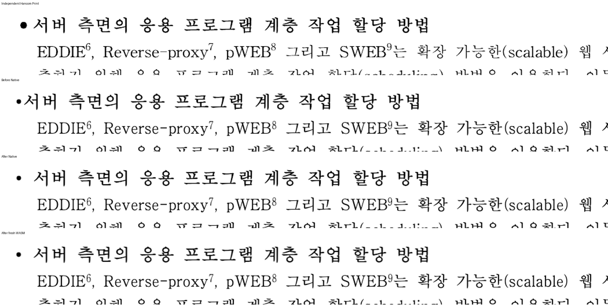
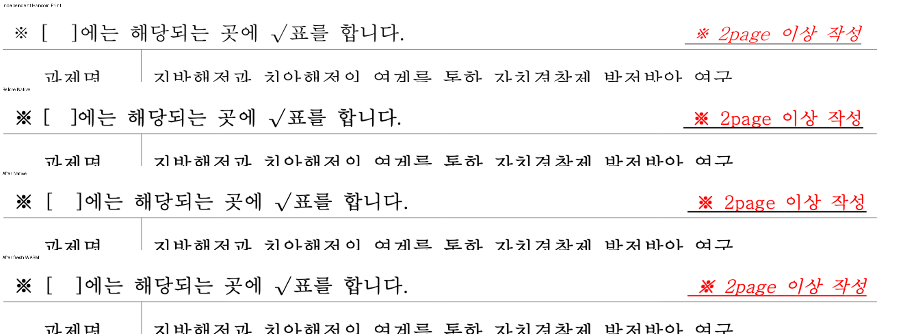

# 원본 기호 전진과 명시 영문 슬롯의 소유

Issue: #7445. 이 기록은 전체 PR 검증 완료를 의미하지 않는다.

## 원인과 수정

- HWP5 변환본의 한양신명조 HFT 글머리 `•`는 독립 Print에서 인접 한글과 같은 전각 전진을
  갖는다. 메트릭 범위에 이 문자를 보충하고 후단의 일반 구두점 반각 규칙이 확인된 폭을
  다시 줄이지 않게 했다. 굵은 전진도 인접 한글과 같은 경로를 사용한다.
- 사업신청서의 명시 글꼴 환경은 영문 슬롯을 Batang으로 선택한다. 기존 해석은 원래
  LegacyLatin 소유를 잃어 대괄호를 휴먼명조로 측정·출력했다. 원래 슬롯 소유와 명시 선택을
  함께 해석하고 공통 composition run에서 측정과 paint가 같은 공급자를 소비하도록 했다.
  명시 환경이 없는 저장 run의 구두점 소유는 유지한다.

## 입력과 독립 기준

| 대상 | 입력 SHA-256 | Print PDF SHA-256 |
| --- | --- | --- |
| `samples/hwp3-sample-hwp5.hwp` / `pdf/hwp3-sample-hwp5-hwp-2020.pdf` | `dc2edf4737c110ab16a6c6543bceed9f5648d634a40e180ce3fc2725ec0f21d8` | `fec78b1b1e8491b735247ff33ad38d3db69ff4cf1f55a6e22d4e81a289597f0b` |
| `samples/task2097/1741000_project_application.hwp` / `pdf/task2097/1741000_project_application-2020.pdf` | `f645ec5d34f897f4078a57b15e5e6e408bbf751e653b187ab28a7549cea29096` | `3ef880378d5ec7bfb7bbedadab3dc9a855a2838348a383f767021cb43f7e3f89` |

사업신청서는 기존 `resolution-20261005/project2097-reference-font-environment.json`을 사용했다.
SHA-256은 `0099b748acf06f5122d2af654e5dd642832a7133b6a720e420da82de66dc55a9`이다.
원본 글꼴 선언과 본문은 수정하지 않는다.

## 실제 검증

빌드 출처는 parent `8dfeef09dc29289e8ed117791a5e5823dc8ec733`에 당시 작업 변경을 적용한
source 파일별 SHA로 고정했다. ignored output의
`rebase-sync-20261015/hft-bullet-final-advance-candidate-v23/producer.json` 및
`wasm-producer.json`이 정본이다. 이 커밋 단독 또는 최종 HEAD의 전체 검증으로 재인용하지 않는다.
Mac fresh WASM은 locked wrapper `--target web --out-dir pkg --no-opt` 로컬 대체 빌드다.
root pkg와 Studio public JS/WASM hash 일치를 확인했다.

현재 정본 Visual Sweep의 2px 관용 실루엣, 캡처 8개, compat 2022로 전쪽을 산출했다.

| 대상·범위 | DPI | Native 최저 | fresh WASM 최저 | 쪽수 |
| --- | --- | ---: | ---: | --- |
| 변환본 전쪽 | 96 | 97.12304% | 97.30854% | 16/16 |
| 변환본 전쪽 | 192 | 93.33355% | 93.81592% | 16/16 |
| 변환본 제목 5쪽 | 192 | 99.23833% | 99.64186% | 전쪽 결과의 해당 쪽 |
| 사업신청서 전쪽 | 192 | 93.93027% | 93.79837% | 2/2 |

고정 base `463c48cc228170b576c832591b76826116e86a49`와 동일 조건의 변환본 전16쪽
96 DPI 및 사업신청서 전2쪽 192 DPI를 Decimal로 대조했다. 두 backend 모두 0.01%p 이상
하락한 쪽은 없다. 변환본의 base 192 DPI 전쪽 비교까지 완료했다는 의미는 아니다.
페이지별 TSV와 입력·글꼴·빌드 출처는 위 ignored output에 보존한다.

정식 `issue_7445_reference_font_slot_ownership` 검사 2건은 수정 전 각각 글머리 반각 전진,
대괄호의 잘못된 실제 공급자 때문에 실패했다. 관련 25건은 수정 전후 통과했다.
수정 전 27건 중 25 PASS/2 FAIL(2.204초), 수정 후 27 PASS(1.642초)다.
#4138 원본115쪽·분할197쪽, 시작 경계·자동 탭 소유 검사도 이 대조군에 포함한다.
새 검사는 원문 보존·전진 비율·실제 paint 공급자·scalar 소유를 검사하며 새 px 핀은 추가하지 않았다.

## 직접 판독과 잔여

아래는 독립 Print → 수정 전 Native → 수정 후 Native → 수정 후 fresh WASM 순서다.
제목 첫 글자와 끝 글자 원점, 대괄호 간격 및 본문 보존을 직접 확인했다.

글머리의 실제 대체 윤곽은 독립 HFT 원형보다 작다. 전진 보정을 윤곽 일치 완료로 보고하지 않는다.
사업신청서 붉은 안내문의 기울임·밑줄 차이도 남아 있으며 이번 대괄호 보정으로 해결했다고
주장하지 않는다. 다른 문서의 devel 대비 하락, 수식 및 최종 전범위 검증이 남아 있으므로
PR 제출 가능 상태는 아직 아니다.
