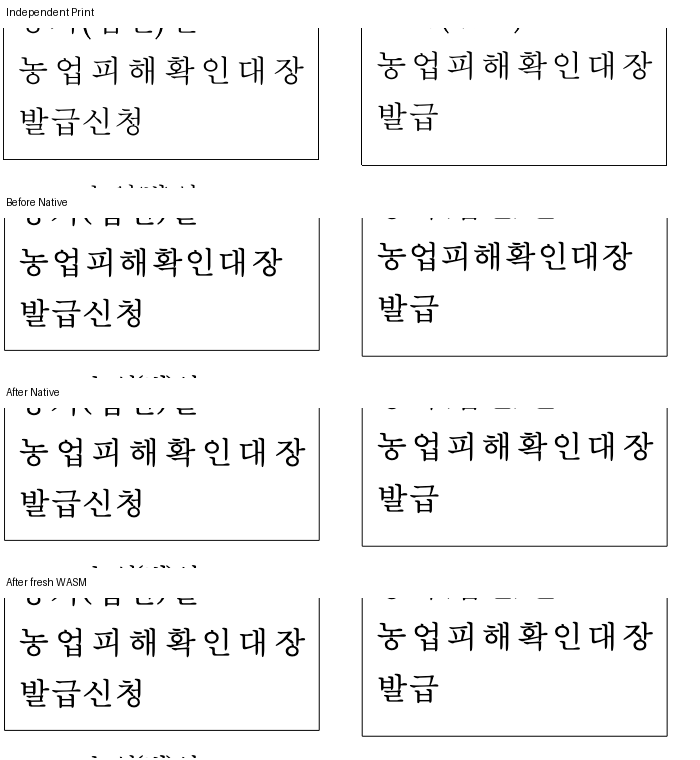

# 저장 줄말 구분 공백과 가시 글자의 정렬 예산

Issue: #7445. 개별 보정 기록이며 전체 PR 검증 완료를 뜻하지 않는다.

## 독립 근거와 수정

자산관리규정의 표569·셀16/24·문단1은 JUSTIFY이며 첫 줄이 `농업피해확인대장 `이다.
저장 줄 너비는 각각10780/10412 HWPUNIT이고 다음 줄의 시작은 구분 공백을 소비한9이다.
독립 한컴2020 Print 46쪽에서 마지막 `장`의 자연 전진 끝은 CSS647.68/229.12,
원본 줄 프레임 끝은647.8133/229.2267이다. 이전 출력은636.4/218.9로 안쪽에 멈췄다.

내부 공백이 없는 양쪽 정렬의 fallback이 마지막 구분 공백까지 폭과 분배 슬롯에 넣었다.
가시 폭과 글자 사이 gap으로 분배하고, 음수 자간의 마지막 잉크 점유는 기존 공통 질의로
계상한다. TAB과 고정 label을 제외한 동일 scalar 축에서 gap을 센다.
명시적인 synthetic wrap separator의 기존 전진 계약은 유지한다.
원문·source offset·구분 공백·다음 줄 소유를 바꾸거나 bbox를 clamp하지 않았다.

## 정식 검사와 시각 결과

`issue_7445_stored_justify_tail_ownership`은 두 셀의 가시 마지막 전진과 원본 줄 프레임의
비율, 원문 순서·구분 공백·후속 줄 보존을 검사한다. 절대 px 원점을 고정하지 않는다.
관련38건은 수정 전 통과하고 이 새 검사만 실제 FAIL했다(39건38 PASS/1 FAIL,1.894초).
TAB 축까지 정리한 최종 후보는39 PASS(1.706초)다. #4138 원115/분할197쪽·auto tab,
규제분석의 field 소유·98% 페이지 좌표, 기존 정렬·머리말·꼬리말 대조군을 포함한다.

새 파일 등록 전의 첫 fmt는 해당 파일을 수집하지 못해 이전 후보의 마지막 fmt check가
실패했다. 생성 suite 등록 후 포맷을 정리했고 최종 후보의 fmt/check와 manifest는 통과했다.
그 포맷 실패를 전체 게이트 성공으로 기록하지 않는다.

정본은 ignored output `rebase-sync-20261015/stored-justify-tail-final-candidate-v25a/`의
producer·WASM producer·focused 결과·전쪽 TSV·base 비교다. parent는`ab5f77e86`이며
당시 작업 source 전체 hash를 고정했다. 이 커밋 단독의 전체 검증으로 재인용하지 않는다.
Mac fresh WASM은 locked wrapper web/no-opt 로컬 대체 빌드이고 root/Studio public의
JS/WASM hash 일치를 확인했다. compat2022·현재 정본 2px 관용·캡처8개 조건이다.

| 대상 | DPI | Native 최저 | fresh WASM 최저 | 쪽수 |
| --- | ---: | ---: | ---: | --- |
| 자산관리규정 전쪽 | 192 | 92.05225% | 92.07832% | 60/60 |
| 자산관리규정46쪽 | 192 | 96.65551% | 96.70791% | 전쪽 결과의 해당 쪽 |
| 규제분석 전쪽 | 192 | 94.07056% | 94.02746% | 17/17 |
| 위첨자 보도자료 전쪽 | 96 | 96.07722% | 96.05780% | 3/3 |

동일 fixed devel `463c48cc2`와 각 backend별 Decimal 비교에서 자산60쪽과 규제분석17쪽은
0.01%p 이상 하락0쪽이다. 위첨자3쪽의 Native0.11374/fresh0.07170%p 하락은 별도 잔여다.

## 확대 판독과 증거의 한계

독립 Print → 수정 전 Native → 수정 후 Native → fresh WASM 순서다.
두 셀에서 마지막 글자의 위치와 다음 줄 내용·선행/후행 셀 경계를 직접 확인했다.
아래 PNG의 수정 후 원본은 최종 후보의 같은 페이지 PNG와 byte hash가 같아 재사용했다.

후속 감사에서 기존 Visual Sweep WASM PNG 실행기가 Native CLI·Studio의 자동 글꼴 환경
선택 단계를 누락한 것을 확인했다. 이 기록의 페이지별 backend 내 전후 비교와 변경한 Human
MyeongJo 영역의 보정은 유지하되, 이전 실행을 최종 Native/WASM 환경 정합 증거로 재인용하지
않는다. 실행기 보정 뒤 fixed devel과 현재 후보의 전쪽 증거를 다시 산출해야 한다.
다른 문서의 잔여와 최종 전체 회귀·실제 소비 경로 검증도 남았으므로 PR 제출은 보류한다.
