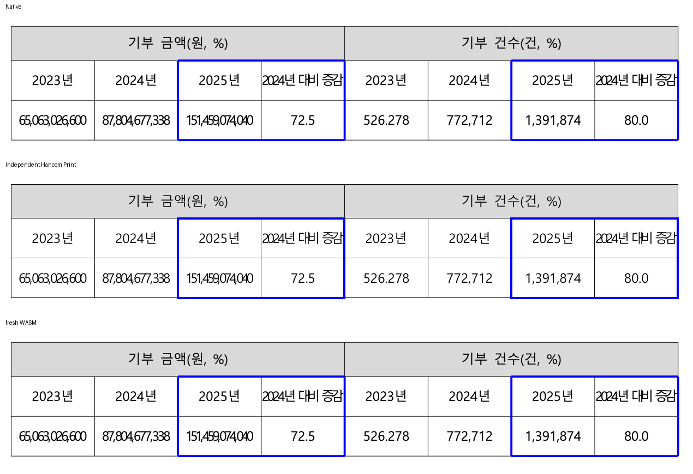
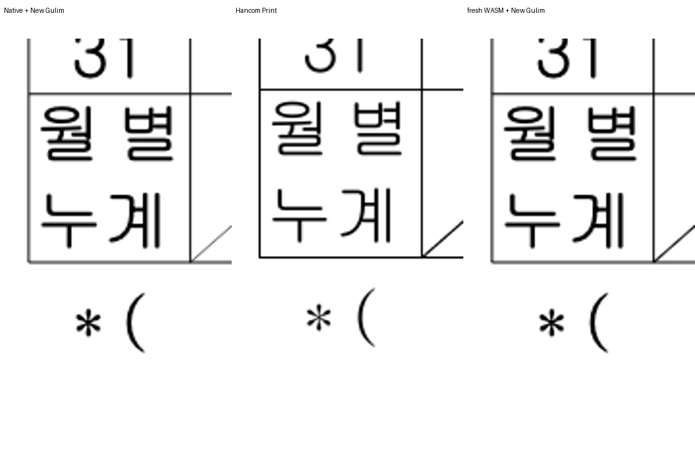
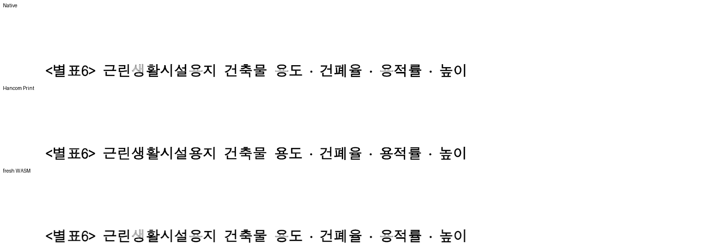
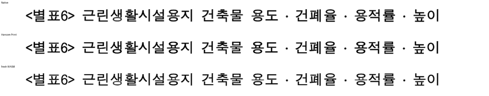

# 2026-10-15 회귀 지침 적용 및 기존 검사 교정

현재 `fix/7445-completed-20261009`, parent `f15f52c7a2`, 기준 `2efefc6a1f` 위의 로컬 보정본이다.
아래 결과는 source 전체 hash를 기록한 동일 Native/fresh WASM producer로 산출했다. 전체 PR 검증 완료를 뜻하지 않는다.

## 적용한 지침

- 기존 검사도 내용·쪽/표/셀 소유, 누락·중복·순서·포함 관계를 확인한다.
- 관련 전쪽 Native/fresh WASM90%·독립 Print 쪽수·직접 판독 뒤에만 검사를 변경한다.
- 같은 페이지의 양쪽 원래 소수값98% 이상·확대 판독을 충족한 경우에만 독립 좌표±2 CSSpx를 허용한다.
- 같은 핵심 동작 후보는 min(Native,WASM)의100→99→98% 순으로 고른다. 다른 내용의 높은 쪽으로 대신하지 않는다.
- 수치는2px 이웃 관용 실루엣이다. 엄격 픽셀·이진화 원값은 TSV에 따로 기록한다.

## 기존 #7413 검사 두 건

### 1쪽 표: 좌표 선택자 교정 및 핵심 상자 보호

`table-text.hwpx`의 독립 `table-text-hwpx-2020.pdf`는1쪽이다. Native/fresh WASM 모두100.00000%이며 확대 판독했다.
이 문서의 유일한 페이지가100% 후보이다.

기존 x=115.30·width=76.40으로 셀을 찾던 선택자를 원본 표 소유와 첫 금액 내용,
같은 열의 연도·금액 셀 소유로 교체했다. 원문·순서·누락·중복·원본 padding 내부 포함을 함께 검사한다.
독립 PDF의 cell clip/괘선 좌표를 pt→96DPI CSSpx로 환산해 두 셀의 시작·폭·높이를±2px로 보호한다.
현재 출력값을 기대 좌표로 복사하지 않았다. 독립 추출값은 cell bounds（로컬 중간 자료 `table-text-independent-cell-bounds.json`）에 있다.

### 영월: 가시 glyph와 종단 논리 간격의 포함 관계 구분

독립 Print3쪽의 월별/누계 원문과 두 줄 순서, 셀 소유·누락·중복·세로 포함·줄간 겹침 검사는 유지했다.
기존 가로 검사는 TextRun bbox의 마지막 보이지 않는 분배 간격을 glyph로 보아 실패했다.
관측값은 `월별` bbox41.6px, 마지막 extraCharSpacing3.4666667px이며 가시 끝은 셀 내부다.

현재 실제 paint가 소비하는 문자 원점과 독립 New Gulim glyph 전진1024/1024em으로 마지막 가시 끝을 확인한다.
한컴 변환 Windows의 실제 프로그램을 ignored 검증 전용 font-supply에 공급했다. 저장소·전역 글꼴 설치는 하지 않았다.
4개 glyph의 분해 윤곽과 hmtx가 PDF subset과 같은 것은 program proof（로컬 중간 자료 `yeongwol-glyph-program-proof.json`）로 확인했다.

전4쪽 Native 최저98.05686%, fresh WASM97.72907%,4/4쪽 일치다.
월별 셀의3쪽은 WASM98% 미만이므로 px 핀을 추가하지 않았다.100%인4쪽은 월별 셀이 없어 같은 동작 후보가 아니다.

수정 전2건 중1PASS/1FAIL → 수정 후2PASS. 실패를 skip하거나 셀 경계를 넓히지 않았다.

## 토지이용 기존 검사 대조군

전5쪽 Native 최저95.08607%, WASM94.73684%, 쪽수5/5이며 기존4검사 PASS다.
초기 제목1쪽은98.81615/98.82167%지만 확대 판독에서 glyph 모양 차이를 발견해 보류했다. 아래 합성 굵게 보정으로 이 잔여를 재검증했다.
기존 검사를 제거하거나 허용치를 변경하지 않았다.

## WASM 글꼴 준비 경계

명시 대체 후보가 없는 문서에서도 미사용 사전의 PENHL.TTF를 모두 준비하느라 실패하던 경계를 찾았다.
이 경우 Native와 같이 Rust 공통 null 환경을 사용한다. 실제 paint가 요청하는 글꼴의 byte/hash/로드 검증은 그대로 수행한다.
필요한 글꼴 공급·hash·로드 거절은 계속 실패한다. 새 경계는 이전 코드1FAIL, 보정 뒤 Node9PASS다.
로컬 web/no-opt fresh WASM이며 root pkg/Studio public JS·WASM hash를 확인했다. Docker 최적화 검증은 하지 않았다.

## 증거와 잔여

실행 증거（로컬 중간 자료 `evidence.json`）에 producer/source/input/PDF/font/TSV hash와 backend별 전쪽 값·실행 ID를 연결했다.
수정 회귀2PASS+정상 대조4PASS이며 라이브러리 check·Native build·fresh WASM build 통과다.
원시 로그와91개 변경/신규 Rust 회귀 소스의 검토 목록은 ignored
`output/pr-review/7445-completed-20261009/regression-policy-audit-20261015/`에 보존한다.
숫자 검색56후보는 정책 위반 판정이 아니며 원본 단위·비율·관계 계약과 실제 위치 핀을 구분해 계속 검토해야 한다.
전체 기존 회귀 교정·최신 전체 회귀·고정 devel 대비0.01%p 무회귀 비교 완료를 주장하지 않는다.

## 합성 굵게의 실제 출력 보정 후 재검증

초기 토지이용 제목의 `생`·`용` 일부가 흐렸던 원인은 같은 DotumChe 프로그램의 OS 합성 굵게/텍스트 획이었다.
독립 PDF의 정규 프로그램·glyph 윤곽과 `fill_text`/`stroke_text`의1.84/92=0.02em을 대조했다.
비트맵 제외·hinting 변경만으로는 해결되지 않았다. SVG의 기존0.02em 계약을 공통으로 옮겼다.
Canvas2D는 정규 descriptor로 fillText+strokeText를 하고, Native는 텍스트 채움을 한 번 남긴 뒤 같은 face/size/원점의 glyph path를 획으로 그린다.
실제 Bold face와 윤곽이 없는 glyph의 기존 경로를 보존했다. Native 텍스트 채움을 검색 불가능한 전체 path로 치환하지 않았다.

| 원본 | Native 최저 | fresh WASM 최저 | 쪽수 | px 검사 판정 |
| --- | ---: | ---: | --- | --- |
| table-text |100.00000%|100.00000%|1/1|1쪽 독립 cell bounds ±2 CSSpx 유지|
| 영월 |98.05546%|97.72386%|4/4|월별 셀3쪽은 관계 검사|
| 토지이용 |95.08447%|94.72780%|5/5|분할 경계3/4쪽은 관계 검사|

동일 핵심 분할을 검증하지 않는 높은 점수의 다른 쪽으로 대신하지 않았다.
같은 글꼴의 이전 후보 대비 이10쪽의 하락은 각0.01%p 미만이지만, 고정 upstream/devel2ef와 전범위 비교는 아직 남아 있다.
새 실행 신원·전쪽 TSV（로컬 중간 자료 `bold-path-evidence.json`）에 source 전체 hash, Native binary와 fresh web/no-opt WASM hash를 연결했다.
Mac 로컬 대체 빌드이며 Docker 최적화 통과는 아니다. Native 전용 후속 보정에서 WASM Rust는 캐시를 사용했고 wrapper를 다시 실행해 새 package를 확인했다.

새 공급자 소속 검사는 이전 producer에서1FAIL, 새 producer의 해당 소스 전체22PASS다(rustc --test).
이는 전체 nextest의 대용이 아니다. 최신 보정본의 집중 nextest는41PASS/0FAIL(0.474초), 전체 PR 검증은 아직 별도 잔여다.

기존 절대 핀 검색은 실제 diff/현재 보정 원본과 대조했다. 범위별 판정（로컬 중간 자료 `policy-dispositions.json`）에
교정한 항목·원본 단위 관계로 유지한 항목·다른 원본의 무변경 검사·최신 전쪽 증거가 필요한 잔여를 구분했다.
