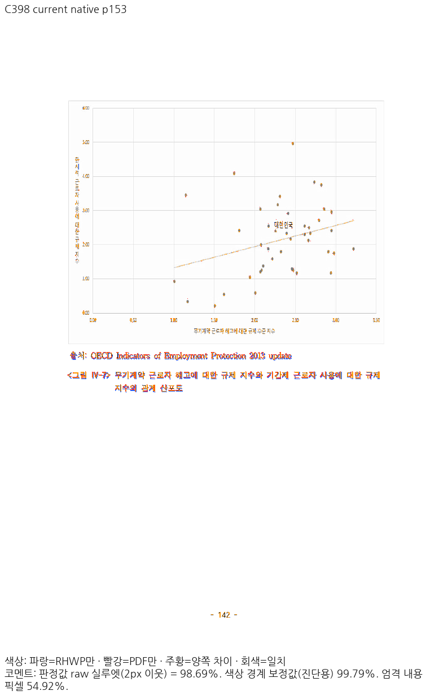
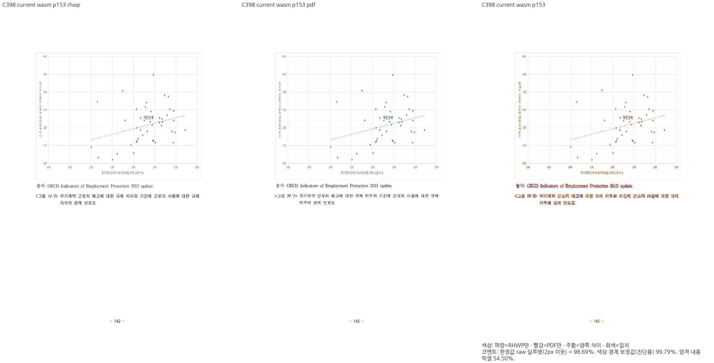
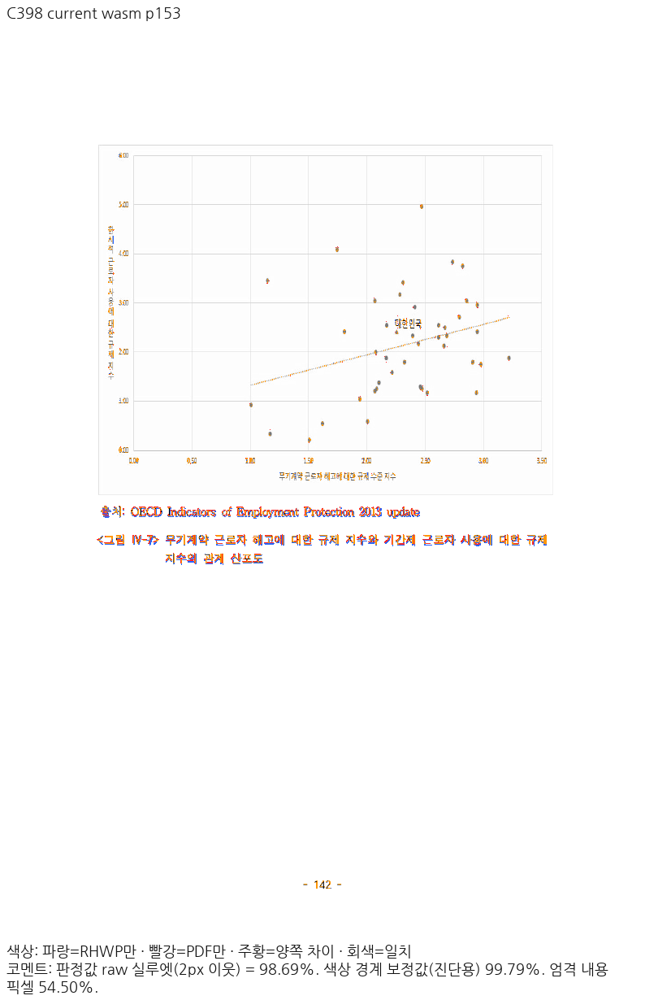

# Print 비트맵의 실제 장치 구간과 격자 명암 회귀 보정

Issue: #7445

## 범위와 출처

- parent `b80662087571f746579350d2ef00f3387b54b527`, 기준 devel `224a326063a5aeab5a1ca8dcaa92918f55843ffc`.
- 결과는 아직 커밋 전인 C360 frozen Native/fresh WASM 소스의 증거다. 새 HEAD 전체 검증 또는 PR 준비 완료가 아니다.
- 원본 `samples/issue5941/1490000-201600081_roadmap_research.hwp`, 독립 한컴2020 Print PDF SHA-256 `133f79cad7b756ebef777d253befb14f9407faaf7fe04eeea66036f3e049bbe7`.
- PDF 변환은 기존 pdftoppm96dpi, raw2px/90%를 유지했다. Cairo·영역 마스크·비교 문턱 변경은 없다.
- producer와 실행 로그는 ignored `output/pr-review/7445-completed-20261009/rebase-6ed1682c-20261018/print-bitmap-frame-correction-c360/`에 보존한다. 아래 최종 전쪽 자료는 새 공통 글꼴 조건의 `same-font-whole-c373/` Native와 `roadmap-wasm-retry-c385/` fresh WASM이다. 기준/후보의 양 backend에는 같은 독립 글리프 공급을 적용했고, WASM은 처음161쪽의 producer/hash를 검증해 재사용하고 실패162–177을 같은 조건으로 다시 산출한 뒤 전302쪽을 완료했다. 검토용 글꼴 공급이 없는 실제 제품 검증과 구분한다. 이전 C366 첨부는 `curation-roadmap-final-c398/previous-curated-c366/`에 원래 hash로 보존했으며 현재 자료와 섞지 않는다.

## 독립 출력과 공통 수정

Print 이미지의600dpi 물리 원점/크기와 덮이는 장치 픽셀 구간을 한 번 계산하고, 원본 픽셀을 정수 구간에 나눠 평균한다. Native/WebCanvas/CanvasKit가 같은 준비 이미지와 사각형을 소비하며 실제 backend의 추가 축소 필터를 피한다. HighQuality의 Lanczos3, crop/회전/반전/투명 이미지의 기존 비대상 경계와 픽셀/캐시 상한은 유지한다.

C352(Flate 격자), C354(같은 격자+다색 strip, JPEG 전환), C356(옅은1pixel 격자·비등방 축소)를 별도 생성해 한컴2020 Print와 대조했다. C360 Native/fresh WASM 모두 세 표본100%다. 대상 PDF에서 그림이나 글꼴을 복원해 이 구현에 넣지 않았다.

선행 도형의 glyph CTM 반올림 상태를 이미지에 전달했던 C358은153쪽89.40041%로 실패해 채택하지 않았다. 독립 C305의 shade 뒤 checker도 이미지가 정밀 CTM을 유지함을 보인다. C360은 이미지 CTM을 글리프 상태에서 분리하고 builder를 이전 정상 바이트로 복구했다.

## 전체 페이지와 직접 판독

| 범위 | Native raw | fresh WASM raw |
| --- | --- | --- |
| 전체302쪽 최저 | 96.69755% | 96.69698% |
| 153쪽 | 98.69180% | 98.68852% |
| 90% 미만 | 0 | 0 |

전체 TSV는 원문 바이트 그대로 첨부했다. 두 backend 모두302/302쪽이며 TSV의1..302 순서, PNG302개와 PDF PNG302개, 누락/중복 없음도 확인했다. 이 수량 검사는 본문 내용 정확성 전체를 대신하지 않는다.

153쪽 Native/fresh WASM review와 standalone overlay를 각각 직접 열어 산점도의 외곽·다섯 내부 가로 격자·점·추세선·축 표기·뒤 출처/제목·쪽번호를 확인했다. 한 내부 줄이 더 옅은 것은 독립 PDF에도 있다. 미세 JPEG 명암/문자 AA 차이는 남으며 픽셀 동일이라고 주장하지 않는다.

이전 C366 글꼴 조건의 Native9/10/11쪽−0.13044/−0.14554/−0.47681%p는 이력이다. 현재 동일 글꼴 조건의 단순 같은 쪽번호 수치에서는0.1%p 하락이 없지만, baseline은299쪽·현재는302쪽이므로 그 수치만으로 전체 무회귀를 주장하지 않는다. C393은 Body type/text/source owner/order가 유일하게 같은219쪽(138쪽은 번호 이동)을 실제 대응 PDF쪽에 무마스크로 대조했고 양backend의 이219쪽에0.1%p 하락이 없다. 나머지83쪽의 의미·경계는 그 진단의 수용 범위가 아니다. 현재 전302쪽의 Native/WASM 내용 소속·순서는 C390에서 별도로 같음을 확인했다. baseline6ed frozen은 C344의 runtime tree 동일성으로224까지 재사용한 것이고224를 새로 렌더했다고 쓰지 않는다. 기준299쪽의 TSV도 byte 그대로 별도 첨부하며302쪽 후보 통과로 표시하지 않는다.

## 기존 검사 감사와 정정 근거

기존 테스트는 모든 내부 선에 RGB232 이하90%를 요구했으나, 독립 PDF 자체의 원본303행은198/272열(72.8%)만 그 조건을 만족한다. 따라서 같은 상한을 모든 선에 적용한다는 주장은 틀렸다.

`independent-band-quantiles.tsv`는 독립 PDF의 각 선을 원본 그림의 중앙 절반과 ±2CSSpx 범위에서 읽은5/50/95분위수다. 정정 검사는95분위수 이내인 열90% 이상을 유지하고, 중앙값이5분위수보다 어둡지 않도록 한다. 독립 PDF 자신도 충족하는 명암 계약이며 검게 덮어 통과할 수 없다. 네 정상 줄의 상한218/218/221/222는 기존232보다 엄격하고, 실제로 옅은 줄만 독립값238을 쓴다. source 행은 원본 그림에서 검출하고 내부5개/외곽2개의 관계도 보호한다.

153쪽은 양 backend raw98% 이상 및 직접 판독을 충족한다. 독립 PDF 이미지의 `(x,y,width,height)` CSS 값 `(121.374664,146.560018,558.740000,430.089315)`에서 네 변을 구해 ±2CSSpx로 검사한다. 그림 쪽 소속302쪽·내부5개·연속성 검사와 함께 적용한다. 다른 쪽98% 미달을 좌표로 고정하지 않는다.

C367 첫 검증은 너비/높이를 우측/하단으로 잘못 읽은 테스트 작성 오류여서 INVALID로 보존했다. 유효한 C369는 동일한 정정 검사에서 수정 전2건 중1PASS/1FAIL(첫 내부87행0/277열), 수정 후2PASS다. run ID는 수정 전 `89f49b48-184c-4701-a672-8ba4ec256637`, 수정 후 `f246c877-4b46-4021-b487-c44eac166f7a`다. 두 production 파일만 이전 보정 전 바이트로 대조했고 `finally`에서 현재 C360 hash로 복구한 뒤 다시 실행했다. 기존 차트 라벨 정상 검사도 양쪽에서PASS다. 로그는 ignored `scatter-contract-repair-c369/before.log`, `after.log`, 복구 hash는 `restore.json`에 보존한다.

## 이미지

## 첨부 SHA-256

- `native-roadmap302-silhouette.tsv`: `a5bdc4347b4e7388642a9d3512bd082e59864ff64417f960c8c1d4e7f5b954e3`
- `native-p153-review.png`: `9615489fc6752b44a13c690eed21ac8ccb0b49749b0019d16584d8a3c834fcef`
- `native-p153-overlay.png`: `ee6a5a14c0d5b1ce57cea86eb5cb7c9b863b60a5c9aba27dd4121cd07bd998af`
- `base-native-roadmap299-silhouette.tsv`: `dba24bc3d12fa9cc6abcf42e7af65276c4b352472ae6de52b29f7a5f78426360`
- `wasm-roadmap302-silhouette.tsv`: `7c681b64aa50194fea05daadf00ece4a212def3df615c678541e682c0873ac39`
- `wasm-p153-review.png`: `7af6b9b82104d2bdd4d8e42f37fbe9b3f5998285146a487c8a249dc4dfb09dac`
- `wasm-p153-overlay.png`: `5d152b26b197c60159fe5df29b833dbe01c6c4cfc98afe46d8e8c174e7a32b60`
- `base-wasm-roadmap299-silhouette.tsv`: `332394ac57c0f06c1fd66281bbdcd36e10aae34852424dbc5f9409eee81bfb4c`

## 독립 재감사 후 최종 검사 조건

C375에서 원본 HWPX의 BMP 픽셀과 독립 PDF 이미지 사각형을 다시 읽어 위5/95분위수 모두를 재현했다. PDF와 검사는 원본 회색 행의 같은 열을 선택한 뒤 ±2CSSpx의 `min(max(R,G,B))`를 쓴다. 초기 C369에만 추가했던 출력 중성색 필터는 JPEG 색 번짐을 달리 취급하므로 제거했다. 원본 회색 행의 식별 조건은 유지한다. 후보 PNG나 resize helper를 기대값 산출에 쓰지 않았다.

최종 C376의 동일 정정 검사에서 수정 전2건1PASS/1FAIL(첫 내부87행0/277열), 수정 후2PASS(0.746초)다. run ID는 수정 전 `c8a7c464-5f47-4699-a722-0a302a852b78`, 수정 후 `f5c61a87-a3c8-46ca-b060-0a500c384313`다. 정상 차트 라벨 검사는 양쪽PASS다. 현재 source의 두 파일을 byte-exact 복구한 뒤 전쪽 dispatcher도 재개했으며, 로그·생산자·복구 기록은 ignored `scatter-contract-repair-c376/`에 있다. C369는 이전 검사 버전의 이력이며 최종 조건의 실행 증거로 대신하지 않는다.

C371의 이전 검사 조건은 이력이다. 최종 C376 검사와 현재 source3479개 지문을 포함한 C377의33개 게이트가 모두exit0이다. 전체 nextest는10,945PASS/0FAIL/45skip(611.282초), NativeSkia root3861PASS/12ignore·다른libs182PASS다. 전체52조건 시각 비교와 실제 제품 경로는 별도로 진행 중이며 이 로드맵 문서의 완료로 전체 PR 준비 완료를 선언하지 않는다.
