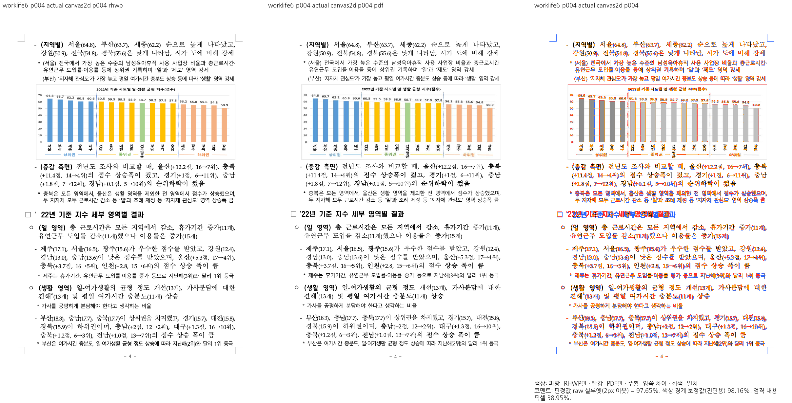
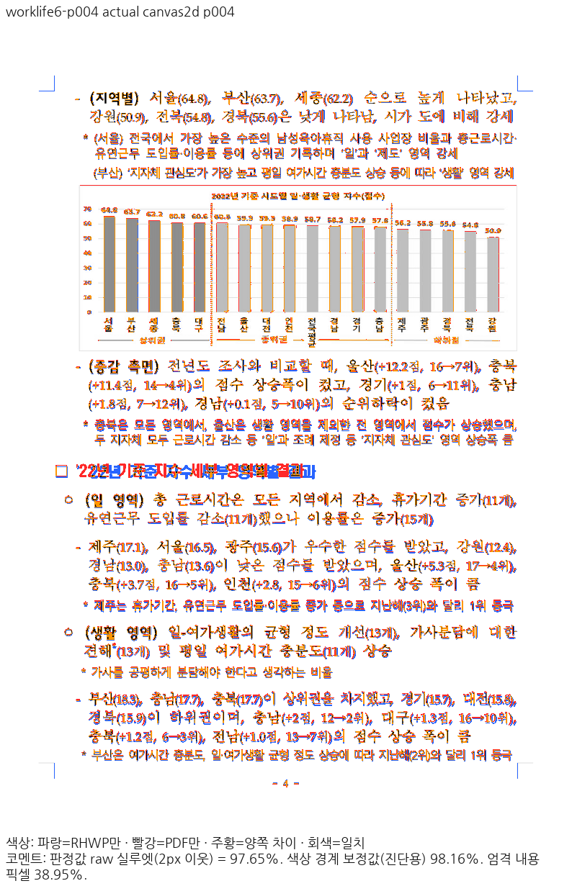
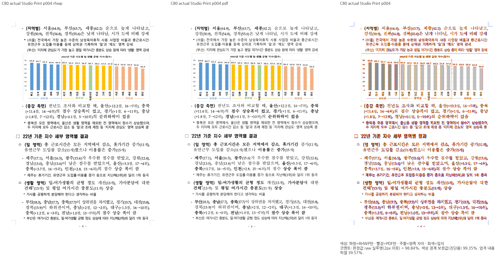
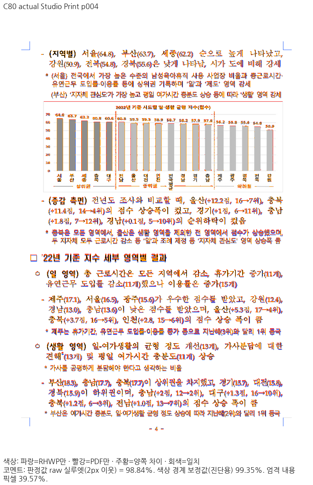
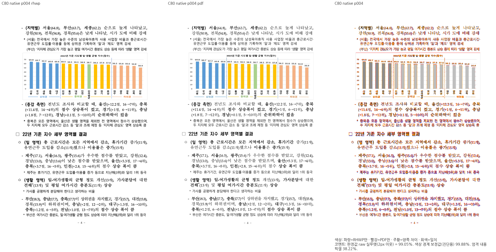
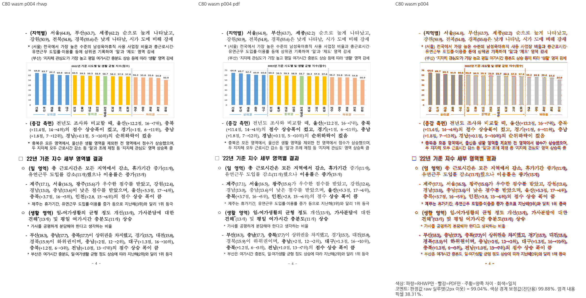
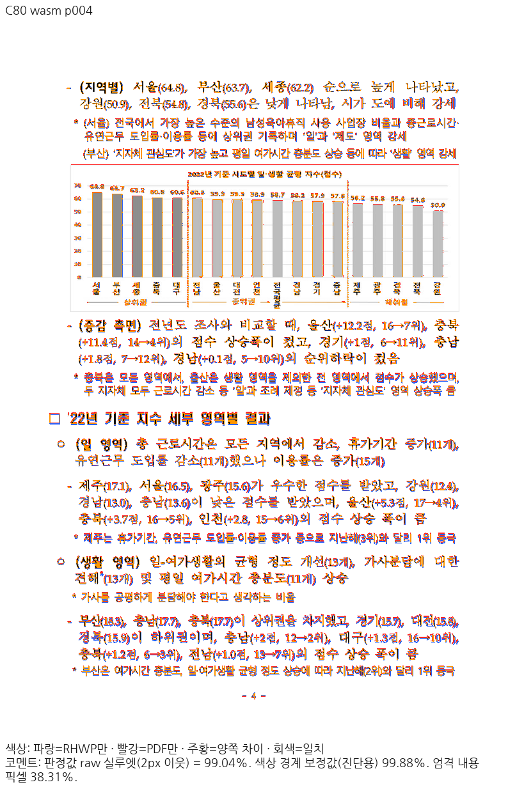

# HFT 작은따옴표와 실제 Canvas 소제목 전진

- 원본: `samples/issue6145/worklife_balance_index_156607916.hwpx`
  SHA256 `7778e5373baf7371a7c643cf4cca73defb065a92ecc941a3e55fff34fcdd2d17`.
- 독립 기준: `pdf/planet-review-20260917/worklife_balance_index_156607916-2020.pdf`
  SHA256 `0cc7229c1d8da5ef425ef76f3ba143db17171a71449bc4e341579a18a07a47ec`.
- Print/compat2022/96DPI. 전6쪽 Native/fresh WASM 최저97.61944/97.61696%,
  중요한4쪽99.04483/99.03763%가 변경 전의 페이지별98% 선행 근거다.
- 변경 전 실제 Studio는 초기 JS/WASM응답 hash를 확인한07a656 코드다.
  작은따옴표 원문 영문 슬롯은한양중고딕HFT(type2)이며 Canvas에서20px로 측정되어
  다음22의 원점125.56CSSpx가 독립 PDF109.86046±2를 벗어난다.
- PDF T16: ToUnicode2019, Widths225, FontMatrix.001, CharProc d1=225.
  별도의 국립국어원2022 Print3쪽 T9에서도2018/2019가225/1000이다.
- 준비 수정은 확인한 원본 기호의 자연 전진만 공통 측정에 연결한다. 선언HFT·원본슬롯
  조건을 유지하고 동명TTF·명시TrueType·내장face·미확인스타일을 승격하지 않는다.
- 정식 실제문서 회귀는 Canvas 준비/선택과 최종Print 레이어의 내용순서·유일소유 및
  다음숫자의 독립±2CSSpx를 검사한다. 수정 전10건9PASS1FAIL(0.075초)→수정 후
  10PASS(0.087초),정상대조를 포함한11PASS(0.081초)다.
- 수정 후 Native/fresh WASM 전6쪽 최저97.61125/97.60876%,90% 미만0이다.
  고정b7a53880 devel 대비0.01%p 이상 하락0,4쪽은99.05194/99.04478%다.
  5/6쪽 PNG는 각backend에서 이전 결과와SHA256이 같아 기존 직접 판독을 재사용했다.
- 실제 Studio Print4쪽은97.65392→98.84117%,초기 JS/WASM2응답 hash가 새 빌드와 같다.
  작은따옴표20→4.5px,다음숫자125.56→110.04CSSpx로 독립109.86046±2를 지킨다.
  Native/WASM3/4쪽과 실제Studio4쪽의 review/overlay를 직접 열어 제목·다음본문·차트
  보존을 확인했다. 세부 글리프/기준선 및3쪽의 기존 차이는 남는다.
- Native build148.153초,Mac locked web/no-opt fresh WASM223.149초,실제Studio19.464초다.
  Docker 최적화 결과가 아니다. 전체48조건/전체회귀/전체actual68/PR준비는 미완료다.

원본 로그·전쪽TSV·독립자폭·빌드/글꼴/실초기응답 hash는 ignored
`output/pr-review/7445-completed-20261009/rebase-b7a53880-20261017/worklife4-title-current-diagnosis/`에 보존한다.
글꼴 bytes와 중간JSON/log는 커밋하지 않는다.
