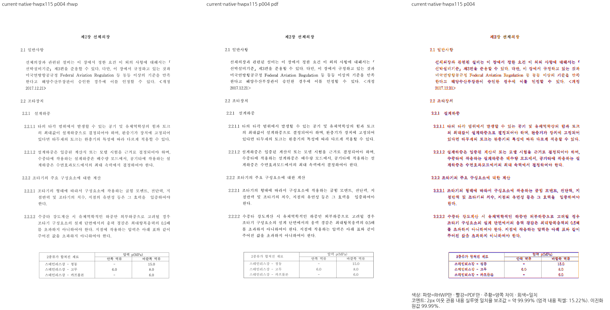
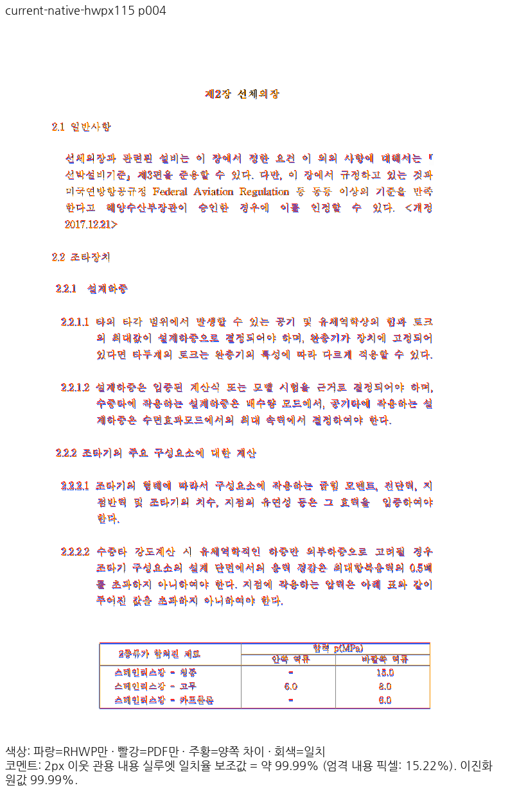

# HWPX 부동 표의 원본 오프셋·온전한 하단 프레임 보정

기준 devel `375aff29498166260a22796d54e67f508c84aada`, 후보 parent `40a54656c4aaf746b552cd2c9c1c4057c04dfc12` + source diff
`b79c34a1d4845f5818794c8df891663ff43d36d0de7b28df9bba7f3896ddede8`다.
이 단계의 전쪽 검증과 회귀 근거이며 전체 PR 검증 완료를 뜻하지 않는다.

## 원인과 공통 소비 경로

공유 저장 호스트 질의 뒤 HWP5만 허용하던 조기 반환 때문에 HWPX가 자신의 문단 기준
1395HU 오프셋을 잃었다. 형식 제한을 제거한 중간 후보 C60은 위치를 복원했지만,
온전한 부동 표가 부모 행의 글줄 클립에 잘려 마지막 줄·아래 괘선이 사라졌다.
C60은 4쪽98.18361%였어도 직접 판독에서 실패해 수용하지 않았다.

입력의 마지막 행 선언5331HU에는 여유가 있다. 앞 두 행은 내용에 맞춰 각각1282HU지만
표 전체 선언7635HU에 비해 합계가260HU 크다. 저장 쪽 되감김이 없고 끝 행 내용 하한을
넘지 않을 때만 그 빈 여유를 회수한다. RowBreak/CellBreak가 같은 계약을 사용한다.

`height_measurer::fit_stored_declared_tail_row_heights` → 캐시가 있는
`typeset::table::fit_measured_for_host` 및 `layout::resolve_row_heights_with_common_fit` →
캐시 없는 중첩 표의 실제 행 계산도 같은 순수 행 결과를 소비한다. 앞 행을 비례 축소하지 않는다.
`stored_nested_float_placement`가 생산한 같은 `ParagraphFloatPlacement`의
`table_top/occupied_bottom` → 부모의 ordinary child 배치·clip이 연결된다.
원본 시작과 행/내용 창 전체를 소유한 Exclusion 개체만 그 물리 끝까지 부모 clip을 연다.
부분 scalar/row 컷의 미소유 꼬리, 재조판·편집 표와 저장 되감김의 계약은 유지한다.
흐름 cursor·쪽 수용 예산을 늘리거나 문서 ID/좌표 예외를 넣지 않았다.

## 독립 기준·같은 조건의 전쪽 검증

- 입력 `samples/issue1949_giant_cell_nested_tables_perf.hwpx`, SHA-256
  `fc6e5f156de470dfbb14aab392389491720ee7fb1bf6f03fe9a018e93b420c65`.
- 독립 한컴 Print `pdf/issue1949_giant_cell_nested_tables_perf-hwpx-2020.pdf`, SHA-256
  `ba065afdd3ace7fd6b87fe82848e6cae3d01915a1606e4d8a70e4c2153d57d73`,115쪽.
- canonical Visual Sweep,96DPI,compat2022,Print profile,threshold32,2px 이웃 관용90%.
  Native Skia PNG와 fresh WASM Canvas PNG를 직접 출력하고 stable readback을 사용했다.
- 같은 빈 명시 FontEnvironment와 독립 전체 한글 표본의 원본 HFT를 공급했다. HFT SHA
  `7257416630313e6989c7690847f2c372a3d5106a2c215a6e16ee03573fe995dd`.
  대상 Print를 글꼴 제작에 쓰지 않았고 글꼴 바이너리를 커밋하지 않았다.

| 경로 | devel 최저 | 후보 최저 | 쪽수 | 후보90% 미만 | devel 대비0.01%p 이상 하락 |
| --- | ---: | ---: | ---: | ---: | ---: |
| Native | 97.12990% | 97.13453% | 115/115 | 0 | 0 |
| fresh WASM | 97.11559% | 97.13430% | 115/115 | 0 | 0 |

Decimal 원값 비교의 최대 하락은 Native0.00799%p,WASM0.00327%p다.
4쪽은 Native devel97.59871→후보99.98878%,WASM97.64154→99.98877%다.
과거 후보 C59의4쪽89.43018/89.42150%는 변경 전 증거로만 사용한다.

Mac WASM은 locked wrapper `--target web --out-dir pkg --no-opt` 로컬 대체 빌드다.
Docker 최적화 통과로 보고하지 않는다. 빌드284.135초,root pkg/Studio public/동결 pkg의
JS SHA `b6e1206b54974667020dbbe9c972f41c03f9d9ff15b85a0c5885f23221c78cb2`,WASM SHA
`2ae3eeca4e6d655d7ef3a191ab3120850e56611bf40e02e98fdb6e35b75faa07`가 같다. 실제 Studio 초기화 검증은 별도로 남아 있다.

## 직접 판독과 중요한 회귀

[review.png](review.png)와 [WASM 전후 비교](wasm-review.png)는 Print/변경 전C59/변경 후C62 순서다.
[확대 상세](detail.png)에서 마지막 행의 세 내용·상하 간격·아래 테두리가 유지된다.
[Native 전체 쪽](native-output-review.png),[WASM 전체 쪽](wasm-output-review.png),
[Native overlay](overlay.png),[WASM overlay](wasm-overlay.png)에서 앞뒤 본문·줄바꿈도 대조했다.

115쪽 중 양의 원본 문단 오프셋을 가진 온전한 중첩 표는4쪽 host81뿐이어서 같은 동작의
우선 보호 쪽으로 선정했다. 다른 동작의100% 페이지로 이 경계를 대체하지 않는다.
독립 PDF의 표 위/아래 y=969.65869140625/1071.3080240885417 CSSpx를 ±2CSSpx로 검사한다.
PDF pt×96/72이며 raster의2px 관용 일치율과 서로 다른 허용 오차다.

[정식 회귀4건](../../../../../../../tests/cases/issue_7445_hwpx_nested_offset_frame.rs)은 문단 오프셋의 원본 줄·여백 관계,모든 조상 clip 안의
완전 자식과 끝 행 텍스트 순서/누락/중복,다음 쪽 비중복,내용에 맞춘 머리행과 선언 총높이,
독립 Print 위/아래 좌표를 보호한다. sourceC59에서1PASS/3FAIL → 현재4PASS다.
C60에서 별도로 노출된 clip 실패도 보정 전에 실제 실패했다.
manifest를 재생성한 정식 suite 실행은4PASS,기존 집중11묶음48건도 PASS다.

기존 경계도 새 source로 다시 출력했다. 다음 표는 선택 쪽의 최저이며 전쪽 수용을 대신하지 않는다.

| 대조군 | 선택 쪽 | Native 최저 | fresh WASM 최저 |
| --- | --- | ---: | ---: |
| 원본 HWP | 29/104 | 97.18819% | 97.15033% |
| 과거/현재 분할본 각각 | 177/178 | 98.23931% | 98.26963% |
| PII 명시 환경 | 42/65 | 98.16116% | 98.16618% |
| float-stack-defer | 전2쪽 | 99.44614% | 99.44997% |
| pic-in-head-01 저장 되감김 | 18/19 | 99.90665% | 99.90721% |

[Native 대조](controls-native.png)와 [WASM 대조](controls-wasm.png)에서 끝 행·쪽 경계와
177쪽 표 종료/178쪽 두 그림·후속 본문의 보존을 직접 확인했다.
전체 제출 게이트나 다른 문서의 시각 수용으로 확대하지 않는다.

## 원본 증거와 잔여

ignored 정본 `output/pr-review/7445-completed-20261009/regression-policy-audit-20261015/`
`rebase-375aff29-20261016/`의 `candidate-c62/{producer,wasm-producer}.json`,
`candidate-c62-{native,wasm}-boundary/results.json` 및 각각의 전체 `silhouette.tsv`,
`candidate-c62-hwpx-fixed-base/{results,decimal-degradation}.json`,
`hwpx-frame-registration-steps.json`과 before/after 로그를 보존했다. raw TSV/JSON/log는 커밋하지 않는다.

C59 code head의 전체 nextest10467PASS/0FAIL/45skip은 이 후보의 새 전체 통과로 재인용하지 않는다.
이후 전체 회귀·lint/Skia/Studio/Gym·실제 소비 경로,다른 문서의 devel 대비 하락과
PII 기본 글꼴·법원 서식의 알려진 미세 차이는 아직 검증/보정 대상이다. PR은 아직 준비 완료가 아니다.

## 최신 devel4662 재검증

2026-10-16,기준을 `4662c069e557e928ed7968d061121fde90b1f027`로 갱신해 같은 원본·독립PDF·
96DPI·compat2022·빈 명시 환경·같은 독립HFT/기존TTF 공급으로 전115쪽을 다시 출력했다.
후보 `8772811f0577bc8a561813f161f45e34194e65b8`의 Rust/Native/WASM source는
검증된 `bfcb29730a9cf3061bb84d250d9269bb6c17fa3d`와 동일하다. C68은Studio TypeScript 보정이며
이번 canonical Native/WASM의 새로운 Rust 변경으로 보고하지 않는다.

| 경로 | 최신 devel 최저 | 현재 최저 | 쪽수 | 현재90% 미만 | 0.01%p 이상 하락 |
| --- | ---: | ---: | ---: | ---: | ---: |
| Native | 97.12990% | 97.13453% | 115/115 | 0 | 0 |
| fresh WASM | 97.11559% | 97.13430% | 115/115 | 0 | 0 |

4쪽은99.98878/99.98877%이며 표의 세 마지막행 내용·하단선·앞뒤 본문을 정본review/overlay로
다시 판독했다. 기존4회귀가 보호하는 소속·조상clip·원본높이·Print 위/아래±2CSSpx 계약이
98% 선행 조건을 유지한다. 다른47조건의 미완료·하락을 이 문서의 통과로 상쇄하지 않는다.
원본 전체와 두 분할197쪽,HWPX115쪽은 서로 다른 입력·독립PDF로 검증한다.

ignored 원본은 `regression-policy-audit-20261015/rebase-4662c069-20261016/c68-hwpx-base-paired/`의
scope·최종results·Native/WASM TSV·Decimal하락목록이다. 두 하락목록은 모두 비어 있다.
