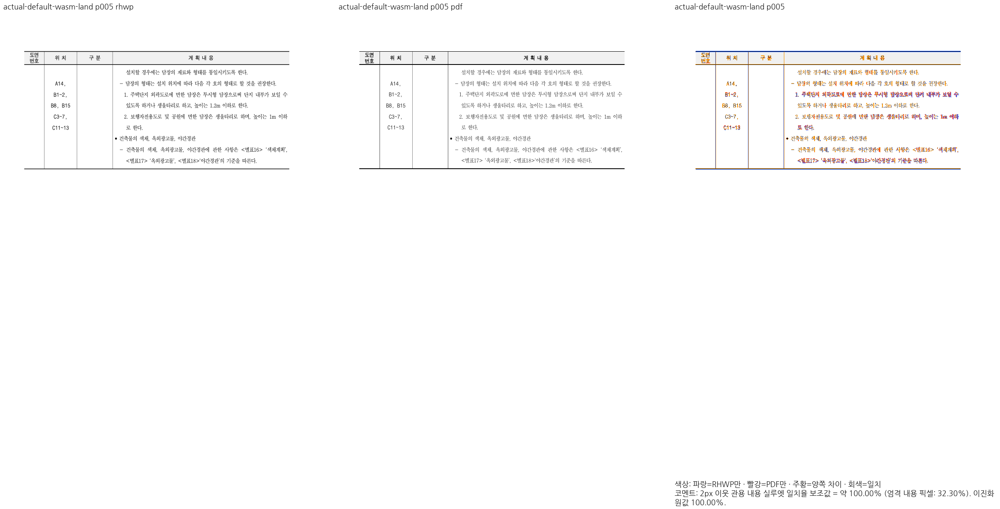
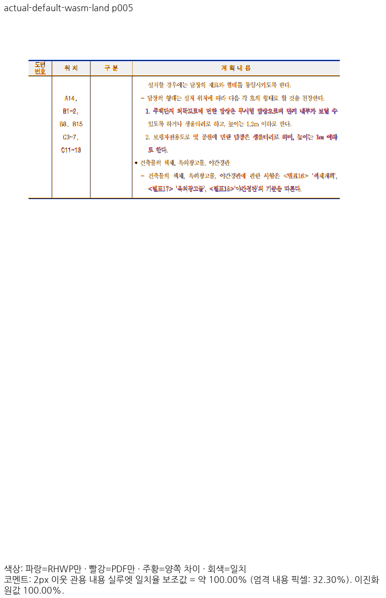

# 토지표의 실제 기본 글꼴 환경과 종료 조각 회귀 보강

Issue: #7445 / 원본 회귀 #6803. 기준 devel `4662c069e557e928ed7968d061121fde90b1f027`.
현재 생산 Rust·Native/fresh WASM은 `bfcb29730a9cf3061bb84d250d9269bb6c17fa3d`와 같다.
이 증적과 함께 변경한 것은 기존 회귀 검사와 작업 기록이며 생산 배치를 새로 수정하지 않았다.

## 원본·조건

- 원본 `samples/issue6803/1376496-neighborhood-facility-land-table.hwp`, SHA-256
  `2482b695bc92c0cafe661af63c54acea834b6927bf9c666bdf47299910e3801d`.
- 독립 한컴 Print `pdf/1376496-neighborhood-facility-land-table-2020.pdf`, SHA-256
  `ef7ac0c12d37f8b96f1af5e2d67e812151d9b9862c4f42824fee8bc04a5dda12`.
- Print profile,compat2022,96DPI/96CSS 좌표계,2px 이웃 관용90%,canonical Visual Sweep.
- 같은 독립 HFT 프로그램과 기존 TTF/시스템 공급을 사용한다. 폰트 바이너리·원시 PDF를
  이 증적에 추가하지 않았다. 허용치·마스크·DPI·기준 PDF는 바꾸지 않았다.

## 실제 기본 선택부터 확인

빈 명시 환경의 기존 비교와 실제 기본 선택의 SVG가4쪽에서 달라 실제 기본 선택을 먼저
전쪽 출력했다. 원인은 실제 존재하지 않는 원 face의 선언 대체를 프로그램 준비 결과가
선택하는 경로다. 입력은 수정하지 않았고 강제 특정 글꼴을 진단의 기본값으로 넣지 않았다.

Native와fresh WASM 모두 `font_environment=None`으로 시작했다. 실제 공급 프로그램으로
Rust 공통 API가 만든 환경을 별도 명시 재생한 출력도 전5쪽 PNG가 각각 byte-identical이다.
기본 환경을 명시 환경으로 몰래 대체한 결과가 아니다. 이전 빈 환경 비교는 따로 보존한다.

| 경로 | 기본 전쪽 수 | 기본 최저 | 90% 미만 | 검증 프로그램 명시 재생과 동일 PNG |
| --- | ---: | ---: | ---: | ---: |
| Native | 5/5 | 98.65935% | 0 | 5/5 |
| fresh WASM | 5/5 | 98.65784% | 0 | 5/5 |

| 쪽 | Native | fresh WASM | 보호·선정 근거 |
| --- | ---: | ---: | --- |
| 1 | 99.99825% | 99.99828% | 기존 결측 기호·후속 제목 원점 검사 유지 |
| 2 | 98.88466% | 98.88487% | 전쪽 보존·쪽수 선행 조건 |
| 3 | 98.65935% | 98.65784% | 이어받기 내용 보존,하단선 미세 차이는 별도 잔여 |
| 4 | 99.55258% | 99.55185% | 이어받기·중첩 표 관계 유지 |
| 5 | 100.00000% | 100.00000% | 같은 표의 종료 경계 중 양쪽 최솟값이 가장 높은 쪽 |

5쪽의 마지막 문단·아래 괘선·반복 머리행·뒤의 빈 본문 영역을 Native/fresh WASM
정본review/overlay에서 직접 판독했다. 100%는2px 이웃 관용 실루엣 값이며 엄격 픽셀
완전 동일을 뜻하지 않는다. 다른 쪽의 미세 차이를 이 값으로 상쇄하지 않는다.
3쪽 하단선은 Print보다 약2.4CSSpx 낮아 원인 추적 대상이며 문서 전체 시각 완료를 주장하지 않는다.

## 관계 검사에 중요한 종료 좌표 추가

[기존 정식 회귀](../../../../../../../tests/cases/issue_6803_split_start_row_rowspan_end_cut.rs)의
`the_fragments_partition_the_cell_exactly_once`가 원본67문단의 순서·누락·중복 검사를 유지한다.
같은 검사 안에 원본 표의 마지막 쪽 소속·종료 셀 포함·마지막 원본 문단 보존과 다음 Print
경계를±2CSSpx로 보강했다. 영역 좌표로 대상을 선택하지 않고 원본 section/paragraph/control 및
마지막 셀의 소속으로 선택한다.

| 경계 | 독립 Print CSSpx |
| --- | ---: |
| left | 58.368000 |
| top | 92.538656 |
| right | 698.663981 |
| bottom | 376.068034 |

기대값은 독립 PDF의 외곽 선 path를72pt→96CSSpx로 환산해 얻었다. rhwp bbox에서 역산하지 않았다.
기존 관계·기호 검사4건은 보강 후4PASS/0FAIL(0.350초)다. 이번 변경은 새 생산 결함을 고친
FAIL→PASS가 아니라 이미 정확한 종료 조각을 보호하는 기존 검사 보강이다. 이를 새 구현 보정의
수정 전 실패로 과장하지 않는다. 새 검사 묶음을 반영한 전체 회귀는 제출 전 별도 확인 대상이다.

### Native

### fresh WASM

## 공급 조건 감사와 잔여

현행48조건 가운데 대체 후보가 없는28조건782쪽은 기본null/빈 환경의 공개SVG가 전부
byte-identical이다. 대체 후보가 있는20조건963쪽은 실제FontFace로드·hash·형식을 검증한
프로그램으로 공통 환경을 만들고 SVG를 대조했다. 16조건은 전쪽 동일하다. PII 두 조건과
재해는 family 표기만 달랐고 토지표는 실제 paint 속성도 달랐다. 이 SVG 감사는 PNG나
실제 Studio 화면 수용을 대신하지 않는다. PII default의 빈 환경 대조는 의도적인 반례로만
보존하며 실제 paired reference와의 대조와 구분했다. 실제 조건의 PNG 검증을 별도로 연결한다.

ignored 원본은 `regression-policy-audit-20261015/rebase-4662c069-20261016/`의
`c68-land-default-check/`, `c68-empty-environment-equivalence.json`,
`c68-prepared-environment-audit/`, `c68-environment-svg-differences/`,
`c69-land-px-regression.log`에 보존한다. 최신 base 대비 전체 비교·하락 보정과 다른 문서
잔여가 계속 남아 있어 PR 준비 완료가 아니다. 지침은 바꾸지 않았다.

### 같은 실제 프로그램 조건의 최신 base 대조

실제 기본 출력과 PNG가 같은 검증 프로그램 환경을 그대로 base에도 공급해 전쪽 비교했다.
Native base최저98.17937→현재98.65935%,WASM98.18952→98.65784%다. 다만2쪽은
Native98.91570→98.88466%(0.03104%p),WASM98.90763→98.88487%(0.02276%p)로
하락해 이 조건도 재검토다. 이전 빈 환경의 비교를 지우거나 이 개선으로 상쇄하지 않았다.
정본은ignored `c69-default-paired-base/`이며 재해2쪽도 같은 방식으로 대조·보존했다.
