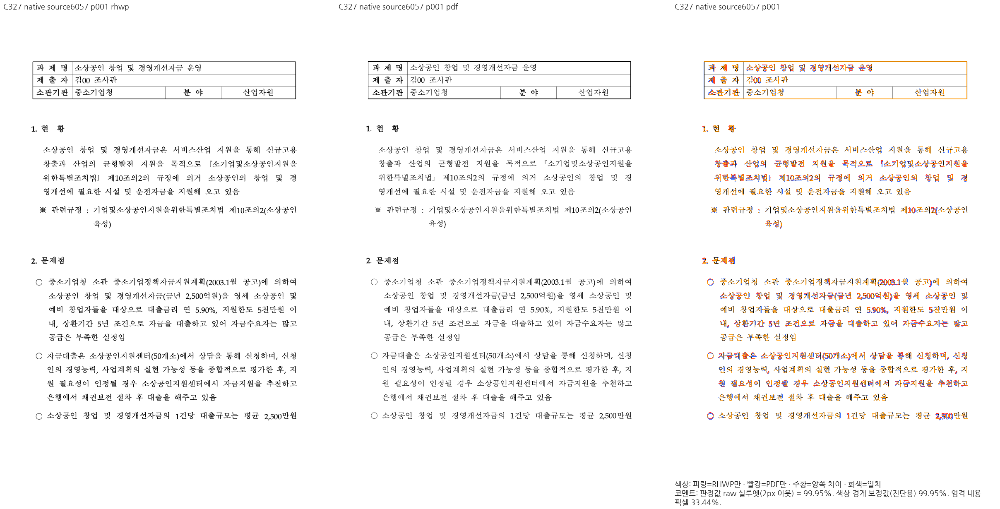
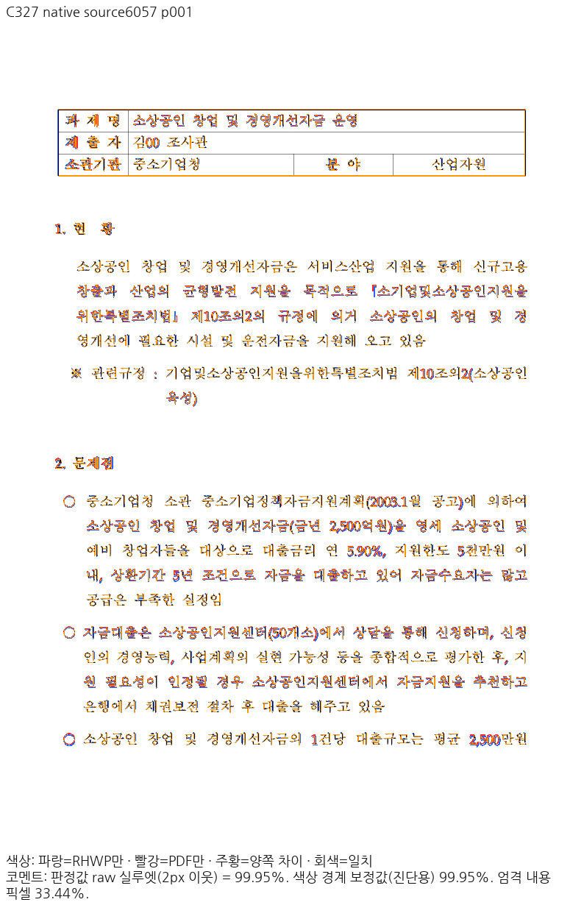
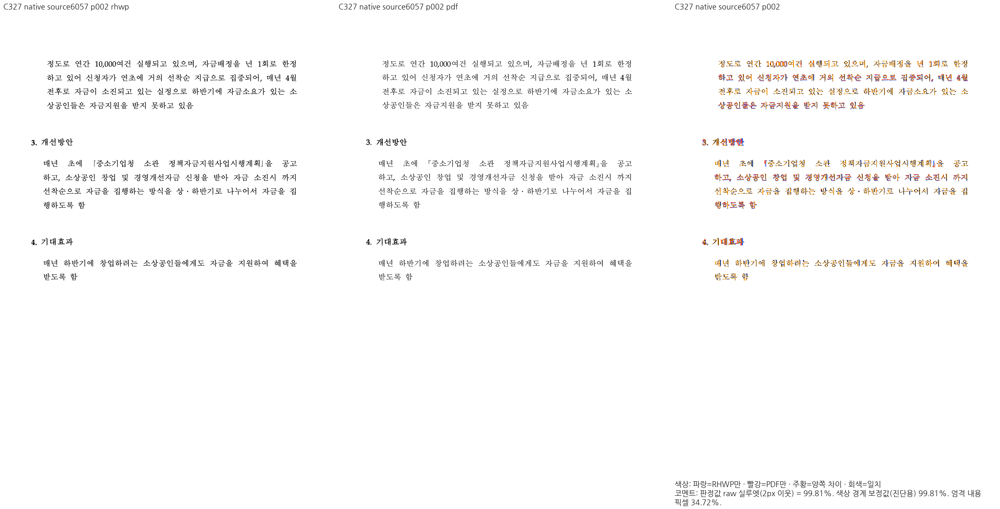
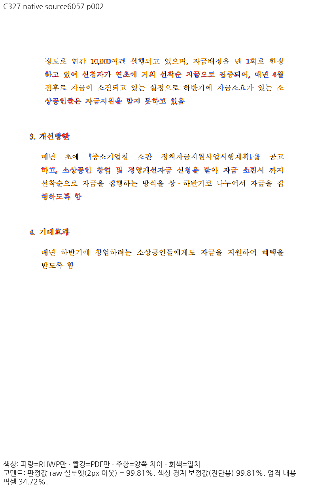
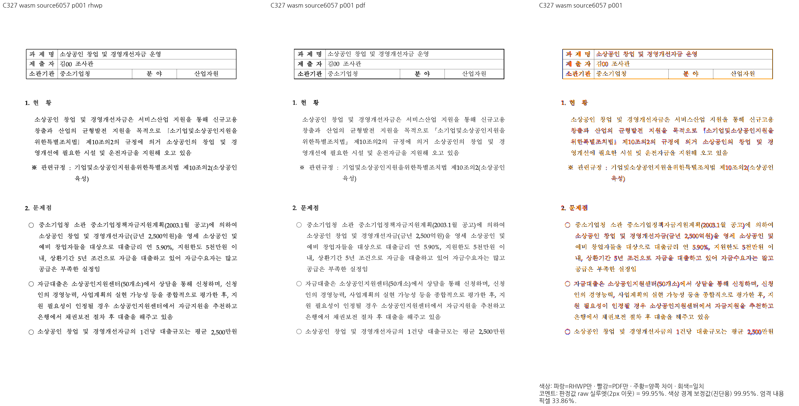
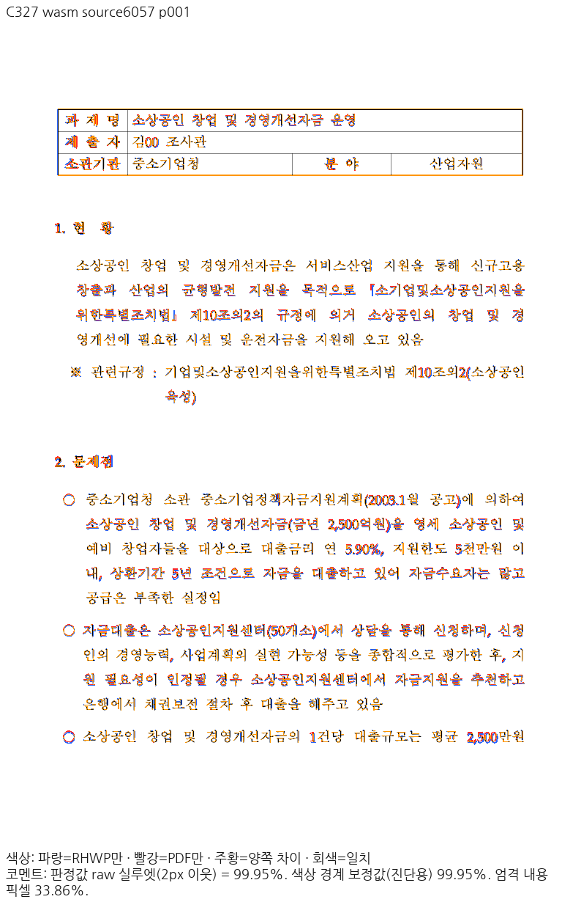
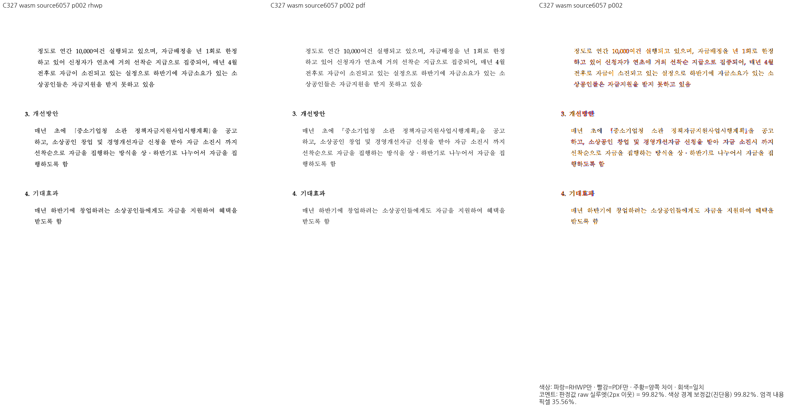
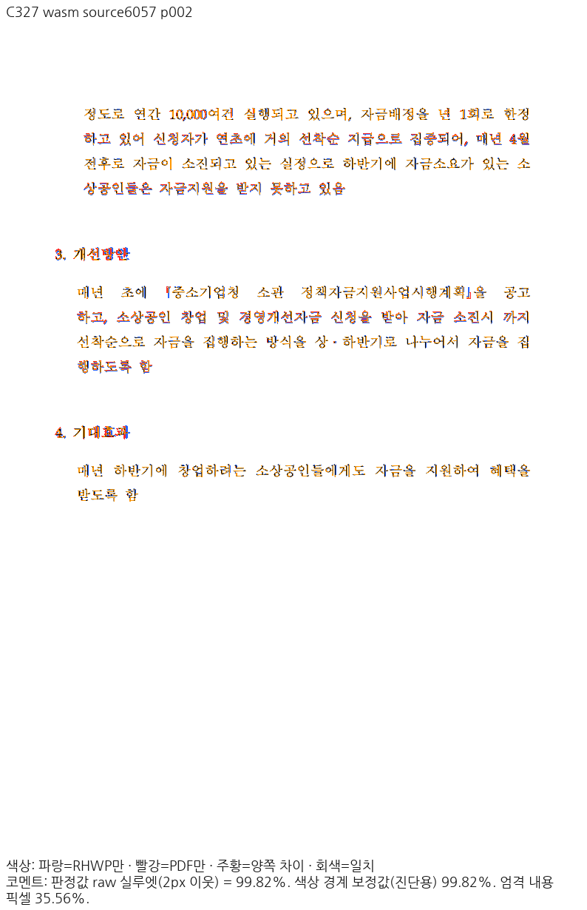

# #6057 반각 책괄호와 뒤 법조문 보호

같은 원본 `samples/issue6057/29494.hwp`를 한컴2020의 정상 Print로 출력한
`pdf/issue6057-29494-2020.pdf`와 대조했다. 변환 job은
`2bd1ce6e-c057-4ff1-a2fb-a4bbec6e7314`, engine2020/build11.0.0.9136,
Print method0/preprocess none이다.

## 독립 기대와 변경

원본 PUA F0854/F0855는 Haansoft Batang A854/A855이며 흰 겹낫표『』의 반각이다.
독립 PDF 임베드 glyph와 설치 원본의 윤곽·advance512/UPEM1024가 같다. 글꼴 바이너리는
이 증적에 포함하지 않는다. 전각《》를 요구하던 기존 검사가 잘못되어 원본 기호와0.5em
전진으로 교정했다. 별도 원문 Unicode《》·『』는 각각의 원문 정체·폭을 유지한다.

`issue_6057_book_bracket_pua_projects_white_corner_brackets`는 표시 정체와
뒤 본문 순서를, `issue_6057_justified_je_keeps_fullwidth_advance_before_digits`는
원본 글자 크기에 대한 한글 전진·책괄호 개수·앞뒤 줄 소속·뒤 한글 비겹침을 검사한다.
1쪽의 독립 PDF text origin을 pt×96/72로 변환한
열기(503.08732,370.95459), 닫기(234.11312,404.51790)CSSpx를±2CSSpx로 보호한다.
이 좌표는 Native 출력에서 복사하지 않았다.

## 전쪽 시각 선행 조건

C327 frozen CLI/locked fresh WASM `--target web --out-dir pkg --no-opt`의
인쇄 프로필·compat2022·96DPI·기존 pdftoppm·raw2px90%를 사용했다.
Mac 로컬 대체 빌드이며 Docker 최적화 결과가 아니다.

| 쪽 | Native raw% | fresh WASM raw% |
| --- | --- | --- |
|1|99.95211|99.95039|
|2|99.81353|99.82029|

전2쪽 쪽수2/2,누락·중복0이며 양쪽 review와 standalone overlay를 직접 열었다.
법명 앞뒤 흰 겹낫표, 뒤 제10, 다음 쪽의 이어지는 본문·개선방안·기대효과·마지막 문단이
보존된다. 작은 AA와 굵은 제목 획 차이가 남으며 엄격 RGB 일치를 뜻하지 않는다.
98% 이상 양쪽1쪽의 중요한 책괄호 위치를 우선 선정했다.

현재 parent는`b80662087571f746579350d2ef00f3387b54b527`, base는
`224a326063a5aeab5a1ca8dcaa92918f55843ffc`이다. parent만으로 WIP 빌드를
입증하지 않으며 C327 source ledger/Native·WASM producer와 다음 파일 hash를 함께 사용한다.
후속 테스트 기대·VSCode 자산 보정은 이 frozen 엔진 소스를 바꾸지 않았다.

| 엔진 소스 | SHA256 |
| --- | --- |
|`src/document_core/queries/rendering.rs`|`a342515c10f3e10997b1bb79e4aff04033be83897311e940d4376284a4f83f31`|
|`src/renderer/font_metrics_overlays.rs`|`454a75606931ab8c3bc897451225baf9651f610a0130e56e922ceea14761be9a`|
|`src/renderer/layout/paragraph_layout.rs`|`b5fb82e7bd67e386a6c4654f6a10a16781de11900dc2541abbc6db09ec490217`|
|`src/renderer/composer.rs`|`a913ea10ef587f1760c36359ce1b0491bc31698746b54fb54c3005dae038f15e`|
|`src/renderer/svg.rs`|`ed25c7e5bd9934cf337f9b500efc819745877633417f2358dff6df608ec55363`|

## 재현 로그와 회귀 실행

ignored output의 `rebase-6ed1682c-20261018/pua-source-print-c324/`,
`pua-and-page-range-c327/`, `pua-svg-consumer-c330/`,
`regression-expectations-c332/`에서 원본/Print/글꼴 원장과 실제 SVG 소비를 보존한다.
C332의 실제 실행은 기존 PUA producer2파일만 안전 임시 복원한 before2FAIL→
현재 source를 hash대로 복원한 after관련11PASS다. 기대 좌표·문턱을 완화하지 않았다.
전체52조건·전체 회귀·actual92와 남은 roadmap 하락은 별도이며 이 증적으로 PR 준비 완료를
주장하지 않는다.

## 이미지

### native 1쪽

### native 2쪽

### wasm 1쪽

### wasm 2쪽

## 바이트 보존

| 파일 | SHA256 |
| --- | --- |
|`native-p001-review.png`|`70ba42af8f34d73da26db941a579c7dc981c0860dd0d6b43ac364fb208eb7257`|
|`native-p001-overlay.png`|`34b58f51cea711ff7b55152396991c40faa7f77e375767dd23dc46b25467ddd3`|
|`native-p002-review.png`|`dba3ab5d805c5104ba9c9932e1d3c3f2659a31c7ea3777b4dc1c1b12a640a528`|
|`native-p002-overlay.png`|`11b2d843fee2c9b822358eb463eb8c7a059bed5a55df1d93b0daa388028679bf`|
|`wasm-p001-review.png`|`61fd72084381a03da2ce732f2d059964a9ecdef253b72276c2b00f150a8217ef`|
|`wasm-p001-overlay.png`|`31d8d997dbc078a30879a43fcd167ab8410888fb17fee0b6ffe8bb83f0984554`|
|`wasm-p002-review.png`|`fae8067d1e6f7f5b42b2ed78cf92dc784b387bd4855360c695a03785885c6c4d`|
|`wasm-p002-overlay.png`|`d6434ac182c97e1f116ed9e4362d866421a64af13dd7be8794d2feb2d573fd0d`|
