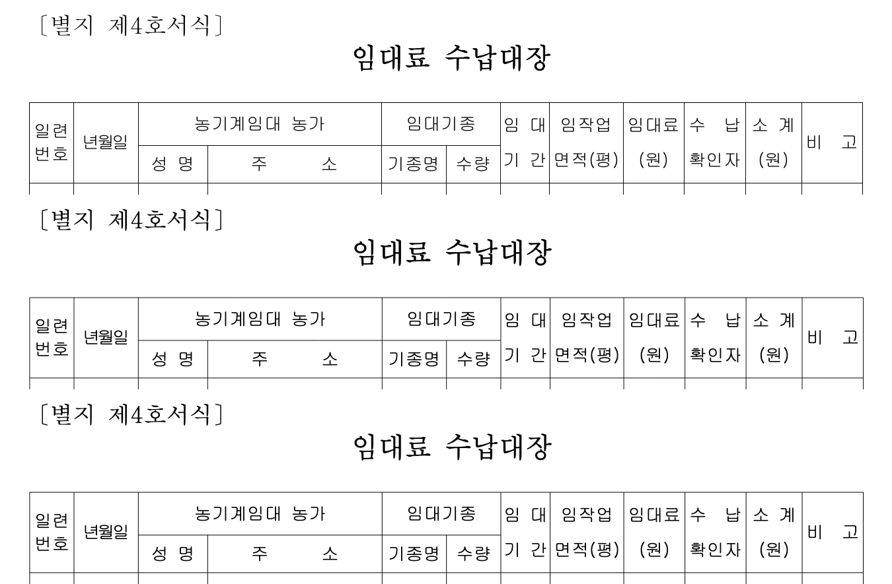
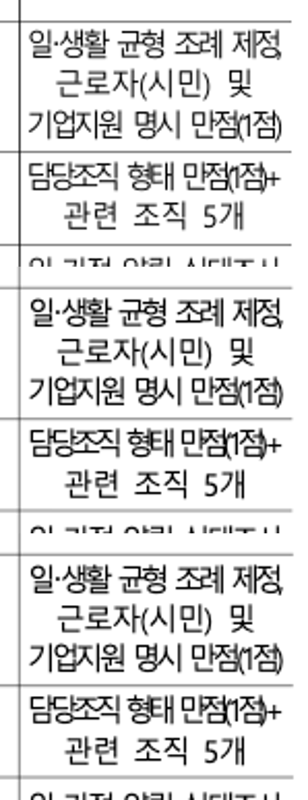
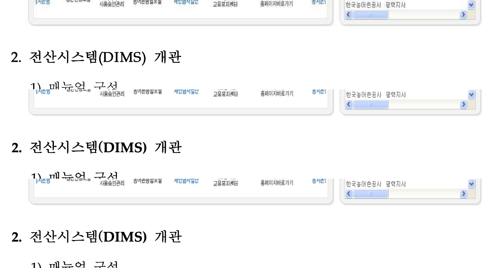

# 문서별 중요 위치의 px 회귀 적용

전쪽 Native/fresh WASM 90%와 독립 Print 쪽수 일치를 확인한 문서에서,
해당 페이지도 양쪽98% 이상·확대 판독을 충족한 위치를 ±2 CSSpx로 보호한다.
좌표는 독립 Print에서 추출하며 원문·소속·순서·누락·중복·포함 검사를 유지한다.
다른 내용의100% 페이지로 변경한 핵심 경계를 대신하지 않는다.

| 문서·중요 위치 | 쪽 | Native / fresh WASM | 적용 검사 |
| --- | ---: | --- | --- |
| table-text 연도·금액 셀 안 여백과 프레임 |1|100 /100|기존 #7413 검사에서 독립 두 셀 x/y/w/h ±2px|
| 영월 마지막 수납대장 표 시작·종료 |4|100 /100|#5699에 제목·원본 셀 소속/빈 행 보존 + 독립 외곽 x/y/w/h 추가|
| #7490 같은 줄에 들어가는 편집 표 |1|98.74064 /98.76872|원본 표 내용·글줄 소속 + 독립 편집 Print x/y/w/h|
| #7490 indent20444 편집 제목 |1|98.74535 /98.77329|제목 전체 한 줄·본문 포함 + 독립 첫 glyph x/baseline|
| 일·생활 균형 지수 마지막 열 SQUEEZE |6|99.94512 /99.94559|두 셀 원문·안 여백/저장 폭 + 독립 셀 프레임|
| 자산관리규정 그림 뒤 전산시스템 제목 |36|98.92960 /98.88248|그림/제목의 저장 간격·순서·비겹침 + 독립 x/baseline|
| 토지이용 제목의 한점 리더 후속 항목 |1|98.81416 /98.81533|기존 #6803의 독립 건폐율/용적률/높이 x ±2px 유지·재검증|
| 개인정보 소제목의 실제 기호 공급자와 후속 한글 |65|98.16116 /98.16618|#5846의 원문/기호·후속 글자 소속 + 독립 기호/다음 글자 x와 baseline|
| 규제분석 누름틀 값의 시작 |12|99.535 /99.535|작성한 접두 공백/값 안 배분을 구별 + 독립 첫 글자 x|
| 생물독소 마지막 줄의 세 그림 |172|99.50266 /99.51700|같은 세 그림의 높은 점수 우선 대조군: 소속·기준선·자연 폭 포함 + 독립 마지막 그림 x/끝|
| 생물독소 비마지막 줄의 그림 배분 |168|99.39203 /99.40273|실제 보정 경계: 소속·기준선·원본 줄 폭 + 독립 마지막 그림 x/끝|
| sample16 2022 저장본 기호 프로그램 |59|99.20113 /99.20178|같은 한점 리더의 가장 높은 완료 쪽: 원문/잉크13개 개수·순서 + 독립 원점/중심|

문서별 전쪽 TSV와 독립 추출값은 아래 증거에 있다.

- [편집 표·제목](issue7490-fit-prefix/evidence.json): 원본1쪽, 서로 다른 정확한 편집 입력 두 종류도 각각 전1쪽 검증했다.20444를20445의 두 줄 기대값과 혼동하지 않았다.
- [일·생활 균형 지수](worklife-squeeze/evidence.json): 전6쪽 최저99.08366 /99.08514%.
- [자산관리규정](asset-picture-successor/evidence.json): 전60쪽 최저90.54804 /90.54058%.
- [영월 독립 프레임](yeongwol-final-ledger/independent-frame.json): 전4쪽 최저98.05546 /97.72386%.3쪽 월별누계의 관계 검사는 그대로다.
- [현재 소규모 전쪽 대조](current-small-whole-results.json), [Native 소스·실행 파일](current-native-producer.json), [fresh WASM](current-wasm-producer.json).

수납대장4쪽100%는 마지막 표의 별도 경계를 보호한다. 월별 셀이 있는3쪽의 px 수용 근거가 아니다.
일·생활1쪽의 더 높은 점수도6쪽 SQUEEZE 셀을 대신하지 않는다. 토지이용3·4쪽 분할은
192DPI WASM98% 미만이므로 관계형 검사를 유지한다.

## 실제 출력 오류와 기존 검사 실패

#7490 편집 표는 모든 열이 병합돼 단일 열 폭을 역산할 수 없는 경우였다.
요청12000HU를 셀에는 보존했으나 컨트롤 크기/응답을3600HU로 줄였다.
요청 합계를 모델·직렬화·응답에 공유하도록 구현을 고쳤다. 동일 편집 전쪽 비교는
Native89.32950 /WASM89.35068% →98.74064 /98.76872%다.
정상 단일 열 대조군, 합계 overflow의 원자적 거절, 저장 후 폭 보존도 검사한다.

집중 검증은68/68→71/71→73/73 PASS다. 자산관리규정의 기존 검사도 포함한
최종75건은74PASS/1FAIL이다. 새 px 검사는 모두 통과했으나 기존 HFT 굵은 한글
전진 계약이 실패했다. [실행 결과](px-focused-validation.json)에 남겼으며 검사 제거·완화 없이
구현을 계속 보정해야 한다. 전체 기존 회귀 교정·전체 PR 검증 완료를 뜻하지 않는다.

확대 PNG의 배열은 독립 PDF → Native → fresh WASM 순서다.

## C33/C38 후속 검증

[누름틀·빈 문단 소유](field-prefix-consumer-repair/validation.json)와
[원본 기호·그림 배분](source-program-and-inline-spacing/validation.json)에 버전별 증거를 연결한다.
C38은 Native/fresh 각465쪽(2022 저장본64, 생물독소205, 원본 HWP5 64,
개인정보 기본/명시각66)의 전쪽90%를 확인했다. Native/fresh의 같은 동작 점수
최솟값을 기준으로2022 저장본59쪽99.20113%(다음60쪽99.14881%)를 선택했다.
생물독소172쪽은 마지막 줄의 자연 폭 대조군이고,168쪽은 비마지막 줄 배분의
가장 높은 완료 쪽이다. 서로의 원본 폭 계약을 섞지 않는다.

앞 표의 다른 행은 링크된 기존 생산자의 증거다. 새 head의 전체 범위와 devel 대비
전쪽 비교는 별도로 다시 수행한다. 이 표를 전체 PR 검증 완료로 인용하지 않는다.
