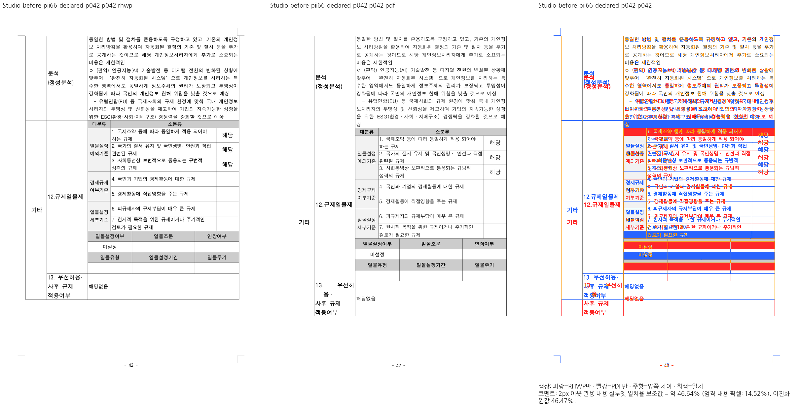
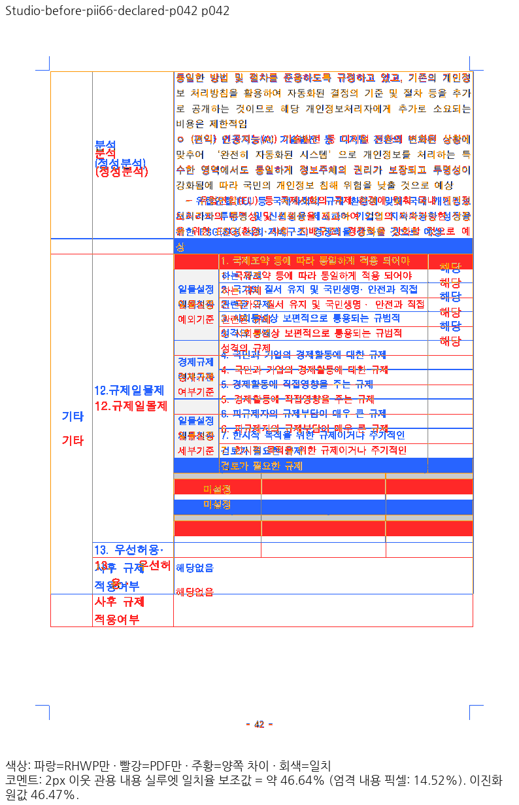
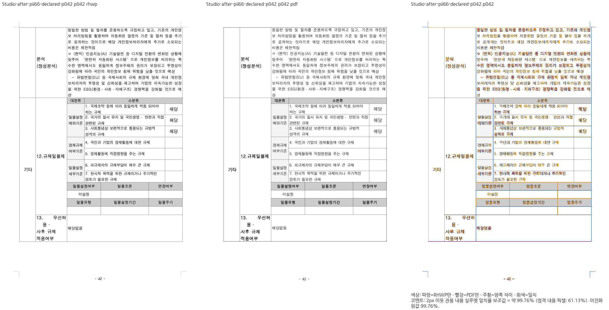
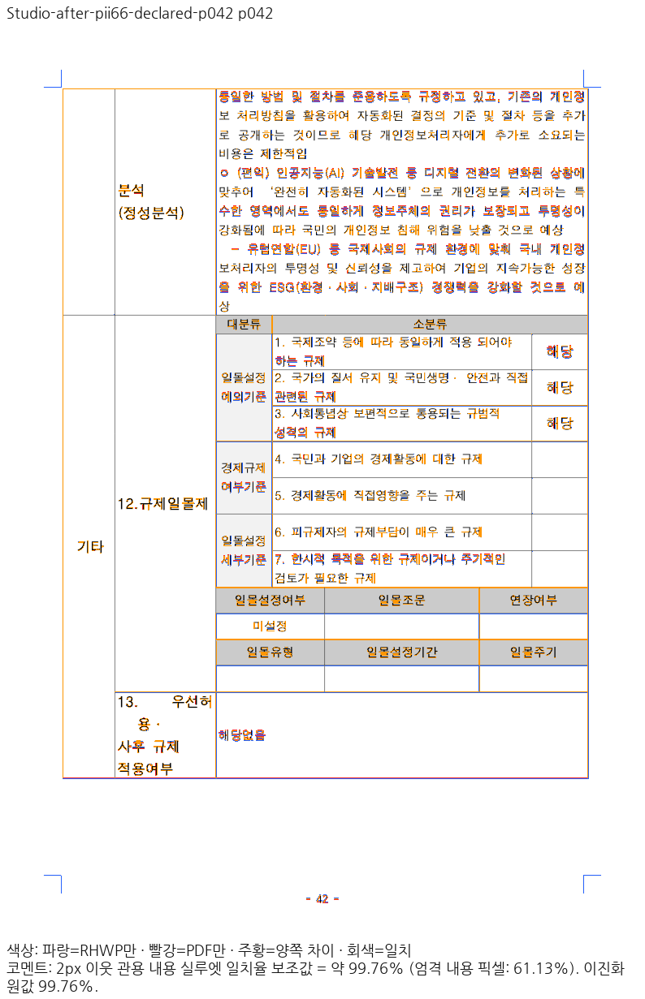

# Studio 선언 글꼴 프로그램의 SFNT 준비 복구

Issue: #7445. Rust code head `bfcb29730a9cf3061bb84d250d9269bb6c17fa3d` 위의
Studio TypeScript 보정이다. 이 증적은 아래 실제 제품 경로와 42쪽 보정 방향을 입증한다.
현재 브랜치의 전 문서 완료·PR 준비 완료를 뜻하지 않는다.

## 원인과 공통 소비

`Local Font Access 승인 face bytes → 기존 normalizeFontFaceData → FontFace/표시 별칭과
선언 프로그램 snapshot → Rust의 검증된 TrueType 메트릭 선택 → 실제 CanvasView`다.

기존 일반 FontFace/CanvasKit 공급자는 SFNT 메타데이터를 정규화했지만 선언 프로그램 공급자는
원시 bytes를 바로 FontFace에 넣었다. 설치된 HY신명조·HY중고딕은 원시 bytes로 브라우저 검사를
통과하지 못하고 같은 glyph/hmtx를 보존한 정규화 뒤에는 로드됐다. 그 결과 선언 환경이 비어
PII의 실제 Studio 조판이 Native 기본 조판과 달랐다. 같은 기존 정규화 함수를 사용하고,
로드한 SFNT 형식을 snapshot에 전달했다. 형식만으로 메트릭을 무조건 신뢰하지 않으며
Rust의 검증된 face 계약은 유지한다. TTC를 임의 face index로 선택하는 기존 금지도 유지한다.

글꼴 교체·문서 ID 예외·강제 FontEnvironment 주입·비교 마스킹·허용치 변경은 없다.

## 독립 기준과 실제 출력

- 원본 `samples/task2097/75544_pii_bunseok.hwpx`, SHA-256
  `f429768ec02e5a849d08c06678cbee029fdc8618ca9e2bdcdbba485087fe71f1`.
- 독립 한컴 Print `pdf/task2097/75544_pii_bunseok-hwpx-2020.pdf`, SHA-256
  `0fef38f44b3825f1c97869c2720112536504eaf30cec2a2d2af6d4399ffe8770`,66쪽.
- 측정 쪽42. 실제 Studio 기본 compat2022·인쇄 프로필·Canvas2D·96CSS DPI·DPR1.
  같은 PDF를96DPI/shape로 raster하고 실제 페이지 화면을 그대로 비교했다.
- 정본 `visual_sweep.py`의 compare/overlay/review·2px 이웃 관용 실루엣을 그대로 사용했다.
  resize·crop 재정렬·마스크는 없다. UI 모서리 안내선도 숨기지 않았다.
- 이 조건의 보정 전46.64253% → 보정 후99.75687%. 표 하단,셀의 마지막 글자와
  다음 줄 소속이 Print와 맞는지 직접 확인했다. 안티앨리어싱·미세 glyph 차이는 남는다.
- 이 단일 실제 소비 확인은192DPI Native/fresh WASM 전쪽 TSV를 대신하지 않는다.
  Rust/pkg는 이 보정에서 바뀌지 않았다. C67 Native/fresh WASM 증적의 동일 source 범위와
  새로운 실제 Studio 소비 증적을 구분한다.

### 보정 전

### 보정 후

## 회귀와 실행 범위

정규화가 필요한 SFNT 입력은 glyph/hmtx payload를 유지하고 디렉터리 정렬만 틀린 별도 공개
기존 fixture로 재현했다. 수정 전1PASS/1FAIL → 수정 후 기존 SFNT 검사와 합쳐10PASS다.
형식 미확인 bytes를 로드 성공만으로 TrueType이라고 선언하지 않는 반례도 유지했다.
전체 Studio2014PASS/0FAIL/2skip,TypeScript 통과다. 이 검사는 픽셀 기대값을 고정하지 않는다.

새 실제 Studio는6문서 화면/인쇄12건 및2정상 대조군의3backend×2프로필12건을 실행했다.
후자12건은Canvas2D4+CanvasKit8이며12건 모두CanvasKit이라고 주장하지 않는다.
총24초기화의JS/WASM48응답·변경TS24응답을 실제 초기 요청에서 source/hash로 검증했고
초기화/자원 오류0이다. PII42쪽 두 출력만 바뀌었고 다른5문서10출력과 대조군12출력은
이전 출력과 byte-identical이다. 자산관리 제목·일가정 양립 제목의 기존 굵기 차이는 남는다.
PII·고용노동부의 지원하지 않는 CanvasKit 경로를 통과로 처리하지 않았다.

ignored 원본: `output/pr-review/7445-completed-20261009/regression-policy-audit-20261015/rebase-4662c069-20261016/`
아래 `actual-full-c68/`, `c68-canonical-reviews/`, `c68-studio-gates.json`,
`c68-declared-program-before.log`, `c68-declared-program-after.log`.
로그·TSV·중간JSON·글꼴 프로그램은 이 assets에 커밋하지 않는다.
