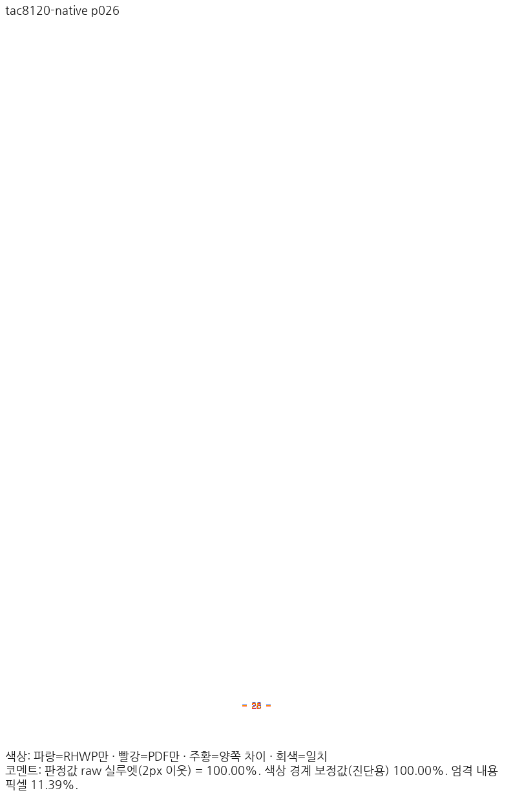
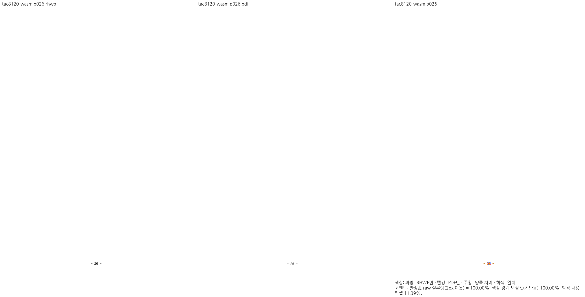

# #7445 보정31 — 리베이스 ClipPath 소비와 원본 번호 메트릭

Issue: #7445, 반영 기능 #7998/#8120. 부모 HEAD `00cecfaa5f3c7b1b0e63620e63151200e680bfc4`, 새 base `80968497c2c178eeecb3b2e1d04d086ad27a0dc7`. 이 단계는 전체 브랜치 검증 완료·PR 준비 완료가 아니다.

## 구현과 독립 근거

326커밋 리베이스에서 충돌8건의 양쪽 의도를 보존했다. 이후 실제 Native 빌드는 새 ClipPath 종류를 누락한 기존 페이지 기하 순회5곳과 Skia 재귀 인자의 RenderProfile/bool 불일치를 검출했다. ClipRect와 같은 자식 재귀를 ClipPath에도 적용하고 전체 RenderProfile을 전달한다. clip 경계나 인쇄 profile을 무시하지 않는다. 기존6검사 helper의 같은 종류 누락도 재귀만 보완하며 원래 assertion은 유지했다. builder/border 형식 보정은 동작 변경이 아니다. 전체 tests cargo check v4는 성공했으며 실제 테스트 실행으로 계산하지 않는다.

TAC26쪽 번호는 실제 Native caller의 `굴림,Haansoft Dotum` 목록을 원본 메트릭 lookup에 그대로 넘겨 조회가 실패했다. 원본/측정 face를 고르는 기존 primary_font_name과 metric_font_family 우선순위를 조회 생산에도 사용했다. HFT.2/HCRWin.23/미등록1/3em 계약과 본문 글꼴 파일은 바꾸지 않았다. 독립 Hancom2020 Print 기준선798pt=1064CSSpx에서2.631111px 위로 이동하던 번호를 복구했다. 값 생산(source_descent_em)→footer 공통 baseline→Print layer runToPage→Native/Canvas 출력까지 대조했다.

입력 `samples/tac-img-02.hwp` SHA `f8d5b42367363de0bfde553c062e8a632c222e076a52c95b36efb490b743008e`, PDF `pdf/tac-img-02-hwp-2020.pdf` SHA `f5b56bc65f796acafe3075aadd714ec96d2e508f862dfd899ec5e5081d03e1cc`. 원본66쪽/compat2022/96DPI/Print/PDFium smooth_rgb_v1/raw2px90%.

## 실제 빌드와 전쪽 TSV

Native frozen CLI SHA `446705797ddeb1b370e45cdd0d4fbc8845b0ab8f781e1e97d10f9710e4b18d03`, library `da8ed479e1418e590bf12067c068b8247b0e1682c46ccdfb0a7f78a0ec72f3ae`. fresh WASM JS `d7d8cf9b5f7ce8a0f00b49a39aa1fee49e331cce6774e7ba57c3e9d078cd7030`, WASM `68229bd10828bb01ada4c21bdcd1820eeeddc28688c22d46d1b3ae31726f32d7`. Mac locked web/pkg/no-opt의 로컬 대체 빌드이며 Docker 최적화 통과가 아니다. root pkg/Studio public/frozen과 실제 Studio7736 초기화200응답을 대조했고 WASM 초기화 true/errors0이었다. 문서 paint/Actual36 완료와 구분한다.

주요8문서 각769쪽 전쪽90이상이다. 아래 수도시설3쪽은 별도 기존 미달 대조군으로 주요 통과 수에 포함하지 않는다. 각 파일은 같은 최신 실행 TSV의 byte-identical 사본이다. 대표 직접 판독과 전체 PR gate를 이 수치만으로 완료하지 않는다.

| backend | 문서 | 쪽수 | 최저 raw | 90 미달 쪽 | 전쪽 TSV |
|---|---|---:|---:|---|---|
| native | handbook | 383 | 92.33793% | [] | [native-handbook.tsv](native-handbook.tsv) |
| native | science | 4 | 96.14438% | [] | [native-science.tsv](native-science.tsv) |
| native | legal | 74 | 96.05600% | [] | [native-legal.tsv](native-legal.tsv) |
| native | prep | 140 | 94.75150% | [] | [native-prep.tsv](native-prep.tsv) |
| native | rowbreak-hwpx | 18 | 92.85921% | [] | [native-rowbreak-hwpx.tsv](native-rowbreak-hwpx.tsv) |
| native | rowbreak-hwp | 18 | 93.07060% | [] | [native-rowbreak-hwp.tsv](native-rowbreak-hwp.tsv) |
| native | pii | 66 | 96.98523% | [] | [native-pii.tsv](native-pii.tsv) |
| native | tac8120 | 66 | 96.20794% | [] | [native-tac8120.tsv](native-tac8120.tsv) |
| native | water-control | 3 | 71.85405% | [3] | [native-water-control.tsv](native-water-control.tsv) |
| wasm | handbook | 383 | 92.35482% | [] | [wasm-handbook.tsv](wasm-handbook.tsv) |
| wasm | science | 4 | 96.06833% | [] | [wasm-science.tsv](wasm-science.tsv) |
| wasm | legal | 74 | 96.01774% | [] | [wasm-legal.tsv](wasm-legal.tsv) |
| wasm | prep | 140 | 94.22354% | [] | [wasm-prep.tsv](wasm-prep.tsv) |
| wasm | rowbreak-hwpx | 18 | 92.82532% | [] | [wasm-rowbreak-hwpx.tsv](wasm-rowbreak-hwpx.tsv) |
| wasm | rowbreak-hwp | 18 | 92.96483% | [] | [wasm-rowbreak-hwp.tsv](wasm-rowbreak-hwp.tsv) |
| wasm | pii | 66 | 96.98523% | [] | [wasm-pii.tsv](wasm-pii.tsv) |
| wasm | tac8120 | 66 | 96.16900% | [] | [wasm-tac8120.tsv](wasm-tac8120.tsv) |
| wasm | water-control | 3 | 72.05077% | [3] | [wasm-water-control.tsv](wasm-water-control.tsv) |

리베이스 전후 공통640쪽/backend는 같은 원본·PDF PNG·글꼴713파일·도구·PDFium library를 대조했고0.1%p 이상 하락0이다. Native PrEP 최악-0.06265pp, WASM -0.05147pp; 편람59/79 및 PrEP15쪽의 PNG byte변경은 있어 엄격한 픽셀 동일이라고 쓰지 않는다. 추가 PII/TAC 및 정확한809base 전쪽 대조는 별도 실행 중이다.

WASM 첫 시도의 FontFace.load 오류와 후속 Chromium 작업자 시작30초timeout은 통과로 쓰지 않았다. 동일 글꼴/hash/guard로17–32쪽 재시도 성공을 확인했고, v2의240개 완료 PNG·export manifest·TSV 해시를 검증한 뒤 실패241–256 묶음을 별도 보존하고 그 묶음부터 재개했다. 전쪽 TSV는 모든 페이지를 다시 집계했다. 비교 gate·글꼴 guard·capture8은 변경하지 않았다.

## TAC26 직접 판독 및 정식 회귀

26쪽은 Native/fresh WASM raw 각각100%. 숫자26과 양쪽 hyphen이 원본 번호 한개로 남고 용지 하단 위치를 복구한 것을 같은 배율 review/overlay로 직접 확인했다. raw100은 RGB 픽셀 완전 동일을 의미하지 않는다.

새 `issue_7445_supplied_number_source_metric`는 공개 FontEnvironment caller로 원본 굴림 프로그램 공급을 선언해 설치 글꼴에 의존하지 않는 메트릭 계약을 검사한다. 최종source SHA `ade656d7631f8acb3bfe7d77107bcdf846ea88eebb6a667edfcdafc1258e94c4`: frozen V2에서 실제1FAIL→V3에서1PASS. 원본66쪽·번호 소속·누락/중복·primary face·실제 fallback 목록 경로·독립798pt 기준선±2CSSpx를 함께 검사한다. Native/fresh66쪽90이상/26쪽둘다98이상/직접판독 후에만 정식 case로 추가했다. prepare 결과 suite011로 수집됨을 확인했으며 자동 suite 실행은 후속 집중/전체 회귀에서 완료해야 한다.

## 남은 검증과 후속 보정

- 현재 base 대비769쪽 양 backend 전쪽 비교가 실행 중이다.
- #8064 Native 전용179조건2082쪽은 진행 중이며 언어 원본15쪽의 실제 회귀를 새 base에서도 확인했다. p14 기준99.14191→96.10979%, p2 -0.14808pp. 저장 줄 원점·문단 여백 소유를 다음 단계에서 보정한다. 기존 기준을 낮추지 않는다.
- 법령2/13쪽 accepted 하한, 과학3/4쪽 본문/수식 기준선 차이, 전체integration nextest·필수 lint/build/Skia/manifest/unit tiers·Actual36/대표 직접 판독도 남아 있다.
- CLI 전용 소스 archive에서 빠뜨린 compile-time 템플릿/문서와 실행 상태 초기화 race, 처음 Studio host-mode/종료 서버 오류는 output에 실패 기록을 보존하고 수정했다. 제품 통과로 재인용하지 않는다.

실행 로그·중간JSON·진단Rust는 ignored `output/pr-review/7445-completed-20261009/rebase-80968497-20261021/`에만 보존한다. 원본·PDF·상용 글꼴·공유target·다른작업트리는 보존했다. PR은 새 사용자 승인 전 게시하지 않는다.
