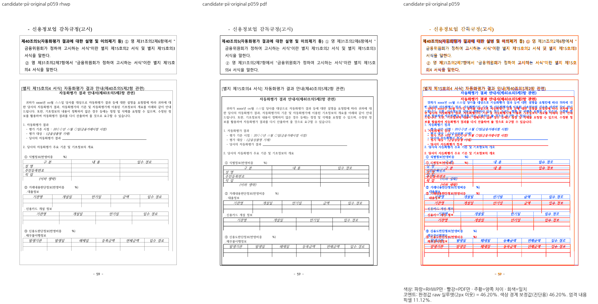
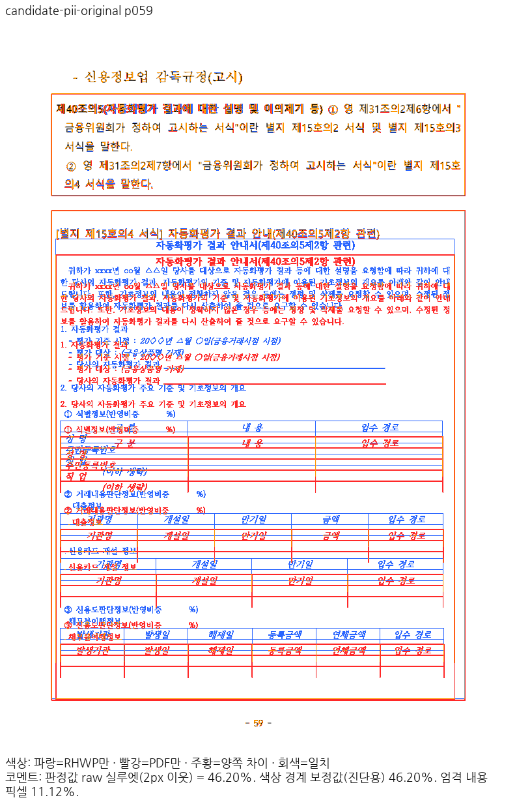
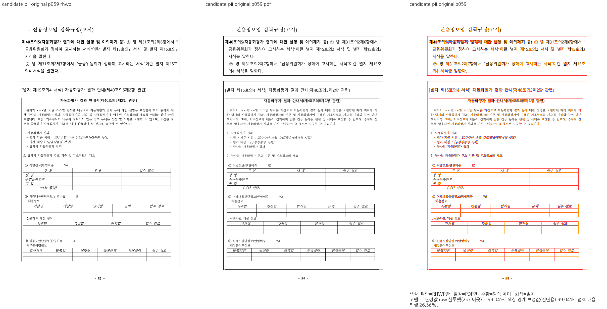
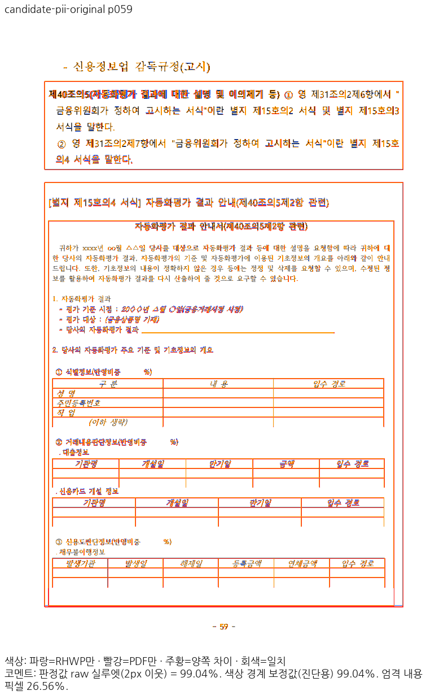
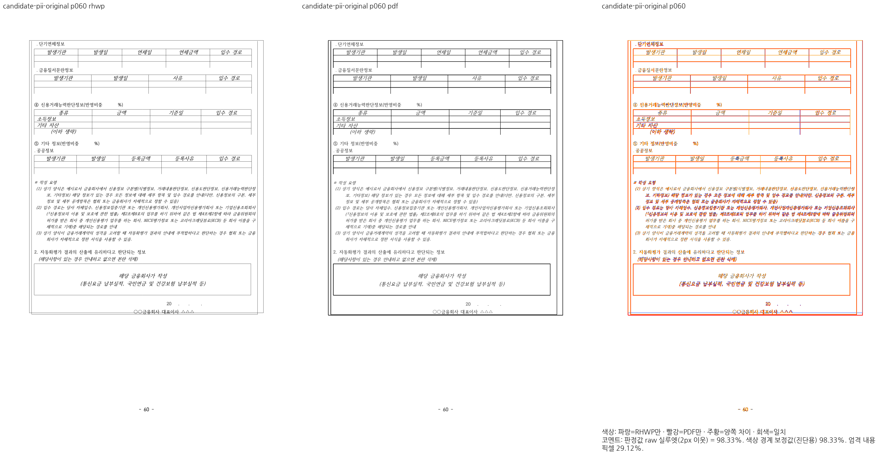
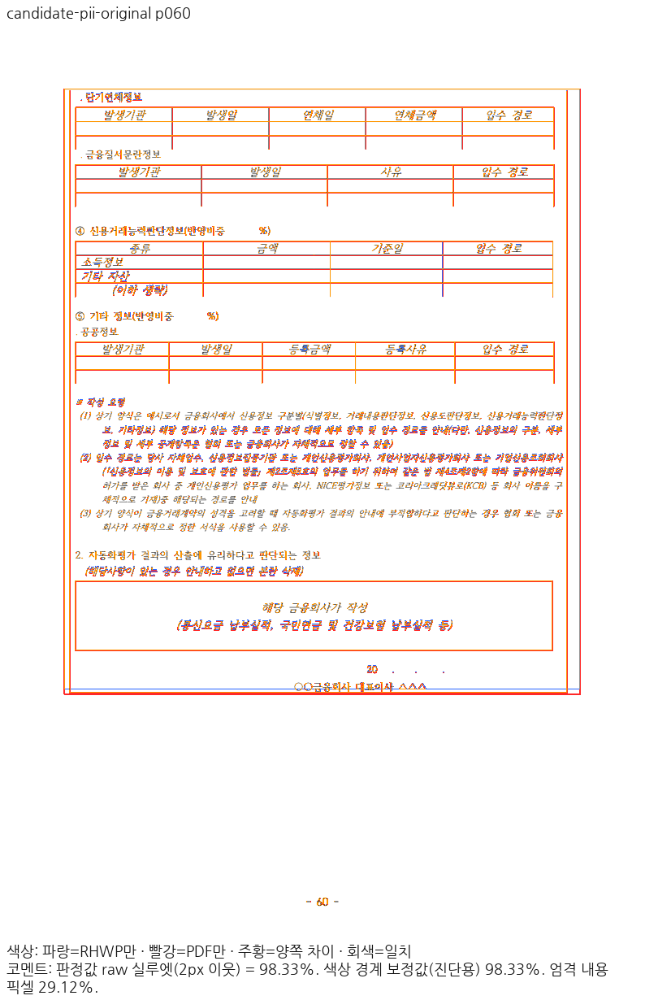

# Stage 52: 부분 셀의 원본 문단 앵커 공유

Issue: #7445, 원 해결 #5846 → #5904 → 통합 #5912/b9eb551 및 #7642/363ef22d2c7.
parent: `f8f4cc63b6a5b91939d98b72c2aafee60f8fb96b`, base: `2e087a5b4bc1515ad877e8020b30114639a59392`.
대상은 기존 `samples/task2097/75544_pii_bunseok.hwpx`와 대응 독립 2020 Print PDF다. 새 문서를 추가하지 않았다.

## 원인과 실제 소비

원본 제목 문단의 글 앞 표는 문단 상대 Top 오프셋 2997 HU = 39.96px다. 글자를 그린 뒤의 커서 16px를 앵커로 쓰면 표 전체가 23.96px 앞당겨진다. 전체 셀 경로는 이미 `nested_overlay_outer_frame`을 사용한다.
부분 경로도 같은 query를 사용하며 `owns_paragraph_entry && start_line == 0`으로 문단 시작의 실제 소유를 확인한다. 셀 전체의 linear 프레임 인증으로 이 개체의 앵커를 대신 판단하지 않는다. 선택한 원점을 `nested_y`와 재귀/통째 자식의 `resolved_table_top`까지 전달하며 바깥 위여백은 한 번 소비한다. 이어받는 문단 내부 컷은 원래 앵커를 다시 열지 않는다.
P39의 옛 셀 프레임 조건은 전 66 PNG가 이전과 동일하여 수용하지 않았다. P40에서 실제 문단 시작 소유로 교정했다. 문서 ID·쪽 번호·오프셋 상수를 구현에 넣지 않았다.

## 현재 소스의 실행 증거

- frozen Native CLI SHA256: `ee9725bd798bde365aba2d9b0356b28cc2f0ba7f71d8af3e10a0dc1499bee747`.
- 라이브러리 SHA256: `98c1634900b11e8fcf12ab23d81256a76c03963c23d17d2f1bec3a609bce5a18`.
- 변경 소스 SHA256: `c54e62cf10c9b30f85c0289cdaefdd22a78cc68945063b074924686b42bd2c0b`.
- patch SHA256: `d8f7ba8892f3a80477c085be4b85acbd0c71b2c5008f64de8f22d451fc391dde`. 복사된 P39 메타데이터의 낡은 patch hash는 실제 저장 patch hash로 정정했으며 소스 파일 hash는 동일했다.
- 같은 713개 글꼴 원장, 선언 글꼴 환경, Native PNG / PDFium 152.0.7947.0 smooth RGB / 96DPI / compat2022 / 2px / 90% / capture 8을 유지했다.
- 기존 집중 113건: **112 PASS / 1 FAIL**, 테스트 20.762초. 실패는 기존 #5846의 65쪽 `(4,1)` 칸 소실이다. 기대값·검사·공차를 변경하지 않았다.
- 기존 59쪽 원본 앵커 관계를 공개 SDK에서 별도로 실행: P39 exit101 → P40 exit0. 실제 오프셋 16px → 39.96px, 원본 기대 39.96px다. 이 진단은 정식 전체 함수 통과가 아니다.
- Native 전 66/66쪽: **59쪽 46.20358 → 99.03871%**. PNG 변화는 59쪽만이고 나머지 65쪽 byte 동일, 점수 하락 0쪽, 문단·셀 소유별 연결 문자열 1826개 변화 0이다. 이 문자열 감사만으로 쪽별 순서 전체를 입증했다고 쓰지 않는다.
- 60쪽 98.32834% 유지. 전쪽 최저 66쪽 60.81274%, 미달 66쪽 1개이며 fixed base 대비 41쪽 99.23712 → 97.93657% 하락도 남아 있다.
- 후보 59·60쪽 review와 overlay를 직접 열어 제목·표 시작·내용 순서·다음 쪽 보존을 확인했다. 선 굵기·가장자리·일부 glyph 및 60쪽 바닥 경계의 미세 차이는 남아 있어 완전 픽셀 일치로 표현하지 않는다.

## 전쪽 TSV

[고정 base](base-native.tsv) · [수정 전](before-native.tsv) · [후보](candidate-native.tsv).

## 전후 PNG

## 남은 범위와 로그

새 소스의 fresh WASM 전쪽·전체 nextest·필수 게이트·실제 소비 검증과 65→66쪽 보정은 미완료다. PR 준비 완료가 아니며 새 PR은 사용자 승인 뒤 진행한다. 새 회귀/px 핀·지침·원격 변경은 없다.
로그/producer/실행 JSON은 ignored output의 `repair-focused-v40`, `pii-overlay-native-v40`, `pii-overlay-anchor-cause-v40`에 보존한다.
