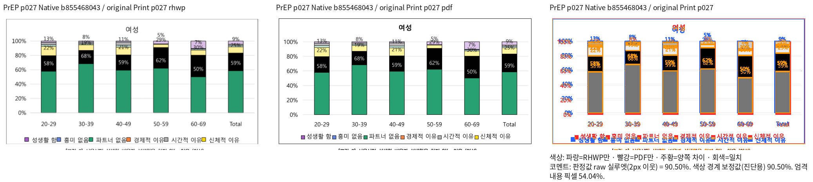
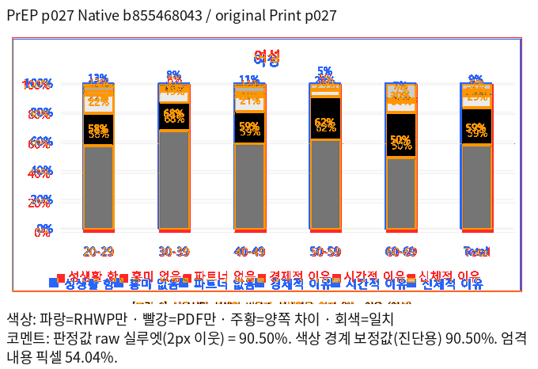

# PrEP 차트 배치 후속 재현 자료

대표 이슈: #7445. 하위 이슈: [#8044](https://github.com/edwardkim/rhwp/issues/8044).
보정 후에도 실패가 남은 차트 범위만 후속 이슈에서 추적한다.
보정·재검증에 성공한 항목과 정상 회귀 검사는 이관하지 않는다.

## 코드와 비교 조건

- code source: `b855468043`, Native Skia, Print profile, compat 2024, 96dpi.
- 원본: `samples/issue2006/1790387_prep_final_report.hwpx`, SHA-256
  `c68baed24096386f9041930d24d39409b61ac99463bf04dfd242440dfdeb739f`, 140쪽.
- 독립 기준: `pdf/issue2006/1790387_prep_final_report-hwpx-2024.pdf`, SHA-256
  `732baa118fbe380cf4c5e12e080eee5acb1eb8372070390fef47e53e2469f729`, 140쪽.
- 원본·기준 PDF는 기존 경로의 커밋 파일을 유지한다. 별도 사본을 추가하지 않는다.
- 대조군은 원본 여성 차트를 두 독립 개체에 배치한 합성 HWPX다. 폭·범례 크기·face를
  변경하고 한컴 2024 MCP로 별도 Print 출력했다. 저장 LineSeg를 수동으로 넣지 않았다.
- MCP: engine 2024, Hancom 13.0.0.3901, PrintMethod 0,
  `frame_print_to_pdf_ex_one_up`. 아래 PDF는 해당 결과의 바이트 동일 보존본이다.
- 대조군의 주 차트 XML과 OLE 사본이 다르면 제품은 미리보기 팔레트를 빌리지 않는다.
  이 차이와 배치 차이를 함께 공개하며, 팔레트를 빌린 별도 진단 점수를 제품 결과로 쓰지 않는다.

## 실제 재출력

| 범위 | Native raw 실루엣 | 직접 확인·처리 |
| --- | ---: | --- |
| 원본 26쪽 / 27쪽 | 94.15825% / 94.23658% | 선택 쪽 수치 통과, 차트 배치 차이 남음 |
| 원본 27쪽 차트 부분 영역 | 90.49601% | 제목·막대 하단·범례 차이 남음 |
| 폭 대조군 1쪽 / 2쪽 | 90.36209% / 86.43815% | 좁은 폭 미달 |
| 범례 8pt / 16pt | 90.06597% / 80.27725% | 16pt 미달 |
| 범례 함초롬돋움 / 맑은 고딕 12pt | 86.28812% / 85.13861% | 두 쪽 미달 |

`original-selected-native.tsv`는 원본의 **26·27쪽만** 포함한다. 나머지 세 대조군 TSV는
각 2쪽 전체다. 이 자료를 원본 전 140쪽 또는 fresh WASM의 완료 증거로 사용하지 않는다.
현재 chart source의 fresh WASM은 미실행이며 후속 검증 대상이다.

## 범위와 복원 조건

- 남은 출력 결함의 후속 이관이다. 고정 upstream에서 기존 점수가 90% 미만이었다는 신규
  판정이 아니며, 다른 비교 조건의 결과로 종료된 #7804를 다시 이관 근거로 사용하지 않는다.
- 기존 범례 크기·소유 선·rich 제목 글꼴 보정과 남은 배치 결함을 구별한다. 기존 차트 검사
  165개 통과만으로 배치 일치를 선언하지 않는다. 이 자료를 이유로 정상 검사를 제거하지 않는다.
- 새 차트 회귀는 아직 추가하지 않았다. 같은 입력·독립 PDF의 Native/fresh WASM 관련 전쪽이
  90% 이상이고 제목·플롯·범례의 직접 확대 판독을 통과한 뒤 추가한다.
- 문서별 좌표 예외 대신 글꼴 측정, 키 크기, 줄바꿈 후 열 배치, 실제 플롯 예약 높이가 공유하는
  공통 결과를 보정한다. 문단/개체 소유·내용 순서·보존·포함 관계도 유지한다.
- 작업 로그와 중간 JSON은 ignored output의 `stage4001`~`stage4004`에 보존하며 커밋하지 않는다.

## 보존 파일의 SHA-256

| 파일 | SHA-256 |
| --- | --- |
| `legend-font-face-2024.pdf` | `383a97411461a0479d154697724bb64f1af8a1a80a2380e12e07a3ff7760e938` |
| `legend-font-face-native.tsv` | `d08f51131c1b0587713a9659647c32a5461d025de0cd8e176a5d24315142b9c3` |
| `legend-font-face.hwpx` | `b8bef6d248ff485b8de410822d18b51f0b84cd7beb87d7aa2cc36f4b09937b97` |
| `legend-font-size-2024.pdf` | `98d5abbef5dc34dca06278e84819a09816c6d54e07042cb07395a4451823b806` |
| `legend-font-size-native.tsv` | `ec9bb6c2b0c26fe8273f67fc68f50d67a25562edabb577c011213b7e8d4a7c8d` |
| `legend-font-size.hwpx` | `ae6648e5c3d03122c12e9ca4cf1431e0016bb5b383d7ffef8eb20ea0529598ee` |
| `legend-width-2024.pdf` | `10423350e25854d520b4790c25e5641b1b7b4643d7f07a8274bee53297b89e0a` |
| `legend-width-native.tsv` | `3548a2fe6bab9aae58af8ea2a0f33274c649a54e24d4c11798d542d63ad7a8bd` |
| `legend-width.hwpx` | `b3fe32b0880dfed40178c25a8527fd9bd9500898fcd38c718f933b825855493c` |
| `original-p027-overlay.png` | `4e67827addb73c0c364e243fed621ee5768827edaaf1ebc482f38cc4ad7b9ce0` |
| `original-p027-review.png` | `65faa7e91921390df62daa26cd10ba33f879b2e371dd2a0ac7df259ca1d205fb` |
| `original-selected-native.tsv` | `6eff5e4f824ab395bf47fab01468bf2cd95a3cbba2248df1b8e259d1597cf70a` |
