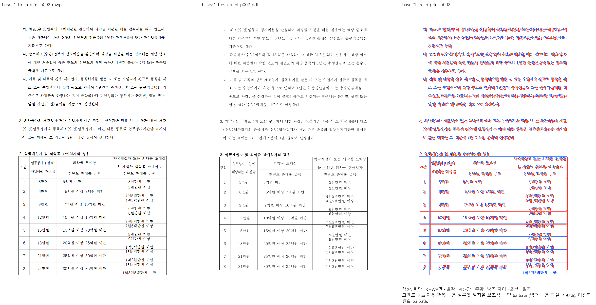
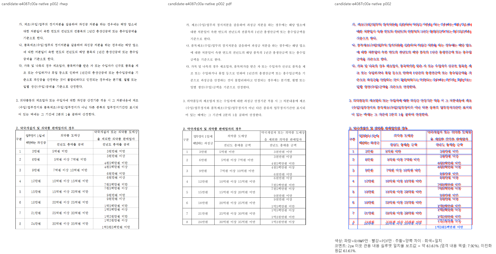
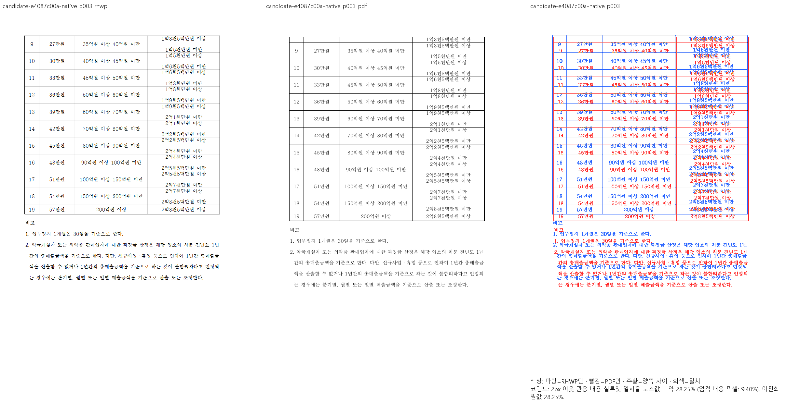

# #7445 — table_text_anchor_wrap.hwpx 회귀 원본 이관

이 자료는 활성 렌더링 fixture가 아니라 미달 문서의 재현 자료다.
등록은 [#7445 댓글](https://github.com/edwardkim/rhwp/issues/7445#issuecomment-6090426792)에 연결한다.

고정 upstream/devel `21ed64071f81f35f37618717693bd30f727392c9`와 제품
`e4087c00a8d5b78534e27cb79f01cdd4bf2b6917`의 같은 원본·독립 Print·96dpi·Windows
글꼴 조건으로 전3쪽 Native를 비교했다. 이 원본의 fresh WASM은 미검증이다.

| 쪽 | 고정 base Native | 보완 제품 Native |
| --- | ---: | ---: |
| 1 | 49.94421% | 55.80981% |
| 2 | 63.63483% | 63.63483% |
| 3 | 28.24847% | 28.24847% |

현재2·3쪽 raster bytes는 base와 같다. f485 제품에서2쪽의 앞 본문과 표가 겹치던
추가 회귀는 보완됐고, 이관으로 숨기지 않았다. 전3쪽 review를 직접 확인했으며,
기존 제목 글꼴·표 행 높이·표와 뒤 본문 위치 차이는 남아 있다. 피델리티 해결로 보고하지 않는다.

- [원본 HWPX](table_text_anchor_wrap.hwpx): SHA-256 `5947d1cd9553bd5368a23a7538e93d38d250460d5ca379e7770fad363e81d888`.
- [기존 대응 Print](table_text_anchor_wrap-hwpx-2024.pdf): SHA-256 `169408fce4b773e53e61635b6af93699c30804c7b4cface80dde1366ea182a4f`.
- [같은 원본의 새 Print](table_text_anchor_wrap-fresh-2024.pdf): SHA-256 `0d411a09a97cefe47e05ff2c09b385bc3d1646550713edd64030e7250633518a`.

새 Print는 실제 한컴2024 13.0.0.3901, method0, `frame_print_to_pdf_ex_one_up`,3쪽이다.
새/기존 Print의 전3쪽 raster가 같음을 확인했다. 기존 PDF를 잘못된 원문으로 취급하지 않는다.

원본과 기존 PDF의 바이트를 바꾸지 않고 기존 `samples/`·`pdf/` 경로에서 이곳으로 옮겼다.
`render_page_samples.tsv`와 `oracle_page_count_baseline.tsv`의 이 HWPX 행만 제거한다.
본문 겹침 partition11 자체와 그 안의 다른 원본은 유지한다. `task1745/`의 HWP 대조군도 유지한다.
same-id 글자모양 corpus는 원본에서 수집한 정적 메타데이터이며 파일을 읽지 않는 planner 계약을
계속 검사한다. 이관 자료를 활성 renderer/golden의 새 입력으로 자동 수집하지 않는다.

TSV·실행 로그·중간 JSON·직접 판독 기록은 ignored `output/pr-review/planet6897-20261008/`에 있다.
제거 전 일반 겹침 검사와 manifest는 위 고정 base의 Git 경로로 보존한다. 새 baseline 숫자·
허용치·ignore·조건부 return은 추가하지 않는다. 테스트 함수 수는 그대로이고 활성 입력만1개 줄인다.

같은 원본 전3쪽 Native/fresh WASM 최저90% 이상과 제목·표/행·본문의 소속·보존·겹침을
직접 판독한 뒤 독립 기대값의 관계형 회귀로 복원한다. 이 이관으로 #7445를 종료하지 않는다.

추가 회귀의 보완과 실제 검사·자산 이동 범위는
[#7445 후속 등록](https://github.com/edwardkim/rhwp/issues/7445#issuecomment-6091683296)에 기록했다.
게시 뒤 API에서 한국어 본문이 원문과 같고 선두 BOM·물음표 치환이 없음을 확인했다.

