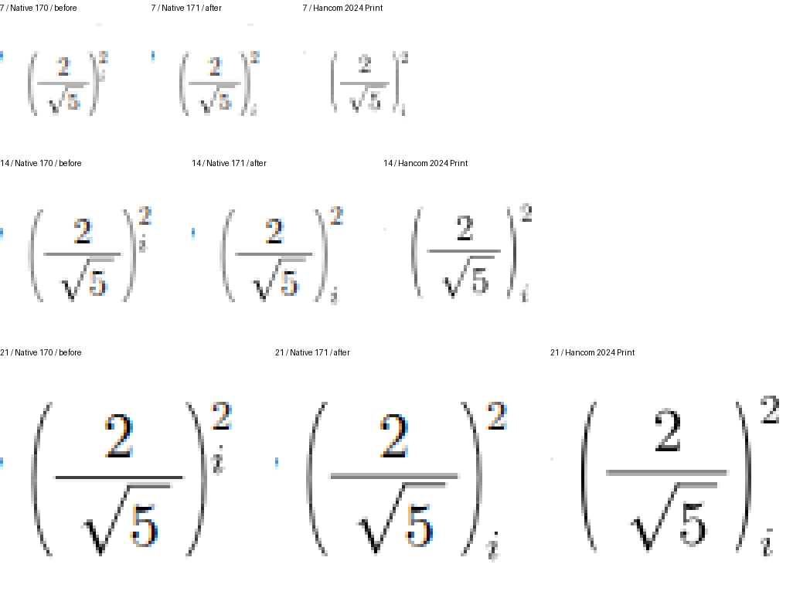
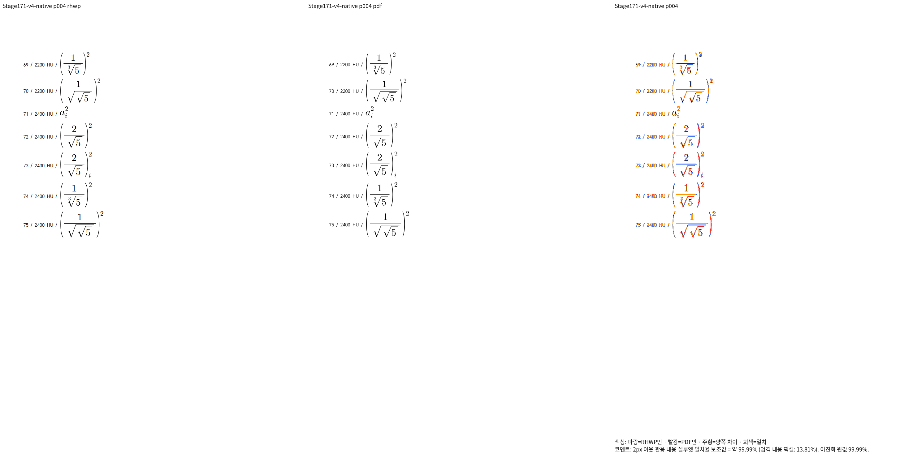
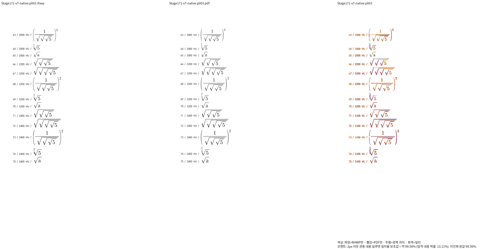
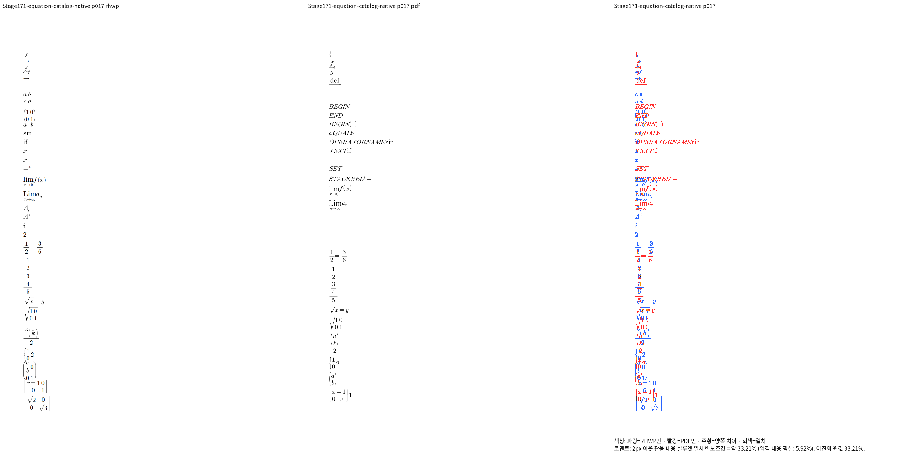
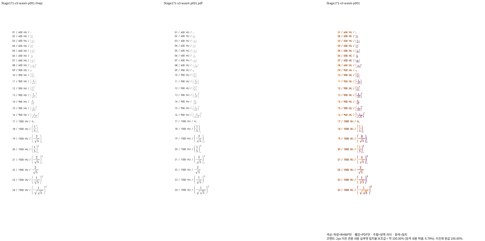
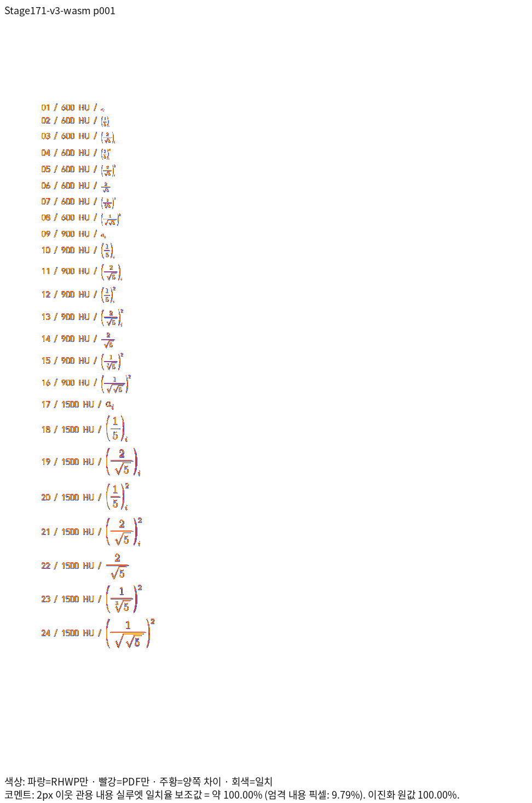

# #7642 분수 첨자·중첩 근호의 새 Native 증적

생산 소스: `589ed5c9d`.
Native binary SHA-256: `976d561f4804b4006d8e6437989f6d67657a68b0a7095a12c6a920555842dade`.
같은 소스의 새 출력이며 이전 head의 PNG를 재사용한 결과가 아니다.
Print profile, compat 2024, 96dpi, 전체 글꼴 바이트로 비교했다.

| 진단 | 실제/Print 쪽수 | Native 최저 | 90% 미만 |
| --- | --- | --- | --- |
| v1 | 1/1 | 100.0% | 0쪽 |
| v2 | 1/1 | 100.0% | 0쪽 |
| v3 | 1/1 | 100.0% | 0쪽 |
| v4 | 4/4 | 99.87465% | 0쪽 |
| v5 | 5/5 | 99.9368% | 0쪽 |
| v6 | 2/2 | 99.98322% | 0쪽 |
| v7 | 3/3 | 99.56009% | 0쪽 |

아래첨자 `i`가 높던 현상은 같은 영역의 수정 전·후·Print 확대에서 개선을 확인했다.
근 지수·중첩 근호의 위첨자와 22/24pt 경계, 세·네 겹 근호·복합 근 지수도 직접 대조했다.
100%는 2px 관용 실루엣 보조값이며 엄격 픽셀·동일 이미지라는 뜻은 아니다.

## 별도로 남은 수식 카탈로그의 미달

아래는 같은 생산 소스의 별도 259식·18쪽 카탈로그이며 `compat 2022`와 독립 2020 Print다.
전체 최저 33.20773%, 11쪽 미달이며 이 페이지는 33.20773%다.
이 자료의 통과·골든 변경 근거로 승격하지 않는다. `BEGIN`, `OPERATORNAME` 등의
LaTeX 확장과 한컴의 문자 출력 차이, 실제 위치·문법 차이를 분리해서 검토 중이다.

fresh WASM 진단 전체 비교는 완료됐으며, 새 정식 관계형 회귀 두 건은 nextest에서 PASS했으며 전체 원본과 Rust 최종 검증·PR은 미완료다.
입력·저장 HWP·Print PDF와 해시는 [진단 자료](../../../../pdf/issue7642-extended-base-script-diagnostic/README.md)에 보존한다.
실행 명령·TSV·남은 범위는 [Stage 171](../../../working/task_m100_7642_stage171.md)에 연결한다.

## fresh WASM의 실제 종료 결과

같은 생산 소스의 fresh WASM 빌드는 exit 0, 생산 소스 해시 유지 true,
Studio의 JS/WASM 동기화 해시 일치 true로 종료됐다. 진단 7종 전체 17쪽은
Native와 같은 쪽수·최저값으로 모두 90% 이상이다. 실제 두 경로의 PNG 17개를
SHA-256으로 각각 대조했으며 모두 byte-identical이다. WASM의 원문 SVG와
render tree는 실제 WASM export이며 Native는 전체 글꼴 CSS 공급에만 사용했다.
새 WASM review도 직접 확인했다.

원본 9월 2022 HWP/HWPX의 fresh WASM도 각각 전체 23/23쪽,
최저 91.83899%/91.85645%, 미달 0쪽, 소스 해시 유지 true로 종료됐다.
이 두 문서의 결과를 나머지 원본 문서의 최종 검증으로 보고하지 않는다.
