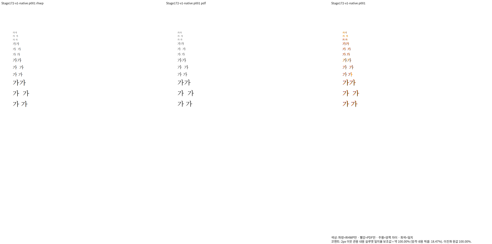

# #7642 정상 크기의 고정폭 공백 관계형 검사

Issue: #7642, #6597

코드 생산 SHA: `536da3f62906a30e9e269892b9b70e89edfd66ff`.
입력·독립 한컴 저장/Print 출처는
[자료](../../../../pdf/issue7642-figure-space-diagnostic/README.md)에 있다.

| 대조 대상 | Native | fresh WASM | 전체 쪽수 | 미달 |
| --- | ---: | ---: | --- | ---: |
| 네 글자 크기의 공백 진단 | 100% | 100% | 각각 1/1 | 0 |
| 원본 30307 | 93.19077% | 93.19077% | 각각 13/13 | 0 |

최저값은 전체 쪽 TSV 기준이다. 진단의 실제 Native/WASM PNG 바이트도 같다.
두 출력의 증거를 동일 backend 실행으로 대체하지 않았다.

Print rawdict의 앞뒤 `가` origin을 대조하면 고정폭 전진은
0.253/0.248/0.245/0.248em이다. 일반 공백과의 비는 약 절반이다.
본문 순서와 앞뒤 글자·두 공백 종류의 보존을 직접 판독했다.

새 이름 `print_saved_figure_space_preserves_its_owner_and_scales_against_normal_space`는
원본 소유 문단과 글자 크기로 대상을 찾고 누락·중복·내용과 정규화된 전진
비율을 검사한다. 절대 화면 px나 전체 SVG 해시를 고정하지 않는다.
선택 nextest **1건 PASS**, exit0이며 실행 로그는 ignored
`output/pr-review/issue7642/failed-inputs-20261008/stage15-current-validation/stage173-space-relations-nextest.log`에 있다.

기존 검사는 0pt 합성 입력 때문에 widths=[]로 실패했다. 입력 전제의 오류를
전역 기본값 변경으로 숨기지 않고 새 검사로 교체했다. 새 정상 입력이 과거
엔진 결함의 수정 전 FAIL을 입증했다고 주장하지 않는다.
새 검사의 최초 컴파일에서 base_size 타입 오류가 있었으며 i32 소스 타입을
그대로 사용해 수정·재실행했다. 컴파일 실패는 렌더링 결함 재현으로 세지 않는다.

원본 30307의 일부 글꼴 모양/굵기 차이는
[원본 기록](../issue7642-figure-space-source-20261012/README.md)에 이어 남겨 둔다.
이 정상 공백 계약을 다른 전체 55개 문서·수식·전체 회귀의 완료로 보고하지 않는다.
