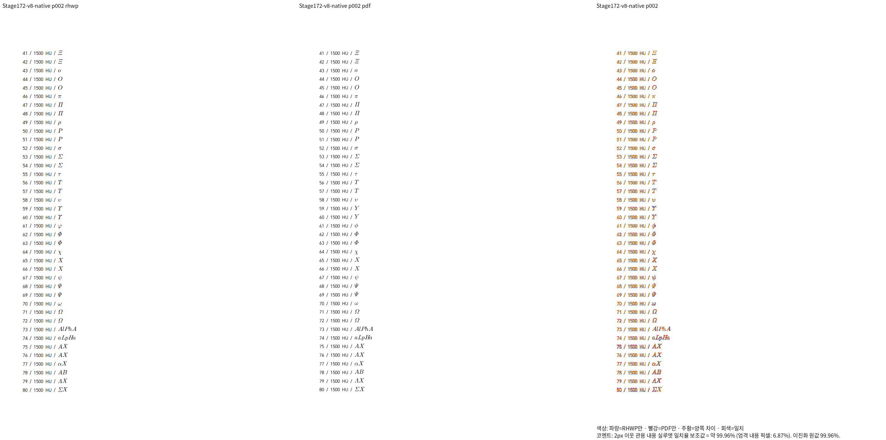
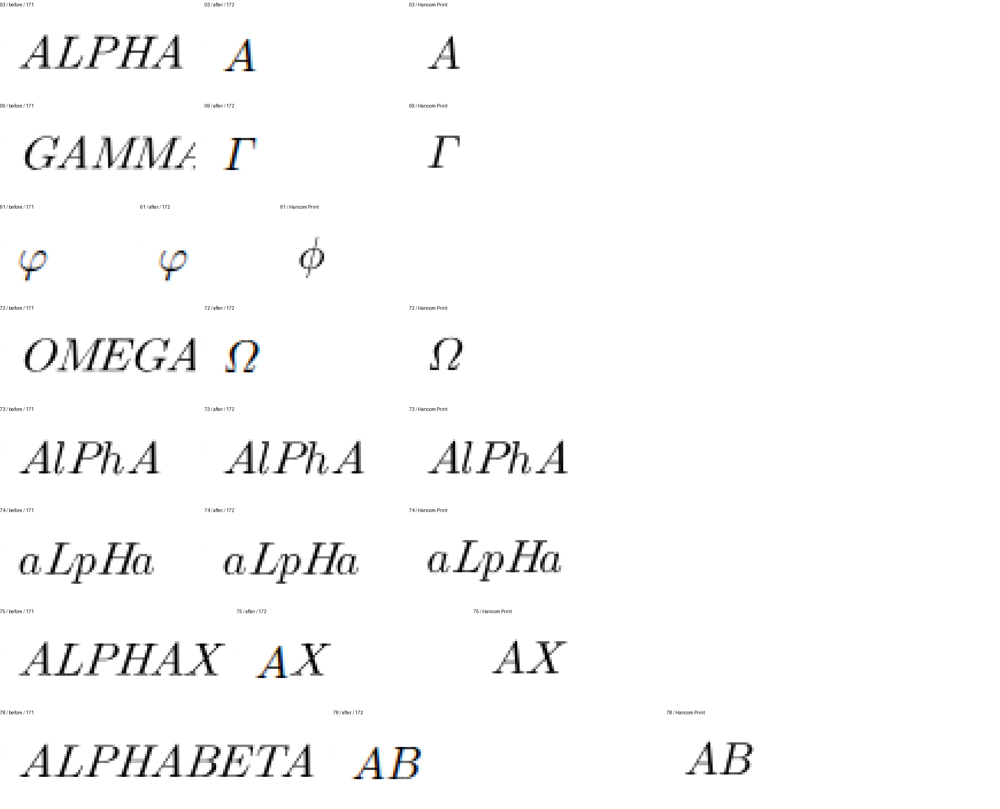

# #7642 그리스 이름 대문자 처리의 Native 증적

Issue: #7642

코드 생산 SHA: `536da3f62906a30e9e269892b9b70e89edfd66ff`.
수정 전 생산 SHA: `589ed5c9d`(Stage 171).
입력: `pdf/issue7642-extended-base-script-diagnostic/extended-base-script-v8-2024.hwp`.
독립 기준: 같은 폴더의 `extended-base-script-v8-2024.pdf`.
한컴 저장·Print 출처와 입력 해시는 [Stage 172](../../../working/task_m100_7642_stage172.md)에 있다.

## 전체 쪽 TSV와 직접 판독

Native는 두 쪽 모두 90% 이상이며 최저 **99.95954%**다. 수정 전 Native/fresh WASM의
최저는 **87.48741%**였다. 정확한 TSV와 실행 로그는 ignored
`output/pr-review/issue7642/failed-inputs-20261008/stage15-current-validation/stage172-extended-v8-native-after/`에 보존한다.
대표 이미지는 이 생산 코드의 새 출력이다.

전체 대문자 `ALPHA`·`GAMMA`·`OMEGA`의 기호와 `ALPHAX`·`ALPHABETA`의
뒤 피연산자는 Print와 대응한다. 혼합 철자 `AlPhA`·`aLpHa`는 문자로 보존한다.
그러나 소문자 `phi`의 고리·세로 획은 Print와 다르다. 점수 통과로 이 차이를
완료 처리하지 않는다. 변형 기호와 스타일·크기 대조군을 별도로 Print해
원인을 확인한다.

## 판정

**부분 개선 / 최종 검증 미완료**. fresh WASM 빌드·대조, `phi` 표시 보정,
남은 카탈로그·전체 원본·회귀·lint와 PR 준비가 남았다. 이 증적만으로
정식 회귀 추가나 PR 승인·통합을 판정하지 않는다.

## 후속 검증

Stage 172의 fresh WASM v8 두 쪽도 최저 99.95954%로 종료됐다. 이 문서의
phi 차이는 해당 생산 코드의 관측을 보존한 기록이다. Stage 173에서 변형·스타일을
보정한 뒤 v8–v11 전체 Native/fresh WASM 13쪽을 다시 검증했다.
[현재 결과와 확대 판독](../issue7642-greek-symbol-contract-20261012/README.md).
전체 브랜치 검증은 여전히 미완료다.
