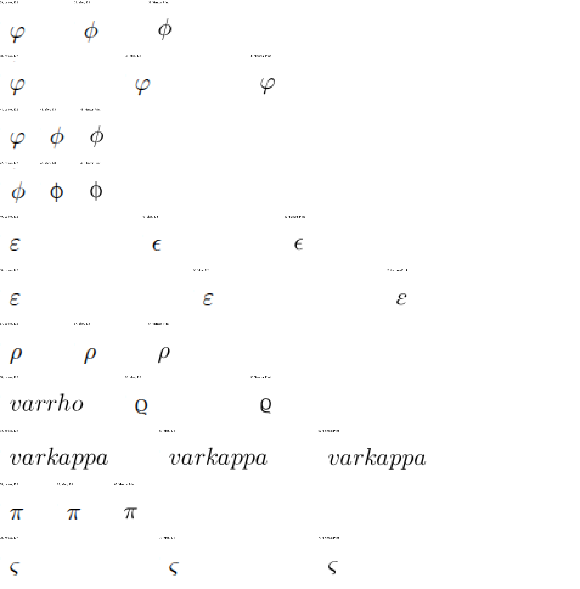
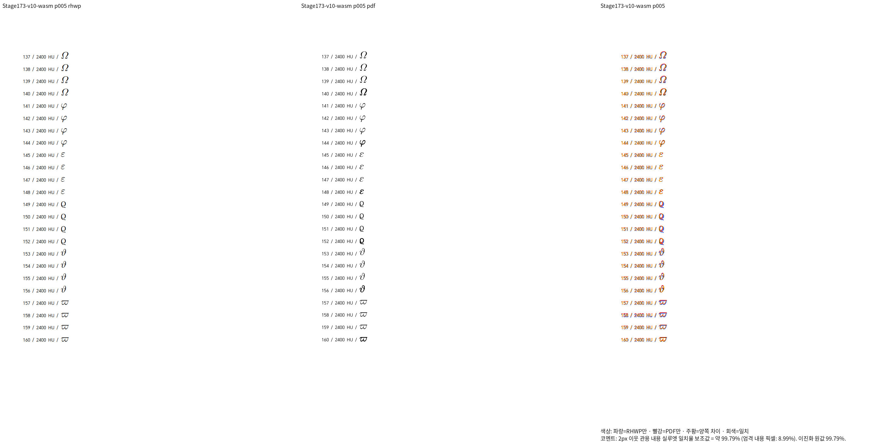
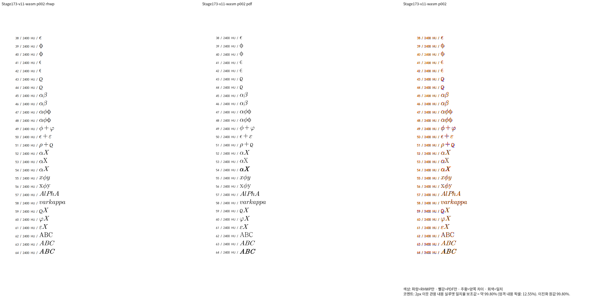

# #7642 그리스 변형·스타일의 독립 Print 계약

Issue: #7642

생산 코드 SHA: `d93d905d462256e0e1e5ec23567b65e214f3ef72`.
수정 전 생산 코드: `536da3f62906a30e9e269892b9b70e89edfd66ff`.
독립 입력·한컴 저장본·Print PDF: [원본과 실행 출처](../../../../pdf/issue7642-extended-base-script-diagnostic/README.md).

## 전체 페이지 대조

418개 식의 전체 13쪽을 Native/fresh WASM에서 각각 재출력했다.
실제 Native/WASM PNG 13쌍의 SHA-256은 각각 동일하다. 전체 페이지 TSV·실행
로그·해시 대조는 ignored `output/pr-review/issue7642/failed-inputs-20261008/stage15-current-validation/`의
`stage173-extended-v{8,9,10,11}-{native,wasm}-after/`와
`stage173-greek-native-wasm-png-reconciliation.json`에 보존한다.

| 입력 | 전체 쪽수 | Native 최저 | fresh WASM 최저 | 90% 미만·누락 |
|---|---:|---:|---:|---|
| v8 | 2 | 99.97641% | 99.97641% | 없음 |
| v9 | 4 | 94.90713% | 94.90713% | 없음 |
| v10 | 5 | 99.79163% | 99.79163% | 없음 |
| v11 | 2 | 99.80142% | 99.80142% | 없음 |

Native 명령은 같은 입력·PDF에 `visual-sweep-batch-native-stage167.py`의
`--compat 2024 --embed-fonts=full --dpi 96 --silhouette-only`를 적용한다.
fresh WASM 명령은 `visual-sweep-bounded-wasm-stage168.py`의 같은 인수와
`--wasm-pkg .../stage173-fresh-wasm-package`를 적용한다. WASM의 실제 배치·SVG·PNG를
사용하며 글꼴 공급의 원본·전달 내역을 각 receipt와 raw SVG 해시로 보존한다.
전체 쪽수는 2/4/5/2쪽이며 측정 불가·누락이 없다. 평균으로 미달 쪽을 상쇄하지 않았다.

모든 Native·WASM·nextest·수정 전 코드의 사전 빌드는
`/home/tsjang/rhwp/target/pr-review` 한 곳을 사용한다. output의 실행 파일 사본과
WASM 패키지는 완료된 산출물의 검증용 보존본이다.

## 확대 판독과 반례

`phi`는 세로 획이 있는 기호, `varphi`는 고리 변형으로 구분된다.
`epsilon`/`varepsilon`과 `rho`/`varrho`도 합치지 않는다. 직접 Unicode의
대체 face와 라틴 기본/rm/it/bold 경로를 대조했다. 그리스 기호는 라틴 스타일로
다시 기울임·굵기를 바꾸지 않으며 라틴 변수 X·ABC는 해당 스타일을 유지한다.
`varkappa`와 혼합 철자 `AlPhA`는 한컴과 같이 문자로 남긴다.
붙인 `varrhoX`/`varphiX`/`varepsilonX`의 뒤 피연산자도 보존한다.

공개 LMM glyph와 한컴 기호의 윤곽이 픽셀마다 완전히 같다는 주장은 하지 않는다.
기호 의미·변형·스타일·상대 기준선과 식 간격을 동일 영역에서 직접 확인했다.
최저 페이지(v9 4쪽)의 직접 Unicode upsilon 계열도 대표 review로 보존한다.

## 메트릭 출처와 정식 관계형 검사

설치 `HYhwpEQ`의 UPM은 1024이며 글꼴 SHA-256은
`a3a3cd992a89ac38e7707b58143ebdb1da9511d3c462f019cda7f92c30467807`이다.
독립 Print의 기호 코드와 hmtx 전진을 대조했다. 글꼴 파일·윤곽을 복사하지 않고
기존 공개 LMM glyph 대응과 상대 메트릭만 사용했다. 세부 관측은 ignored
`stage173-greek-font-metric-provenance.json`과 독립 PDF에 있다.

새 이름 `tests/cases/issue_7642_greek_print_relations.rs`의 두 검사는 원본 수식의
단일 소유·누락 없는 보존, 스타일별 같은 glyph·face·상대 프레임,
변형 기호의 구별, 붙인 피연산자의 순서·비겹침을 검사한다.
실물의 고정 px 좌표·선택 영역·전체 SVG 해시는 사용하지 않는다.
최종 동일 검사 소스(SHA-256 `fa3fa76f4a90174c58be57d74510be34f7bf46b1b1d821825d2b28fb57720841`)를 실제 수정 전
`c6f000edb6e1d8929624c46ff431a41bd5fa6ec0` 라이브러리에 연결해 2건 FAIL(exit 101),
현재 코드의 nextest에서 2건 PASS(exit 0)를 확인했다. 수정 전 실패는 alpha의
라틴 스타일에 따른 glyph 변경과 `varrhoX`가 7개 문자로 남는 차이다.
컴파일·fixture 오류를 결함 재현으로 세지 않았다. 정확한 실행·비교 기록은
ignored `stage173-greek-relations-before-after.json`과 두 테스트 로그에 있다.
고정 base 대비 manifest 정책 검사도 PASS이며 파생 suite는 Git에 포함하지 않는다.

## 판정

**그리스 대조군의 전체 Native/fresh WASM·대표 확대 판독 충족 / 전체 브랜치 검증 미완료.**
원본 55종의 최종 head 대조, 기존 실패 회귀의 원인 보정, 카탈로그·WMF의 남은
출력 차이와 전체 Rust/lint 검증이 남았다. 이 자료만으로 PR 완료·승인·통합을 판정하지 않는다.
