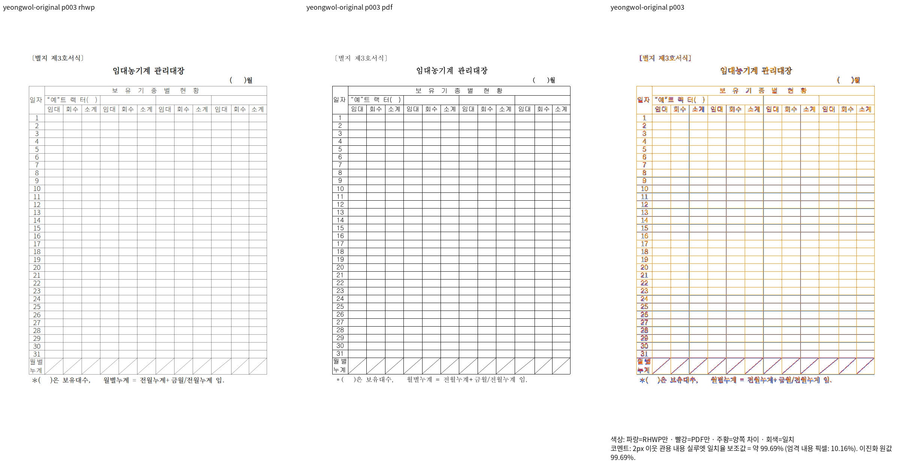
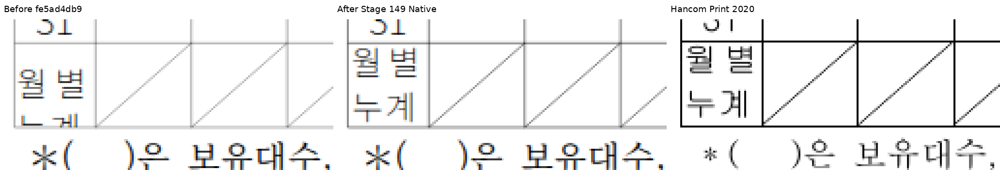

# Stage 149 — 영월 셀·대각선 Native 대조

Issue: #7642

입력: `samples/issue5699/20099369_yeongwol_forms.hwp`.
기준: `pdf/issue7642-failed-inputs-followup-20261011/20099369_yeongwol_forms-2020.pdf`.
Native 빌드 SHA-256: `3eda3382f3ab25862692285be80ed59c33dd1f88dc4289d9517f3c5edbab58ef`.

전체 4쪽 최저 99.29000%, 대표 3쪽 99.68892%다. 마지막 셀의 두 줄을 셀 안에 보존하고
대각선 물리 두께를 Print와 대조했다. 같은 위치의 수정 전·후·Print를 4배 확대한 자료다.
이미지를 옮기거나 가로 배율을 조절하지 않았다. raster 안티앨리어싱 차이는 남아 있다.
fresh WASM은 검증 전이며 이 자료로 전체 완료를 선언하지 않는다.

