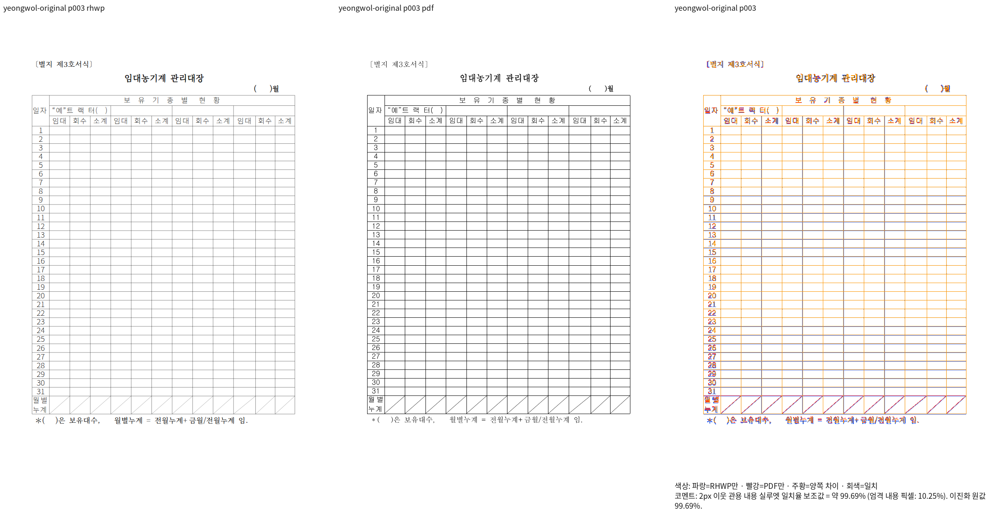
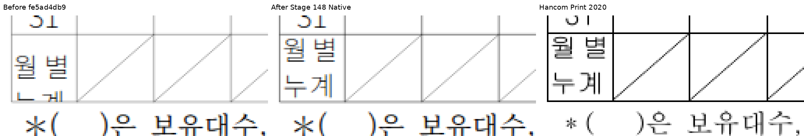

# 영월 재정렬 셀 — Stage 148 Native 증거

Issue: #7642

입력: `samples/issue5699/20099369_yeongwol_forms.hwp`.
기준: `pdf/issue7642-failed-inputs-followup-20261011/20099369_yeongwol_forms-2020.pdf`.
한컴 2020 Print이며 원본을 변경하지 않았다.

- Native release-test 빌드 SHA-256: `b0b4609450993e94c0e47006a2c4c8214bae9cf278ba564c1fb4a7089bc1728f`.
- 같은 변경 commit의 source이며, 상세 빌드/입력 해시는 Stage 148 기록에 연결했다.
- 전체 4쪽 Native 최저 99.29000%, 대표 3쪽 99.68892%.
- 전체 review/overlay와 수정 전 `fe5ad4db9`·수정 후·독립 Print의 같은 위치 4배 확대다.
- “누계”의 셀 하단 잘림은 해소됐다. 대각선 두께 차이는 남아 있고 다음 보정 대상이다.
- 이 변경 source의 fresh WASM 검증은 아직 전이다. 대표 Native 점수로 전체 완료를 선언하지 않는다.

