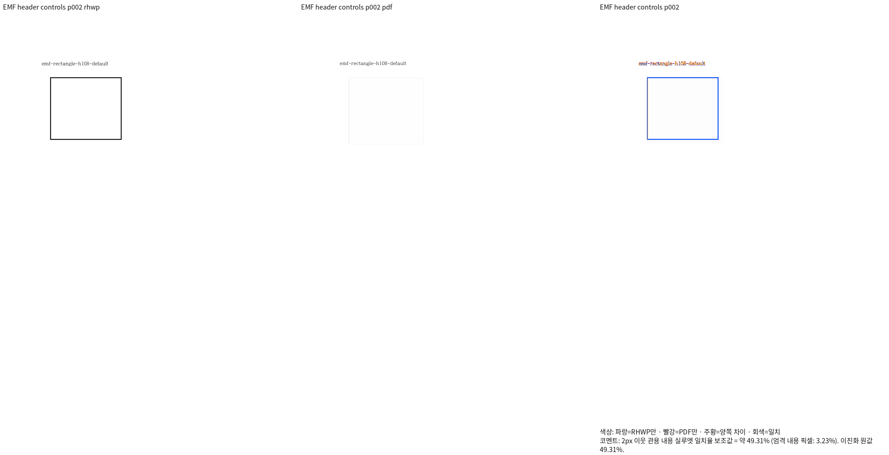
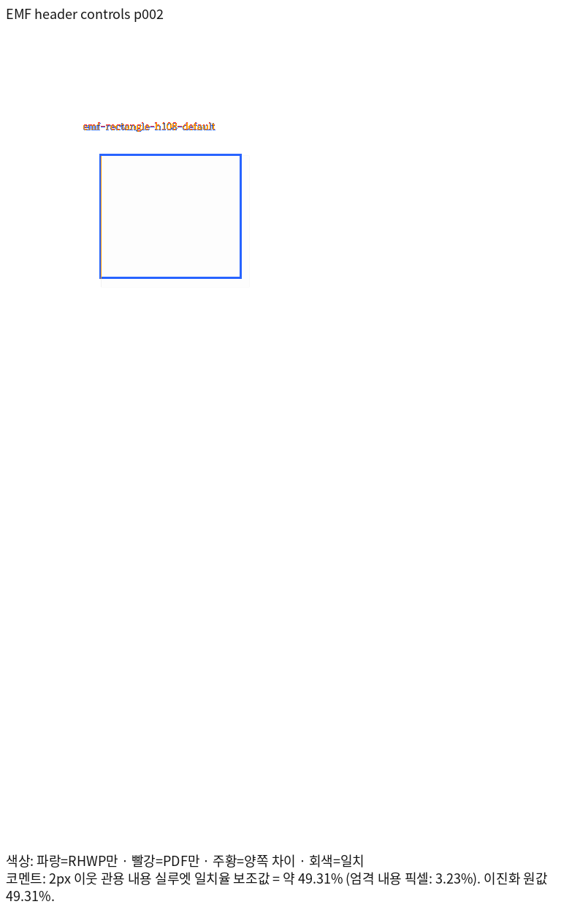
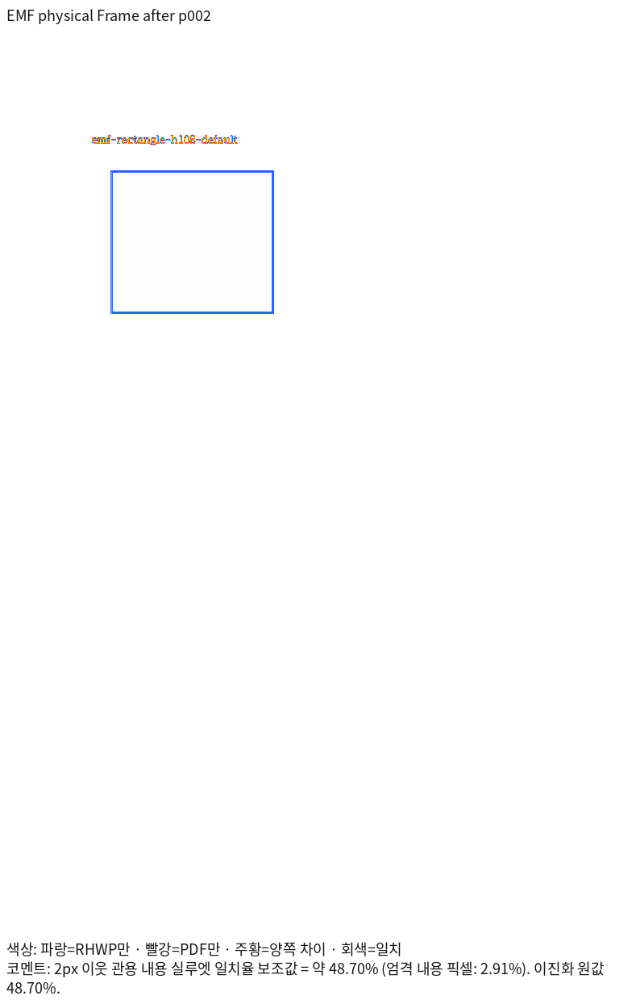

# #7642 메타파일 Frame과 장치 단위 보정 전 증적

Issue: #7642

이 그림은 보정 전 생산 SHA `8e4f09c48`의 실제 Native 출력이다.
[12쪽 입력·한컴 Print·원문 메타파일](../../../../pdf/issue7642-metafile-primitive-diagnostic/README.md)을
동일 페이지에서 대조했다. 108바이트 기본 EMF 사각형 2쪽이며 일치율은 **49.30833%**다.
전체 12쪽도 최저 33.06477%, 모두 미달이다. 회귀 기준이나 제출 완료로 승인하지 않았다.

Native가 Bounds를 출력 폭으로 늘리는 배율과 cosmetic 선 굵기 차이가 보인다.
Windows GDI에서는 원문과 12개 헤더 대조군 모두 재생됐지만 한컴 Print에서는
88바이트·stock 생략의 세 도형만 빠졌다. 각 실행을 구분해
[Stage 176](../../../working/task_m100_7642_stage176.md)에 기록한다.

수정 후 출력은 이 PNG를 재사용하지 않고 별도로 산출한다. 프레임 배율과 XOR 마스크
영역을 먼저 보정하고 장치 패턴·선 굵기는 남은 검토로 기록한다. 로그·TSV·JSON은
ignored output에 보존하며 Git에 넣지 않는다.

## Frame 보정 후 실제 출력

생산 SHA `4b86e1c20`의 같은 2쪽이며 TSV 원값은 48.69565%다. 위치·크기 보정과
별개로 선이 독립 Print보다 훨씬 굵다. 따라서 완료나 회귀 추가 선행 조건 충족으로
판정하지 않는다. 실제 전체 12쪽은 최저 32.16762%, 모두 미달이다.
정상 WMFC 대조군 전체 15쪽은 최저 92.83091%를 유지했다. 이는 Native 결과이며
새 생산 코드의 fresh WASM 전체 대조는 아직 완료하지 않았다.

헤더 경계 보완 후의 빌드·시각 결과는 별도로 기록한다. 위 PNG는 보완 이전의
정확한 생산 SHA에 대응하며 새 head 전체 검증으로 바꾸어 보고하지 않는다.
