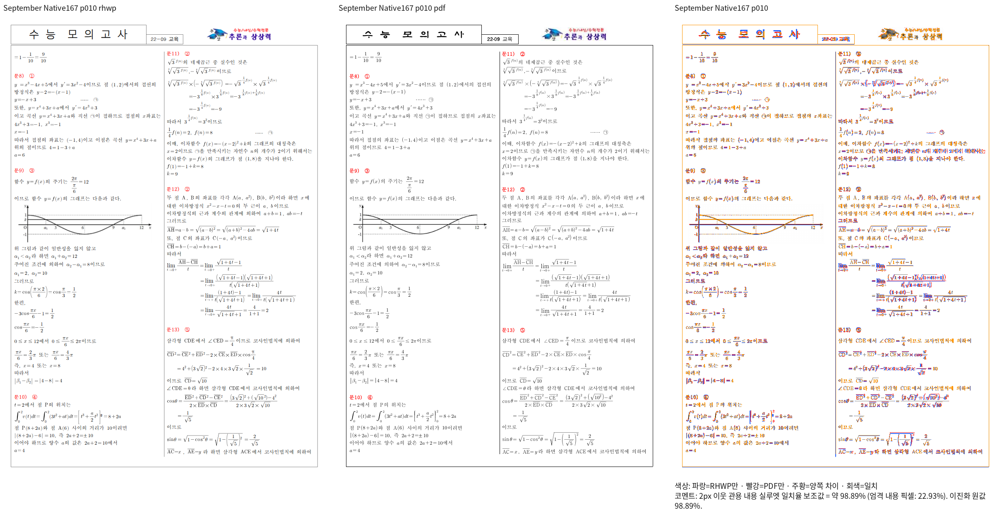
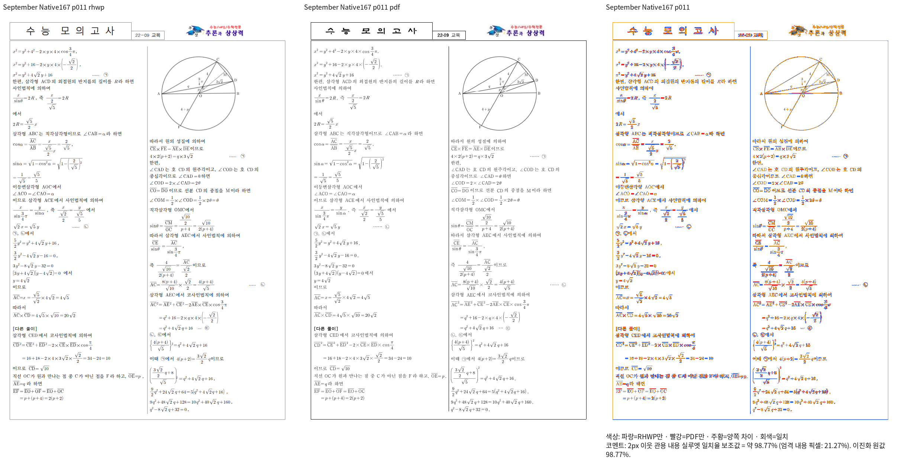
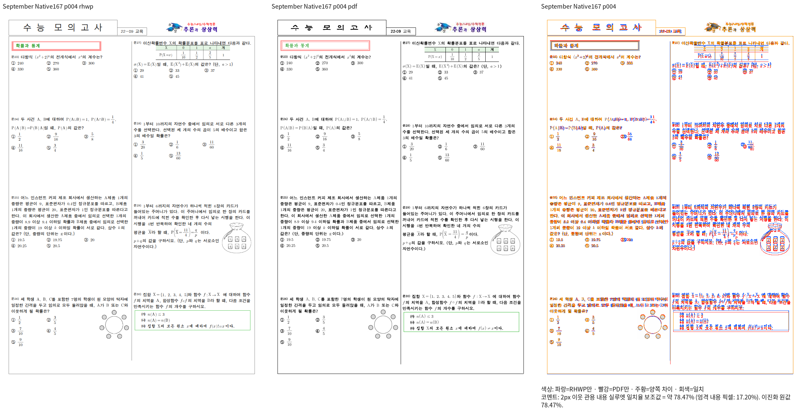

# 저장 미주 내부 컷 보정의 부분 검증

- 구현 SHA: `630dbe785f03e1b2e50b1652044deffe0ef8dc5c`.
- 원본: `samples/3-09월_교육_통합_2022.hwp`.
- 독립 기준: `mydocs/pr/assets/pr_7600_control_print_20261006/input-01-3-09월_교육_통합_2022-2020.pdf`.
- 원본·기준 SHA와 compat 2022는 Stage 44 입력 목록과 대조했다.
- Native 바이너리 SHA-256: `5d37304d987c11008a013751bec47f56ad5ce42812805b7cf6d63203194ea300`.

## 개선과 남은 미달

Native 10쪽은 **98.88989%**, 11쪽은 **98.77369%**다. 직전 선택 검증의
약 35%에서, 문7 마지막 수식이 다음 쪽으로 넘어오는 저장 소속을 보존해 개선됐다.

문8~13의 소유·순서, 그래프와 뒤 본문, 미주 마지막 수식과 다음 문제 시작을
전체 페이지에서 대조했다. 수식·첨자의 작은 차이는 확대 판독과 추가 보정 대상이며,
이 점수를 전체 검증 완료로 사용하지 않는다.

4쪽은 **78.47295%**다. 수정 전 `9787757e42fd7111872baf22ab440b1a7ff8462d`의
독립 Native 실행도 같은 점수이고 PNG 바이트 SHA가 현재와 정확히 같다.
현재 변경으로 생긴 차이가 아니지만 현재 브랜치에서 보정할 미달로 유지한다.
특히 오른쪽 단의 표 이후 문제와 본문의 시작 위치·수식/보기 간격을 확인해야 한다.
이 검증은 upstream/devel 대조가 아니므로 기존 검사 이관의 base 증거로 쓰지 않는다.

HWP 원본 전체 23쪽 Native 비교를 완료했다. **22쪽은 90% 이상이며 4쪽만
78.47295%로 미달**이다. 실제 출력과 Print의 전체 쪽수도 각각 23쪽이다.
HWPX 짝의 전체 비교는 진행 중이다. fresh WASM 빌드·Studio 동기화는
완료됐지만 이 입력의 새 전체 WASM TSV는 아직 미산출이다. 모든 페이지 90%와
확대 판독을 확인하기 전 새 회귀 기준을 고정하거나 PR 제출 완료로 선언하지 않는다.

ignored `output/pr-review/issue7642/failed-inputs-20261008/stage15-current-validation/`에
`stage167-all-02-whole-native/receipt.json`, 페이지 TSV, 실행 로그와
`stage167-page4-before-after-identical.json`을 보존했다.
