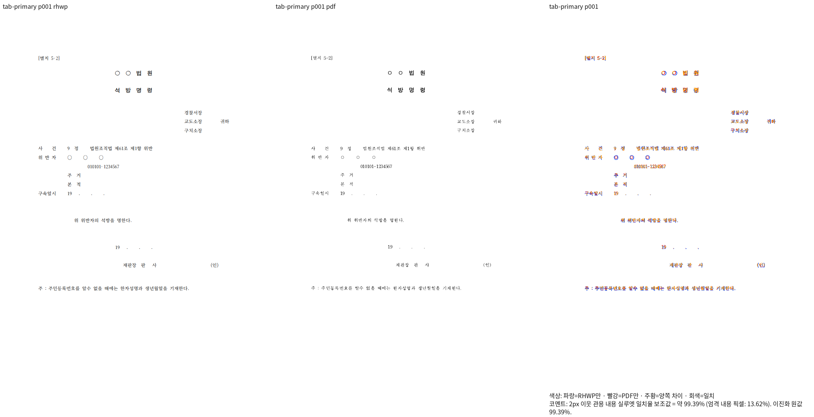
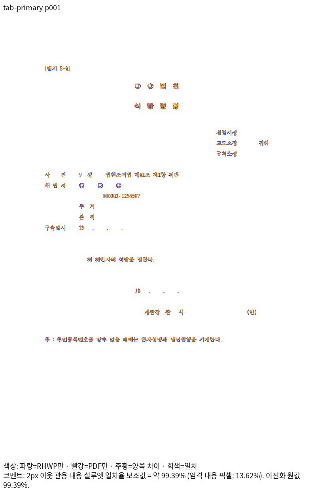
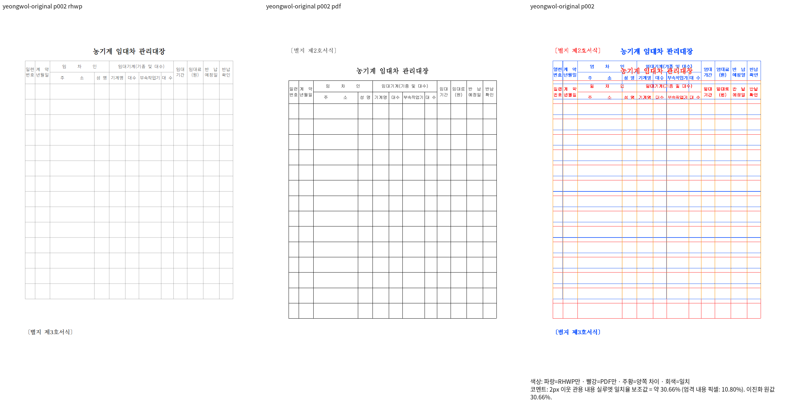
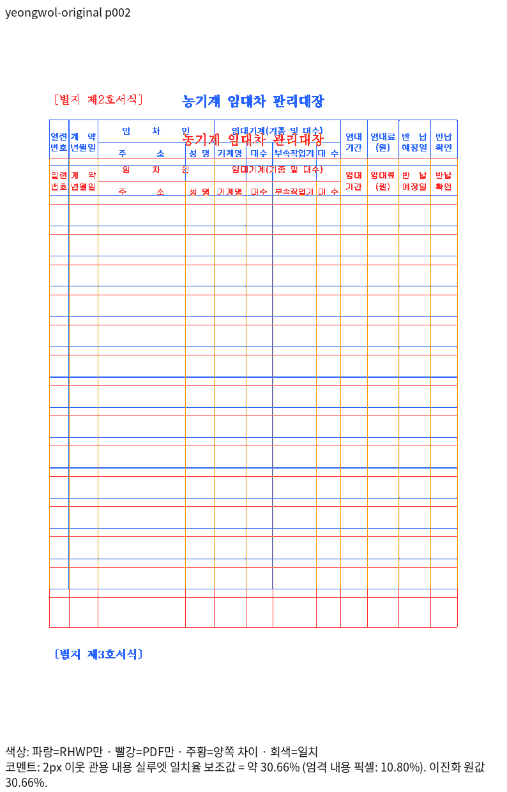

# 외부 생성 HWP3의 탭 재정렬 — Native 중간 증거

Stage 145의 Native 출력이다. 기준 head는 `373d35be56dba0a1cef0082a88ce0104271ba15f`이며,
이 폴더와 함께 커밋한 보정 source 1,505개 파일의 해시 원장은 ignored output의
`stage145-native-realign-build.json`에 있다. 빌드 전후 source 해시가 일치했고 빌드 exit는 0이다.
바이너리 SHA-256은 `2b2e71c712357c693e32376cb6b32bcda91d6e0de2a3cd3e580d1fb3ef876480`이다.

| 원본 | 독립 기준 | 전체 쪽 | Native 최저값 | 판독 |
| --- | --- | ---: | ---: | --- |
| `samples/issue1892_hwp3_tab_roundtrip.hwp` | `pdf/issue7642-hwp3-realign-controls-20261012/issue1892_hwp3_tab_roundtrip-hancom-2020.pdf` | 1 | 99.38884% | 탭 뒤 `귀하`와 하단 `(인)` 위치 개선. 원형 글리프 크기 차이는 남음 |
| `samples/issue5699/20099369_yeongwol_forms.hwp` | `pdf/issue7642-failed-inputs-followup-20261011/20099369_yeongwol_forms-2020.pdf` | 4 | 30.65792% | 미충족. 서식 표제의 쪽 소속과 표 시작 위치·선 두께·줄바꿈 차이가 남음 |

Print 출처와 입력 해시는 각 기준 폴더의 기존 provenance 및
`output/pr-review/issue7642/failed-inputs-20261008/stage15-current-validation/stage145-realign-preflight/receipt.json`에
연결한다. TSV·로그·중간 JSON은 Git에 포함하지 않는다. Native `--compat 2022 --profile print`,
full font 임베딩, 96 DPI의 같은 좌표계로 대조했다. 영월의 전 4쪽 TSV는 원본 PNG를 재사용해
추가 산출했으며 gate 미달로 실제 exit 1이다. 두 원본의 전체 쪽수는 각각 독립 Print의 1/4쪽과 같다.

## 탭 원본

## 영월 원본의 남은 차이

fresh WASM, 최신 전체 회귀, 남은 미세 차이의 판독·보정은 미완료다. 이 폴더는
중간 증거이며 PR 준비 완료나 회귀 테스트 추가의 선행 조건 충족으로 보고하지 않는다.
