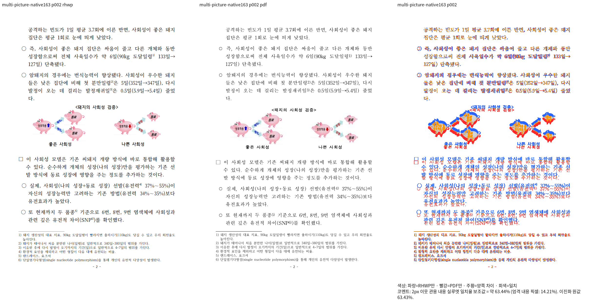
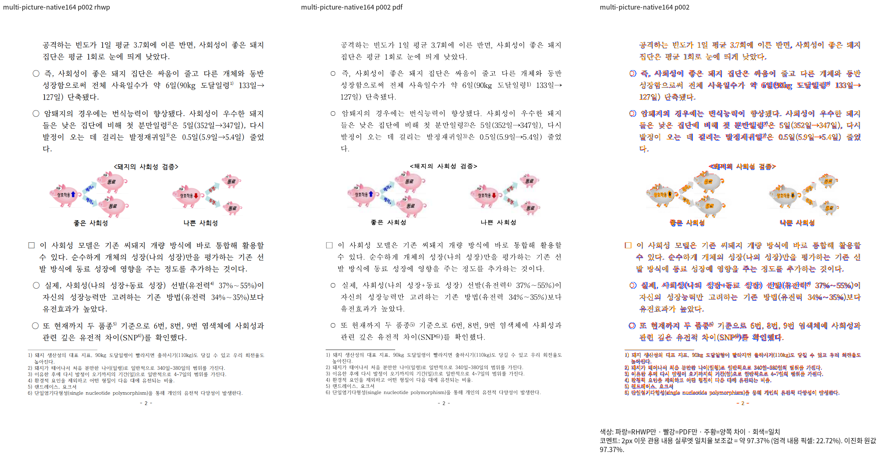

# #7642 각주 표식 본문의 저장 좌표 재시작 — Native 진단 증적

- 보정 전 소스: `89285d012dba022d50989816267830be0101bd2d`
- 보정 후 소스: `9787757e42fd7111872baf22ab440b1a7ff8462d`
- 새 Native binary SHA-256: `1c378170e2e9e9537ad17cc957447042e7569629ba1c21497d695df6bcd3dd6a`
- 입력: `pdf/issue6812-multiple-square-pictures-print/multiple-square-pictures.hwpx`
- 입력 SHA-256: `b7d308b604380836b663a0708d324d2367343de813a789ec8870df809824a31f`
- 독립 한컴 2020 Print: `pdf/issue6812-multiple-square-pictures-print/multiple-square-pictures-2020.pdf`
- PDF SHA-256: `4acdcedd336fb4864196769f149291f88925a419ee5e51b69b9a9bd0b40853b2`

| 범위 | Native 결과 |
| --- | --- |
| 문제의 2쪽 | 63.43505% → 97.37226% |
| 진단 HWPX 전체 11쪽 | 최저 95.76069%, 미달 0쪽 |
| 원본 HWP 전체 11쪽 | 최저 95.76069%, 미달 0쪽 |

[보정 후 독립 overlay](native164-p002-overlay.png)

각주 표식을 본문 개체 프레임으로 오인해 저장 축 재시작을 거부하던 경로를
고쳤다. 이미 수용한 앞 문단 꼬리의 흐름을 보존하고 새 축을 이어받아 그림 표,
뒤 본문, 각주 구역의 소유와 순서를 대조했다. 진단 수치를 보정 상수로 쓰지 않았다.
그림의 색·래스터 농도와 글자의 미세 형태는 자동 점수와 별도로 판독한다.
fresh WASM도 진단 HWPX와 원본 HWP 각각 전체 11쪽 최저 95.76066%, 미달 0쪽이다.
같은 입력의 새 관계형 회귀는 수정 전 코드에서 간격 소실로 FAIL, 수정 후 PASS를
확인했다. 명령·생산 소스·테스트 해시는 Stage 164에 있다. 전체 작업의 다른
시각 미달과 Rust 실패는 남아 있으며 이 기록만으로 PR 준비·승인을 판정하지 않는다.

입력 생성과 Print 작업 ID는 기준 자료 폴더 README에 있다. 전체 TSV, 실행 로그,
소스 해시와 재시작 추적은 ignored `output/pr-review/issue7642/failed-inputs-20261008/stage15-current-validation/`
아래 `stage164-common-frame-preflight`, `stage164-picture-detail-review`,
`stage164-multi-p2-flow.log`에 보존한다.
[실제 생산·소비 분석](../../../working/task_m100_7642_stage164.md)을 함께 따른다.
