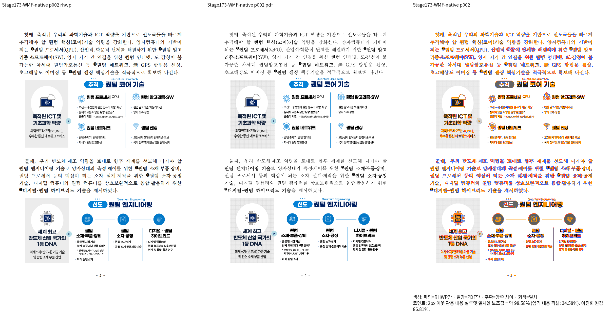
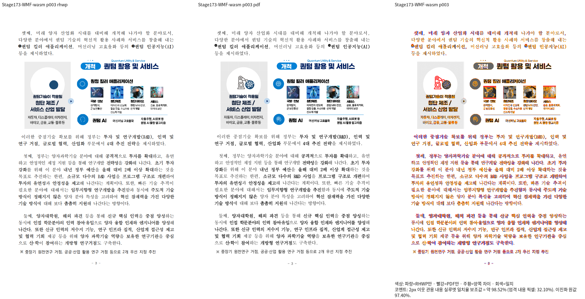

# #7642 WMF 실패 회귀 원본의 독립 Print 대조

Issue: #7642

원본은 기존 #6469 검사의 `samples/issue6469/wmf_fill_shapes.hwpx`다.
원문을 수정하거나 재저장하지 않고 한컴 2020 MCP로 Print했다.
[독립 PDF와 실행 출처](../../../../pdf/issue6469/README.md).
생산 SHA는 `d93d905d462256e0e1e5ec23567b65e214f3ef72`이며 Native/fresh WASM
각 전체 15/15쪽 최저 92.83091%, 미달·측정 불가·누락 쪽 없음이다.
TSV·실행 로그는 ignored `output/pr-review/issue7642/failed-inputs-20261008/stage15-current-validation/`의
`stage173-wmf6469-whole-{native,wasm}/`에 있다. compat 2022·full font·96dpi·
silhouette-only로 해당 두 backend의 실제 출력을 대조했다.

## 점수와 별개로 확인한 출력 결함

2·3쪽 배경 격자의 차이, 3쪽 왼쪽 로봇 및 작은 아이콘 누락이 보인다.
전체 페이지 90% 통과로 면제하지 않는다. 원본 WMF의 표준 WMFC 안에 EMF+와
중첩 그림이 있다. 2쪽의 회색 배경은 현재 SVG에 소문자 `#d9d9d9`로 실제
방출되므로 기존 대문자 문자열 검사의 실패와 구분한다. 3쪽 실제 SVG는 legacy WMF 경로였고, 원문의 EMF+에는 압축 PNG/JPEG와
metafile 이미지가 함께 있다. 현재 Object parser가 Bitmap ImageDataType 1을
수용하지 않아 EMF+ 전체 경로가 폴백되는 조건을 확인했다. 그 조건의 보정이
아이콘을 복원하는지는 아직 실행으로 입증하지 않았다. 새 기대값·golden·관계형 검사로
이 미완성 출력을 고정하지 않는다.

## 판정

**전체 페이지 수치 조건 충족 / 확대 판독 미충족 / 원인 보정 진행 중.**
이 증적만으로 #6469의 기존 검사 변경이나 PR 승인·완료를 판정하지 않는다.

압축 bitmap의 Width/Height/Stride/PixelFormat은 미정 값이며 encoded 내용에서
실제 형식·크기를 읽어야 한다는 [Microsoft의 EmfPlusBitmap 사양](https://learn.microsoft.com/en-us/openspecs/windows_protocols/ms-emfplus/112a5e2c-6bb3-4daf-8ee3-0f3d3984410f)과
[CompressedImage 사양](https://learn.microsoft.com/en-us/openspecs/windows_protocols/ms-emfplus/9c00912b-adfa-469e-8baa-82d9d3d8d6ae)을 다음 보정의 독립 근거로 확인했다.

## Stage 175 후속 보정

위 판정은 Stage 173 당시 출력의 기록이다. 압축 그림 객체와 C=1 정수 목적 점을
보정한 뒤 [새 Native/fresh WASM 증적과 관계형 검사](../issue7642-wmfc-content-20261012/README.md)에서
로봇·원 내부 선·아이콘 복원을 확인했다. 이전 PNG를 새 출력 증적으로 재사용하지 않았다.
배경 격자와 alpha/raster 표현 차이는 새 기록에도 남기며 전체 브랜치 완료를 선언하지 않는다.
