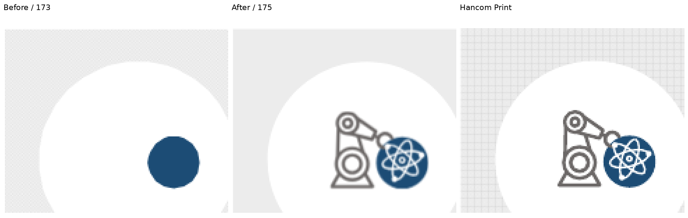
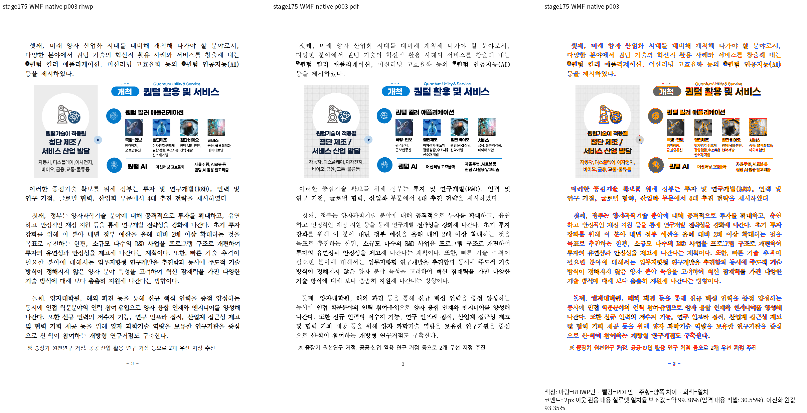
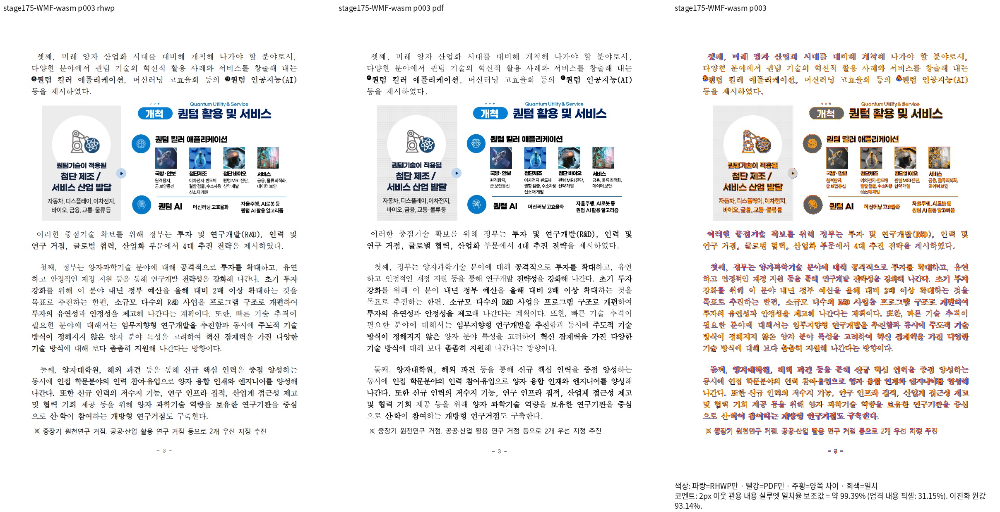

# #7642 WMFC 내부 그림의 내용 보존

Issue: #7642

생산 SHA: `8e4f09c48`.
원본·독립 한컴 2020 Print: [입력과 실행 출처](../../../../pdf/issue6469/README.md).
전체 Native/fresh WASM 각각 15/15쪽 최저 **92.83091%**, 미달·누락·쪽수 불일치 없음이다.
실행은 동일 원본·PDF의 compat 2022/full font/96dpi/silhouette-only이며,
TSV·원문 해시·실행 명령·산출물 해시는 ignored
`output/pr-review/issue7642/failed-inputs-20261008/stage15-current-validation/`의
`stage175-wmf6469-whole-{native,wasm}/receipt.json`과 `wmf6469-{native,wasm}/silhouette.tsv`에 있다.
Native/fresh WASM PNG는 전부 byte-identical이라고 보고하지 않는다.
페이지별 실제 해시 대조는 `stage175-wmf-native-wasm-png-reconciliation.json`에 있다.

## 확대 판독과 구현 주장

3쪽 로봇·원 내부 선·양자 AI 아이콘과 원문 사진이 복원됐다. Native 3쪽은
99.38044%이며 fresh WASM도 같은 쪽의 복원을 직접 확인했다. 원문 회색
패널의 Print 격자와 SVG alpha 표현·미세한 raster 차이는 별도로 남긴다.
이 차이를 픽셀마다 완전히 같은 출력 또는 전체 브랜치 완료로 보고하지 않는다.

거절 조건은 압축 BitmapDataType와 DrawImagePoints의 C=1 목적 점이었다.
표준 PNG/JPEG 내용에서 크기·형식을 읽고, signed 정수 점/float 점을 같은
목적 삼각형·배치 행렬로 소비한다. 원문 SrcRect·world transform·TileFlipXY·
clip이 그 공통 결과를 소비한다. 데이터 길이·decoder·공통 예산도 확인하며
문서 ID·고정 px 좌표를 조건으로 쓰지 않는다. 세 전체 EMF의 사전 재생도 수용됐다.

## 새 관계형 회귀의 범위

`tests/cases/issue_7642_wmfc_content_relations.rs`는 원문 WMFC 객체에서
도해 3개·내부 벡터 그림 10개·고유 PNG/JPEG 4개를 독립 집계하고 실제 Print
profile SVG가 내용을 보존하는지 검사한다. gray 색은 수치 RGB로 읽어
대소문자 직렬화에 의존하지 않으며 각 도해의 단일 소유를 검사한다.
실물의 절대 px 위치·선택 영역·전체 SVG golden은 사용하지 않는다.
이 그림 내용의 검출 검사와 색 직렬화 정상 대조군의 수정 전 결과를 구분한다.
공용 `target/pr-review`의 release-test nextest에서 두 검사 모두 통과했다.
동일 검사 소스 SHA-256은
`5b1d492329a5e70c5d1cb22c21fb7ad0dca3d4a4666afd183649f55d7ff8ab84`다.
그림 내용 검사는 실제 수정 전 Stage 173 CLI에서 내부 벡터 **7개/원문 10개**로
실패하고, 수정 후 Stage 175 CLI에서는 벡터 10개와 압축 그림 4개를 보존해 통과했다.
회색 단일 소유 검사는 수정 전·후 모두 통과한 정상 대조군이다.
기존 `issue_6469_wmf_brush_only_raster_ops.rs`의 두 검사는 새 이름의 이 두
검사로 대체했다. 대문자 `#D9D9D9` 문자열이나 실제 수용되지 않은 XOR 경로의
설명으로 EMF+ 출력을 판정하지 않는다. 원본 HWPX·독립 PDF는 그대로 유지한다.
명령·실행 파일 SHA·수정 전 실패 및 수정 후 통과 로그는 ignored
`stage175-wmfc-relations-before-after.json`과 `stage175-wmfc-relations-*-cli.log`에 있다.
첫 시도에서 CLI에 없는 `--embed-fonts none`을 넘긴 호출 오류는 결함 재현으로
세지 않으며, 수정한 호출의 결과만 위 판정에 사용한다.

## 추가 독립 Print 진단

같은 원본의 한컴 2024 Print는 기본 2020 기준 교체 없이 별도 진단했다.
Native 전체 15쪽 최저 92.56896%, 미달·누락 없음이다.
WMF/EMF 합성 검사들의 그림 연산을 묶은 독립 진단 14쪽은 Native에서
10쪽이 90% 미만이며 최소 13.16977%다. 따라서 그 기존 검사·golden을
이 새 그림 복원의 통과로 갱신하지 않는다. 입력 생성 조건·그리기 상태·
마스크 계조와 EMF 출력 차이를 보정한 후 별도로 검증한다.

## 판정

**WMFC 내용 복원의 전체 Native/fresh WASM·대표 확대 판독 충족 / 전체 브랜치 검증 미완료.**
추가 합성 진단·나머지 기존 실패 회귀·원본 55종의 최종 전체 대조·Rust/lint가 남았다.
